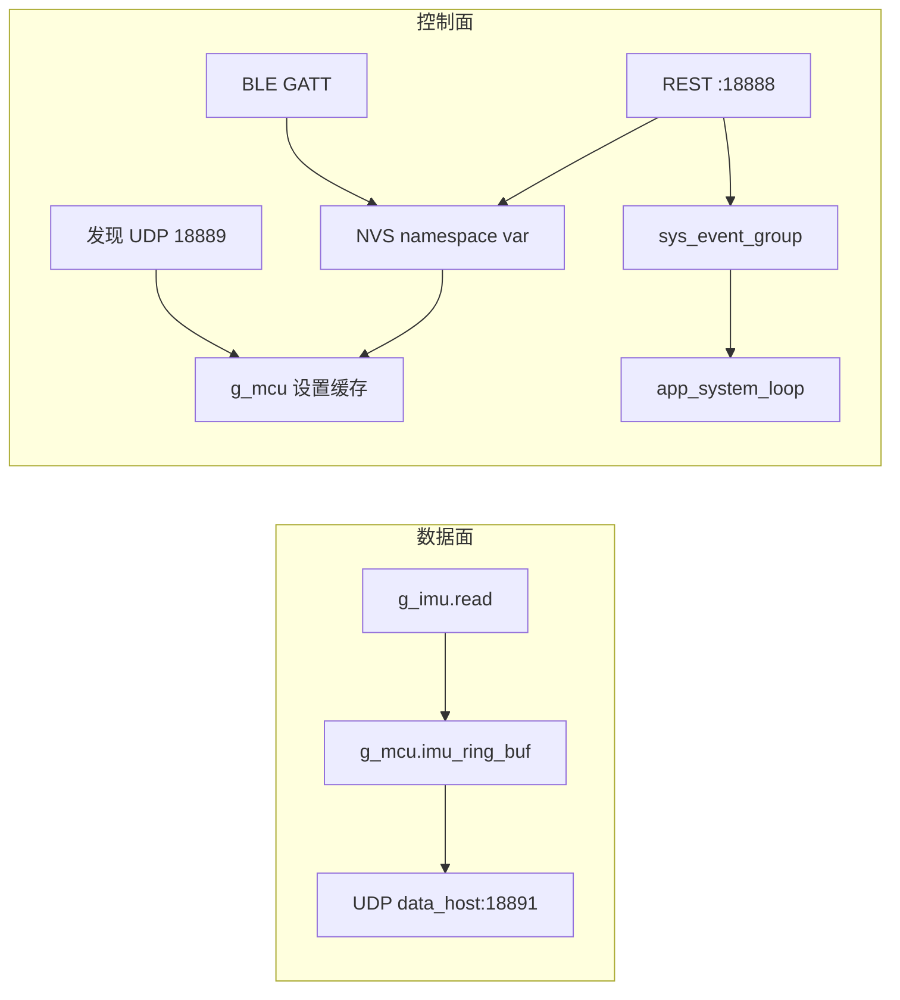

# RFMarkIt ESP Node 架构总览

这是动捕与 6DOF 跟踪用的 active marker 固件。每个节点自己读 IMU，把姿态样本经 Wi-Fi 以 UDP 送给接口机；凭据、发现、灯和升级走另一组通道，不跟样本挤在同一条套接字上。运行时是 ESP-IDF 上的 FreeRTOS。仓库按 `IDF_VERSION` 使用本地工具链，文档与 CI 对齐的默认版本是 v5.5.3。固件版本字符串是 `CONFIG_FIRMWARE_VERSION`，由根 `CMakeLists.txt` 用 `git describe --tags --abbrev=0` 生成，空则是 `3.3.2`。

板型在编译期定死，没有运行时的板级探测，也没有名为 `CONFIG_HARDWARE_V1` 的符号。身份来自 eFuse MAC：12 位小写十六进制写进 `g_mcu.device_id`，再拼成 BLE 名 `markit_` 加这 12 位，同一串还是 STA 的 DHCP hostname。进程内的组合根是 `mcu_t g_mcu`。电源上下文 `g_power_mgmt_ctx` 放在 RTC 内存里，不是 `mcu_t` 的成员。

下面只串起子系统之间的交接。引脚、事件位和失败边界留在各篇里。

## 硬件变体

选择发生在 `make set_hardware_vN` 或 CI：`idf.py set-target` 加上对应的 `sdkconfig.defaults.vN`。Kconfig 里 IMU 的默认项仍是 HI229，产品锁定靠 defaults 文件。细节和可编译的非默认组合见 [hardware.md](hardware.md)。

v1 是 ESP32 加 HI229。IMU 走 `UART_NUM_1`，产品默认打开 bootloader rollback，也打开了 IDF 的 SoftAP 组件，但应用只做 STA。

v2 是 ESP32-S3 加 BNO08X。IMU 走 SPI，主机宏是 `SPI2_HOST`。defaults 关掉 SoftAP，控制台是 secondary USB-JTAG。这份 defaults 没有写 rollback。

v3 是 ESP32-C5 加 BNO08X。BNO 引脚与 v2 相同，主机同样是 `SPI2_HOST`。`include/settings.h` 只在 ESP32 与 ESP32-S3 上把 `CONFIG_EN_MULTI_CORE` 设为 1，C5 上该宏为 0，三条业务任务不绑核。

## 运行时结构

`app_main` 先跑完 `init()`，再 `sys_start_tasks()`，然后 `sys_ota_guard()`，最后 `vTaskDelete(NULL)` 删掉 main 任务。顺序和门闩见 [boot-and-tasks.md](boot-and-tasks.md)。

`init()` 的调用顺序是 `sys_init_chip`、`sys_init_nvs`、`sys_init_events`、`sys_wifi_netif_init`、`power_mgmt_init`。事件组创建后立刻置上 `EV_SYS_WIFI_DISCONNECTED`，此时还没有人在等。`power_mgmt_init` 看的是 RTC 里的上下文：冷启动进入待机；从深睡回来且原因是按钮（`ESP_SLEEP_WAKEUP_EXT0` 或 `ESP_SLEEP_WAKEUP_GPIO`）也进入待机；其它唤醒原因读一帧 IMU 后再次深睡，不创建业务任务；`POWER_UNKNOWN` 则 `esp_restart`。

待机把按钮、灯、IMU、BLE、Wi-Fi 驱动和 REST 按标志补齐。驱动初始化不等于关联，`esp_wifi_start` 要等系统循环处理那一位断开事件。环形缓冲和 `g_imu.self_test` 在待机之后。自检的返回值被丢掉，不决定要不要继续。

`sys_start_tasks` 拉起三条长期任务。句柄已经非空就跳过，返回值不检查。`CONFIG_EN_PROFILING` 现为 0，没有第四条 trace 任务。

| 任务 | 多核（v1 / v2） | 单核（含 v3） | 管什么 |
| --- | --- | --- | --- |
| `app_monitor` | 核 0，优先级 6 | 不绑核，优先级 12 | `enabled` 且 `mux == IMU_MUX_STREAM` 时按 `target_fps` 读 IMU 并入环；否则每 500 ms 看一次门闩 |
| `app_data_client` | 核 1，优先级 5 | 不绑核，优先级 12 | `active`、`ntp_synced`、`discovery_completed` 三者都真才发 UDP |
| `app_system_loop` | 核 0，优先级 4 | 不绑核，优先级 8 | 等待 `sys_event_group`，把位译成私有循环上的处理函数，并创建三只软件定时器 |

同一条启动路径上还有不归 `sys_start_tasks` 管的任务：`button_daemon`、HI229 的 `hi229_poll_task` 或 BNO 的 SPI / 解析任务、`system_event_loop_task`、NimBLE host、httpd。`app_system_loop` 进入之后才有私有事件循环（队列深度 16）和发现（15 s）、对时（300 s）、电源（20 s）三只定时器。`sys_ota_guard` 与这三条任务重叠：当前构建没有 `CONFIG_OTA_GUARD_ENABLED`，main 任务无条件等 3 秒，若启动槽仍是 `ESP_OTA_IMG_PENDING_VERIFY` 就取消回滚。

启动不会把 `g_mcu.state.active` 设成真。采集和发送一直空转，直到按钮或 REST 把模式打开，并且对时和发现都成功过一次。

## 控制面与数据面

样本只走数据面。BLE、REST、发现和 NVS 都不搬运 `imu_dgram_t`。发现成功后写入的 data host 只决定 UDP 目的地址，不把样本拉进控制面。

数据面的热路径在 `components/apps/monitor.c` 与 `components/apps/network.c`。控制面的监听在待机时就 `rest_controller_start`，端口 `CONFIG_CONTROLLER_LISTEN_PORT`（18888），不等 `EV_SYS_WIFI_CONNECTED`。发现端口是 18889。IMU 数据口是 18891，只作目的端口，源端口由协议栈临时分配。

## 一条样本的生命周期

模式位先到，样本后到。`sys_set_operation_mode` 写下 `g_mcu.state.active` 并置 `EV_SYS_MODE_CHANGE`。`app_system_loop` 把它投成 `SYSTEM_MODE_CHANGE_EVENT`：先由 `sys_mode_change_handler` 把 `mux` 设成 `IMU_MUX_STREAM` 或 `IMU_MUX_IDLE`，再由电源处理进入活动态或回到待机。`active` 可以先于 `mux` 被发送任务看见。

`app_monitor` 看到 `enabled` 且 `IMU_MUX_STREAM` 后做 `buffer_reset` 和 `ring_buf_reset`，再用周期 `1000000 / g_mcu.target_fps` 微秒的 `esp_timer` 给自己发读信号。每次 `g_imu.read` 成功才分配从 0 递增的 `seq` 并 `ring_buf_push`。这个 `seq` 是任务栈上的计数，不是 NVS 键 `SEQ`，也不是 `imu_t.seq`。读失败不占号。驱动差异在 [imu.md](imu.md)：v1 的 HI229 不按 `target_fps` 改模块输出率，主机没取走的帧被快照覆盖；v2 / v3 的 BNO08X 把报告间隔设成同一微秒数。默认编译不写陀螺，`gyr` 保持 0。

时间戳不在 `app_monitor` 里生成，而在对应的 `read` 里盖上。`dev_ts_us` 来自 `gettimeofday`，`tsf_ts_us` 来自 `esp_wifi_get_tsf_time(WIFI_IF_STA)`。HI229 把两者回拨到帧解析完成的时刻，并带上片内 `imu_ts_ms`；BNO08X 盖的是 `read` 当时的钟，`imu_ts_ms` 保持 0。SNTP 只负责把墙上时钟步进到 UTC，并用 `ntp_synced` 卡住发送；它不把 TSF 换算成 Unix。见 [time-sync.md](time-sync.md)。

`app_data_client` 不看 `wifi_connected`。三个布尔同时为真才 `udp_socket_init`，目的地是当时的 `g_mcu.data_host_ip_addr` 加端口 18891。发现成功时先把应答源地址写进这块 RAM，再把 `discovery_completed` 置真，所以第一次建连看到的是单播地址，不是 NVS 里的 `255.255.255.255`。之后有新序号就 `tag_packet` 收成无包头的 `marker_packet_t` 再 `sendto`。环满了就覆盖；消费者对过期序号读到的是当时最新的一帧，线上会重复。发送失败把 `active` 拉回假。见 [imu-streaming.md](imu-streaming.md)。

`ntp_synced` 和 `discovery_completed` 在本次上电里只会从假变成真。Wi-Fi 后来断开不会单独关上这两扇门。

## 配置如何进入设备并留下

业务读的是 `g_mcu` 里的设置缓存，不是每次去翻闪存。`sys_init_nvs` 在任务起来之前，从 namespace `var` 装入 `WIFI_SSID`、`WIFI_PSK`、`DATA_HOST`、`NTP_HOST`、`SEQ`、`TARGET_FPS`；HI229 构建再装 `IMU_BAUD`。空字符串换成编译期默认：SSID `markit`，PSK `12345678`，data host `255.255.255.255`，NTP 主机名为空（对时改用网关）。整数在 RAM 里钳位，不写回。`OTA_HOST` 在键表里，但不会装进 `g_mcu.ota_url`。

运行中的写入不是同一条写穿路径。

BLE 的写特征接受 `"<SSID> <PASSWORD>"`，同时改 RAM 和 NVS 的 `WIFI_SSID` / `WIFI_PSK`，然后置 `EV_SYS_WIFI_CONFIG_UPDATED`。系统循环把它当成一次重连。见 [ble.md](ble.md)。

REST `POST /v1/nvs/variable/<name>` 只 `sys_set_nvs_var`。不回写 RAM，也不置 Wi-Fi 事件。因此 HTTP 改过的 SSID、主机、帧率或波特率，要等下次启动才进入 `g_mcu`；已经在跑的关联、UDP 目的地址和读节拍都不变。升级 URL 是例外：`POST /v1/system/upgrade` 把 query 里的 `ota_url` 抄进 RAM 并置 `EV_SYS_OTA_TRIGGERED`，不写 `OTA_HOST`。灯的 `seq` 会同时写 NVS 和 `g_mcu.seq`。见 [api.md](api.md)。

发现应答覆盖 RAM 里的 data host；`ntp_host` 非空时再覆盖 NTP 主机名。两者都不 commit。见 [nvs.md](nvs.md)。

Wi-Fi 关联只用当时 RAM 里的 SSID / PSK，认证门槛是 `WIFI_AUTH_WPA2_PSK`。启动后的第一次连接来自已经置上的断开位，不是 `esp_wifi_init` 自己连上的。见 [wifi.md](wifi.md)。

深睡会重启进 `app_main`，已 commit 的键还在，发现覆盖和升级 URL 不在。

## 子系统如何协同

跨任务的「发生过某件事」是 FreeRTOS event group 上的位，不带载荷。可能阻塞的工作再投到 `g_mcu.system_loop`，由 `system_event_loop_task` 串行执行。`g_mcu` 上固定三组：`sys_event_group` 唤醒 `app_system_loop`；`task_event_group` 只做在途闩，没有人 `WaitBits`；`wifi_event_group` 只让一次 `sys_wifi_try_connect` 和默认循环上的 Wi-Fi 回调会合。协议栈的 `WIFI_EVENT` / `IP_EVENT` 登记在默认事件循环上，所以私有循环堵在发现或重连里时，关联仍能推进。位的置位者和翻译表见 [events.md](events.md)。

`app_system_loop` 用掩码 `0x00FFFFFF` 等待，返回时清掉已经置上的低 24 位。连上之后先投对时、再投发现。断开、失败和 BLE 改凭据合成重连。模式位改 `mux` 和电源状态。OTA 位则在 `app_system_loop` 自己身上调用 `sys_ota_perform`。发现、对时和电源的周期定时器直接 `esp_event_post_to`，不经过 `EV_SYS_POWER_MGMT`；当前树里没有人置这一位。每次醒来，只要不是手动灯，还会顺带重算灯语。

外设的开关在电源状态机里，不在各协议模块自己决定。冷启动的模式是 `POWER_MODE_NORMAL`：待机打开 BLE，并把 Wi-Fi 省电设为 `WIFI_PS_MAX_MODEM`，同时武装 300 秒的一次空闲定时器。进入 `POWER_ACTIVE` 时若 BLE 还开着就关掉，发射功率改用 `CONFIG_MAX_TX_POWER`，省电类型改成 `WIFI_PS_NONE`。`POWER_MODE_PERFORMANCE` 和 `POWER_MODE_LOW_ENERGY` 的分支还在，当前固件没有写入者把 `mode` 选成它们。深度睡眠前关掉 IMU、抢占灯，并 hold 灯脚；只有编进 HI229 引脚时才同时 hold `CONFIG_IMU_EN_PIN`。按钮是唤醒源。空闲定时器到期后的 light sleep 循环和「立刻深睡」叠在同一次回调里，哪一步先跑完取决于调度。见 [power-management.md](power-management.md)。

## 子系统地图

| 文档 | 职责 | 主要源文件目录 |
| --- | --- | --- |
| [hardware.md](hardware.md) | 编译期把 v1 / v2 / v3 落到 SoC、IMU 和引脚 | `include/`，`sdkconfig.defaults.v1`–`v3` |
| [boot-and-tasks.md](boot-and-tasks.md) | `app_main` 的顺序，以及三条业务任务何时开始干活 | `main/`，`components/apps/`，`components/sys/` |
| [events.md](events.md) | 三组事件位，以及私有 `esp_event` 循环上的 `SYSTEM_EVENTS` | `components/sys/`，`components/apps/` |
| [global-state.md](global-state.md) | `g_mcu` 的字段、谁写入、什么进不了 NVS | `components/sys/` |
| [imu.md](imu.md) | HI229 与 BNO08X 的函数表、样本和 `mux` | `components/imu/`，`lib/hi229/`，`lib/bno08x/` |
| [time-sync.md](time-sync.md) | 一次性 SNTP、`ntp_synced` 门闩，以及样本上的两套钟 | `components/sys/` |
| [imu-streaming.md](imu-streaming.md) | 环形缓冲、`marker_packet_t` 和 UDP 18891 | `components/apps/`，`lib/ring_buf/`，`lib/libudp/` |
| [wifi.md](wifi.md) | 仅 STA 的关联、重试，以及 `wifi_connected` | `components/sys/` |
| [ble.md](ble.md) | NimBLE 广播和 GATT 写入 STA 凭据 | `components/ble/` |
| [api.md](api.md) | 端口 18888 上的 REST 与调试 WebSocket | `components/rest_controller/` |
| [discovery.md](discovery.md) | UDP 18889 广播，用应答源地址覆盖 data host | `components/sys/` |
| [nvs.md](nvs.md) | namespace `var` 的键表，以及 RAM 与闪存何时分叉 | `components/sys/` |
| [led.md](led.md) | 由连接、对时、发现和 `active` 决定的灯语 | `components/blink/`，`components/sys/` |
| [button.md](button.md) | 单击翻转 `active`，长按进入不带定时唤醒的深睡 | `components/sys/` |
| [battery.md](battery.md) | 按需读一次分压，不参与状态迁移 | `lib/battery/` |
| [power-management.md](power-management.md) | RTC 里的电源状态，以及待机、推流、省电、深睡时关哪路外设 | `components/sys/` |
| [ota.md](ota.md) | 双 OTA 槽、`esp_https_ota`，以及启动后 3 秒确认 | `components/sys/`，`manifests/` |

## 核对记录

已改：`docs/design/wifi.md` 并发一节原写 v3 在 `settings.h` 里不定义 `CONFIG_EN_MULTI_CORE`；`include/settings.h` 在非 ESP32、非 ESP32-S3 上把该宏定义为 0。已改成「定义为 0」。不绑核、优先级 8 的结论未改。

已知张力：`led.md` 写按 ESP-IDF v5.5.3，ESP32 与 ESP32-S3 的 `soc_caps.h` 没有 `SOC_GPIO_SUPPORT_HOLD_SINGLE_IO_IN_DSLP`，ESP32-C5 上该宏为 1。`hardware.md` 与 `power-management.md` 写本仓库没有这份头文件，v1 / v2 是否定义该宏代码未体现。工作区搜不到 `soc_caps.h`，无法从本仓库源码裁决。电源代码本身只按这个宏分叉，注释把为真的分支对应到 ESP32-C5，三篇在这一点上一致。
