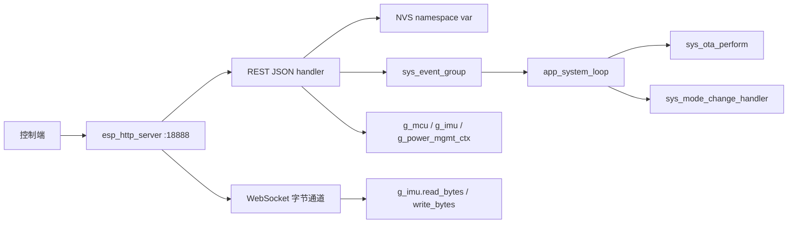
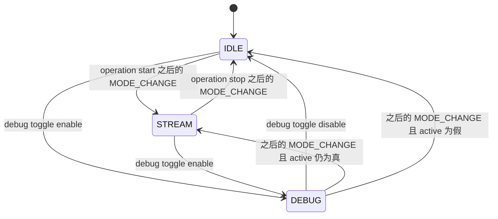
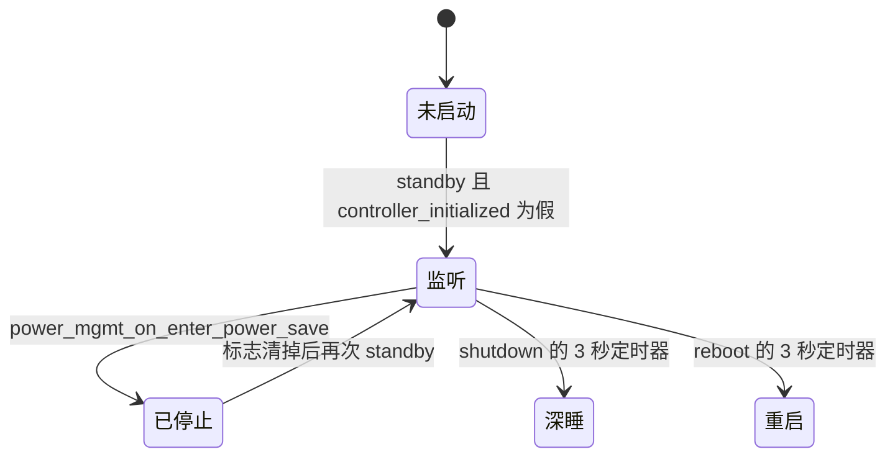

# 控制面 HTTP API（HTTP API）

本机用一个 HTTP 服务接受运维控制：身份与时间、采集开关、LED、NVS、OTA、重启或深睡。IMU 采样流不走这里，而是 UDP。另一条 WebSocket 只在调试复用下转发传感器侧字节，不提供 JSON 控制。服务没有鉴权，参数放在 URI query 里，而不是 JSON body。

## 职责

- 在 `CONFIG_CONTROLLER_LISTEN_PORT`（18888）上提供 `/v1/...` JSON 接口，并在调试复用下提供一条 WebSocket。
- 把少数动作变成事件位，交给 `app_system_loop`：OTA、运行模式、以及唤醒后的自动 LED。其余动作直接改 `g_mcu`、`g_imu` 或 `g_power_mgmt_ctx`。
- 除 WebSocket 以外，每个 handler 都调用 `reset_power_save_timer()`，用来推迟省电定时器。
- 不负责 Wi-Fi 关联、UDP 发送、发现报文、BLE 配网，也不在本模块里执行 OTA 下载。

`rest_controller.c` 顶部注释表把电源写成只有 POST、把 `power_mgmt` 写成 `always_on` / `cancel_always_on`、把校准写成三种动作，并提到 `version_shutdown`。当前 handler 没有这些分支，以 handler 为准。

## 在系统中的位置

监听的建立和拆除不在 handler 里。[power-management.md](power-management.md) 的 `power_mgmt_on_enter_standby` 在 `controller_initialized` 为假时调用 `rest_controller_start`；`power_mgmt_on_enter_power_save` 调用 `rest_controller_stop`。启动顺序见 [boot-and-tasks.md](boot-and-tasks.md)。可达性依赖 STA 已关联，但 start 不等待 `EV_SYS_WIFI_CONNECTED`，见 [wifi.md](wifi.md)。

事件位的定义在 [events.md](events.md)，被改写的全局字段在 [global-state.md](global-state.md)。NVS 键的加载规则在 [nvs.md](nvs.md)。OTA 下载在 [ota.md](ota.md)。IMU 复用与采样环在 [imu.md](imu.md) 和 [imu-streaming.md](imu-streaming.md)。LED 图案在 [led.md](led.md)。电量采样在 [battery.md](battery.md)。发现报文里的 host 与这里的写入不是同一条路径，见 [discovery.md](discovery.md)。改 Wi-Fi 后置 `EV_SYS_WIFI_CONFIG_UPDATED` 的是 BLE，不是本 API，见 [ble.md](ble.md)。按键也会调用 `sys_set_operation_mode`，见 [button.md](button.md)。芯片与引脚差异在 [hardware.md](hardware.md)。总览见 [00-overview.md](00-overview.md)。

## 设计

### 数据与状态

服务器上下文 `rest_server_context` 保存 `base_path` 和一个 64 字节 `buffer`。handler 不读 `user_ctx`。`CONFIG_CONTROLLER_BASE_PATH` 现为 `"/"`，路由仍是绝对路径 `/v1/...`，不会再拼这个前缀。

查询串从 `req->uri` 里用 `parse_url_kv_pair` 截取，不读 body。匹配是 `strstr` 子串，不是按 `&` 切开的键表：命中第一处键名，值延伸到下一个 `&` 或 URI 末尾。值最长 `CONFIG_PARAM_VALUE_MAX_LEN`（128）；更长返回 `ESP_ERR_INVALID_ARG`。`%XX` 会解码，`+` 变成空格。`%` 后面不足两个十六进制字符时，代码未校验。多数 handler 忽略解析失败，把空字符串当成非法取值。

成功响应默认是 200 和 `application/json`（`cJSON_Print`）。业务失败多数仍返回 `ESP_OK`，只把状态行改成 `HTTPD_400` 或 `HTTPD_500`，并在同一 JSON 里放 `status` 字符串。未注册路径走 `default_err_handler`（只挂了 `HTTPD_404_NOT_FOUND`），体为 `responder`、`path`、`error`。`error` 是传入的 `httpd_err_code_t` 数值。路径能匹配但方法未注册时，不会进入 handler 里的 `default` 分支；405 的 JSON 形状代码未体现。

`cJSON_Print` 失败时代码未检查，会把空指针交给 `httpd_resp_sendstr`。

WebSocket 注册在 `HTTP_GET` 且 `is_websocket = true`。它不是第二条 REST。出站是 binary 帧，入站只接受 text。

| 方向 | 帧 | 负载 |
| --- | --- | --- |
| 设备到客户端 | `HTTPD_WS_TYPE_BINARY` | `g_imu.read_bytes` 读到的至多 `CONFIG_WEBSOCKET_FRAM_MAX_LEN`（64）字节 |
| 客户端到设备 | `HTTPD_WS_TYPE_TEXT` | 原文再追加 `\r\n`，然后 `g_imu.write_bytes` |

握手之后，发送循环在独立任务 `ws_async_send_task`（优先级 10，`xTaskCreate` 栈深度 3072）里跑。任务先拷贝 `hd` 与 `fd`，再 `os_delay_ms(500)`，然后在 `IMU_MUX_DEBUG` 期间读字节并 `httpd_ws_send_frame_async`。读到长度大于 0 并成功发送后 `os_delay_ms(100)`；长度为 0 则立刻再读。发送失败或复用离开 `IMU_MUX_DEBUG` 时任务退出并 `vTaskDelete`。互斥在任务内部懒创建，持有期间覆盖整段发送循环。

运行模式与 IMU 复用不是同一个变量。`POST /v1/operation/mode` 只改 `g_mcu.state.active` 并置 `EV_SYS_MODE_CHANGE`。真正写 `g_imu.p_imu->mux` 的是 `sys_mode_change_handler`：`active` 为真则 `IMU_MUX_STREAM`，否则 `IMU_MUX_IDLE`。调试开关直接写 `mux`，不改 `active`。

`app_monitor` 只在 `enabled` 且 `mux == IMU_MUX_STREAM` 时向 `g_mcu.imu_ring_buf` 推样本。调试或空闲会退出它的内层循环，但不会停掉 HI229 的 `hi229_poll_task`。

电源模式字符串来自 `g_power_mgmt_ctx.mode`：`POWER_MODE_PERFORMANCE` → `performance`，`POWER_MODE_NORMAL` → `normal`，`POWER_MODE_LOW_ENERGY` → `low_energy`，其余 → `unknown`。`no_sleep` 不是这个接口写的。调试 enable 把它设为真，disable 设为假；进入 active 的电源处理也设为真，回到 standby 设为假；OTA 事件设为真，OTA 失败路径再清掉。当前仓库里没有别的赋值把 `next_mode` 写成与 `mode` 不同的值，因此 HTTP 不能切换 `POWER_MODE_*`。`no_sleep` 为真时，待机分支里的电源周期处理会 `reset_power_save_timer`；它不禁止 shutdown 那条深睡调用。

LED 的 `led_status_enum` 与 `POST /v1/blink/toggle` 的关系：

| 数值 | 枚举 | POST 结果 |
| --- | --- | --- |
| 0 | `LED_UNKNOWN` | 拒绝，条件是 `target_state_enum > 0` |
| 1 | `LED_OFF` | `blink_led_off` |
| 2 | `LED_ON` | `blink_led_on` |
| 3 | `LED_DUTY` | `sys_set_led_status` 走 default，HTTP 400 |
| 4 | `LED_FAST_FLASH` | 对应 blink 函数 |
| 5 | `LED_FAST_BREATH` | 对应 blink 函数 |
| 6 | `LED_SLOW_BREATH` | 对应 blink 函数 |
| 7 | `LED_SEQ_ENC` | `blink_start_seq_enc_pattern` |
| 其他 | | HTTP 400 |

`blink_*` 会把 `g_mcu.state.led_status` 写成上述枚举。toggle 不置 `led_manual`。自动灯效在 `app_system_loop` 每次被事件唤醒且 `led_manual` 为假时排队，所以未先切到 manual 的 toggle 会被下一次唤醒盖掉。configure 的 `auto` / `manual` 会改 `led_manual` 并置 `EV_SYS_LED_STATUS_CHANGED`。该位本身没有单独分支，作用是唤醒事件组等待（掩码 `0x00FFFFFF`）。`off` 把 `led_manual` 设为真并 `blink_led_off`，不置这个位。GET configure 只根据 `led_manual` 回报 `auto` 或 `manual`，不会出现 `off`。

序列灯的占空缓冲只在 `blink_msp_init` 里按当时的 `g_mcu.seq` 填充。configure 更新 `g_mcu.seq` 和 NVS 后不重建缓冲。已经处于 `LED_SEQ_ENC` 时再次进入该图案会直接返回。

监听生命周期：

shutdown 与 reboot 的定时器都是一次性的，周期 `pdMS_TO_TICKS(3 * 1000)`。JSON 先发送，定时器后启动。深睡函数本身还有约 2.1 秒的灯效延时，并且不调用 `rest_controller_stop`。

### 行为与时序

公共副作用：除 `imu_debug_socket_handler` 外，handler 开头都 `reset_power_save_timer()`。定时器只在非 `POWER_MODE_PERFORMANCE` 时存在，超时是 `CONFIG_POWER_SAVE_TIMEOUT_S`（300 秒）。`PERFORMANCE` 下定时器被删除，reset 为空操作。WebSocket 流量不拨这个定时器；调试 enable 把 `no_sleep` 设真之后，待机状态下约每 `CONFIG_POWER_MGMT_DURATION_S`（20 秒）的电源事件会代为 reset。

`GET /v1/system/info` 不改业务状态。JSON 含 `id`（`g_mcu.device_id`）、`ver`（编译宏 `CONFIG_FIRMWARE_VERSION`，来自 `git describe --tags --abbrev=0`，空则 CMake 默认 `3.3.2`）、`time`（`gettimeofday` 的秒，含微秒小数；未同步 NTP 也不改报错）、`tsf_time`（`esp_wifi_get_tsf_time(WIFI_IF_STA)`，返回值未检查）、`battery_level`（`battery_read_level` 的整数再转成 JSON 数）、`target_fps`（RAM 里的 `g_mcu.target_fps`，不是当场读 NVS）。

`POST /v1/system/power` 的 query `target_state`：`reboot` 三秒后 `esp_restart`；`shutdown` 三秒后 `power_mgmt_on_enter_deep_sleep(false)`，即不再定时唤醒的深睡。其他取值 HTTP 400，`status` 为 `invalid target_state value`。成功时 `status` 为 `ok`，并回显 `target_state`。`xTimerCreate` 失败未检查：体里已经是 `ok`，定时器不会启动。重复请求会再创建一个定时器，旧的不删除。不先停止采集。

`GET /v1/system/upgrade` 只返回 `ota_err`（`g_mcu.state.ota_err`）。没有进行中标志；下载未完成时读到的是上一次失败留下的值，成功重启后调用方看不到这次结果。

`POST /v1/system/upgrade` 的 query `ota_url` 非空时 `strcpy` 到 `g_mcu.ota_url` 并 `set_sys_event(EV_SYS_OTA_TRIGGERED)`，体里只有 `ota_url`，没有 `status`。空串则 HTTP 500，`status` 为 `empty ota_url`，不置位。不写 NVS `OTA_HOST`。`app_system_loop` 看到该位后向 `g_mcu.system_loop` 投递 `SYSTEM_OTA_EVENT`（处理函数把 `no_sleep` 设真），调用 `sys_set_operation_mode(false)`，再在这个任务里同步执行 `sys_ota_perform`。成功则 `esp_restart`；失败把 `esp_err_t` 写入 `ota_err`，并把 `no_sleep` 清假。`MODE_CHANGE` 要等这次 `sys_ota_perform` 返回、下一轮 `xEventGroupWaitBits` 才处理。POST 不等待下载。下载期间 httpd 仍在，GET 可以被并发处理。环路正堵在 OTA 里时再次 POST 会留下事件位，失败返回后的下一轮会再用当时的 `g_mcu.ota_url` 做一次。位在同一轮里只会合并成一次。

`POST /v1/system/selftest` 固定 `status` = `ok`。注释写明自检未实现，不调用 `imu_self_test`，不改 `imu_status`。

`GET /v1/system/power_mgmt` 与 `POST /v1/system/power_mgmt` 是同一个函数，忽略方法和 query。返回当前 `mode` 与 `no_sleep`。不写 `next_mode`，不置 `EV_SYS_POWER_MGMT`，没有 `status`，也不会 400。

`GET|POST /v1/nvs/variable/*` 用最后一个 `/` 之后的段当作变量名。空段 HTTP 400，`status` 为 `empty name`。体里总会带 `uri`。

可写名字与 `g_mcu_vars[]` 一致。POST 只调用 `sys_set_nvs_var`，除下面注明的 SEQ 灯路径外，不把值抄回 RAM，也不置 `EV_SYS_WIFI_CONFIG_UPDATED`。Wi-Fi、数据主机、NTP 的运行副本要等下次 `sys_load_nvs_configuration`，或被发现 / BLE 另写。`TARGET_FPS` 与 `IMU_BAUD` 同样不热更新。`app_monitor` 在进入流循环时才按当时的 `g_mcu.target_fps` 启动周期定时器。

| NVS 名 | 宏 | 类型 | 启动时装入 | HTTP 写入之后 |
| --- | --- | --- | --- | --- |
| `WIFI_SSID` | `CONFIG_NVS_WIFI_SSID_NAME` | `VAR_STR` | `g_mcu.wifi_ssid` | 只落 NVS。关联仍用 RAM |
| `WIFI_PSK` | `CONFIG_NVS_WIFI_PSK_NAME` | `VAR_STR` | `g_mcu.wifi_psk` | 同上 |
| `DATA_HOST` | `CONFIG_NVS_DATA_HOST_NAME` | `VAR_STR` | `g_mcu.data_host_ip_addr` | 只落 NVS。UDP 用 RAM；发现可覆盖 RAM |
| `OTA_HOST` | `CONFIG_NVS_OTA_HOST_NAME` | `VAR_STR` | 不装入 | 只落 NVS。升级用的是 `g_mcu.ota_url` |
| `NTP_HOST` | `CONFIG_NVS_NTP_HOST_NAME` | `VAR_STR` | `g_mcu.ntp_host_ip_addr` | 只落 NVS。对时用 RAM；发现可覆盖 RAM |
| `TEST` | `CONFIG_NVS_TEST_NAME` | `VAR_INT32` | 读入后丢弃 | 启动加载注释把它当作防止后续项损坏的 workaround。HTTP 按普通整数读写 |
| `IMU_BAUD` | `CONFIG_NVS_IMU_BAUD_NAME` | `VAR_INT32` | 仅 `CONFIG_IMU_SENSOR_HI229` 时装入并夹到 9600..921600 | 只落 NVS。HI229 在 init 时使用当时的 `g_mcu.imu_baud` |
| `SEQ` | `CONFIG_NVS_SEQ_NAME` | `VAR_INT32` | `g_mcu.seq`，夹到 0..255 | 本路由不改 RAM。灯的 configure 会另写此键并改 RAM |
| `TARGET_FPS` | `CONFIG_NVS_TARGET_FPS_NAME` | `VAR_INT32` | `g_mcu.target_fps`；小于等于 0 或大于 `CONFIG_MAX_FPS`（400）则用 `CONFIG_TARGET_FPS`（100） | 只落 NVS |

字符串以 `CONFIG_VAR_STR_MAX_LEN`（64）字节 blob 写入，不是按 URL 的 128 字节上限。整数用 `strtol`，非法前缀变成 0，仍然 `status` = `ok`。GET 把 NVS 格式化成字符串放进 `value`。`nvs_get_*` 的失败未检查，缓冲区保持初值空串也会报 `ok`。`nvs_open` 失败走 `ESP_ERROR_CHECK`，httpd 任务中止，而不是 JSON 500。`sys_set_nvs_var` 在打开成功后固定返回 `ESP_OK`，因此 handler 里的 `cannot set value` / HTTP 500 到不了。

GET 把 `?` 算进名字长度，带 query 的 GET 对不上表。POST 在 `?` 处截断名字，query 必须有 `value`。没有 `?` 则 400 `empty value`；解析失败 400 `invalid value`；名字不在表里 400 `invalid name`。

`nvs_variable_list_handler` 能列出上表名字，但 `controller_uri` 没有注册它，对外没有 list 资源。

`POST /v1/imu/calibrate` 与自检一样固定 `ok`，注释写明校准未实现。不区分 `imu_cali_reset` / `imu_cali_acc` / `imu_cali_mag`。

`POST /v1/imu/toggle` 的 `target_state`：`enable` 调用 `g_imu.toggle(..., true)`，`disable` 传 `false`。返回值忽略，HTTP 仍 `ok`。其他取值 400。HI229 的 toggle 在 httpd 任务里 `hi229_delay_ms(100)` 并改使能脚；BNO08X 成功才改 `enabled`，失败也仍对 HTTP 报 `ok`。

`GET /v1/imu/status` 返回 `power`、`baud_rate`、`enabled`、`imu_status`，以及 `imm` 或 JSON `null`。`power` 来自 `g_imu.enabled()`：HI229 读使能脚电平，高/低与 `CONFIG_HI229_ENABLE_LVL` 比较，结果是 `ON` / `OFF`；BNO08X 读 `p_imu->enabled`。`enabled` 直接格式化 `p_imu->enabled`，小写 `on` / `off`。两者在 HI229 上可能不一致。`baud_rate` 是 `g_mcu.imu_baud`，不是当前 UART 寄存器。`imu_status` 是 `imu_status_t` 的数值：`IMU_STATUS_UNKNOWN` = -1，`IMU_STATUS_FAIL` = 0，`IMU_STATUS_READY` = 1。

`imm` 的取数依赖 `mux`：

| `mux` | 行为 |
| --- | --- |
| `IMU_MUX_DEBUG` 或 `IMU_MUX_IDLE` | 先 `buffer_reset`，再 `g_imu.read(..., true)`。第三个参数在接口上叫 `crc_check`；HI229 与 BNO08X 的实现都没有用它做 CRC |
| `IMU_MUX_STREAM` | `ring_buf_peek(..., -1, NULL)`，按环的约定取最后一帧，不弹出 |

读失败则 `imm` 为 `null`，HTTP 仍 200。成功时 `imm` 含 `acc[3]`、`gyr[3]`、`rpy[3]`（来自 `eul`）、`quat[4]`、`seq`。STREAM 路径不用 `ring_buf_peek_safe`。`ring_buf_reset` 把 `head` 置 1，第一帧 push 之前负索引会落到 slot 0 并返回 `ESP_OK`。若 `head` 仍为 0，负索引也不会因为 `index >= head` 而失败。这两种空窗都会把 `imm` 编出来，而不是 `null`。

`POST /v1/imu/debug/toggle` 回显字段名仍是 `target_state`，但 `parse_url_kv_pair` 的键是空字符串。`strstr` 对空键命中 URI 开头，于是取值是第一个 `=` 到 `&` 之前的内容，并不核对键名。只有一个 `target_state` 时，`enable` 把 `mux` 设为 `IMU_MUX_DEBUG` 且 `no_sleep = true`，`disable` 把 `mux` 设为 `IMU_MUX_IDLE` 且 `no_sleep = false`。多参数或值不在第一个 `=` 上时，不再按键名匹配。无法解析成这两个词则 400。不改 `active`。disable 在 `active` 仍为真时也会把 `mux` 打成 `IDLE`、把 `no_sleep` 打成假，直到下一次 `MODE_CHANGE` 再按 `active` 改回去。enable 期间 `GET /v1/operation/mode` 仍可能报 `running`，因为那个字符串看的是 `active` 和 `imu_status`，不看 `mux`。

`GET /v1/imu/debug/socket` 在握手（`req->method == HTTP_GET`）时：已是 `IMU_MUX_DEBUG` 则 `trigger_async_send` 并返回 `ESP_OK`；否则打日志并返回 `ESP_FAIL`，不设 HTTP 状态，也不发 JSON。其后的数据帧走同一 handler：非 text 返回 `ESP_FAIL`；text 且长度大于 0 则追加 CRLF 再 `write_bytes`；空 text 只打日志；`httpd_ws_recv_frame` 成功但 `len` 大于 64 时只打日志并返回 `ESP_OK`，不写 IMU，也不设 400。`recv` 本身失败则把该错误码返回给 httpd。

`GET /v1/blink/configure` 返回 `seq`（`g_mcu.seq % 100`，JSON 数）、`mode`（`auto` / `manual`）和 `status` = `ok`。

`POST /v1/blink/configure` 的 `mode` 与 `seq` 都可选，与「缺了就 400」不同。`auto` / `manual` 改 `led_manual` 并置 LED 事件；`off` 见上文；其他非空 mode 400，且不再处理 `seq`。`seq` 必须整段被 `strtol` 消费，然后 `seq % 0x100` 写入 NVS `SEQ`（`sys_find_var` 长度 3）和 `g_mcu.seq`。回显的 `seq` 是原始 query 字符串，不是取模后的数。因此 POST `seq=150` 之后 RAM 为 150，GET 显示 50；POST `seq=256` 存储 0，回显仍是 `"256"`。mode 已经生效之后 seq 非法，则 mode 保留且 HTTP 400。两个都空则只拨省电定时器并 `ok`。负数代码未拒绝。`sys_set_nvs_var` 的返回值在这条路径上被忽略。

`GET /v1/blink/toggle` 返回 `state`，即 `g_mcu.state.led_status` 的数值，没有 `status`。

`POST /v1/blink/toggle` 把 `target_state` 按十进制解析，不要求整段消费。前缀大于 0 就调用 `sys_set_led_status`。成功 `ok`，函数返回非 `ESP_OK` 或数值不大于 0 则 400 `invalid target_state value`。不置 `led_manual`，也不置 LED 事件。

`GET /v1/operation/mode` 返回 `active`（`g_mcu.state.active`）和字符串 `imu_status`：`p_imu->status == IMU_STATUS_FAIL` 时为 `fail`；否则 `sys_get_operation_mode()` 为真时为 `running`；否则 `IMU_STATUS_READY` 为 `ready`；其余为 `unknown`。`active` 为真且状态是 `IMU_STATUS_UNKNOWN` 时字符串仍是 `running`。

`POST /v1/operation/mode` 的 `action`：`start` / `stop` 调用 `sys_set_operation_mode(true/false)`。该函数只写 `active`、置 `EV_SYS_MODE_CHANGE` 并返回 `ESP_OK`，因此 HTTP 总是 `ok`。体里还有数值型 `imu_status`（置位前的 `p_imu->status`）。非法 `action` 400，但数值 `imu_status` 已经放进 JSON。事件循环上 `SYSTEM_MODE_CHANGE_EVENT` 先跑 `sys_mode_change_handler` 改 `mux`，再跑 `sys_power_mgmt_handler`：active 时 `power_mgmt_on_enter_active` 且 `no_sleep = true`，否则 `power_mgmt_on_enter_standby` 且 `no_sleep = false`。这会停掉 BLE（进入 active 时）并改 Wi-Fi 省电，细节在电源文档。start 若发生在 `IMU_MUX_DEBUG` 期间，下一次模式处理会把 `mux` 盖成 `STREAM`，发送任务随即退出。

### 并发

handler 跑在 `esp_http_server` 的任务上，不拿 `imu_t.mutex`，也不拿 `g_power_mgmt_ctx.mutex`。与 `app_monitor`、`hi229_poll_task`、WebSocket 发送任务、电源事件任务共享这些字段。

NVS 的 open/commit 和 HI229 toggle 的 100 毫秒延时、电量读取里的 `battery_delay_ms(50)` 都堵在 httpd 任务上。电量或 NVS 打开失败时 `ESP_ERROR_CHECK` 会中止该任务，而不是返回 JSON。

OTA 堵的是 `app_system_loop`，不是 httpd，也不是名为 `system_event_loop_task` 的 esp_event 任务。因此下载期间电源与模式事件仍能在事件循环上跑，但 `app_system_loop` 不会处理新的事件组位，直到 `sys_ota_perform` 返回。

WebSocket 发送任务的参数 `async_resp_arg` 在 handler 栈上。任务要被调度到之后才拷贝 `hd` 与 `fd`。handler 返回后该栈帧失效。互斥也在这 500 毫秒延迟之后创建；两个连接同时看到空指针时，代码未保证只有一把锁。全局 `ws_async_send_task_handle` 会被覆盖，旧任务不通过句柄删除。发送互斥只包住发送循环，每个连接的 text 帧仍在各自的 httpd 回调里调用 `write_bytes`。

HI229 上 `hi229_poll_task` 与 `hi229_read_bytes` 对同一 UART 口做 `uart_read_bytes`，调试复用期间没有在 API 层停 poll 任务。`buffer_reset` 还会 `uart_flush`。BNO08X 没有这条 UART 争用。

省电定时器回调在创建 `app_power_save` 之后立刻 `power_mgmt_on_enter_deep_sleep(false)`，该函数不返回。控制面被停掉是深睡的结果，还是先被 `power_mgmt_on_enter_power_save` 里的 `rest_controller_stop` 停掉，代码没有把两步串起来。

### 配置

端口和前缀是 `include/settings.h` 里的宏，不是 Kconfig / sdkconfig 符号：

| 宏 | 值 | 用途 |
| --- | --- | --- |
| `CONFIG_CONTROLLER_LISTEN_PORT` | 18888 | `httpd_config_t.server_port` |
| `CONFIG_CONTROLLER_BASE_PATH` | `"/"` | 传入 start，handler 不使用 |

`httpd_config_t` 从 `HTTPD_DEFAULT_CONFIG()` 来，本模块只改三处：`uri_match_fn = httpd_uri_match_wildcard`（给 NVS 的 `*`）、`server_port`、`max_uri_handlers` 等于 `controller_uri` 的项数（当前 20，没有富余槽）。`max_open_sockets`、收发超时、任务栈与监听地址都没改，数值在 ESP-IDF 的默认宏里，本仓库未写出。没有 TLS。`rest_controller_handlers.h` 的 TODO 写了 basic auth / JWT，没有实现。

`rest_server_register` 不检查 `httpd_register_uri_handler` 的返回值。`httpd_start` 失败则释放上下文并返回 `NULL`。调用方仍把 `controller_initialized` 设为真，之后不会重试 start，stop 时会对空句柄调用 `httpd_stop`。`rest_controller_stop` 忽略 `httpd_stop` 的返回值，也不释放 `rest_server_context`。

### v1 / v2 / v3

`components/rest_controller/` 没有 `CONFIG_IDF_TARGET_*` 或 `CONFIG_IMU_SENSOR_*` 守卫。路由、JSON 键和查询参数在三个变体上相同。差异在被调的驱动和深睡实现。

| 变体 | 目标与传感器 | 对本 API 可见的差异 |
| --- | --- | --- |
| v1 | `CONFIG_IDF_TARGET_ESP32`，`CONFIG_IMU_SENSOR_HI229` | 调试通道是 UART：`hi229_read_bytes` 超时 `0x100` tick，`hi229_write_bytes` 把缓冲区写出。`IMU_BAUD` 会在启动时装入。电量使能脚与 ADC 通道按 [hardware.md](hardware.md) 的 ESP32 定义。shutdown 的唤醒在电源模块里走 `esp_sleep_enable_ext0_wakeup` |
| v2 | `CONFIG_IDF_TARGET_ESP32S3`，`CONFIG_IMU_SENSOR_BNO08X` | `bno08x_read_bytes` 把四元数和欧拉角格式化成文本再当 binary 帧发送，没有新样本时仍 `snprintf` 未初始化的局部量。`bno08x_write_bytes` 直接返回 `ESP_OK`，入站文本被丢掉。`IMU_BAUD` 不在启动时装入，`baud_rate` 保持 0，除非别的代码写入 `g_mcu.imu_baud`（本 API 的 NVS POST 不会）。深睡唤醒同样是 ext0 |
| v3 | `CONFIG_IDF_TARGET_ESP32C5`，`CONFIG_IMU_SENSOR_BNO08X` | 字节通道与 v2 相同（BNO08X 的 SPI host 在 S3 与 C5 上同为 `SPI2_HOST`）。`modelspec.h` 的 C5 分支没有 HI229 引脚。shutdown 的唤醒在电源模块里走 `esp_deep_sleep_enable_gpio_wakeup`，不再用 ext0 |

status 与 toggle 仍走 `g_imu` 函数指针，handler 不按芯片分叉。v1 的 `power` 读 GPIO，v2/v3 的 `power` 与 `enabled` 来自同一布尔。

## 接口

对其他子系统暴露的 C API 只有：

| 符号 | 方向 |
| --- | --- |
| `rest_controller_start` | 电源 standby 调用。失败返回 `NULL` |
| `rest_controller_stop` | 电源 power save 调用。句柄存在 `g_mcu.rest_controller` |
| 各 `*_handler` | 只由 `controller_uri` 注册，不给别的组件调用 |

本模块置位的事件：

| 事件 | 谁置位 | 谁消费 |
| --- | --- | --- |
| `EV_SYS_OTA_TRIGGERED`（`BIT7`） | upgrade POST，且 URL 非空 | `app_system_loop` 调用 `sys_ota_perform`，并先 `sys_set_operation_mode(false)` |
| `EV_SYS_MODE_CHANGE`（`BIT8`） | `sys_set_operation_mode`，即 operation POST；OTA 路径也会调用它 | 循环投递 `SYSTEM_MODE_CHANGE_EVENT`，改 `mux` 与电源状态 |
| `EV_SYS_LED_STATUS_CHANGED`（`BIT6`） | blink configure 的 `auto` / `manual` | 只保证事件组等待返回。自动灯效还要求 `led_manual` 为假 |

不置位：`EV_SYS_WIFI_CONFIG_UPDATED`、`EV_SYS_POWER_MGMT`、`EV_SYS_OTA_TRIGGERED` 以外的 OTA 进度。依赖但只读的状态包括 `g_mcu.state.ota_err`、`active`、`led_status`、`led_manual`、`target_fps`、`imu_baud`、`seq`，以及 `g_power_mgmt_ctx.mode` / `no_sleep`。

NVS 依赖见上表，命名空间是 `CONFIG_VAR_NVS_TABLE_NAME`（`"var"`）。升级 URL 存在 RAM `g_mcu.ota_url`（`CONFIG_OTA_URL_LEN`，128），与键 `OTA_HOST` 分开。发现回复日志里有 `ota_host`，`discovery.c` 不把它写入 `g_mcu.ota_url`。

对外没有回调，也没有把 WebSocket 句柄交给 IMU 或网络任务。调试发送任务由握手时创建。

## 规格与实现的差异

对照 `manifests/openapi/openapi.yaml`（`info.version` 1.0.0，不是固件版本）与当前注册表、handler。规格没写枚举的地方，下表只列形状或方法对不上的项。

| 路径 | 规格 | 实现 |
| --- | --- | --- |
| `/v1/system/info` | 200 的必填字段没有 `target_fps` | 多返回 `target_fps` |
| `/v1/system/power` | 只声明 GET，query `target_state` | 只注册 POST。GET 进不了 handler |
| `/v1/system/upgrade` GET | `ota_host` 与 `ota_err` | 只有 `ota_err` |
| `/v1/system/upgrade` POST | 200 的体是 `status` | 成功体是 `ota_url`，没有 `status`。空 URL 的 500 与规格一致。规格里的 400 invalid method 在已注册方法上到不了 |
| `/v1/system/selftest` | GET | 只注册 POST，且不执行自检 |
| `/v1/system/power_mgmt` POST | 必填 query `mode`，200 含 `mode` 与 `status`，非法 400 | POST 与 GET 相同，只回 `mode` 与 `no_sleep`，不改模式 |
| `/v1/nvs/variable/{name}` | 200 含 `value`/`status` 或 `status` | 总会多一个 `uri`。GET 不剥 query。500 分支在现有 `sys_set_nvs_var` 下到不了 |
| `/v1/imu/calibrate` | POST，校准成功 | POST 固定 `ok`，不校准 |
| `/v1/imu/status` | `imm` 含 `acc`、`rpy`、`quat`、`seq` | 额外有 `gyr`。失败时 `imm` 为 `null`，规格未写 |
| `/v1/imu/debug/toggle` | query 键 `target_state` | 查找键是空字符串，见行为一节 |
| `/v1/imu/debug/socket` | GET 与 POST；未调试或非法包为 400 | 只注册 GET + WebSocket。未调试返回 `ESP_FAIL`，handler 不设 400。过长帧在 `recv` 成功时返回 `ESP_OK` |
| `/v1/blink/configure` GET | `seq`、`mode` | 另有 `status` = `ok`。`seq` 是 `% 100` 后的数 |
| `/v1/blink/configure` POST | `mode` 与 `seq` 都必填 | 都可选。实现接受 `off`。回显 `seq` 是原始字符串；存储值是 `% 0x100` |
| `/v1/operation/mode` | GET 的 `imu_status` 为字符串，POST 为整数 | 与规格一致，但两种方法的类型不同。`running` 不表示 `mux == IMU_MUX_STREAM` |

`/v1/imu/toggle`、`/v1/blink/toggle`、operation 的 `start`/`stop` 在方法与主要字段上和规格一致。toggle 的 `LED_DUTY` 会 400，规格没有枚举。

## 失败与边界

- 未注册路径：JSON 404 处理器。错误的方法、以及 WebSocket 握手返回的 `ESP_FAIL`，状态行由 httpd 决定，本仓库没有对应的 JSON。
- 自检与校准永远 200 `ok`，不能用来判断传感器。
- 电源 POST 在定时器创建或 `xTimerStart` 失败时仍可能已经回复 `ok`。`xTimerStart` 失败只打日志，不改响应。
- 升级 URL 长度允许到 128，与 `g_mcu.ota_url` 的 128 字节相同，`strcpy` 还要写结尾 NUL。长度达到 128 时代码未截断。非空字符串都会触发 OTA，不检查 scheme；下载失败记在 `ota_err`。
- NVS 字符串有效载荷按 64 字节 blob，短于 query 上限。整数不校验范围，非法数字存 0。GET 带 query、POST 不带 `value`、名字不在表内，是 400。500 `cannot set value` 当前不可达。打开 NVS 或读 ADC 失败会中止 httpd 任务。
- `system/info` 在 httpd 任务里阻塞约 50 毫秒做电量采样。单位与分压在电量模块，不在本接口换算。
- IMU toggle 不把驱动错误映射成 HTTP 错误。status 在环空窗时仍可能给出 `imm`。IDLE/DEBUG 的 `buffer_reset` 会清掉 HI229 UART。
- 调试开关的空键、发送任务的栈上参数、懒创建的互斥，以及 v1 上 poll 任务与 `read_bytes` 抢 UART，都会让调试通道的行为偏离「按 `target_state` 打开一个独占控制台」。v2/v3 入站写入被驱动空实现吃掉，出站在没有新样本时仍可能发出未初始化数值的文本。
- 调试期间不 reset 省电定时器。是否续命取决于 `no_sleep` 和电源周期事件是否还在跑。disable 会清掉 active 路径刚设上的 `no_sleep`。
- blink configure 可以只生效一半。toggle 在 `led_manual` 为假时不能稳住。SEQ 图案不随 POST 更新。GET 与 POST 的 seq 模数不同（100 与 256）。
- operation 的 `running` 与 `mux`、与 WebSocket 是否在发，三者可以不一致。start/stop 的 HTTP 成功只表示事件已置位。
- 服务器 start 失败仍标记已初始化。stop 泄漏上下文。`max_uri_handlers` 卡死在当前路由条数，再注册（包括那个未挂上的 list handler）必须同时加大这个上限。
- 没有任何鉴权、来源限制或 CORS 处理。同一 STA 上的调用方都能触发 OTA、深睡和 NVS 写入，包括 Wi-Fi 口令。口令写入不会立刻重连。

## 设计取舍

升级 URL 不作为开机配置保存，而是每次 POST 带上再触发。`8ff1f77`（v3.1.2 Bug fix）的说明是 “no ota configuration, ota endpoint is set upon upgrade request”。下载前先停采集，对应 `630718a`（v3.0.1）的 “de-activate marker during ota”。

`/v1/system/info` 额外返回 `target_fps`，因为 `908322e`（refactor: change names of attributes）写了 “fps is now configurable”。同一提交删掉了电源模式 POST 对 `next_mode` 的写入，提交说明没有提到这件事，历史未说明。因此现在的 POST 只是再读一遍。

`/v1/imu/status` 用 `power` 而不是更早的 level 字段，`a80e267`（Fix CMake System and IMU interface）写的是 “remove level field from restful GET[/v1/imu/status] and replace with power”。`gyr` 来自 `54d3c3b`（feat: add gyroscope configuration）；OpenAPI 没有跟着加。同一次提交把调试开关的查询键改成了空字符串，说明里没有动机。

三秒后才重启或深睡、WebSocket 的 64 字节与 100 毫秒间隔、端口 18888，都在 `521da2c`（EVERY THING HAS CHANGED，其中有 “feat: RESTful controller”）引入，历史未说明这些数。查询串而不是 JSON body、以及不做鉴权，历史同样未说明；头文件里的 auth TODO 没有后续实现。

## 源文件

- `components/rest_controller/rest_controller.h`
- `components/rest_controller/rest_controller.c`
- `components/rest_controller/rest_controller_handlers.h`
- `components/rest_controller/rest_controller_handlers.c`
- `components/rest_controller/CMakeLists.txt`
- `manifests/openapi/openapi.yaml`
- `include/settings.h`
- `components/sys/power_mgmt.c`
- `components/sys/sys.c`
- `components/sys/sys.h`
- `components/sys/nvs_mgmt.c`
- `components/sys/led_status.c`
- `components/apps/system_loop.c`
- `components/apps/monitor.c`
- `components/imu/imu.h`
- `components/blink/blink.c`
- `lib/hi229/hi229.c`
- `lib/bno08x/bno08x.c`
- `lib/battery/battery.c`
- `lib/ring_buf/ring_buf.c`
- `include/modelspec.h`
- `sdkconfig.defaults.v1`
- `sdkconfig.defaults.v2`
- `sdkconfig.defaults.v3`
