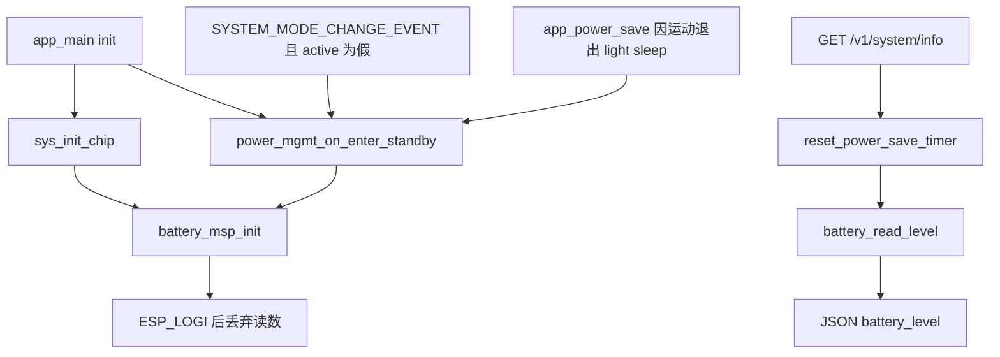
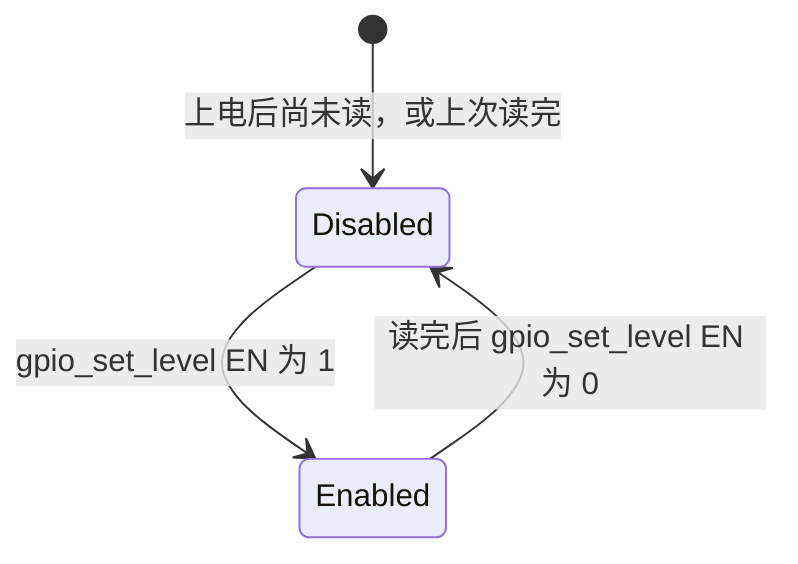

# 电池采样（Battery）

电池采样在有人要读的时候，把分压后的 ADC 电压换算成毫伏。结果只进启动日志，或进 `GET /v1/system/info` 的 JSON。它不周期采样，不写入 `g_mcu`，也不参与 [电源管理](power-management.md) 的状态迁移。三个硬件变体都有使能脚：测量时才把分压电阻接到地，读完再断开。

## 职责

- 初始化 `ADC_UNIT_1` 的 oneshot 通道，并尽量建立 eFuse 校准。
- 拉高使能脚、等待固定 tick、读一次、再拉低，然后按分压把引脚毫伏放大成估计的电池毫伏。
- 启动自检时把这个毫伏数打到日志；HTTP 查询时原样放进 `battery_level`。
- 不换算百分比，不设低电阈值，不改电源状态、灯态或 NVS。

## 在系统中的位置

`main/app_main.c` 的 `init` 先调用 `sys_init_chip`，其中第一次 `battery_msp_init`。随后进入待机时，`power_mgmt_on_enter_standby` 会再调用一次。运行期唯一的对外读数在 [API](api.md) 的 `system_info_handler`。`app_system_loop` 不采样。



`mcu_t` 没有电池字段，见 [全局状态](global-state.md)。电源状态枚举里也没有低电态，见 [电源管理](power-management.md)。灯、BLE、发现和 IMU 流都不读这个电压，见 [LED](led.md)、[BLE](ble.md)、[发现](discovery.md)、[IMU 流](imu-streaming.md)。引脚宏在 `include/modelspec.h`，与 [硬件](hardware.md) 的其它 GPIO 放在一起。没有电池相关事件位，见 [事件](events.md)。

## 设计

### 数据与状态

模块内部只有三份静态状态：`adc1_handle`、`adc1_cali_handle`、`cali_enable`。没有环形缓冲，没有上次电压的缓存。

`battery_read_level` 的返回值是 `int`，函数注释写的是 mV，不是百分比。`g_mcu` / `mcu_state_t` 都不保存它。`power_peripheral_state_t` 有 Wi-Fi、BLE、IMU、LED、按钮、REST 的初始化标志，没有电池标志，所以待机路径无法跳过重复初始化。

使能脚在一次读取里只有两态。`CONFIG_BATTERY_EN_VALUE` 固定为 1，三个目标共用，不按板子分开。



`Enabled` 至少盖住后面的 `vTaskDelay` 和一次 `adc_oneshot_read`。采样 API 失败时进程会在拉低之前中止，脚就停在 `Enabled`。

分压网络只写在 `battery_read_level` 的注释里，没有单独的原理图符号，也不按目标分叉：

| 注释中的元件 | 位置 |
| --- | --- |
| R1，15 kΩ | `VBAT` 到 ADC 节点 |
| R2，10 kΩ | ADC 节点到开关 |
| 开关，标注 `ADC_EN` | R2 与 `GND` 之间 |

按这组电阻，电池电压应是引脚电压的 2.5 倍。实现是无符号整数先除后乘，并且行尾注释仍写 “the voltage divider ratio is 2”：

```c
voltage = voltage / 2 * 5;
```

`voltage` 是 `uint32_t`。引脚为 1001 mV 时结果是 2500，而先乘 5 再除 2 会得到 2502。奇数毫伏先被 `/ 2` 丢掉，再乘 5。

### 行为与时序

`battery_msp_init` 的顺序是：若定义了 `CONFIG_BATTERY_EN_PIN`，把该脚配成输出、上拉、不下拉、无中断；`gpio_config` 的返回值丢掉。然后 `adc_oneshot_new_unit`，只填 `unit_id = ADC_UNIT_1`，`clk_src` 与 `ulp_mode` 保持零。通道为 `ADC_BITWIDTH_DEFAULT`、`ADC_ATTEN_DB_12`。接着尝试校准，最后做一次自检读，`ESP_LOGI` 打印 “battery level”，不和任何阈值比较，函数在能返回时一律 `ESP_OK`。头文件注释里的 `ESP_FAIL` 没有对应的 `return`。

校准在编译期二选一，不再按 `CONFIG_IDF_TARGET_*` 手写：

| 条件 | 行为 |
| --- | --- |
| `ADC_CALI_SCHEME_CURVE_FITTING_SUPPORTED` | `adc_cali_create_scheme_curve_fitting`，bitwidth 为 `ADC_BITWIDTH_DEFAULT` |
| 否则若 `ADC_CALI_SCHEME_LINE_FITTING_SUPPORTED` | `adc_cali_create_scheme_line_fitting` |
| 创建返回 `ESP_OK` | `cali_enable = true` |
| 两个宏都没有，或创建失败 | `cali_enable = false`，打警告，初始化仍继续 |

哪个目标定义哪个宏，由 ESP-IDF 的 SOC 头决定，本仓库看不出最终选中哪一种。

一次 `battery_read_level`：

1. 定义了使能脚时，把它驱动到 1。
2. 无论有没有使能脚，都 `vTaskDelay(50 / portTICK_PERIOD_MS)`。`portTICK_PERIOD_MS` 能整除 50 时，这就是 50 ms。变体 sdkconfig 没有写 `CONFIG_FREERTOS_HZ`，共享的 `sdkconfig.defaults` 当前工作区不存在，tick 频率代码未体现。
3. `adc_oneshot_read` 一次，没有多次平均。
4. `cali_enable` 为真时，`adc_cali_raw_to_voltage` 得到引脚毫伏；否则 `adc_raw * 1100 / 4096`。
5. 定义了使能脚时，驱动到 0，再做上面的 `/ 2 * 5`。未定义则返回引脚毫伏，不放大。

现有 v1、v2、v3 都定义了使能脚，第 5 步都会编进去。`#ifdef` 看的是宏是否存在，不是引脚号非零。

采样时机只有这两类，没有定时器，也没有独立任务：

| 时机 | 调用栈 | 读数去向 |
| --- | --- | --- |
| 每次 `battery_msp_init` 末尾 | `sys_init_chip`；以及下面每一次进入待机 | 日志后丢弃 |
| `GET /v1/system/info` | `system_info_handler` | JSON 字段 `battery_level` |

待机入口 `power_mgmt_on_enter_standby` 在拉起 REST、处理完省电定时器之后调用 `battery_msp_init`，且不看任何「已经初始化」标志。因此正常启动至少采样两次：`sys_init_chip` 一次，紧接着的待机再一次。之后还有两条路径会再进待机并再初始化：`sys_power_mgmt_handler` 在 `SYSTEM_MODE_CHANGE_EVENT` 且 `g_mcu.state.active` 为假时；`app_power_save` 在 light sleep 中检测到运动、跳出循环之后。`power_mgmt_on_enter_active`、`power_mgmt_on_enter_power_save`、`power_mgmt_on_enter_deep_sleep` 都不采样。

HTTP 处理函数在读电池之前调用 `reset_power_save_timer`。被重置的是省电倒计时，不是因为电压高低。电压值随后不进入 `sys_power_mgmt_handler` 的任何分支。

### 并发

`battery.c` 没有互斥量。使能脚的「拉高、等待、读取、拉低」不是原子的。ESP-IDF 5.5 把 `adc_oneshot_new_unit`、`adc_oneshot_config_channel`、`adc_oneshot_read` 标成 thread-safe；这只覆盖驱动内部，不覆盖本模块的 GPIO 时序和 `cali_enable`。

`rest_controller_start` 从 `HTTPD_DEFAULT_CONFIG()` 出发，只改了端口、wildcard 匹配和 `max_uri_handlers`。httpd 仍是单个 server 任务，多个 `/v1/system/info` 在这个任务里串行，每次阻塞至少那段延时。它们仍可能和 `app_main` 或系统事件循环里的 `battery_msp_init` 重叠。`system_info_handler` 不拿 `g_power_mgmt_ctx` 的锁。

`battery_read_level` 使用 `vTaskDelay`，只能在任务上下文调用。当前调用点是 `app_main` 的 `init`、电源事件处理所在任务、`app_power_save`，以及 httpd 任务。没有 ISR 调用。

### 配置

`CONFIG_BATTERY_EN_PIN`、`CONFIG_BATTERY_READ_ADC_CHANNEL`、`CONFIG_BATTERY_EN_VALUE` 都是头文件宏，不是 Kconfig，也不出现在 `sdkconfig.defaults.v1`、`sdkconfig.defaults.v2`、`sdkconfig.defaults.v3`。没有电池 NVS 键，见 [NVS](nvs.md)。

`lib/battery` 通过根 `CMakeLists.txt` 的 `EXTRA_COMPONENT_DIRS` 注册，组件 `REQUIRES` 为 `esp_adc` 与 `esp_driver_gpio`。`components/sys` 的 CMake `REQUIRES battery`。`components/rest_controller` 的 CMake 没有写 `battery`，但 `system_info_handler` 直接调用 `battery_read_level`。

衰减固定 `ADC_ATTEN_DB_12`，位宽固定 `ADC_BITWIDTH_DEFAULT`。回退公式另写死 12 位满量程 4096 和 1100 mV，不读这两项配置。1100 mV 是未校准时的常数，不是 `ADC_ATTEN_DB_12` 的满量程。校准成功时不走这条公式。

本模块没有 `CONFIG_IMU_SENSOR_*` 分支。

### v1 / v2 / v3

电池脚只按 `CONFIG_IDF_TARGET_*` 选择。三块板共用同一极性、同一衰减、同一分压算式。

| 变体 | 守卫 | 使能脚 | ADC |
| --- | --- | --- | --- |
| v1 ESP32 | `CONFIG_IDF_TARGET_ESP32` | `GPIO_NUM_25` | `ADC_CHANNEL_6`，注释为 `GPIO_NUM_34` |
| v2 ESP32-S3 | `CONFIG_IDF_TARGET_ESP32S3` | `GPIO_NUM_2` | `ADC_CHANNEL_0`，注释为 `GPIO_NUM_1` |
| v3 ESP32-C5 | `CONFIG_IDF_TARGET_ESP32C5` | `GPIO_NUM_2` | `ADC_CHANNEL_0`，注释没有 GPIO |

v3 没有把采样脚写成 `GPIO_NUM_*`。不要把 v2 注释里的 `GPIO_NUM_1` 当成 v3 的源码定义；对应 GPIO 代码未体现。v3 的宏值与 v2 相同，分压注释却没有按芯片拆开，固件对三块板使用同一套换算。

deep sleep 的 `gpio_hold_en` 只覆盖 `CONFIG_IMU_EN_PIN`（若定义）和 `CONFIG_BLINK_PIN`，不覆盖电池使能脚。light sleep 路径同样不碰 ADC，也不采样。

## 接口

对外只有两个函数：

| 符号 | 约定 |
| --- | --- |
| `battery_msp_init` | 声明返回 `esp_err_t`。ADC 调用失败时被 `ESP_ERROR_CHECK` 中止，不会把错误交还给调用方。能返回时是 `ESP_OK`。`sys_init_chip` 和 `power_mgmt_on_enter_standby` 都不看返回值 |
| `battery_read_level` | 返回估计的电池毫伏。没有错误码。ADC 或校准换算失败同样 `ESP_ERROR_CHECK` 中止 |

依赖的事件位：没有。不置位、不清除、不等待 `EV_SYS_*` 或 `EV_TASK_*`。

依赖的 NVS 键：没有。

被谁调用：

- `sys_init_chip`：上电第一次初始化加自检日志。
- `power_mgmt_on_enter_standby`：每次进入 `POWER_STANDBY` 都再初始化一次。
- `system_info_handler`：`GET /v1/system/info`。

线协议只有这一个字段。OpenAPI 把它标成必填 number，描述是 “Battery level”，没有写单位。数值是 `battery_read_level` 的 `int` 转成 `double`，与同一次响应里的 `id`、`ver`、`time`、`tsf_time`、`target_fps` 放在一起。

| JSON 字段 | 来源 | 含义 |
| --- | --- | --- |
| `battery_level` | `battery_read_level` | 估计电池电压的毫伏整数，不是百分比 |

这个处理函数会先 `reset_power_save_timer`。除此之外，电池模块不调用电源、灯、Wi-Fi 或 IMU。

## 失败与边界

没有低电保护。全仓库没有电压阈值，没有因电压进入 `POWER_SAVE` 或 `POWER_DEEP_SLEEP` 的路径，灯态也不表示低电。读数再低，状态机仍只看模式、运动和省电定时器。

其它边界：

- `adc_oneshot_new_unit` 在 ADC1 已被占用时，ESP-IDF 5.5 返回 `ESP_ERR_NOT_FOUND`。本函数用 `ESP_ERROR_CHECK` 包住它。启动顺序是先 `sys_init_chip` 再 `power_mgmt_on_enter_standby`，第二次会再次申请同一单元。仓库里没有 `adc_oneshot_del_unit`，也没有忽略这个错误。失败则中止，待机初始化不会走到第二次自检。
- 同一次读取里，`adc_oneshot_read` 或 `adc_cali_raw_to_voltage` 失败也会在拉低使能脚之前中止，分压开关保持导通。
- 校准失败不是致命错误。此后每笔读数走 `adc_raw * 1100 / 4096`，再乘约 2.5。该常数忽略 `ADC_ATTEN_DB_12` 的满量程，也忽略 `ADC_BITWIDTH_DEFAULT` 若不是 12 位的情况。
- `cali_voltage` 直接转成 `uint32_t`。负值会绕回。代码未检查符号。
- 单次采样，没有丢弃毛刺、没有量程钳位。0 或明显不合理的毫伏仍会打日志或写进 JSON。
- `gpio_config` 失败被忽略。使能脚若没有变成输出，后面的 `gpio_set_level` 不一定能接通分压，初始化仍返回 `ESP_OK`。
- 成功路径不释放 ADC 单元，也不删除校准 scheme。驱动若允许再次 `adc_oneshot_new_unit`，旧 handle 会被覆盖且不回收。按上面的 `ESP_ERR_NOT_FOUND` 约定，正常情况死在检查宏，到不了这一步。
- 查询发生在 httpd 任务里，调用方被阻塞一整段建立时间加一次转换。没有超时参数，也没有“ADC 忙则跳过”的分支。
- deep sleep 不锁存使能脚。上次成功读取后电平为 0，睡眠期间是否保持，代码未体现。ADC 外设在睡眠前也不关闭。
- 在 `battery_msp_init` 成功之前调用 `battery_read_level`，`adc1_handle` 仍是 `NULL`，读调用会失败并中止。现有 HTTP 路径排在第一次 `sys_init_chip` 之后。

## 设计取舍

使能脚串在分压下臂和地之间，是为了不测量时断开这串电阻。建立时间固定为 `50 / portTICK_PERIOD_MS` 个 tick，提交说明没有写为什么是这个数，历史未说明。

分压补偿在 `908322e`（subject: refactor: change names of attributes，正文另有 “fix: fix battery”）从 `voltage *= 2` 改成 `voltage / 2 * 5`，同时 `CONFIG_BATTERY_EN_VALUE` 从 0 改为 1。`0c747a5`（subject: fix: fix monitor rate control）只把注释里的 R1 从 10 kΩ 改成 15 kΩ。算式旁仍写 ratio is 2。两次说明都没有解释 2.5 倍或极性，历史未说明。

迁到 `esp_adc` oneshot，以及用 curve fitting / line fitting 代替按芯片手写的 eFuse 方案，发生在 `3e172e7`。该提交 subject 是引入 `sdkconfig.defaults.v1` 的重构说明，正文写了 “refactor: bump to esp-idf v5.x”。

低电不进电源状态机。提交记录里没有「故意不做保护」或阈值的说明，历史未说明。读数不进 `g_mcu` 同样历史未说明。`battery_msp_init` 在芯片初始化和每次待机各调一次，也历史未说明。

## 源文件

- `lib/battery/battery.c`
- `lib/battery/battery.h`
- `lib/battery/CMakeLists.txt`
- `include/modelspec.h`
- `components/sys/sys.c`
- `components/sys/sys.h`
- `components/sys/power_mgmt.c`
- `components/sys/CMakeLists.txt`
- `components/rest_controller/rest_controller.c`
- `components/rest_controller/rest_controller_handlers.c`
- `components/rest_controller/CMakeLists.txt`
- `main/app_main.c`
- `CMakeLists.txt`
- `manifests/openapi/openapi.yaml`
