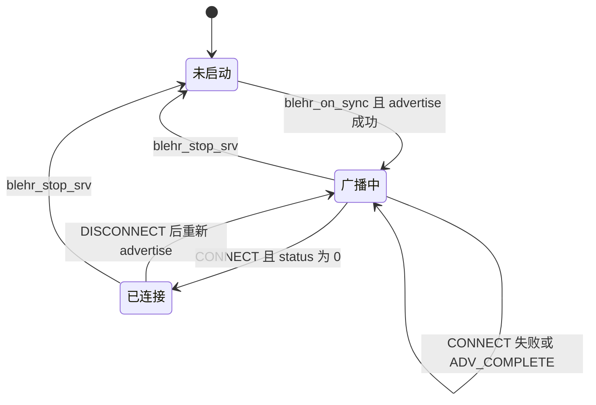
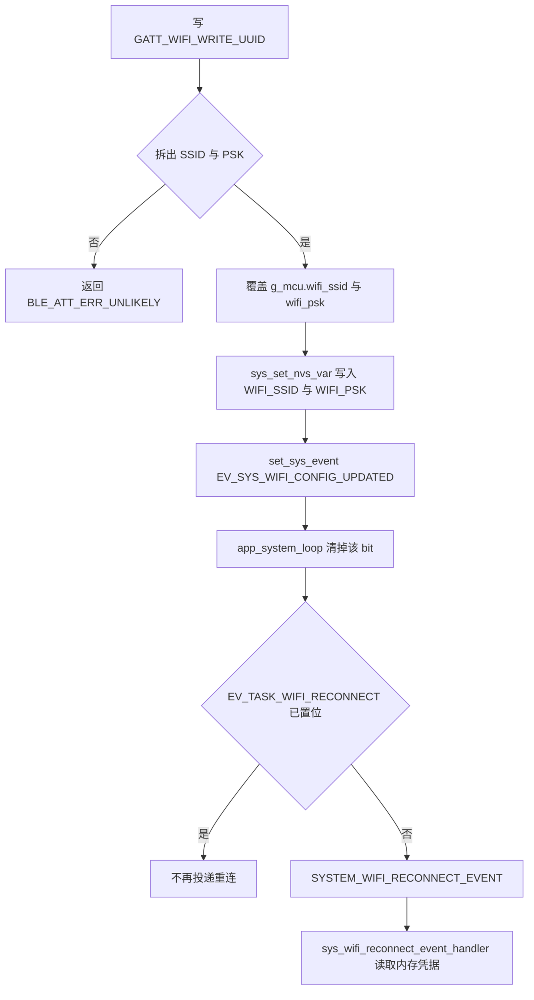

# 蓝牙配网与 GATT（BLE provisioning）

设备在尚未连上可用 AP 时，需要一条不依赖 Wi-Fi 的路径写入 STA 凭据，并让调试端确认当前 IPv4。本组件用 NimBLE 做外设：按固定前缀广播，提供一个自定义 GATT 服务，写入 `g_mcu` 与 NVS 后置事件，由系统循环去触发重连。它不运行 Wi-Fi 状态机，连接与断线也不改 LED 或 IMU。

## 职责

- 在允许开射频的电源态里启动或停止 NimBLE host，并做可连接的通用广播。
- 用 `g_mcu.ble_local_name` 同时作为 GAP 设备名和广播里的 complete local name。
- 接受一段 ASCII 凭据，写入 `g_mcu.wifi_ssid`、`g_mcu.wifi_psk` 以及 NVS 键 `WIFI_SSID`、`WIFI_PSK`，然后置 `EV_SYS_WIFI_CONFIG_UPDATED`。
- 在读特征上返回当前 IPv4，或在未连接时返回字面量 `0.0.0.0`。
- 不负责扫描、不作为 central 发起连接、不配对、不发 notification。

## 在系统中的位置

名字在 [boot-and-tasks.md](boot-and-tasks.md) 的 `sys_init_chip()` 里生成，早于 NVS 与 Wi-Fi。`app_main()` 进入 `power_mgmt_on_enter_standby()` 后才调用 `blehr_start_srv()`。之后 BLE 的寿命由 [power-management.md](power-management.md) 掌握：standby 打开，active、power save、`POWER_MODE_LOW_ENERGY` 关掉。单击切 active/standby 的入口在 [button.md](button.md) 与 [api.md](api.md) 的 `sys_set_operation_mode()`；它们只置 `EV_SYS_MODE_CHANGE`，不直接调用本组件。

配网数据落在 [global-state.md](global-state.md) 的 `g_mcu` 和 [nvs.md](nvs.md) 的 `var` 表。触发重连只通过 [events.md](events.md) 的 `EV_SYS_WIFI_CONFIG_UPDATED_BIT`，后续 `SYSTEM_WIFI_RECONNECT_EVENT` 由 `app_system_loop()` 投递，连接过程见 [wifi.md](wifi.md)。同一把名字还会在 `sys_wifi_netif_init()` 里设成 STA hostname。同一对 NVS 键也可由 REST 写入，那条路径不经过 GATT。

本组件不读传感器，不推动 [led.md](led.md) 的灯状态。OTA 把运行模式拉回非 active 时会间接要求重新打开 BLE，OTA 本身见 [ota.md](ota.md)。芯片差异见 [hardware.md](hardware.md)；GATT 源文件没有按目标分叉。

## 设计

### 数据与状态

广播名不是 Kconfig。`include/settings.h` 的宏 `CONFIG_BLE_LOCAL_NAME_PREFIX` 为 `"markit_"`，`CONFIG_BLE_LOCAL_NAME_LEN` 为 32，`CONFIG_DEVICE_ID_LEN` 为 12。`sys_init_chip()` 用 `esp_efuse_mac_get_default()` 把出厂 MAC 格式化成 12 位小写十六进制，再拼进 `g_mcu.ble_local_name`。拼之前对该缓冲 `bzero`，所以名称以 NUL 结尾，长度是 7 + 12 = 19，用的是完整 device id，不是 MAC 末四位。`device_id[12]` 本身没有多出来的 NUL，靠后面的 `_device_id_sep_` 把日志里的 `%s` 截断；广播名不依赖这个布局。运行时没有改名路径。

`ble_local_name` 被用了两次：`ble_svc_gap_device_name_set()`，以及 advertising data 的 complete local name。真正的 BLE 地址是另一件事。`blehr_on_sync()` 调用 `ble_hs_id_infer_auto(0, &blehr_addr_type)`，privacy 参数为 0，然后 `ble_hs_id_copy_addr()` 只用于日志。代码未把该地址写回广播名，也未核对它与 eFuse MAC 是否相同。

组件没有自己的连接状态枚举。跨任务可见的只有调用方传入的 `bool *status_out`，实际就是 `g_power_mgmt_ctx.peripheral_state.ble_enabled`。`blehr_start_srv()` 在 `nimble_port_freertos_init()` 返回后就把该标志设为 true，此时 `blehr_on_sync()` 多半还没广播。文件内静态量 `blehr_addr_type` 与 `conn_handle` 只在 host 回调里写；`conn_handle` 在连接失败时也会被赋值，断线不清，除 `BLE_GAP_EVENT_SUBSCRIBE` 的日志外没有读者。

GATT 表由 `gatt_svr_svcs[]` 静态定义。`gatt_svr_init()` 还会 `ble_svc_gap_init()` 与 `ble_svc_gatt_init()`，因此标准 GAP/GATT 服务一并存在。自定义服务只有一个 primary。源码注释写成 Device Information / Manufacturer name，与 UUID 宏不符，以宏为准。

| 对象 | UUID | flags | 访问 |
| --- | --- | --- | --- |
| primary service | `GATT_WIFI_CONFIGURATION_UUID` `0x1829` | — | — |
| 写特征 | `GATT_WIFI_WRITE_UUID` `0x2B1F` | `BLE_GATT_CHR_F_WRITE` | `gatt_svr_chr_wifi_info` |
| 读特征 | `GATT_WIFI_READ_UUID` `0x2B20` | `BLE_GATT_CHR_F_READ` | 同一个回调 |

没有 CCCD，没有 notify/indicate，flags 里没有 `ENC` / `AUTHEN` / `AUTHOR`。`BLE_GATT_CHR_F_WRITE` 是带响应的 Write Request，不是 Write Command。

写载荷是一段临时加上 NUL 的 ASCII，不是 TLV：

| 段 | 规则 |
| --- | --- |
| SSID | `strtok(..., " ")` 的第一段。空格属于分隔符，SSID 不能含空格 |
| PSK | 再 `strtok(NULL, "\n")`。可含空格，停在第一个 `\n` 或缓冲末尾。空密码得到 NULL，整次写入失败 |
| 失败 | 任一段缺失则返回 `BLE_ATT_ERR_UNLIKELY`，不改 RAM、不写 NVS、不置事件 |

读载荷没有自定义头：`g_mcu.state.wifi_connected` 为真时，把 `g_mcu.ip_info.ip` 格式化成点分 IPv4 放进 ATT 值；否则追加 7 字节 `"0.0.0.0"`。值长度是 `strlen`，不额外带 NUL。不返回 SSID 或 PSK。

`wifi_connected` 要到 `sys_wifi_try_connect()` 成功返回才为真。`ip_info` 在 `wifi_event_handler()` 处理 `IP_EVENT_STA_GOT_IP` 时更新，断线路径不清它。读特征只看布尔标志，所以未连接时不会把残留地址交出去。

### 行为与时序

启动顺序固定在 `blehr_start_srv()`：`nimble_port_init()`，登记 `sync_cb` / `reset_cb`，`gatt_svr_init()`，设置 GAP 设备名，再 `nimble_port_freertos_init(blehr_host_task)`。host 任务里阻塞在 `nimble_port_run()`，直到 `nimble_port_stop()`。同步回调里推断地址并 `blehr_advertise()`。

广播参数：flags 为 `BLE_HS_ADV_F_DISC_GEN | BLE_HS_ADV_F_BREDR_UNSUP`，tx power 交给栈填（`BLE_HS_ADV_TX_PWR_LVL_AUTO`），名称标记为 complete。`conn_mode` 是 `BLE_GAP_CONN_MODE_UND`，`disc_mode` 是 `BLE_GAP_DISC_MODE_GEN`，时长 `BLE_HS_FOREVER`，对端地址 NULL。没有 scan response（未调用 `ble_gap_adv_rsp_set_fields`），广播里也不带 service UUID。名称放不下时设置字段失败，函数打日志后返回，不会改用短名。

成功连上之后不会再次 `blehr_advertise()`，因此链路上同时只有一条连接。失败、断线、`BLE_GAP_EVENT_ADV_COMPLETE` 都会无条件再广播；`ADV_COMPLETE` 不区分原因。`SUBSCRIBE` 与 `MTU` 只打日志。没有 `ble_gap_terminate()`，对端不断开则一直保持，直到 host 被 stop。`blehr_on_reset()` 只记录 reason；若栈之后再次同步，仍会走 `blehr_on_sync()` 重新广播。代码未体现 reset 之后不再同步时的补救。

停机：`nimble_port_stop()` 返回 0 才 `nimble_port_deinit()`。无论 stop 或 deinit 是否成功，`*status_out` 都写成 false。deinit 失败只打日志。

电源侧何时调用（细节在 [power-management.md](power-management.md)）：

- `power_mgmt_on_enter_standby()`：`mode != POWER_MODE_LOW_ENERGY` 且尚未 enabled 时，先 `esp_wifi_set_ps(WIFI_PS_MAX_MODEM)`，再 `blehr_start_srv()`。`mode == POWER_MODE_LOW_ENERGY` 时改为 `blehr_stop_srv()`。冷启动 `power_mgmt_init()` 把 `mode` 设为 `POWER_MODE_NORMAL`，因此第一次 standby 会开 BLE。从 deep sleep 醒来且 `power_mgmt_wake_up_handler()` 决定再次睡下去时，不会走到 standby，BLE 不会启动。
- `power_mgmt_on_enter_active()`：若标志为真，先停 BLE，再 `esp_wifi_set_ps(WIFI_PS_NONE)`。active 来自 `EV_SYS_MODE_CHANGE` → `SYSTEM_MODE_CHANGE_EVENT`。置位入口是按钮单击、REST `action=start`、以及数据发送失败时 `network.c` 把模式拉回 false（那次会回到 standby 并重新开 BLE）。OTA 处理里同样 `sys_set_operation_mode(false)`。
- `power_mgmt_on_enter_power_save()` 与切到 `POWER_MODE_LOW_ENERGY` 的分支也会停 BLE，这两处不改 Wi-Fi 省电模式。
- 当前仓库没有任何语句把 `next_mode` 写成与 `mode` 不同的值，`LOW_ENERGY` / `PERFORMANCE` 的切换分支到不了。注释仍写着 NORMAL 开 BLE、LOW_ENERGY 关 BLE。代码未体现谁来改 `next_mode`；`g_power_mgmt_ctx` 在 RTC 内存里，旧固件留下的值代码未处理。
- `power_mgmt_on_enter_deep_sleep()` 不调用 `blehr_stop_srv()`。长按按钮直接进该函数。power save 循环在入睡前已经停过 BLE；定时器回调 `power_mgmt_handle_transition()` 则在拉起 `app_power_save` 的同时直接 deep sleep，那条路径上 BLE 停止代码未执行。

写特征成功后的交接：

`set_sys_event` 展开为 `xEventGroupSetBits(..., EV_SYS_WIFI_CONFIG_UPDATED_BIT)`，该位是 `BIT0`。`app_system_loop()` 用 `xEventGroupWaitBits(..., pdTRUE, ...)` 清位，并把该位与 `EV_SYS_WIFI_DISCONNECTED_BIT`、`EV_SYS_WIFI_FAIL_BIT` 同等看待。重连守卫已置位时，新的配网位被清掉且不再 `esp_event_post_to`。NVS 在置位之前已经 `nvs_commit`，所以即使这次重连被丢掉，重启仍会从 [nvs.md](nvs.md) 装回新凭据。BLE 链路在配网后保持，本组件不断开它。`sys_wifi_reconnect_event_handler()` 内部先断开再按内存中的 SSID/PSK 连接；认证与重试见 [wifi.md](wifi.md)。

### 并发

GAP 与 GATT 回调都在 `blehr_host_task` → `nimble_port_run()` 上执行。`blehr_start_srv()` / `blehr_stop_srv()` 由 `app_main`、系统事件循环或 `app_power_save` 调用，不在 host 任务里调用。`ble_enabled` 是普通 `bool`，没有原子操作或互斥；约定是只有 start/stop 写它。

凭据没有锁。host 任务 `strcpy` 到 `g_mcu.wifi_ssid` / `wifi_psk` 并调用 `sys_set_nvs_var()`（内部 `nvs_open`，会阻塞），同时 Wi-Fi 重连任务会 `strcpy` 同一对缓冲。`strtok` 也使用全局解析状态。代码未体现与其他任务的互斥。`xEventGroupSetBits` 用在 host 任务上下文，不是 ISR 版本。

`nimble_port_freertos_init()` 的栈大小、优先级、绑核未在本仓库覆盖，沿用 NimBLE 移植层默认值。代码未体现另外的 BLE 任务。

### 配置

`components/ble/CMakeLists.txt` 的 `REQUIRES` 包含 `sys`、`nvs_flash`、`json`、`bt`。本目录 C 源文件没有使用 `json`。蓝牙栈是 NimBLE：`nimble_port_*`、`ble_hs_*`、`ble_gap_*`、`ble_gatts_*`。`main/Kconfig.projbuild` 没有蓝牙选项。

已跟踪的 sdkconfig 片段里，和 BLE 有关的只有：

| 文件 | 符号 | 取值 |
| --- | --- | --- |
| `sdkconfig.defaults.v1` | `CONFIG_BTDM_CTRL_BLE_MAX_CONN` | 3 |
| `sdkconfig.defaults.v1` | `CONFIG_BT_NIMBLE_HS_FLOW_CTRL` | y |
| `sdkconfig.defaults.v2`、`sdkconfig.defaults.v3` | `CONFIG_BT_NIMBLE_ENABLE_CONN_REATTEMPT` | y |
| 同上 | `CONFIG_BT_NIMBLE_MAX_CONN_REATTEMPT` | 3 |

应用代码不读取这些符号。`CONFIG_BTDM_CTRL_BLE_MAX_CONN` 是 ESP32 BTDM 控制器的连接数上限；本组件在连接成功后不恢复广播，所以上限不会变成多连接。`CONFIG_BT_NIMBLE_ENABLE_CONN_REATTEMPT` 服务于 host 作为 central 时的 `ble_gap_connect` 重试；本组件没有那次调用。

`CONFIG_BT_ENABLED` 与 `CONFIG_BT_NIMBLE_ENABLED` 没有出现在已跟踪的 defaults 里。`sdkconfig.defaults` 被 `.gitignore` 忽略，当前工作区也不存在该文件，而 `Makefile` 与 CI 仍把它和 `sdkconfig.defaults.vN` 拼在一起。蓝牙总开关是否打开，代码未体现。

NVS 侧用到的名字都是头文件宏，不是 Kconfig：命名空间 `CONFIG_VAR_NVS_TABLE_NAME`（`"var"`），键 `CONFIG_NVS_WIFI_SSID_NAME`（`"WIFI_SSID"`）、`CONFIG_NVS_WIFI_PSK_NAME`（`"WIFI_PSK"`），字符串缓冲 `CONFIG_VAR_STR_MAX_LEN`（64）。启动时若 NVS 里该键为空，`sys_load_nvs_configuration()` 回落到 `CONFIG_WIFI_SSID` / `CONFIG_WIFI_PSK`（`"markit"` / `"12345678"`）。GATT 只覆盖，不负责这个默认值。

### v1 / v2 / v3

`components/ble/` 下没有 `CONFIG_IDF_TARGET_*` 或 `CONFIG_IMU_SENSOR_*`。ESP32、ESP32-S3、ESP32-C5 共用同一套广播与 GATT。`CONFIG_IMU_SENSOR_HI229` 与 `CONFIG_IMU_SENSOR_BNO08X` 不影响配网。

差异只在上一节的 sdkconfig 片段：v1（`CONFIG_IDF_TARGET_ESP32`）写的是 BTDM 最大连接数与 NimBLE flow control；v2（`CONFIG_IDF_TARGET_ESP32S3`）与 v3（`CONFIG_IDF_TARGET_ESP32C5`）写的是 central 连接重试。deep sleep 唤醒脚在电源管理里按目标分叉，那个分叉不调用 BLE API。

## 接口

对其他子系统只导出启停。`gatt_svr_init()` 仅由 `blehr_start_srv()` 调用。`gatt_svr_register_cb()` 在头文件里声明，但全仓库没有把它赋给 `ble_hs_cfg.gatts_register_cb`，因此不会运行；未知 `op` 上的 `assert(0)` 同样到不了。

| 函数 | 方向 | 约定 |
| --- | --- | --- |
| `blehr_start_srv(bool *status_out)` | 电源管理 → BLE | 成功调用后 `*status_out = true`。`nimble_port_init` 或 `gatt_svr_init` 失败时 `ESP_ERROR_CHECK` 中止，标志保持原值 |
| `blehr_stop_srv(bool *status_out)` | 电源管理 → BLE | 返回前一律 `*status_out = false` |

`ble_hs_cfg` 只写了 `sync_cb = blehr_on_sync` 与 `reset_cb = blehr_on_reset`。代码未设置 `sm_io_cap`、`sm_bonding`、`sm_mitm` 或 `store_status_cb`。

依赖的事件位：

- 置位 `EV_SYS_WIFI_CONFIG_UPDATED`（`BIT0`）。不清除、不等待。
- 不消费 `EV_SYS_WIFI_CONNECTED` 等其他系统位。读 IP 时看的是 `g_mcu.state.wifi_connected`，不是 `wifi_event_group`。
- 间接依赖系统循环把配网位变成 `EV_TASK_WIFI_RECONNECT` 与 `SYSTEM_WIFI_RECONNECT_EVENT`。这两个符号不在本组件里置位。

依赖的 NVS 键：`var` 表中的 `WIFI_SSID`、`WIFI_PSK`，类型 `VAR_STR`。写入经 `sys_find_var()` + `sys_set_nvs_var()`，存的是长度为 `CONFIG_VAR_STR_MAX_LEN` 的 blob，不是以字符串长度截断的 blob。本组件不读回 NVS。

读写的全局状态：写 `g_mcu.wifi_ssid`、`g_mcu.wifi_psk` 与 `ble_enabled`；读 `g_mcu.ble_local_name`、`g_mcu.state.wifi_connected`、`g_mcu.ip_info.ip`。

## 失败与边界

- 设置广播字段或 `ble_gap_adv_start` 失败：打日志并返回。没有定时器再试。若发生在首次 `blehr_on_sync()`，`ble_enabled` 已经是 true，standby 不会再次 `blehr_start_srv()`。
- `ble_hs_id_infer_auto` 失败：`assert`。`ble_hs_id_copy_addr` 的返回值被忽略，地址日志可能是全零，广播仍会尝试启动。
- `nimble_port_stop()` 非 0：不 `deinit`，但 `ble_enabled` 仍被清掉。下一次 standby 会再 `nimble_port_init()`。代码未体现这种重叠初始化的恢复。
- 写路径在 `om_data[om_len]` 写入 NUL。这是载荷后的一字节，是否落在 mbuf 容量内，代码未检查。只解析 `ctxt->om` 的第一段，没有把 mbuf 链展平。
- `strcpy` 进 `ssid[64]` / `psk[64]` 以及随后的 `g_mcu` 缓冲，没有长度检查。token 长于 63 字节会越界。Wi-Fi 配置结构更短的 SSID 上限不在这里裁剪。
- 局部 `ssid` / `psk` 没有先清零。`sys_set_nvs_var()` 却总是把 64 字节 blob 写入。NUL 之后的未初始化字节会进 NVS；加载侧用 `strlen`，短字符串仍能读回。`g_mcu` 侧在 `strcpy` 前 `memset` 过，RAM 副本是干净的。
- `sys_find_var()` 的 NULL 与 `sys_set_nvs_var()` / `nvs_set_blob()` 的错误都没有检查。`nvs_open` 失败会在 `ESP_ERROR_CHECK` 处中止 host 任务。键写在 `g_mcu_vars[]` 里，正常构建能找到。RAM 已更新之后若 NVS 中止，事件可能还没置上，两次键写入也不成事务。
- 解析失败返回 `BLE_ATT_ERR_UNLIKELY`。成功返回 `ESP_OK`，其值为 0，因此 ATT 写响应是成功。未知 UUID 与 `os_mbuf_append` 失败同样是 `BLE_ATT_ERR_UNLIKELY`。
- 配网位若撞上已经置位的 `EV_TASK_WIFI_RECONNECT`，本次重连不会排队。进行中的 `sys_wifi_reconnect_event_handler()` 可能已经拷走旧凭据。失败后再重试依赖 `EV_SYS_WIFI_FAIL`，见 [wifi.md](wifi.md)，本组件不重试。
- 写回调用 `ESP_LOGI` 打印整段原文。重连日志会再打印 PSK。没有配对或链路加密要求。
- 长按进 deep sleep、以及 `power_mgmt_handle_transition()` 直接 `esp_deep_sleep_start()` 时，代码未调用 `blehr_stop_srv()`。
- 进入 active 才把 Wi-Fi 省电设回 `WIFI_PS_NONE`。standby 在 `blehr_start_srv()` 之前就把省电设成 `WIFI_PS_MAX_MODEM`，`esp_wifi_set_ps` 的返回值未检查；若随后 init 中止，省电模式已经改过。

## 设计取舍

配网随 "EVERY THING HAS CHANGED"（521da2c，正文 "feat: BLE network configuration"）引入；进入 active 时关掉 BLE 的说明是 "feat: ble auto-stop"（908322e），读特征改为返回 IP 的说明是 "feat: ble read chr now return ip address"（b2439cc）。空格分隔、不配对、不在连接成功后续广播，以及 v1 把 `CONFIG_BTDM_CTRL_BLE_MAX_CONN` 设为 3，历史未说明。

## 源文件

- `components/ble/ble_srv.h`
- `components/ble/ble_srv.c`
- `components/ble/gatt_srv.c`
- `components/ble/CMakeLists.txt`
- `include/settings.h`
- `components/sys/sys.h`
- `components/sys/sys.c`
- `components/sys/nvs_mgmt.c`
- `components/sys/power_mgmt.c`
- `components/sys/wifi.c`
- `components/sys/button.c`
- `components/apps/system_loop.c`
- `components/apps/network.c`
- `components/rest_controller/rest_controller_handlers.c`
- `main/app_main.c`
- `sdkconfig.defaults.v1`
- `sdkconfig.defaults.v2`
- `sdkconfig.defaults.v3`
