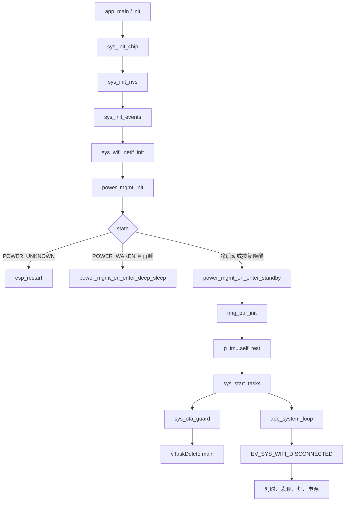
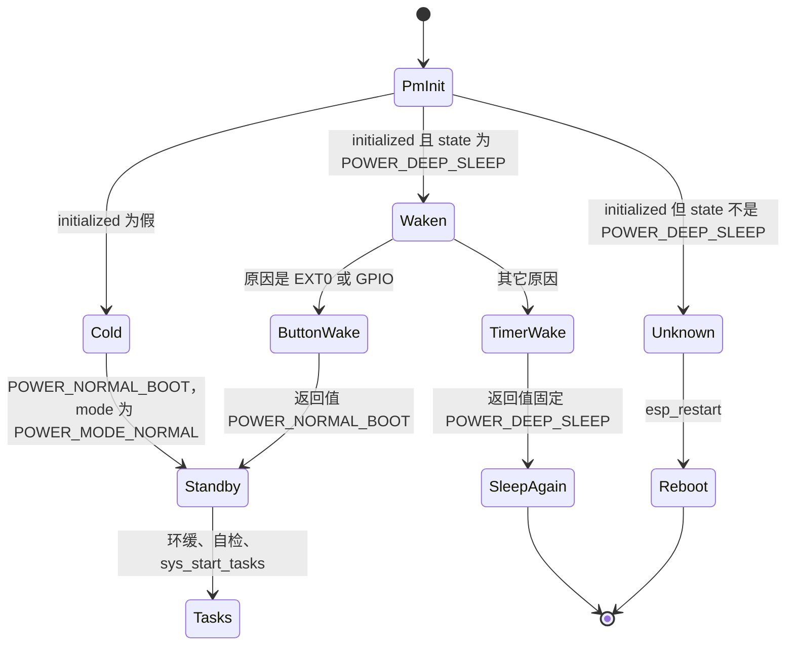

# 启动与 FreeRTOS 任务（Boot and tasks）

从上电到可以采集，固件先在 `app_main` 里准备芯片身份、NVS、事件组和 STA 网络接口，再按 RTC 里的电源上下文决定再睡、重启或进入待机。待机把按钮、灯、IMU、BLE、Wi-Fi 驱动和 REST 拉起来之后，才创建采集、发送和系统循环；IMU 自检的返回值不决定要不要继续。系统循环不自己完成关联、对时或发现，它把 `g_mcu.sys_event_group` 上的位翻译成另一条任务里的处理函数。环形缓冲里的热路径见 [IMU 流](imu-streaming.md)。

## 职责

- 按固定顺序完成 `init()`，并在电源状态不允许继续时再睡或 `esp_restart`，不创建业务任务。
- 用 `sys_start_tasks()` 创建 `app_monitor`、`app_data_client`、`app_system_loop`；句柄已非空则跳过。`sys_stop_tasks()` / `sys_stop_timers()` 是省电路径的对称操作，状态机见 [电源管理](power-management.md)。
- 在 `app_system_loop` 里建立私有 `esp_event` 循环和三只 FreeRTOS 软件定时器，把系统事件位分发给已注册的处理函数。
- 规定采集任务、发送任务开始干活的门闩。读、入环、UDP 组包和丢帧不在这里展开。
- 在业务任务已经创建之后、删掉 main 任务之前调用 `sys_ota_guard()`。镜像确认与回滚见 [OTA](ota.md)。

本模块不实现 GATT、不解析发现报文、不推进电源状态枚举的全部边。那些只在启动顺序里被调用。

## 在系统中的位置

`app_main` 是 ESP-IDF 的入口。它依赖 [NVS](nvs.md) 里已经提交的凭据和帧率，依赖 [电源管理](power-management.md) 放在 `RTC_DATA_ATTR` 里的 `g_power_mgmt_ctx`，也依赖 [硬件](hardware.md) 的引脚宏。身份和默认事件循环在 `sys_init_chip()` 里准备好之后，[Wi-Fi](wifi.md) 才有地方注册 `WIFI_EVENT` / `IP_EVENT`。

待机入口会创建 [按钮](button.md)、[LED](led.md)、[IMU](imu.md)、[BLE](ble.md) 和 [API](api.md) 的 httpd。这些发生在 `sys_start_tasks()` 之前，所以按钮任务可以早于系统循环运行。系统循环起来之后，启动时已经置位的 `EV_SYS_WIFI_DISCONNECTED` 才触发第一次关联；连上之后投递的是 [时间同步](time-sync.md) 和 [发现](discovery.md)。`app_monitor` 与 `app_data_client` 只在门闩打开后接触环形缓冲，见 [IMU 流](imu-streaming.md)。事件位的全体定义见 [事件](events.md)，字段放在 [全局状态](global-state.md)。

## 设计

### 数据与状态

全局对象 `g_mcu` 静态初始化为 0。任务句柄因此一开始是 `NULL`，`state.active`、`ntp_synced`、`discovery_completed`、`wifi_connected`、`led_manual` 都是假。`g_power_mgmt_ctx` 不是这样：它带 `RTC_DATA_ATTR`，深睡之后仍在。两份状态谁持久，见 [全局状态](global-state.md) 和 [电源管理](power-management.md)。

`sys_init_events()` 创建三只事件组，互不替代：

| 句柄 | 角色 |
| --- | --- |
| `g_mcu.sys_event_group` | `app_system_loop` 的唤醒源。`xEventGroupWaitBits` 返回时清除已等到的位 |
| `g_mcu.task_event_group` | 电平闩，挡住重复投递。`get_task_event` 用 `xEventGroupClearBits(..., 0)` 只读不改 |
| `g_mcu.wifi_event_group` | 一次 `sys_wifi_try_connect` 的内部握手，系统循环不读它 |

创建之后立刻 `set_sys_event(EV_SYS_WIFI_DISCONNECTED)`。此时还没有任务在等，位会留到系统循环第一次醒来。

设备身份在 NVS 之前写好。`esp_efuse_mac_get_default` 的 6 字节 MAC 被格式化成 12 位小写十六进制，`memcpy` 进 `g_mcu.device_id`（`CONFIG_DEVICE_ID_LEN` 为 12）。这个字段本身不放 NUL；紧随其后的 `g_mcu._device_id_sep_` 靠 `g_mcu = {0}` 保持为 0，`ESP_LOGI("%s")` 才能停住。`ble_local_name` 先整体清零，再拼 `CONFIG_BLE_LOCAL_NAME_PREFIX`（`"markit_"`）和这 12 个字符。同一串在 `sys_wifi_netif_init()` 里设成 STA hostname。注释写有的 AP 会嫌名字太长；代码没有截断。

环形缓冲在自检之前初始化。`app_main` 的静态数组 `s_data_buf` 长度是 `CONFIG_DATA_BUF_LEN * sizeof(imu_dgram_t)`，`CONFIG_DATA_BUF_LEN` 为 128。`ring_buf_init(..., static_buf = true)` 把 `head` 和 `_head` 设为 1，不拷贝调用方缓冲。返回值被丢掉。槽位和覆盖语义见 [IMU 流](imu-streaming.md)。

IMU 的 `mux` 没有单独的启动赋值。BSS 里的 0 就是 `IMU_MUX_IDLE`。只有 `sys_mode_change_handler` 会改它：`g_mcu.state.active` 为真则 `IMU_MUX_STREAM`，否则 `IMU_MUX_IDLE`。`active` 只由 `sys_set_operation_mode` 写入，并同时 `set_sys_event(EV_SYS_MODE_CHANGE)`。启动代码自己不会把 `active` 设成真。

### 行为与时序

`app_main` 先跑完 `init()`，打日志，`sys_start_tasks()`，再 `sys_ota_guard()`，然后 `vTaskDelete(NULL)`。删掉的是 ESP-IDF 的 main 任务。本仓库没有改这只任务的名字、栈、优先级或绑核。`sys_start_tasks` 只负责把任务创建出来就返回，不等它们的入口跑完；后面的 3 秒守卫和这三只任务重叠。

`init()` 的顺序是代码里的调用顺序，不能对调的原因写在每一步后面。

1. `sys_init_chip()`。打印 `CONFIG_IDF_TARGET`、核数、是否带 BT/BLE、revision、flash 大小和最小剩余堆。`esp_event_loop_create_default()` 建默认事件循环，失败则 `ESP_ERROR_CHECK` 中止。默认循环的栈、优先级和核没有在本仓库改。然后写 `device_id` / `ble_local_name`，打印 `CONFIG_FIRMWARE_VERSION`（根 `CMakeLists.txt` 用 `git describe --tags --abbrev=0`，空则 `"3.3.2"`）。最后 `battery_msp_init()`，返回值忽略。电池在待机里还会再调一次，见 [电池](battery.md)。
2. `sys_init_nvs()`。`nvs_flash_init` 若返回 `ESP_ERR_NVS_NO_FREE_PAGES` 或 `ESP_ERR_NVS_NEW_VERSION_FOUND`，擦除后再初始化一次，第二次的返回值不检查。其它错误不擦除，仍然往下装载。装载开头 `os_delay_ms(100)`。擦除条件和 `TEST` 保护见 [NVS](nvs.md)。启动后 IMU 和 Wi-Fi 用的是这次装进 RAM 的值。
3. `sys_init_events()`。见上一节。必须在任何 `set_sys_event` 之前。
4. `sys_wifi_netif_init()`。`esp_netif_init`、创建默认 STA、把 hostname 设为 `ble_local_name`。不 `esp_wifi_init`，也不连接。驱动初始化要等待机，见 [Wi-Fi](wifi.md)。
5. `power_mgmt_init()`，返回值忽略，只看写完的 `state`。函数一进来就动 GPIO hold，然后 `boot_count++`。`SOC_GPIO_SUPPORT_HOLD_SINGLE_IO_IN_DSLP` 成立时（源码注释指 ESP32-C5）先 `gpio_hold_dis` 再立刻 `gpio_hold_en`。否则 `gpio_deep_sleep_hold_dis()` 再 `gpio_deep_sleep_hold_en()`，运行期不锁脚。脚是 `CONFIG_BLINK_PIN`；`CONFIG_IMU_EN_PIN` 有定义时再加上。判定和后续边见 [电源管理](power-management.md)，这里只保留启动分叉：

   - 冷启动：`initialized` 置真，`state = POWER_NORMAL_BOOT`，`mode` 与 `next_mode` 都是 `POWER_MODE_NORMAL`，新建 mutex，外设标志清零。`app_main` 对这个状态没有专门分支，直接落入待机。
   - 从深睡回来：`state` 先写成 `POWER_WAKEN`，`next_mode` 保持原 `mode`，外设标志清零，然后才调用 `power_mgmt_wake_up_handler()`。原因是 `ESP_SLEEP_WAKEUP_EXT0` 或 `ESP_SLEEP_WAKEUP_GPIO` 时日志 “wakeup from button”，返回 `POWER_NORMAL_BOOT`。`app_main` 只在返回值等于 `POWER_DEEP_SLEEP` 时再睡，所以按钮唤醒会继续待机，`active` 仍是重启后的假。其它原因（含定时器，也含 `ESP_SLEEP_WAKEUP_UNDEFINED`）日志写成 “wakeup from timer”：先 `imu_interface_init`，再 `g_imu.read(..., true)`，失败就 `taskYIELD()`，没有超时。读到一帧后用 `acc` 相对 `{0, 0, -1}` 算范数并打日志，返回值仍是 `POWER_DEEP_SLEEP`，不和 `CONFIG_POWER_SAVE_MOTION_LIMIT` 比较。源码 TODO 写运动检测要等 PCB 修改。`power_mgmt_on_enter_deep_sleep(true)` 不返回，后面的环缓、自检和 `sys_start_tasks` 都不会执行。这条路径上 `led_initialized` 仍是假。
   - `POWER_UNKNOWN`：`esp_restart()`。环缓、自检、待机和业务任务都不会做。`initialized` 在重启前保持为真，`state` 保持 `POWER_UNKNOWN`。

6. `power_mgmt_on_enter_standby()`。按外设标志补齐，最后把 `state` 写成 `POWER_STANDBY`。顺序是按钮、LED、IMU（已初始化但关掉则 `toggle(true)`）、BLE、Wi-Fi 驱动、发射功率、REST、空闲定时器、电池。`mode != POWER_MODE_LOW_ENERGY` 且 BLE 未开时，先 `esp_wifi_set_ps(WIFI_PS_MAX_MODEM)` 再 `blehr_start_srv`；低功耗模式则 `blehr_stop_srv`。Wi-Fi 只做到 `sys_wifi_msp_init`（`esp_wifi_init` + `WIFI_MODE_STA`），不 `esp_wifi_start`。日志打印 `CONFIG_MAX_TX_POWER`，实际传入 `esp_wifi_set_max_tx_power` 的是 `CONFIG_NORMAL_TX_POWER`。`mode != POWER_MODE_PERFORMANCE` 时武装一次性 `power_save_timer`（`CONFIG_POWER_SAVE_TIMEOUT_S`，300 秒）。冷启动的 mode 是 `POWER_MODE_NORMAL`，所以这只定时器会武装。到期以后的任务删建不在启动函数里，见 [电源管理](power-management.md)。
7. `ring_buf_init`。见上一节。
8. `g_imu.self_test(g_imu.p_imu)`。注释写必须放在 `init()` 末尾。走到这里时，待机已经调用过 `imu_interface_init`，函数指针已装上。定时器再睡的路径到不了这里。返回值不检查，不改 `mux`，不打系统事件，也不进深睡。

自检本身按传感器分叉，守卫是 `CONFIG_IMU_SENSOR_*`，不是 `CONFIG_IDF_TARGET_*`：

| | `CONFIG_IMU_SENSOR_HI229` | `CONFIG_IMU_SENSOR_BNO08X` |
| --- | --- | --- |
| 实现 | `hi229_self_test` | `bno08x_self_test` |
| 做什么 | `uart_flush` 后 `uart_read_bytes`，超时 `0x100` 个 tick。统计 `0x5A 0xA5` 出现次数，等于 `CONFIG_HI229_SELF_TEST_RETRY`（4）则 `IMU_STATUS_READY` / `ESP_OK`，否则 `IMU_STATUS_FAIL` / `ESP_FAIL` | 注释 Not implemented，直接 `ESP_OK`，不改 `status` |
| 失败后采不采集 | `enabled` 仍是 `hi229_init` 里 `toggle(true)` 留下的真。`app_monitor` 不看 `status`，一旦 `mux == IMU_MUX_STREAM` 就读 | 自检不会把传感器关掉。初始化失败是另一条路：`enabled` 保持假，monitor 空转，直到后来的 `toggle(true)` 把 `bno08x_config` 跑成功 |

因此自检失败不会让 `app_main` 停住，也不会单独禁止推流。HI229 上 `hi229_poll_task` 在自检之前就已经在 `uart_read_bytes` 同一端口，自检期间没有把那只任务停掉。

`sys_start_tasks()` 用 `sys.h` 的宏创建任务。`launch_task` 走 `xTaskCreate`（不绑核）。`launch_task_multicore` 走 `xTaskCreatePinnedToCore`。两者都在句柄为 `NULL` 时才创建，都不看返回值。栈参数按 ESP-IDF 的 `xTaskCreate` 是字节。`CONFIG_EN_MULTI_CORE` 在 `include/settings.h`：`CONFIG_IDF_TARGET_ESP32` 或 `CONFIG_IDF_TARGET_ESP32S3` 时为 1，否则为 0。v1/v2 走上面一行，v3 的 ESP32-C5 走下面一行。

| 任务名 | 入口 | 栈 | 优先级 | 核 | 何时 |
| --- | --- | --- | --- | --- | --- |
| `app_data_client` | `app_data_client` | 4096 | 5 | 1 | 多核 |
| `app_monitor` | `app_monitor` | 4096 | 6 | 0 | 多核 |
| `app_system_loop` | `app_system_loop` | 4096 | 4 | 0 | 多核 |
| `app_log_trace` | `app_log_trace` | 4096 | 5 | 0 | 多核且 `CONFIG_EN_PROFILING`。该宏现为 0，函数体不编译 |
| `app_data_client` | `app_data_client` | 4096 | 12 | 不绑 | 单核 |
| `app_monitor` | `app_monitor` | 4096 | 12 | 不绑 | 单核 |
| `app_system_loop` | `app_system_loop` | 4096 | 8 | 不绑 | 单核 |
| `app_log_trace` | `app_log_trace` | 2048 | 5 | 不绑 | 单核且 `CONFIG_PROFILING_ENABLED`。仓库没有这个宏；函数体却挂在 `CONFIG_EN_PROFILING` 上 |

同一条启动路径上还有别的 `xTaskCreate`，不经过 `launch_task`，`sys_stop_tasks` 也不删除它们：

| 任务名 | 入口 | 栈 | 优先级 | 核 | 创建点 |
| --- | --- | --- | --- | --- | --- |
| `button_daemon` | `button_daemon` | 2048 | 10 | 不绑 | 待机里的 `sys_init_buttons`。句柄是局部变量 |
| `hi229_poll_task` | `hi229_poll_task` | 4096 | 7 | 不绑 | `hi229_init`，仅 `CONFIG_IMU_SENSOR_HI229` |
| `bno08x_spi_task` | `BNO08x_spi_task` | 4096 | 8 | 不绑 | `BNO08x_initialize`，仅 `CONFIG_IMU_SENSOR_BNO08X` |
| `bno08x_data_proc_task` | `BNO08x_data_proc_task` | 4096 | 7 | 不绑 | 同上，在硬复位结果出来之前就创建 |
| `system_event_loop_task` | `esp_event` 内部 | 4096 | 创建时 `uxTaskPriorityGet(NULL)`，等于当时的 `app_system_loop` | `tskNO_AFFINITY` | `app_system_loop` 里 `esp_event_loop_create`，队列深度 16 |
| `blehr_host_task` | `blehr_host_task` | 调用点未给 | 调用点未给 | 调用点未给 | `nimble_port_freertos_init`。见 [BLE](ble.md) |
| httpd | `httpd_start` | 未改 `HTTPD_DEFAULT_CONFIG` | 未改 | 未改 | `rest_controller_start`。见 [API](api.md) |
| `app_power_save` | `app_power_save` | 4096 | 12 | 不绑 | 不是启动时创建。空闲定时器回调里创建，见 [电源管理](power-management.md) |

Wi-Fi 驱动任务和默认事件循环任务、FreeRTOS 软件定时器任务的栈与优先级，本仓库都没有配置。

`app_monitor` 一创建就开始转，但默认不读传感器。外层条件是 `g_imu.p_imu->enabled` 且 `mux == IMU_MUX_STREAM`，否则 `os_delay_ms(500)`。启动后 `mux` 是 `IMU_MUX_IDLE`，`active` 是假，所以会停在这 500 ms 上，直到某个调用方 `sys_set_operation_mode(true)`，并且 `app_system_loop` 把 `EV_SYS_MODE_CHANGE` 送到 `sys_mode_change_handler`。当前会把 `active` 设成真的是按钮单击和 REST，不是 `init()`。内层的 FPS 定时器、`ring_buf_push` 和离开 `IMU_MUX_STREAM` 时不停定时器，见 [IMU 流](imu-streaming.md)。

`app_data_client` 同样一创建就转。外层门闩是三个布尔同时为真：`g_mcu.state.active`、`ntp_synced`、`discovery_completed`。否则 `os_delay_ms(100)`。它不读 `wifi_connected`，也不读 `IMU_STATUS_*`。后两个布尔只在对时回调和发现成功路径上被写成真，`init()` 不写。因此启动之后发送任务空转，直到关联、对时、发现都成功，并且有人把模式设为 active。`active` 在 `sys_set_operation_mode` 里立刻生效，`mux` 要等事件循环任务跑完 `sys_mode_change_handler` 才变。发送任务可以先看到 `active`，采集任务仍停在 `IMU_MUX_IDLE`。套接字、序号和失败后把 `active` 拉回假，见 [IMU 流](imu-streaming.md)。

`app_system_loop` 先创建私有循环并注册处理函数，再启动定时器，然后永久 `xEventGroupWaitBits(g_mcu.sys_event_group, 0x00FFFFFF, pdTRUE, pdFALSE, portMAX_DELAY)`。掩码盖住 bit 0 到 bit 23。等到任一位就返回并清掉这些位；一次返回里的各分支互不排斥，按源码顺序都可能跑。

注册顺序决定同一事件上的调用顺序：

| `SYSTEM_*` 事件 | 处理函数 | 跑在哪 |
| --- | --- | --- |
| `SYSTEM_TIME_SYNC_EVENT` | `sys_time_sync_handler` | `system_event_loop_task` |
| `SYSTEM_DISCOVERY_EVENT` | `sys_discovery_handler` | 同上 |
| `SYSTEM_LED_STATUS_EVENT` | `sys_led_status_handler` | 同上 |
| `SYSTEM_WIFI_RECONNECT_EVENT` | `sys_wifi_reconnect_event_handler` | 同上 |
| `SYSTEM_MODE_CHANGE_EVENT` | 先 `sys_mode_change_handler`，再 `sys_power_mgmt_handler` | 同上 |
| `SYSTEM_POWER_MGMT_EVENT` | `sys_power_mgmt_handler` | 同上 |
| `SYSTEM_OTA_EVENT` | `sys_power_mgmt_handler` | 同上。下载本身不在这只任务上 |

事件组位到投递的翻译：

| 等到的位 | `app_system_loop` 做什么 |
| --- | --- |
| `EV_SYS_WIFI_CONNECTED` | 先投递 `SYSTEM_TIME_SYNC_EVENT`，再投递 `SYSTEM_DISCOVERY_EVENT` |
| `EV_SYS_WIFI_DISCONNECTED`、`EV_SYS_WIFI_FAIL`、`EV_SYS_WIFI_CONFIG_UPDATED` 任一 | 若 `EV_TASK_WIFI_RECONNECT` 未置位，则置位并投递 `SYSTEM_WIFI_RECONNECT_EVENT` |
| `EV_SYS_OTA_TRIGGERED` | 投递 `SYSTEM_OTA_EVENT`，然后 `sys_set_operation_mode(false)`，再在本任务里同步调用 `sys_ota_perform()` |
| `EV_SYS_POWER_MGMT` | 投递 `SYSTEM_POWER_MGMT_EVENT`。当前树没有 `set_sys_event(EV_SYS_POWER_MGMT)`，20 秒节拍不经这一位 |
| `EV_SYS_MODE_CHANGE` | 投递 `SYSTEM_MODE_CHANGE_EVENT` |
| `EV_SYS_NTP_SYNCED`、`EV_SYS_DISCOVERY_COMPLETED`、`EV_SYS_LED_STATUS_CHANGED` | 没有单独分支。它们只是把等待叫醒 |
| 每次醒来的末尾 | 若 `EV_TASK_LED_STATUS` 未置位且 `led_manual` 为假，置位并投递 `SYSTEM_LED_STATUS_EVENT` |

`EV_SYS_LED_STATUS_CHANGED` 因此没有专用动作；任何被掩码盖住的位都会顺带尝试刷新灯。灯色怎么从布尔量算，见 [LED](led.md)。`led_manual` 为真时这里不再投递，深睡入口会把该标志设成真。

三只定时器都是自动重载，`xTimerStart` 的阻塞时间是 0。创建失败时句柄可能是 `NULL`，代码仍会拿去 `xTimerStart`。成功才打日志。FreeRTOS 软件定时器第一次到期是一个完整周期之后，启动当下不触发。

| 定时器 | 周期 | 回调条件 |
| --- | --- | --- |
| `discovery_timer` | `CONFIG_DISCOVERY_INTERVAL_S`（15）秒 | 仅 `wifi_connected` 时投递 `SYSTEM_DISCOVERY_EVENT`。不看 `EV_TASK_DISCOVERY` |
| `time_sync_timer` | `CONFIG_NTP_UPDATE_INTERVAL_S`（300）秒 | `(wifi_connected && !EV_TASK_TIME_SYNC) \|\| !ntp_synced` 时置任务位并投递。未同步时不看任务位 |
| `power_mgmt_timer` | `CONFIG_POWER_MGMT_DURATION_S`（20）秒 | `g_power_mgmt_ctx.state != POWER_SAVE` 时投递 `SYSTEM_POWER_MGMT_EVENT` |

第一次对时和第一次发现来自 `EV_SYS_WIFI_CONNECTED`，不是来自定时器。启动时的 `EV_SYS_WIFI_DISCONNECTED` 让循环立刻请求重连；关联要等 `system_event_loop_task` 跑到 `sys_wifi_reconnect_event_handler`。按钮若在系统循环开始等待之前就单击，第一次返回里会同时带上断开位和 `EV_SYS_MODE_CHANGE`。

OTA 位的处理堵住的是 `app_system_loop`，不是 `system_event_loop_task`。同一次醒来里，Wi-Fi 分支在 `sys_ota_perform` 之前，电源位、模式位和灯的投递在它返回之后。`sys_set_operation_mode(false)` 新置的 `EV_SYS_MODE_CHANGE` 不在这次 `bits` 快照里，要等下一次等待。成功则 `esp_restart`，下一次等待不会发生。下载、回滚和 `no_sleep` 见 [OTA](ota.md) 与 [电源管理](power-management.md)。

`sys_ota_guard()` 发生在 `sys_start_tasks()` 返回之后、`vTaskDelete(NULL)` 之前，调用者是 main 任务。仓库里没有 `CONFIG_OTA_GUARD_ENABLED`（Kconfig 和三份 `sdkconfig.defaults.*` 都没有），所以当前编译进的是 `#else`：无条件 `os_delay_ms(3000)`，然后若 `sys_ota_uncommitted()` 为真就调用 `esp_ota_mark_app_valid_cancel_rollback()`。这 3 秒不看 Wi-Fi，业务任务已经在跑。打开该宏才会在 main 任务里空等 `wifi_connected` 再做另一套检查。两套分支的判定见 [OTA](ota.md)。

### 并发

存在两条 `esp_event` 循环。默认循环在 `sys_init_chip` 里创建，`WIFI_EVENT` 和 `IP_EVENT` 登记在上面，所以关联回调不会被堵在自定义循环里的 `sys_wifi_try_connect` 挡住。自定义循环 `g_mcu.system_loop` 只跑 `SYSTEM_EVENTS`。投递一律 `esp_event_post_to(..., portMAX_DELAY)`。队列深度 16；满了之后，系统循环和软件定时器回调都会堵在投递上。

重连、对时、发现的处理函数在 `system_event_loop_task` 上同步执行，并各自用 `portMAX_DELAY` 拿互斥。一次重连不返回，后面的对时、发现、灯和电源事件就停在队列里。阻塞时长见 [Wi-Fi](wifi.md)、[时间同步](time-sync.md)、[发现](discovery.md)。`sys_ota_perform` 是例外，它占着 `app_system_loop`，自定义循环仍能跑已经入队的处理函数，包括把 `no_sleep` 置位的 `SYSTEM_OTA_EVENT`。

`sys_mode_change_handler` 与 `sys_power_mgmt_handler` 挂在同一个事件上，注册顺序固定为先改 `mux`、再切电源状态。电源侧做什么见 [电源管理](power-management.md)。

任务优先级是启动时就定死的，数据面忙等时不会降下来。多核配置里 `app_monitor`（6，core 0）高于同核的 `app_system_loop`（4），`app_data_client`（5，core 1）高于同核上更低的任务。`system_event_loop_task` 不绑核，优先级也是 4。热路径里的 `taskYIELD` 只让给同优先级或更高的任务，让不出这只事件任务，也让不出 idle。这是用核换发送延迟，见 [IMU 流](imu-streaming.md)。`button_daemon` 优先级 10 且不绑核，在 v1/v2 上高于两只数据面任务，单击和长按可以抢占采集和发送。

单核配置把两只数据面任务都放在 12，`app_system_loop` 是 8，`button_daemon` 是 10，IMU 驱动任务是 7 或 8。门闩打开后 `app_data_client` 用 `taskYIELD` 空转时，比它低的按钮、系统循环和 IMU 任务都不会因为这次 yield 跑到。`app_monitor` 在等 FPS 队列时是阻塞的，不是一直就绪。FreeRTOS 软件定时器任务和 `esp_timer` 任务的优先级本仓库没有写，推流期间 15 秒 / 300 秒 / 20 秒节拍以及读节拍还能不能触发，代码未体现。单核上两个优先级同为 12 的任务是否时间片轮转，取决于未提交的 sdkconfig，代码未体现。

`wifi_connected`、`active`、`ntp_synced`、`discovery_completed`、`mux` 都是普通共享变量。定时器回调和数据面任务读它们时不加 `g_power_mgmt_ctx.mutex`。那把 mutex 在启动时创建，电源处理函数实际用的是另一把 `sync_mutex`。

`sys_stop_tasks` 按 `app_system_loop`、`app_monitor`、`app_data_client` 的顺序 `vTaskDelete`，再把这三个句柄置 `NULL`，以便下次 `sys_start_tasks` 能再建。不删 `button_daemon`、IMU 驱动任务和 `system_event_loop_task`。`sys_stop_timers` 只 `xTimerStop` 三只软件定时器，不删除。再次进入 `app_system_loop` 会 `esp_event_loop_create` 一只新的循环和新的定时器，并覆盖 `g_mcu.system_loop` 与定时器句柄。省电回调是否真能跑到这次重建，见 [电源管理](power-management.md)。

### 配置

下列符号都在 `include/settings.h` 里 `#define`，不是 Kconfig。改它们要重新编译。

| 符号 | 值 | 启动时的作用 |
| --- | --- | --- |
| `CONFIG_EN_MULTI_CORE` | ESP32 / ESP32-S3 为 1，否则 0 | 选择上表两套优先级和绑核 |
| `CONFIG_EN_PROFILING` | 0 | 为 0 时不编译 `app_log_trace` |
| `CONFIG_DATA_BUF_LEN` | 128 | 环形槽数 |
| `CONFIG_DEVICE_ID_LEN` | 12 | MAC 十六进制宽度 |
| `CONFIG_BLE_LOCAL_NAME_PREFIX` | `"markit_"` | 蓝牙名和 hostname 前缀 |
| `CONFIG_TARGET_FPS` | 100 | NVS 缺失、≤0 或大于上限时的帧率 |
| `CONFIG_MAX_FPS` | 400 | 装载后的上限 |
| `CONFIG_DISCOVERY_INTERVAL_S` | 15 | 发现定时器周期 |
| `CONFIG_NTP_UPDATE_INTERVAL_S` | 300 | 对时定时器周期 |
| `CONFIG_POWER_MGMT_DURATION_S` | 20 | 电源节拍 |
| `CONFIG_POWER_SAVE_TIMEOUT_S` | 300 | 待机时武装的一次性空闲定时器 |
| `CONFIG_POWER_WAKE_UP_DURATION_S` | 30 | 定时器再睡的深度睡眠长度，单位秒 |

`CONFIG_FIRMWARE_VERSION` 来自 CMake，不是 `settings.h`。`CONFIG_OTA_GUARD_ENABLED` 与 `CONFIG_PROFILING_ENABLED` 在当前树未定义。

NVS 装载直接写进 `g_mcu` 的键：`WIFI_SSID`、`WIFI_PSK`、`DATA_HOST`、`NTP_HOST`，以及 `SEQ`、`TARGET_FPS`。`CONFIG_IMU_SENSOR_HI229` 时还有 `IMU_BAUD`，并夹到 9600 与 921600 之间。`target_fps` 先把负值抬到 0，再把 ≤0 或大于 `CONFIG_MAX_FPS` 换成 `CONFIG_TARGET_FPS`，最后再 `MIN` 到 400。钳位只改 RAM。`TARGET_FPS` 在 `imu_interface_init` 之前装好，待机把当时的 `g_mcu.target_fps` 交给 IMU。`OTA_HOST` 在变量表里，但 `sys_load_nvs_configuration` 不把它写入 `g_mcu.ota_url`。键的存储格式见 [NVS](nvs.md)。

### v1 / v2 / v3

任务源文件没有按硬件版本拆开。差异来自目标宏、`CONFIG_EN_MULTI_CORE` 和 IMU 选择。defaults 里的配对是：v1 为 `CONFIG_IDF_TARGET_ESP32` + `CONFIG_IMU_SENSOR_HI229`，v2 为 `CONFIG_IDF_TARGET_ESP32S3` + `CONFIG_IMU_SENSOR_BNO08X`，v3 为 `CONFIG_IDF_TARGET_ESP32C5` + `CONFIG_IMU_SENSOR_BNO08X`。`modelspec.h` 在 C5 上只有 BNO 引脚段。

| | v1 | v2 | v3 |
| --- | --- | --- | --- |
| 业务任务 | 绑核，优先级 5 / 6 / 4 | 同 v1 | 不绑核，优先级 12 / 12 / 8 |
| 按钮相对数据面 | 10，高于 monitor 和 data client | 同 v1 | 10，低于两只优先级 12 的数据面任务 |
| IMU 任务 | `hi229_poll_task` 优先级 7，高于 monitor(6) 和 data client(5) | `bno08x_spi_task` 8，`bno08x_data_proc_task` 7，都高于 data client | 同 v2 的两只任务，但都低于数据面的 12 |
| 自检 | 数 UART 同步字；失败仍继续，且不禁止日后的 `IMU_MUX_STREAM` | `self_test` 恒成功。初始化失败则 `enabled` 为假，monitor 不推流 | 同 v2 |
| GPIO hold | `CONFIG_IMU_EN_PIN` 在 HI229 段有定义，和 `CONFIG_BLINK_PIN` 一起 hold。走 `gpio_deep_sleep_hold_*` | BNO 段没有 `CONFIG_IMU_EN_PIN`，只 hold 灯脚。hold API 同 v1 | 只 hold 灯脚。走 `SOC_GPIO_SUPPORT_HOLD_SINGLE_IO_IN_DSLP` 的 per-pin hold |
| 深睡按钮唤醒 | `esp_sleep_enable_ext0_wakeup`。醒来原因 `ESP_SLEEP_WAKEUP_EXT0` 算按钮 | 同 v1 | `esp_deep_sleep_enable_gpio_wakeup`。醒来原因 `ESP_SLEEP_WAKEUP_GPIO` 算按钮 |
| OTA 守卫 | 与另外两个变体一样，未定义 `CONFIG_OTA_GUARD_ENABLED`，启动多等 3 秒 | 同 v1 | 同 v1 |

v1 的 `sdkconfig.defaults.v1` 打开了 bootloader rollback。v3 的 defaults 也打开了。v2 的 defaults 没有这一项。守卫函数仍会查询分区状态；rollback 是否真由 bootloader 执行，见 [OTA](ota.md)。

Wi-Fi、对时、发现和灯的状态机没有目标守卫。`settings.h` 里多核宏只影响 `sys_start_tasks` 这三只（以及编进去的 profiling 任务）。`button_daemon`、IMU 任务和 `app_power_save` 始终是 `xTaskCreate`。

## 接口

对其他子系统暴露的是启动顺序、三只业务任务，以及系统循环的投递规则，不是一套新的公开类型。

- 入口：`app_main`。正常走完会删掉 main 任务。
- 任务寿命：`sys_start_tasks`、`sys_stop_tasks`、`sys_stop_timers`。省电和再次待机由 [电源管理](power-management.md) 调用。
- 模式：`sys_set_operation_mode(bool)` 写 `g_mcu.state.active` 并置 `EV_SYS_MODE_CHANGE`，返回值恒为 `ESP_OK`。`sys_get_operation_mode` 只读 `active`。谁可以调用见 [按钮](button.md) 和 [API](api.md)。
- 私有循环：`g_mcu.system_loop`。其他模块用 `esp_event_post_to` 投 `SYSTEM_EVENTS`，或用 `set_sys_event` 叫醒 `app_system_loop` 再由它投递。不要假设处理函数跑在调用者的任务上。

`app_system_loop` 消费的系统位，以及它依赖的任务位：

| 符号 | 方向 |
| --- | --- |
| `EV_SYS_WIFI_DISCONNECTED` | 启动时由 `sys_init_events` 置位；之后每次 `sys_wifi_try_disconnect`。循环清掉并请求重连 |
| `EV_SYS_WIFI_CONNECTED` | `sys_wifi_try_connect` 成功时置位。循环清掉并投递对时与发现 |
| `EV_SYS_WIFI_FAIL` | 重连 handler 失败时置位，成功时 `clear_sys_event`。循环把它和断开同等看待 |
| `EV_SYS_WIFI_CONFIG_UPDATED` | [BLE](ble.md) 写完凭据后置位。循环把它和断开同等看待 |
| `EV_SYS_NTP_SYNCED` | 对时成功回调置位。循环只清掉，没有分支 |
| `EV_SYS_DISCOVERY_COMPLETED` | 发现成功时置位。循环只清掉，没有分支 |
| `EV_SYS_LED_STATUS_CHANGED` | REST 改灯模式时置位。循环只因此醒来，再按末尾规则决定要不要投递灯事件 |
| `EV_SYS_OTA_TRIGGERED` | REST upgrade 在 URL 非空时置位。循环在本任务执行 `sys_ota_perform` |
| `EV_SYS_MODE_CHANGE` | `sys_set_operation_mode` 置位。循环投递 `SYSTEM_MODE_CHANGE_EVENT` |
| `EV_SYS_POWER_MGMT` | 循环会投递电源事件。当前没有置位者 |
| `EV_TASK_WIFI_RECONNECT` | 循环在投递重连前置位，重连 handler 结束时清除 |
| `EV_TASK_TIME_SYNC` | 对时定时器和已连接分支的投递前置位，对时 handler 结束时清除。定时器在 `!ntp_synced` 时不看它 |
| `EV_TASK_LED_STATUS` | 循环投递灯事件前置位，灯 handler 结束时清除 |
| `EV_TASK_DISCOVERY` | 发现 handler 会清除。系统循环和发现定时器都不置它，所以它挡不住重复发现 |

启动时装入、之后被 IMU 或 Wi-Fi 读的 NVS 键：`WIFI_SSID`、`WIFI_PSK`、`DATA_HOST`、`NTP_HOST`、`TARGET_FPS`，HI229 还有 `IMU_BAUD`。`SEQ` 被装进 `g_mcu.seq` 并夹到 0 与 255，采集任务用的序号是自己的局部变量，不读这个字段。`OTA_HOST` 不在这次装载里写入 `ota_url`。

## 失败与边界

- 自检失败继续启动。HI229 把 `status` 写成 `IMU_STATUS_FAIL` 但 `enabled` 仍为真，模式一旦变成 `IMU_MUX_STREAM` 就会推流。BNO 的 `self_test` 不反映初始化失败；初始化失败靠 `enabled == false` 让 monitor 空转。两条路都不打系统事件。
- HI229 自检和 `hi229_poll_task` 并发读同一 UART，没有互斥。同步字个数不稳定，失败不能当成 “总线上没有芯片” 的充分条件。
- 定时器唤醒若 `g_imu.read` 一直不返回 `ESP_OK`，`power_mgmt_wake_up_handler` 就在 main 任务里 `taskYIELD`，不设超时。待机、按钮、系统循环和 `sys_ota_guard` 都不会开始。IMU 驱动任务已经创建。
- `POWER_UNKNOWN` 时 `esp_restart()` 之前不改 `initialized`，也不把 `state` 改回 `POWER_DEEP_SLEEP`。下一次 `power_mgmt_init` 若仍看到这个组合，会再次 `POWER_UNKNOWN`。软件复位是否擦掉 `RTC_DATA_ATTR`，代码未体现。`esp_restart` 失败也没有后续分支。
- 深睡入口无条件 `g_imu.toggle`。按钮任务早于 `imu_interface_init` 创建，长按若发生在函数表装上之前，`toggle` 仍是空指针。见 [按钮](button.md)。
- `rest_controller_start` 失败时返回 `NULL`，待机仍把 `controller_initialized` 置真。`blehr_start_srv` 和 `sys_wifi_msp_init` 里的 `ESP_ERROR_CHECK` 失败会直接中止启动。
- `ring_buf_init`、`power_mgmt_init`、`battery_msp_init`、`g_imu.self_test`、`xTaskCreate` 的返回值都不看。以当前参数，环缓的 size 检查不会失败；mutex 创建失败时 `ring_buf_init` 仍返回 `ESP_OK`。
- 三只软件定时器创建失败时没有 NULL 检查。`esp_event_loop_create` 和 `esp_event_handler_register_with` 失败则 `ESP_ERROR_CHECK` 中止。
- 私有事件队列深度 16，处理函数又会长时间占着 `system_event_loop_task`。队列满时 `portMAX_DELAY` 把 `app_system_loop` 和定时器守护任务反过来堵住。代码没有丢弃策略。
- 重连失败会 `set_sys_event(EV_SYS_WIFI_FAIL)` 并清掉 `EV_TASK_WIFI_RECONNECT`。循环因此立刻再投递一次，两次尝试之间没有额外退避。一次尝试内部的重试见 [Wi-Fi](wifi.md)。
- `CONFIG_EN_PROFILING` 与 `CONFIG_PROFILING_ENABLED` 不是同一个宏。只打开后者时，单核分支会引用不存在的 `app_log_trace` 和句柄字段。只打开前者时，单核分支不创建这只任务，`sys_stop_tasks` 也不删它。当前两个都关着，固件里没有 `app_log_trace`。`sys_log_trace` / `sys_log_heap_size` 没有别的调用点。
- `sys_stop_tasks` 在句柄仍是 `NULL` 时没有保护。它也不拆掉已经创建的私有事件循环。再次 `sys_start_tasks` 会再挂一套循环和定时器。
- 空闲定时器回调先创建优先级 12 的 `app_power_save`，再调用不返回的 `power_mgmt_on_enter_deep_sleep(false)`。`app_power_save` 里的 `sys_stop_tasks` 和末尾的 `sys_start_tasks` 能否跑完，取决于这只深睡在让出 CPU 之后何时执行。见 [电源管理](power-management.md)。
- `sys_ota_uncommitted` 不看 `esp_ota_get_boot_partition` 和 `esp_ota_get_state_partition` 的返回值。当前 `#else` 在每次启动都先等 3 秒；分区若处于 `ESP_OTA_IMG_PENDING_VERIFY`，`esp_ota_mark_app_valid_cancel_rollback` 会被调用两次，返回值都不看。打开 `CONFIG_OTA_GUARD_ENABLED` 后的空等与再升级，见 [OTA](ota.md)。
- `app_data_client` 在 `while (1)` 之后还有 `vTaskDelete(NULL)`，那一行到不了。发送失败会把模式拉回 inactive 并空等 5 秒，见 [IMU 流](imu-streaming.md)。

## 设计取舍

自检失败现在不会睡下去。`c618cb0` 的说明是 “imu will sleep if self_test failed”，对应的是当时的 `esp_self_test` 失败就 `esp_enter_deep_sleep`。现行 `app_main` 只调用 `g_imu.self_test` 并丢掉返回值，这次改口没有单独的提交说明，历史未说明。

双核优先级从 10/13/8 降到 5/6/4，同一提交的说明是 “fix: fix wdt not reset bug”（`48ad5cb`），没有解释这三个数；单核的 12/12/8 没有一起改。核编号对调的说明是 “fix: adjust task priority”（`47b42df`），diff 只把 data client 换到 core 1、monitor 换到 core 0，没写原因。ESP32-C5 把 `CONFIG_EN_MULTI_CORE` 在其它目标上定义为 0，提交说明是 “feat: add support for esp32c5”（`b08f2df`）。

未定义 `CONFIG_OTA_GUARD_ENABLED` 时不再等 Wi-Fi 才取消回滚。`630718a` 的说明含 “fix: simplify ota update guard”，旁边注释写有时 NVS 损坏导致连不上 Wi-Fi。同一次改动把 `esp_ota_mark_app_valid_cancel_rollback` 写了两次，历史未说明第二次。事件组与私有 `esp_event` 分成两套的原因，历史未说明；`521da2c` 只标明 “feat: new event based architecture”。

## 源文件

- `main/app_main.c`
- `components/apps/system_loop.c`
- `components/apps/monitor.c`
- `components/apps/network.c`
- `components/sys/sys.c`
- `components/sys/sys.h`
- `components/sys/nvs_mgmt.c`
- `components/sys/power_mgmt.c`
- `components/sys/wifi.c`
- `components/sys/button.c`
- `components/imu/imu.c`
- `components/ble/ble_srv.c`
- `components/rest_controller/rest_controller.c`
- `include/apps.h`
- `include/settings.h`
- `include/modelspec.h`
- `lib/hi229/hi229.c`
- `lib/hi229/hi229.h`
- `lib/bno08x/bno08x.c`
- `lib/bno08x/bno08x_driver.c`
- `lib/ring_buf/ring_buf.c`
- `sdkconfig.defaults.v1`
- `sdkconfig.defaults.v2`
- `sdkconfig.defaults.v3`
- `CMakeLists.txt`
