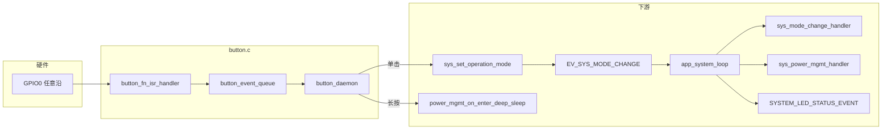
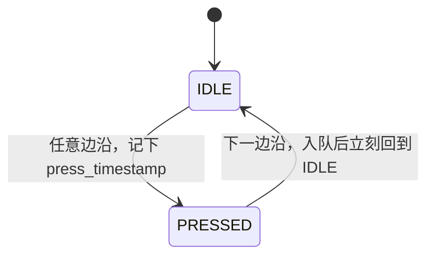
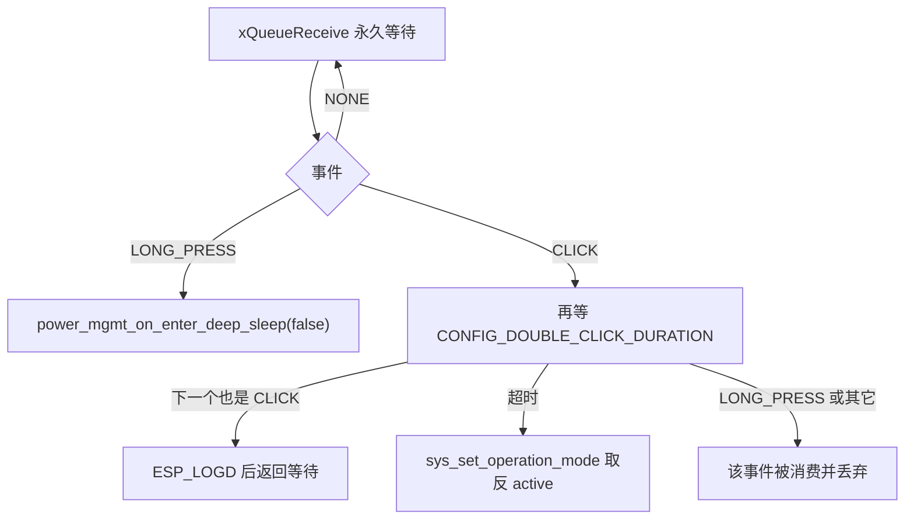

# 板上按钮（Button）

板上按钮是没有主机命令时的本地手势入口。固件把 `CONFIG_BUTTON_FN_GPIO_PIN` 上的边沿收成单击、双击和长按：单击翻转 `g_mcu.state.active`，长按进入不带定时唤醒的 deep sleep，再由同一颗按钮唤醒。双击只打日志。代码里没有软件消抖，也没有配网或恢复出厂手势。

## 职责

- 在一次上电中初始化一次功能键，并用 ISR 把相邻两沿配成 `CLICK` 或 `LONG_PRESS`。
- 在 `button_daemon` 里把孤立的 `CLICK` 变成运行/待机切换，把直接到来的 `LONG_PRESS` 变成 deep sleep。
- 用第二下 `CLICK` 的等待窗口认出双击，但双击不调用任何 sys 或 power 函数。
- 不维护灯态机、不读写 NVS、不改 `POWER_MODE_*`。灯、IMU 复用和无线电源状态都是模式位或 deep sleep 函数的下游。

## 在系统中的位置

初始化不在 `app_main` 里直接调用。`main/app_main.c` 的 `init` 进入 [电源管理](power-management.md) 的 `power_mgmt_on_enter_standby` 之后，才由该函数调用 `sys_init_buttons`。随后 [启动与任务](boot-and-tasks.md) 才 `sys_start_tasks`，因此按钮任务可以早于 `app_system_loop` 跑起来。

单击与 [API](api.md) 的 `operation_mode_handler`、[IMU 流](imu-streaming.md) 发送失败时的 `app_data_client` 共用 `sys_set_operation_mode`。按钮不拥有 `g_mcu.state.active` 这一位，见 [全局状态](global-state.md)。长按与省电超时走同一个 deep sleep 入口，但按钮传入的 `wakeup` 实参是 `false`。

## 设计

### 数据与状态

ISR 内部状态只有三值，其中 `RELEASED` 不是稳定态：同一次中断里写入 `RELEASED`、入队之后立刻写回 `IDLE`。任务能观察到的只有队列元素。

| 符号 | 取值 | 含义 |
| --- | --- | --- |
| `button_state_t` | `IDLE` | 等待被当作「按下」的第一沿 |
| `button_state_t` | `PRESSED` | 已记下 `press_timestamp`，等待被当作「松开」的第二沿 |
| `button_state_t` | `RELEASED` | 仅在同一次 ISR 内瞬态存在，返回前回到 `IDLE` |
| `button_event_t` | `NONE` | 任务有分支，ISR 从不入队 |
| `button_event_t` | `CLICK` | 两沿 tick 差小于或等于长按阈值 |
| `button_event_t` | `LONG_PRESS` | 两沿 tick 差严格大于长按阈值 |

时间戳是 ISR 里 `xTaskGetTickCount()` 的返回值，存进 `uint32_t`。比较的是无符号 tick 差，不是壁钟。差小于 2^32 tick 时绕回仍能得到间隔；代码没有另做绕回处理。

队列 `button_event_queue` 深 10，元素是 `button_event_t`。`button_initialized` 在 `power_peripheral_state_t` 里，只表示「本轮上电已经调用过 `sys_init_buttons`」。它在 `power_mgmt_init` 清 `peripheral_state` 时被清掉；deep sleep 会重启，BSS 与这块 RAM 一起重新开始。

`g_mcu.state.active` 是另一根轴，和 `g_power_mgmt_ctx.state`（`POWER_STANDBY` / `POWER_ACTIVE` / `POWER_DEEP_SLEEP` 等）、`g_power_mgmt_ctx.mode`（`POWER_MODE_PERFORMANCE` / `POWER_MODE_NORMAL` / `POWER_MODE_LOW_ENERGY`）都不是同一个字段。按钮只翻转 `active`，或把 state 直接推进 deep sleep，不改 `mode`。

### 行为与时序

引脚配置在 `sys_init_buttons`：输入、内部上拉、不下拉、`GPIO_INTR_ANYEDGE`、ISR 服务 `ESP_INTR_FLAG_LEVEL1`。`CONFIG_BUTTON_FN_ACTIVE_LEVEL` 不参与手势。ISR 不读 `gpio_get_level`，第一沿一律当按下，第二沿一律当松开。因此「按下」并不保证是下降沿。

判定窗口：

| 窗口 | 宏 | 定义 | 实际比较 |
| --- | --- | --- | --- |
| 长按 | `CONFIG_LONG_PRESS_DURATION` | `(1000 / portTICK_PERIOD_MS)` 个 tick | `release_timestamp - press_timestamp >` 该值才是 `LONG_PRESS`，等于阈值仍是 `CLICK` |
| 双击 | `CONFIG_DOUBLE_CLICK_DURATION` | `(500 / portTICK_PERIOD_MS)` 个 tick | `button_daemon` 取出一个 `CLICK` 之后，`xQueueReceive` 再等这么多 tick |

`portTICK_PERIOD_MS` 能整除 1000 和 500 时，这两个窗口就是 1000 ms 和 500 ms。变体 sdkconfig 没有写 `CONFIG_FREERTOS_HZ`，共享的 `sdkconfig.defaults` 当前工作区不存在，tick 频率代码未体现。没有最小按下时间：同一 tick 内的两沿也是 `CLICK`。

消抖代码未体现。没有消抖定时器、最小脉宽或电平确认。旧草稿里「用按下时长做防抖」与实现不符；时长只用来区分 `CLICK` 和 `LONG_PRESS`。抖动产生的额外边沿会变成额外手势，或把长按的起点重置到最后一次被当成按下的沿。

`button_daemon` 先 `ulTaskNotifyTake`，在 `xTaskNotifyGive` 之前不读队列；这段时间里的事件留在队列中。之后的分发是：

| 手势 | 系统动作 |
| --- | --- |
| 单击 | `sys_set_operation_mode(!g_mcu.state.active)`。不直接改灯，不写 NVS，不调用 `reset_power_save_timer` |
| 双击 | 无。文件头注释写 calibrate，函数体是 `//TODO: make use of this function`。不调 IMU 校准、不改模式、不睡眠 |
| 长按 | `power_mgmt_on_enter_deep_sleep(false)`。不置任何事件位 |
| 单击等待期间到来的 `LONG_PRESS` | 被这次 `xQueueReceive` 取走后丢弃，既不切换也不睡眠 |
| 三击 | 前两下合成一次空双击；第三下重新开单击窗口。窗口内没有第四下时，第三下会翻转 `active` |

双击窗口的起点是任务取出第一件 `CLICK` 的时刻，不是第一下按下沿，也不是两下按下沿的间隔。事件在第二沿（被当作松开的那一沿）才入队，所以第二下必须在窗口内完成松开。第二下松得太晚时，第一下已经按单击翻转了模式，随后这一下再按自身时长变成新的单击或长按。`LONG_PRESS` 作为第一件事件时不打开双击窗口。

单击的下游由 [事件](events.md) 接上。`sys_set_operation_mode` 写入 `g_mcu.state.active` 并 `set_sys_event(EV_SYS_MODE_CHANGE)`，始终返回 `ESP_OK`。`app_system_loop` 用 `xEventGroupWaitBits(..., pdTRUE, ...)` 清掉 `EV_SYS_MODE_CHANGE_BIT`，再 `esp_event_post_to` 一个 `SYSTEM_MODE_CHANGE_EVENT`。该事件上按注册顺序有两个处理函数：

1. `sys_mode_change_handler`：`active` 为真则 `g_imu.p_imu->mux = IMU_MUX_STREAM`，否则 `IMU_MUX_IDLE`。见 [IMU](imu.md)。`app_monitor` 要 `enabled` 且 mux 为 `IMU_MUX_STREAM` 才采集。
2. `sys_power_mgmt_handler`：`active` 为真则 `power_mgmt_on_enter_active` 且 `no_sleep = true`；为假则 `power_mgmt_on_enter_standby` 且 `no_sleep = false`。

`power_mgmt_on_enter_active` 把 Wi-Fi 最大发射功率设为 `CONFIG_MAX_TX_POWER`，状态改为 `POWER_ACTIVE`。仅当 `ble_enabled` 已经为真时才 `blehr_stop_srv` 并把 Wi-Fi 省电设为 `WIFI_PS_NONE`。它不 disarm power save timer。之后周期 `SYSTEM_POWER_MGMT_EVENT` 看到 `POWER_ACTIVE` 会 `reset_power_save_timer`。

`power_mgmt_on_enter_standby` 在标志未置位时补齐按钮、LED、IMU、Wi-Fi 和 REST。发射功率调用的是 `esp_wifi_set_max_tx_power(CONFIG_NORMAL_TX_POWER)`；同函数的日志打印 `CONFIG_MAX_TX_POWER`，与实参不一致。`mode != POWER_MODE_LOW_ENERGY` 且 BLE 未开时会 `blehr_start_srv`，这是回到待机的副作用，不是单独的配网手势。`mode != POWER_MODE_PERFORMANCE` 时 `arm_power_save_timer`，否则 disarm。状态改为 `POWER_STANDBY`。

因此单击在「运行 / 待机」之间切换的是 `active` 以及上面这组副作用：采集 mux、BLE 与 Wi-Fi 省电、发射功率、`no_sleep`、电源状态。UDP 是否发送还要 `active && ntp_synced && discovery_completed`，按钮不检查这两项。`active` 只活在 RAM 里，deep sleep 或重启后回到假。RTC 里的 `g_power_mgmt_ctx.mode` 会留下，但不是按钮改的。

同一次 `app_system_loop` 醒来还会在 `led_manual` 为假、且 `EV_TASK_LED_STATUS` 未置位时投递 `SYSTEM_LED_STATUS_EVENT`。单击自身不设置灯枚举。`get_target_led_status` 里，`active` 只在 Wi-Fi 已连接、NTP 已同步且 discovery 已完成时区分灯态：真为 `LED_ON`，假为 `LED_SLOW_BREATH`。Wi-Fi 未连接仍是 `LED_FAST_FLASH`，已连接但 NTP 或 discovery 未完成仍是 `LED_FAST_BREATH`。详见 [LED](led.md)。代码不会因为 `active` 切到 `LED_SEQ_ENC`。

长按在 `button_daemon` 上下文同步进入 `power_mgmt_on_enter_deep_sleep(false)`，函数标记为 `_Noreturn`，正常路径不返回。顺序是：`g_imu.toggle(..., false)`，`g_mcu.state.led_manual = true`，延迟 100 ms；若 `led_initialized`，则 `blink_led_on`、再延迟 2000 ms、`blink_led_off`。然后按 `#ifdef CONFIG_IMU_EN_PIN` 保持该脚，并总是 `gpio_hold_en(CONFIG_BLINK_PIN)`。`wakeup == false` 时不调用 `esp_sleep_enable_timer_wakeup`，日志是进入永久睡眠，意思是没有定时再醒，不是禁止按钮唤醒。接着才打开按钮唤醒，把 `g_power_mgmt_ctx.state` 设为 `POWER_DEEP_SLEEP`，`esp_deep_sleep_start`。`led_manual` 用来挡住 system loop 的自动灯态；这 2 秒常亮不经过 `led_status_enum`。LED 尚未初始化则跳过常亮，100 ms 延迟仍然执行。

唤醒在 `power_mgmt_wake_up_handler`：原因是 `ESP_SLEEP_WAKEUP_EXT0` 或 `ESP_SLEEP_WAKEUP_GPIO` 时打 `"wakeup from button"` 并返回 `POWER_NORMAL_BOOT`。`app_main` 只在返回值是 `POWER_DEEP_SLEEP` 时再次睡下，所以按钮唤醒会继续落到 `power_mgmt_on_enter_standby`，`active` 仍是重启后的假。其它原因返回 `POWER_DEEP_SLEEP`，`app_main` 用 `power_mgmt_on_enter_deep_sleep(true)` 按 `CONFIG_POWER_WAKE_UP_DURATION_S` 再睡。那条路径不是按钮手势。

配网、恢复出厂、NVS 擦除代码未体现。没有任何手势调用 `nvs_flash_erase` 或 Wi-Fi 配网入口。

### 并发

`button_fn_isr_handler` 是 `IRAM_ATTR`。`button_state` 与两个时间戳只在 ISR 里读写，没有 `volatile`，也没有与任务共享的临界区。任务只消费队列。

`xQueueSendFromISR` 的第三个参数是 `NULL`，ISR 不请求切换到更高优先级任务。返回值被忽略：队列满则该次手势丢掉，没有合并、覆盖或重试。这是唯一的丢事件策略。

`button_daemon` 由 `xTaskCreate` 创建，名字 `"button_daemon"`，栈参数 2048，优先级 10，不绑核。它不在 `g_mcu.tasks` 里。`sys_stop_tasks` 只删 system loop、monitor、data client 和可选的 trace，不删按钮任务。因此 [电源管理](power-management.md) 的省电任务停掉 system loop 之后，单击仍会立刻改 `active` 并置 `EV_SYS_MODE_CHANGE`，但 mux、电源处理和灯事件要等 system loop 再次存在才会发生；长按仍会直接 deep sleep。`app_power_save` 的 light sleep 只打开了定时唤醒，代码未把按钮配成 light sleep 唤醒源，睡眠期间的边沿也没有补记。

`active` 的读改没有锁。`button_daemon` 与 REST 的 `operation_mode_handler` 都能写它。事件位只有一位：loop 清位之前的多次单击会依次翻转布尔值，处理函数只看见最后的 `active`。

`sys_power_mgmt_handler` 用自己的 mutex 串行电源处理；按钮长按不拿这把锁，也不投递 `EV_SYS_POWER_MGMT`。

### 配置

按钮窗口不是 Kconfig，也不是菜单里的 sdkconfig 符号。它们是 `include/settings.h` 里的 C 宏，名字带 `CONFIG_` 前缀。引脚宏在 `include/modelspec.h`，由 `settings.h` 末尾包含进来。`button.c` 只包含 `settings.h`。

| 宏 | 位置 | 按钮路径怎么用 |
| --- | --- | --- |
| `CONFIG_LONG_PRESS_DURATION` | `include/settings.h` | ISR 内长短分类 |
| `CONFIG_DOUBLE_CLICK_DURATION` | `include/settings.h` | 任务内第二事件超时 |
| `CONFIG_BUTTON_FN_GPIO_PIN` | `include/modelspec.h`，`GPIO_NUM_0` | 输入、中断、深睡唤醒 |
| `CONFIG_BUTTON_FN_ACTIVE_LEVEL` | `include/modelspec.h`，`0` | 只传给深睡唤醒电平 |
| `CONFIG_POWER_WAKE_UP_DURATION_S` | `include/settings.h` | 按钮长按不使用；定时再醒才乘进 `esp_sleep_enable_timer_wakeup` |
| `CONFIG_MAX_TX_POWER` / `CONFIG_NORMAL_TX_POWER` | `include/settings.h` | 单击进出 active 时的发射功率，不是手势阈值 |

没有按钮相关的 NVS 键。

### v1 / v2 / v3 差异

手势状态机、队列、任务和 GPIO 配置没有 `CONFIG_IDF_TARGET_*` 或 `CONFIG_IMU_SENSOR_*` 守卫，三个变体同一份 `button.c`。`CONFIG_BUTTON_FN_GPIO_PIN` 和 `CONFIG_BUTTON_FN_ACTIVE_LEVEL` 写在 `modelspec.h` 的 target 分支之外：v1（`CONFIG_IDF_TARGET_ESP32`）、v2（`CONFIG_IDF_TARGET_ESP32S3`）、v3（`CONFIG_IDF_TARGET_ESP32C5`）都是 GPIO0、低有效。

深睡唤醒的打开方式按芯片分：

| 守卫 | 调用 |
| --- | --- |
| `CONFIG_IDF_TARGET_ESP32` 或 `CONFIG_IDF_TARGET_ESP32S3` | `esp_sleep_enable_ext0_wakeup(CONFIG_BUTTON_FN_GPIO_PIN, CONFIG_BUTTON_FN_ACTIVE_LEVEL)` |
| `CONFIG_IDF_TARGET_ESP32C5` | `esp_deep_sleep_enable_gpio_wakeup(BIT64(CONFIG_BUTTON_FN_GPIO_PIN), ...)`。`CONFIG_BUTTON_FN_ACTIVE_LEVEL` 为 0 时电平参数是 `ESP_GPIO_WAKEUP_GPIO_LOW` |

唤醒原因的判断没有 target 守卫，EXT0 与 GPIO 都算按钮。上述两个分支之外的 target，这段代码未启用按钮唤醒。

长按路径里 `#ifdef CONFIG_IMU_EN_PIN` 才会保持 IMU 使能脚。该宏出现在 HI229 的 v1/v2 引脚段；BNO08X 的 v2/v3 段定义的是 `CONFIG_IMU_WAKE_PIN` 等，不定义 `CONFIG_IMU_EN_PIN`。`CONFIG_BLINK_PIN` 的 hold 无此守卫。

`CONFIG_IMU_SENSOR_BNO08X` 的驱动也会 `gpio_install_isr_service(ESP_INTR_FLAG_LEVEL1)`（`lib/bno08x/bno08x_driver.c`）。当前待机顺序是先按钮、后 `imu_interface_init`，所以先装的是按钮。HI229 路径代码未再装 GPIO ISR 服务。传感器种类不改变单击、双击、长按的判定。

## 接口

对其他子系统只暴露 `sys_init_buttons`（声明在 `components/sys/sys.h`）。没有注册回调，也没有单独的按钮事件位。

| 方向 | 符号 | 关系 |
| --- | --- | --- |
| 调用方 | `power_mgmt_on_enter_standby` | `button_initialized` 为假时调用一次，然后把标志置真 |
| 单击发出 | `EV_SYS_MODE_CHANGE` / `EV_SYS_MODE_CHANGE_BIT`（`BIT8`） | 经 `sys_set_operation_mode` → `set_sys_event` |
| 单击不发出 | `EV_SYS_LED_STATUS_CHANGED`、`EV_SYS_POWER_MGMT`、Wi-Fi / NTP / discovery / OTA 各位 | 灯事件是 system loop 醒来后的附带投递 |
| 消费 | `SYSTEM_MODE_CHANGE_EVENT` | `sys_mode_change_handler` 与 `sys_power_mgmt_handler` |
| 长按调用 | `power_mgmt_on_enter_deep_sleep(false)` | 不经过事件环 |
| 唤醒消费 | `ESP_SLEEP_WAKEUP_EXT0`、`ESP_SLEEP_WAKEUP_GPIO` | `power_mgmt_wake_up_handler` |
| 共享写入 | `g_mcu.state.active` | REST `action=start/stop`、OTA 前的强制停、UDP 发送失败也会写 |
| NVS | 无 | 不读不写 [NVS](nvs.md) 中的任何键 |

`sys_init_buttons` 的任务句柄是函数局部变量，返回后系统没有保存，也没有停止或重新配置按钮的接口。

## 失败与边界

- `xQueueCreate`、`xTaskCreate`、`gpio_install_isr_service`、`gpio_config`、`gpio_isr_handler_add`、`xQueueSendFromISR` 的结果都不检查。队列或任务创建失败后，`button_initialized` 仍会被置真，同一次上电不会重试。
- 队列满时手势静默丢弃。没有计数，失败只可能出现在 `ESP_LOGD` 的 `"button clicked"` / `"button double clicked"` / `"button long pressed"`，而且只有真正处理到的手势才打。
- 单击等待若收到非 `CLICK`，该事件被吃掉。窗口内的长按不会睡觉。
- 从按钮唤醒时引脚已经处于有效电平。ISR 安装后的第一沿（通常是松手的上升沿）在 `IDLE` 下会被记成按下且不入队；再下一沿才入队。随后第一次真实按下可能被当成松开，并按「上次松手到这次按下」的 tick 差变成单击或长按。若这次被误判为长按，睡眠发生在按下过程中，而唤醒电平又是低，存在立刻再醒的可能。代码未在安装 ISR 时采样当前电平来对齐状态。
- 待机初始化顺序是按钮、LED、IMU，然后才是 BLE 和 Wi-Fi。`button_daemon` 优先级高于 `app_main`，GPIO 通知之后就可以抢占。长按若发生在 `imu_interface_init` 之前，`g_imu` 仍是零初始化，`g_imu.toggle` 为空指针。LED 尚未初始化时，深睡前的 2 秒常亮被跳过。
- `sys_mode_change_handler` 不检查 `g_imu.p_imu`。正常启动时 system loop 创建于待机返回之后，第一次单击的事件位会等到 IMU 装完才处理；长按不等这条时序。
- 单击切到 active 时，`power_mgmt_on_enter_active` 不取消已经在跑的 power save timer。取消或重置要等后续周期事件、或回到 standby 时的 arm/disarm。定时器若在这之前到期，按钮路径没有同步挡住。
- 省电 light sleep 期间按钮沿会丢。CPU 醒着读 IMU 的间隙里，单击和长按仍然有效，但单击的下游事件环当时可能已被 `sys_stop_tasks` 删掉。
- deep sleep 准备跑在栈参数 2048 的按钮任务里，里面有日志、IMU toggle 和两次 `vTaskDelay`。代码未体现栈高水位检查。
- `gpio_install_isr_service` 重复调用时 ESP-IDF 返回 `ESP_ERR_INVALID_STATE`。按钮与 BNO08X 驱动都忽略该返回值。今天按钮先装；若顺序反过来，按钮这次安装失败后仍继续 `gpio_isr_handler_add`，代码未根据安装结果中止。
- 双击、配网、恢复出厂、IMU 校准：后三项代码未体现；双击有识别、无动作。

## 设计取舍

ISR 只做两沿配对和长短分类，双击等待放在任务里，避免在中断中阻塞；代价是窗口起点随任务取出第一件 `CLICK` 的时刻漂移，并且窗口内的非 `CLICK` 会被误消费。长按不投递 `EV_SYS_POWER_MGMT`，直接在按钮任务里睡下去，因此不和 system loop 的模式处理交叉，也没有失败返回。`521da2c`（EVERY THING HAS CHANGED）引入这套手势时，双击校准已经是 TODO；`3fa3a0d`（Fix bno08x power mgmt）只改写了这句 TODO。没有软件消抖，以及长按为何不走事件位，历史未说明。

## 源文件

- `components/sys/button.c`
- `components/sys/sys.h`
- `components/sys/sys.c`
- `components/sys/power_mgmt.c`
- `components/sys/led_status.c`
- `components/apps/system_loop.c`
- `components/apps/monitor.c`
- `components/apps/network.c`
- `components/rest_controller/rest_controller_handlers.c`
- `include/settings.h`
- `include/modelspec.h`
- `main/app_main.c`
- `lib/bno08x/bno08x_driver.c`
