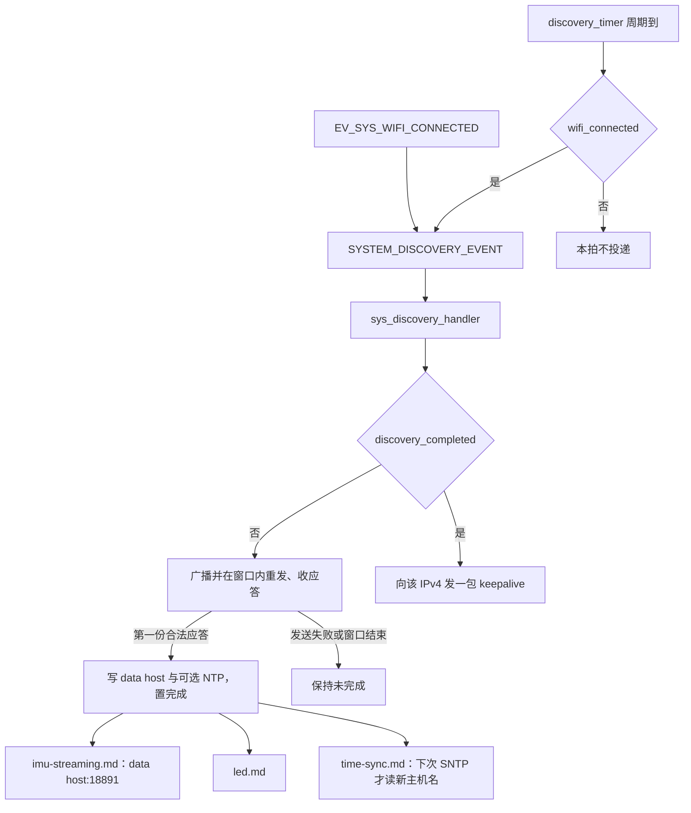
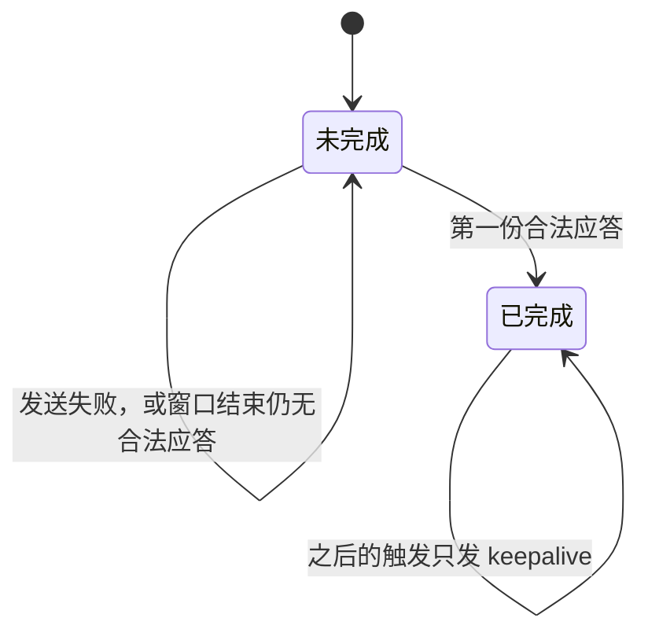

# 设备发现（Discovery）

标记点关联 AP 之后，要知道 IMU 的 UDP 该发给哪一台接口机，并可以顺带换掉 RAM 里的 NTP 主机名。本子系统在 UDP `18889` 上主动广播带 device id 的请求，用第一份合法应答的源 IPv4 覆盖 data host，然后改向该地址发 keepalive。它不关联 Wi-Fi，也不调用 SNTP。`discovery_completed` 是推流和自动 LED 的门闩之一，但本次上电一旦置真就不会再清掉。

## 职责

- 在 Wi-Fi 已标记为连接后，立即以及之后按周期投递发现；未完成时在一个时间窗里反复广播并等待应答。
- 用本机 device id 标识自己。身份不包含 BLE 名、hostname 或本机 IPv4。
- 接受第一份魔数与设备类型都合法的应答：data host 取应答的源 IPv4，NTP 主机名仅在载荷非空时覆盖 RAM。
- 完成后把发现 socket 的目的地址改成该 IPv4，以后每次触发只发一包 keepalive，不再接收。
- 置 `discovery_completed` 与 `EV_SYS_DISCOVERY_COMPLETED`。不写 NVS，不修改 `ota_url`，不启动对时。

## 在系统中的位置

device id 在 [boot-and-tasks.md](boot-and-tasks.md) 的 `sys_init_chip()` 里从 eFuse MAC 生成，早于 NVS 和任务。`app_system_loop()` 创建 `discovery_timer`，把 `SYSTEM_DISCOVERY_EVENT` 注册到 `sys_discovery_handler`。字段放在 [global-state.md](global-state.md) 的 `g_mcu`；事件位见 [events.md](events.md)。

上游是 [wifi.md](wifi.md)：定时器只看 `g_mcu.state.wifi_connected`，首次立即发现来自 `EV_SYS_WIFI_CONNECTED`。同一次连接事件会先投递 `SYSTEM_TIME_SYNC_EVENT`，再投递发现，两者进同一个队列。[time-sync.md](time-sync.md) 不阻塞发现的判定，发现也不读 `ntp_synced`。启动时的 `DATA_HOST` / `NTP_HOST` 来自 [nvs.md](nvs.md)，发现只覆盖 RAM。

下游：[imu-streaming.md](imu-streaming.md) 的 `app_data_client` 在 `discovery_completed` 为真之后，才把 `g_mcu.data_host_ip_addr` 当作 `CONFIG_DATA_HOST_PORT`（18891）的目的地址。[led.md](led.md) 在 Wi-Fi 已连接但 NTP 或发现未完成时保持快呼吸。发现下发的 NTP 主机名要等下一次 [time-sync.md](time-sync.md) 才被 `esp_sntp_setservername` 使用。[button.md](button.md) 只切换 `active`，不参与发现；推流还要 `active` 为真。[ota.md](ota.md) 使用的 `g_mcu.ota_url` 不来自发现应答。[api.md](api.md) 没有发现状态的 REST 字段；`POST /v1/nvs/variable/DATA_HOST` 只写 NVS。[power-management.md](power-management.md) 会停掉发现定时器并拆掉 Wi-Fi。实现没有按芯片分叉，引脚见 [hardware.md](hardware.md)。

## 设计

### 数据与状态

`g_mcu` 在 `sys.c` 里零初始化。`discovery_completed` 启动为假，只有 `sys_discovery_handler` 会把它写成真，没有任何路径写回假。`last_discovery_unix_usec` 在每次进入处理函数时用 `gettimeofday` 更新（宏 `get_time_usec`），包括 keepalive 和失败的尝试。代码未体现读者。对时之前这个 Unix 时间不是 UTC。

跨重启的 data host 初值是 NVS 键 `DATA_HOST`，缺省字面量 `CONFIG_DATA_HOST_IP_ADDR`（`255.255.255.255`）。发现成功前 `app_data_client` 不会用它建 socket。成功时 `strncpy` 进 `g_mcu.data_host_ip_addr` 的是 `client.reply_addr.sin_addr` 的点分十进制，不是载荷里的字段，也不写回 NVS。推流端口仍是 `18891`，不是应答的源端口。

NTP 初值是 NVS `NTP_HOST`，默认可为空串。应答里 `ntp_host` 的 `strlen` 大于 0 才 `strncpy` 到 `g_mcu.ntp_host_ip_addr`（缓冲 64 字节，最多拷 63 字节）。空串表示保留原来的主服务器。不调用 `sys_set_nvs_var`，也不投递 `SYSTEM_TIME_SYNC_EVENT`。

`ota_host` 会随结构体被拷进来并打日志。代码不写入 `g_mcu.ota_url`，也不读、不写 NVS 键 `OTA_HOST`。源文件头注释说应答是为了取得 OTA host，与赋值不符。

发现报文的静态缓冲在第一次进入处理函数时，把 `g_mcu.device_id` 的 12 字节拷到偏移 7，之后不再更新。`sys_init_chip()` 在 `sys_start_tasks()` 之前已经用 `esp_efuse_mac_get_default()` 写成 12 位小写十六进制。UDP 里是这 12 个 ASCII 字节，不是 6 字节二进制 MAC，也不是 `markit_` 前缀。`_device_id_sep_` 只给日志里的 `%s` 截断，不进报文。

线格式是固定偏移，不是 TLV。请求发出 `sizeof(discovery_msg_buffer) - 1` 字节，即 19 字节。设备类型字节写死在字面量里，运行时只改应答控制字节。

| 偏移 | 长度 | 请求字段 | 取值 |
| --- | --- | --- | --- |
| 0 | 5 | magic | `0xE5` 重复 5 次（`CONFIG_MAGIC_MARKER_ADDR`） |
| 5 | 1 | device type | 固定 `0x01`（`CONFIG_DEVICE_TYPE_MARKER`） |
| 6 | 1 | reply | 未完成时 `0x01`，keepalive 时 `0x00` |
| 7 | 12 | device id | `g_mcu.device_id` |

应答至少 71 字节：5 + 1 + 1 + `sizeof(MarkerDiscoveryReplyPacket)`（64）。更长的尾部被忽略；`recv` 缓冲只有 128 字节，实际最多取 127 字节。短包直接失败，没有单独日志。

| 偏移 | 长度 | 应答字段 | 处理 |
| --- | --- | --- | --- |
| 0 | 5 | magic | 必须全是 `0xE5`，否则警告并 `ESP_FAIL` |
| 5 | 1 | device type | 必须是 `0x00`（`CONFIG_DEVICE_TYPE_INTERFACE`）。`0x01` / `0x02`（`CONFIG_DEVICE_TYPE_PC`）都拒绝 |
| 6 | 1 | reply | 读出代码被注释掉，不参与判断 |
| 7 | 32 | `ntp_host` | 当作 C 字符串；非空才覆盖 RAM |
| 39 | 32 | `ota_host` | 只出现在日志里 |

文件头注释把类型字节说成「marker 请求为 `0x01`、controller 应答为 `0x00`」。解码常量的名字是 interface，不是 controller。注释里的示例把未完成请求的 reply 画成 `0x01`，与未完成分支一致；keepalive 会改成 `0x00`。

`未完成` / `已完成` 就是 `g_mcu.state.discovery_completed`。没有「发现进行中」这个跨调用状态。socket、互斥量和报文缓冲都是 `discovery.c` 的静态量，存活到重启；deep sleep 会重启芯片，这些量回到初值。

### 行为与时序

`app_system_loop()` 用 `xTimerCreate` 建立自动重载定时器，周期 `CONFIG_DISCOVERY_INTERVAL_S * 1000` 毫秒（15 秒），并立刻 `xTimerStart`。FreeRTOS 定时器不会在 start 时补发，第一次回调仍在 15 秒后。回调里若 `wifi_connected` 为真，就 `esp_event_post_to(..., SYSTEM_DISCOVERY_EVENT, ...)`，超时 `portMAX_DELAY`。它不读、也不置 `EV_TASK_DISCOVERY`。

另一条入口在同一次 loop 里：`xEventGroupWaitBits` 看到 `EV_SYS_WIFI_CONNECTED_BIT` 时，先投递对时，再投递发现。该位由 `sys_wifi_try_connect()` 在连上之后设置。因此第一次成功关联不必等满 15 秒。处理函数本身不再检查 Wi-Fi 或 NTP；已经进队列的事件，即使后来 `wifi_connected` 变假，仍会跑。

事件循环参数：队列深度 16，任务名 `system_event_loop_task`，优先级等于创建时 `app_system_loop` 的优先级，栈 4096，`tskNO_AFFINITY`。发现、对时、LED、Wi-Fi 重连、模式、电源的处理函数都在这个任务上串行执行。

处理函数第一次调用时创建 `sync_mutex`，并填好 device id。然后无期限取锁。尚未 `client.initialized` 时 `udp_socket_init`：本地 `INADDR_ANY:18889`，目的 `255.255.255.255:18889`。目的是全局广播时 `udp.c` 会 `SO_BROADCAST`。接着 `udp_socket_set_timeout(CONFIG_DISCOVERY_REPLY_TIMEOUT_S)`，只设 `SO_RCVTIMEO`（3 秒，微秒为 0），没有 `SO_SNDTIMEO`。这两次调用的返回值都被忽略；`udp_socket_init` 在 `setsockopt` 广播失败时仍返回 `ESP_OK`。

未完成分支把 reply 设为 `0x01`，用 `esp_timer_get_time()` 做窗口，上限是 `CONFIG_DISCOVERY_INTERVAL_S` 秒。窗口用的是单调时钟，不受 SNTP 阶跃影响。条件只在每一轮开始时检查。一轮是一次 `sendto` 加一次 `recvfrom`：

- 发送失败：打 errno，`goto exit`。本窗口剩余的重试放弃，`discovery_completed` 不变。`udp_socket_send` 把任何 `sendto` 失败都返回成 `ESP_ERR_NO_MEM`，处理函数不看这个码，只看是不是 `ESP_OK`。
- 接收失败：`continue`。超时和其它错误都是 `udp_socket_recv` 的 `ESP_FAIL`，处理函数不读 `errno`。`udp.c` 对超时同样打 `ESP_LOGE`。
- 解码失败：不 `break`，进入下一轮。魔数或类型不对会有警告。
- 解码成功：记下应答源地址，按上面的规则写 data host 和 NTP，置 `discovery_completed`，`set_sys_event(EV_SYS_DISCOVERY_COMPLETED)`，再把发现 socket 的目的改成该 IPv4 的 `18889` 端口（不用应答的源端口），然后 `break`。

窗口走完仍没有成功解码，打 “discovery failed, no reply received”。因为接收最多堵住 3 秒，而判断在 `recv` 之前，一次搜索可以长到大约一个周期再加一次应答超时。正常无应答时大约每 3 秒一发，次数不固定。

完成后的分支把 reply 设为 `0x00`，只发送一包，不再 `recv`。目的地址保持上次 `udp_socket_set_destination` 的结果。发送失败只打日志，不清除完成标志，也不改回广播。

`exit` 在持锁路径上总会交还互斥量并 `clear_task_event(EV_TASK_DISCOVERY)`。没有任何代码 `set_task_event(EV_TASK_DISCOVERY)`。处理函数头注释说它在该位置位时被调用，实际注册的是 `SYSTEM_DISCOVERY_EVENT`。这个任务位清了也没有等待者。对比 [time-sync.md](time-sync.md)：对时定时器会先置 `EV_TASK_TIME_SYNC` 再投递，发现没有这道闸。因此搜索尚在进行时，定时器或新的连接事件可以再投递一份；前一份返回后，队列里的下一份立刻再跑一整段。周期不是两次尝试之间的最小间隔。若前一份已经成功，紧跟着的一份变成多出来的 keepalive。

`EV_SYS_DISCOVERY_COMPLETED` 展开为 `EV_SYS_DISCOVERY_COMPLETED_BIT`（`BIT5`）。`app_system_loop()` 用掩码 `0x00FFFFFF` 等待并在返回时清掉所有已置位，其中没有针对 `BIT5` 的分支。叫醒之后若 `led_manual` 为假且 `EV_TASK_LED_STATUS` 未置位，会投递 `SYSTEM_LED_STATUS_EVENT`。灯色读的是布尔量。`app_data_client` 同样只读布尔量：外层要 `active && ntp_synced && discovery_completed`，然后用当时的 `data_host_ip_addr` 建数据 socket，本地端口 0。建好之后不再读这个字符串。发现在置位布尔量之前已经 `strncpy` 完，所以同一次成功路径上，推流看到的是应答源地址，不是 NVS 里的广播地址。

同一次 `EV_SYS_WIFI_CONNECTED` 把对时排在发现前面。第一次 SNTP 用的是当时的 NVS 主机名或网关；发现若随后改了 `ntp_host_ip_addr`，要等下一次对时触发（连接事件或 `time_sync_timer`）才会生效。发现可以在 `ntp_synced` 仍为假时完成。推流要两个布尔量都为真，自动 LED 在任何一个为假时保持快呼吸。

### 并发

发现处理独占 `system_event_loop_task` 直到本次发送失败、收到合法应答或窗口结束。这段时间里，排在同一队列上的对时、LED、重连、模式和电源处理都不会开始。`app_system_loop` 是另一个任务，仍可以在 `xEventGroupWaitBits` 上醒来并 `esp_event_post_to`；`EV_SYS_OTA_TRIGGERED` 分支还会在那个任务里直接调用 `sys_ota_perform()`。投递使用 `portMAX_DELAY`，队列满时定时器服务任务或 `app_system_loop` 会堵住。代码未把发现任务加入 task WDT。

`sync_mutex` 只被这个处理函数使用，`portMAX_DELAY` 包住整段 socket 操作。同一条事件循环不会重入，所以这把锁挡不住队列里的下一份事件；它能串行化的是第二条调用路径。power save 之后若旧的事件循环任务还停在处理函数里，新建的 loop 会和它抢同一只静态 socket，锁能排队，不能把旧任务停掉。

`data_host_ip_addr`、`ntp_host_ip_addr` 和 `discovery_completed` 没有与读者共享的互斥。`inet_ntoa` 使用进程内静态缓冲；处理函数里对它的几次调用是顺序的。代码未体现其它任务同时调用 `inet_ntoa` 时的保护。`SO_BROADCAST` 在切到单播后保持打开，代码未再设置一次。

### 配置

下面的 `CONFIG_DISCOVERY_*` 是 `include/settings.h` 和 `discovery.c` 里的宏，不是 Kconfig，也不在任何 `sdkconfig.defaults.*` 里。

| 符号 | 值 | 作用 |
| --- | --- | --- |
| `CONFIG_DISCOVERY_PORT` | 18889 | 本地 bind、发现目的端口、keepalive 目的端口 |
| `CONFIG_DISCOVERY_INTERVAL_S` | 15 | 定时器周期，也是单次搜索窗口 |
| `CONFIG_DISCOVERY_REPLY_TIMEOUT_S` | 3 | `SO_RCVTIMEO` 的秒数 |
| `CONFIG_DISCOVERY_BROADCAST_ADDR` | `255.255.255.255` | 未完成时的目的地址。旁边有改组播的 TODO，代码未加入组 |
| `CONFIG_DATA_HOST_PORT` | 18891 | 发现不发送 IMU。推流在发现完成后使用 |
| `CONFIG_DATA_HOST_IP_ADDR` | `255.255.255.255` | 仅 NVS 缺省。成功发现后 RAM 被应答源地址替换 |
| `CONFIG_DEVICE_ID_LEN` | 12 | 报文中的 device id 长度 |

`xTimerStart` 失败时没有 “discovery timer started” 日志，此后只剩 `EV_SYS_WIFI_CONNECTED` 这条立即触发。代码未重试建定时器。

### v1/v2/v3 差异

`discovery.c` 没有 `CONFIG_IDF_TARGET_*` 或 `CONFIG_IMU_SENSOR_*`。ESP32 + HI229、ESP32-S3 + BNO08X、ESP32-C5 + BNO08X 走同一条发现路径，也不读 IMU。`include/settings.h` 里 `CONFIG_EN_MULTI_CORE` 只在 `CONFIG_IDF_TARGET_ESP32` 或 `CONFIG_IDF_TARGET_ESP32S3` 上为 1，ESP32-C5 为 0。这只改变 `app_system_loop` 和 `app_data_client` 是否绑核；发现处理所在的事件循环任务始终是 `tskNO_AFFINITY`。

## 接口

对其它子系统没有单独的查询函数。可观察的结果是 `g_mcu` 上的字段和两个事件位。

- 入口：`SYSTEM_EVENTS` / `SYSTEM_DISCOVERY_EVENT` → `sys_discovery_handler`。投递者是 `discovery_timer_cb` 和 `app_system_loop` 的 `EV_SYS_WIFI_CONNECTED_BIT` 分支。
- `g_mcu.state.discovery_completed`：推流与 `get_target_led_status()` 的门闩。只会被写成真。
- `EV_SYS_DISCOVERY_COMPLETED`（`BIT5`）：成功路径上置位，用来叫醒 `app_system_loop`。该 loop 清位，没有专用分支。代码里没有 `get_sys_event(EV_SYS_DISCOVERY_COMPLETED)`。
- `EV_TASK_DISCOVERY`（`BIT1`）：处理函数末尾清除。代码未体现置位或等待。它不是重入闸。
- `g_mcu.data_host_ip_addr`：成功时改为应答源 IPv4。`app_data_client` 只在创建数据 socket 时读取。
- `g_mcu.ntp_host_ip_addr`：载荷非空时覆盖。读者是下一次 `sys_time_sync_handler`。
- `g_mcu.state.last_discovery_unix_usec`：每次尝试都写。代码未体现读者。
- 依赖的 Wi-Fi 前提只是 `g_mcu.state.wifi_connected` 为真时定时器才投递，以及 `EV_SYS_WIFI_CONNECTED` 会额外投递一次。不依赖 `EV_SYS_NTP_SYNCED` 或 `ntp_synced`。`wifi_connected` 在 `sys_wifi_try_connect()` 成功时置真，在该函数失败路径和 `sys_wifi_try_disconnect()` 里置假。`wifi_event_handler()` 的 `WIFI_EVENT_STA_DISCONNECTED` 不改这个布尔量。
- NVS：启动时读取 `DATA_HOST`、`NTP_HOST`。发现不写这两个键，也不碰 `OTA_HOST`。`POST /v1/nvs/variable/DATA_HOST` 或 `NTP_HOST` 只调用 `sys_set_nvs_var`，不改当前 RAM；本次已发现的地址继续用到重启。重启后 NVS 再载入，若再次发现成功又会被应答盖掉。
- `GET /v1/system/info` 不返回发现标志或 data host。

## 失败与边界

- 一整窗没有合法应答：保持未完成，推流不开始，已连接时 LED 仍是快呼吸（NTP 未同步时本来也是）。下一份 `SYSTEM_DISCOVERY_EVENT` 会再搜，不一定再等 15 秒。
- 搜索中一次发送失败：立刻结束本次处理，不把已经收到、但还没解码成功的情况保留下来。socket 不关闭。
- 接收超时与接收错误不分。乱序、重复、魔数不对的包都被丢掉，窗口继续。没有丢包计数，也没有退避；间隔就是阻塞在 `recvfrom` 上的那 3 秒加上发送本身。
- 第一份类型为 interface 的合法包赢得本轮上电。不核对 device id 回显，不核对应答源端口，不认证。之后即使接口机换了地址，也只向旧 IPv4 发 keepalive。Wi-Fi 重连不会回到广播分支，因为完成标志还在。
- `ntp_host` 或 `ota_host` 的 32 字节里没有 `NUL` 时，`strlen` 和 `%s` 会越过 `ntp_host` 读进同一结构的 `ota_host`，两者都没有 `NUL` 时会读出结构体。长度检查只保证至少拷到了 64 字节，不保证字符串结尾。
- `SO_RCVTIMEO` 设置失败时处理函数继续跑。socket 默认可以无限阻塞，窗口条件就得不到执行。代码未检查 `setsockopt` 的结果。
- keepalive 发送失败不撤销发现，也不重建 socket。`client.initialized` 一旦为真就不再 `udp_socket_init`。仓库里没有调用方使用 `udp_socket_free`。
- power save：`app_power_save()` 先 `sys_stop_tasks()` 再 `sys_stop_timers()`，后者会 `xTimerStop(discovery_timer)`。随后 `sys_wifi_msp_deinit()` 把 `wifi_connected` 置假。`discovery_completed`、RAM 里的 data host 和静态 socket 都保留。回到 standby 时 `sys_start_tasks()` 新建 `app_system_loop`，从而再创建一只定时器和另一条事件循环，并覆盖 `g_mcu.system_loop`。代码未删除名叫 `system_event_loop_task` 的旧任务，也未在 Wi-Fi 拆掉之后重建发现 socket。新的推流任务看到完成标志仍为真，不会等待重新发现。
- deep sleep 通过 `esp_deep_sleep_start()` 重启，BSS 里的完成标志和 socket 消失，下次仍要从广播开始。代码未把发现状态放进 RTC。
- 绑定 `18889` 失败时 `udp_socket_init` 会关掉 socket 并把 `initialized` 置假，但发现忽略返回值，接着发送失败并退出。下一份事件会再试。代码里没有第二个绑定该端口的 socket；数据口是临时端口，REST 是 TCP `18888`。

## 设计取舍

搜索窗口等于发现周期，并且窗口内每次接收前都重发，来自 `0c747a5`（subject “fix: fix monitor rate control”）。该说明里另有一行 “fix: increase discovery speed”：原先先发一包，再按应答超时空等，应答超时当时是 5 秒；这次把窗口改成 `CONFIG_DISCOVERY_INTERVAL_S`，并把 `CONFIG_DISCOVERY_REPLY_TIMEOUT_S` 改成 3。没有写为什么窗口必须等于定时器周期。同一提交给广播地址加上了改组播的 TODO，历史未说明为何仍用 `255.255.255.255`。

data host 始终取应答源地址。`7a9f5f0`（subject “fix: bug in network to cause wrong ntp/data host”）把 `memcpy` 收成 `strncpy`，并删掉 `ota_host` 非空时再把 `ntp_host` 拷进 `ntp_host_ip_addr` 的那段。那段并没有把 `ota_host` 写入 `ota_url`。为何应答里继续带 32 字节 `ota_host` 却不使用，历史未说明。完成后不再广播、完成标志不随断线清除、以及 `EV_TASK_DISCOVERY` 只清不置，历史未说明。

## 源文件

- `components/sys/discovery.c`
- `components/apps/system_loop.c`
- `components/apps/network.c`
- `components/sys/led_status.c`
- `components/sys/time_sync.c`
- `components/sys/sys.h`
- `components/sys/sys.c`
- `components/sys/nvs_mgmt.c`
- `components/sys/wifi.c`
- `components/sys/power_mgmt.c`
- `include/settings.h`
- `lib/libudp/udp.c`
- `lib/libudp/udp.h`
- `main/app_main.c`
