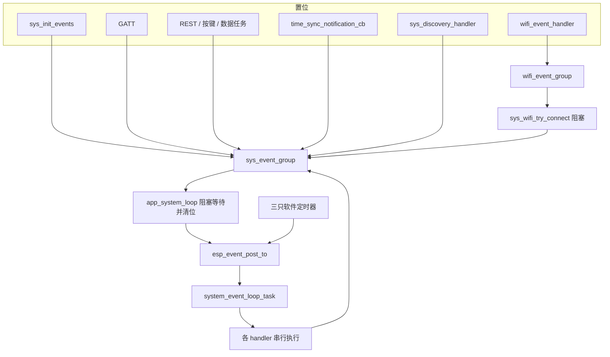

# 事件织物（Event fabric）

跨任务要表达「发生过某件事」时，固件用 FreeRTOS event group 的位，不传载荷。需要跑一段可能阻塞的处理时，再投到一条私有 ESP event loop 上，由单独的任务串行执行。位是电平不是计数：同一位在被读走之前置多少次，仍然只醒一次。`g_mcu` 上固定三组；Wi-Fi 协议栈另走默认事件循环；IMU 驱动还有只在对应传感器下编译进来的私有组。各子系统自己的状态机不在这里展开。

## 职责

- 在 `sys_init_events()` 里创建 `sys_event_group`、`task_event_group`、`wifi_event_group`，并提供 `set` / `clear` / `get` 宏。
- `app_system_loop()` 在 `sys_event_group` 上阻塞等待，把一部分位译成 `SYSTEM_EVENTS` 投给私有循环。
- `task_event_group` 只做在途闩锁。全仓库没有人对它调用 `xEventGroupWaitBits`。
- `wifi_event_group` 只让 `sys_wifi_try_connect()` 和默认循环上的 `wifi_event_handler()` 会合一次关联结果。
- 不实现关联、对时、发现、灯语或电源状态机。那些模块只通过这里的位和事件号进出。

## 在系统中的位置

组在 [boot-and-tasks.md](boot-and-tasks.md) 的 `init()` 里创建：`sys_init_chip()` 先 `esp_event_loop_create_default()`，`sys_init_events()` 再造三组并置上 `EV_SYS_WIFI_DISCONNECTED`。`sys_start_tasks()` 拉起 `app_system_loop` 之后，私有循环和三只软件定时器才存在。字段挂在 [global-state.md](global-state.md) 的 `g_mcu` 上。事件层自己不读写 NVS，见 [nvs.md](nvs.md)。

| 方向 | 谁 | 文档 |
| --- | --- | --- |
| 启动时已置的断开位，以及关联会合 | `sys_wifi_try_connect` / `wifi_event_handler` | [wifi.md](wifi.md) |
| 凭据写入后置 `EV_SYS_WIFI_CONFIG_UPDATED` | GATT | [ble.md](ble.md) |
| REST 置 OTA、模式、灯位；NVS 写入不置位 | HTTP | [api.md](api.md) |
| 单击置 `EV_SYS_MODE_CHANGE` | `sys_set_operation_mode` | [button.md](button.md) |
| 发送失败把模式拉回非 active | `app_data_client` | [imu-streaming.md](imu-streaming.md) |
| 连接位触发的第一次对时，以及 300 s 定时器 | `SYSTEM_TIME_SYNC_EVENT` | [time-sync.md](time-sync.md) |
| 连接位与 15 s 定时器触发的发现 | `SYSTEM_DISCOVERY_EVENT` | [discovery.md](discovery.md) |
| 每次 sys 组醒来可能附带的灯语 | `SYSTEM_LED_STATUS_EVENT` | [led.md](led.md) |
| 模式、OTA、20 s 节拍 | `sys_power_mgmt_handler` | [power-management.md](power-management.md) |
| OTA 下载本体 | `sys_ota_perform` | [ota.md](ota.md) |
| 驱动私有组 | HI229 / BNO08X | [imu.md](imu.md) |
| 任务优先级随目标变化 | `CONFIG_EN_MULTI_CORE` | [hardware.md](hardware.md) |
| 总览 | — | [00-overview.md](00-overview.md) |

按钮自己的队列、BNO HINT 的任务通知、IMU 环形缓冲都不是这三组。长按直接调用 `power_mgmt_on_enter_deep_sleep()`，不经过事件位。

## 设计

### 数据与状态

两套 ESP 事件循环，分工按「谁会堵住」切开：

- 默认循环在 `sys_init_chip()` 创建。本仓库只注册 `wifi_event_handler`：`WIFI_EVENT` 的 `ESP_EVENT_ANY_ID`，以及 `IP_EVENT` 的 `IP_EVENT_STA_GOT_IP`。协议栈的关联回调走这里，所以私有循环堵在发现或重连里时，关联仍能推进。
- 私有循环是 `g_mcu.system_loop`，在 `app_system_loop()` 开头 `esp_event_loop_create`。任务名 `system_event_loop_task`，队列深度 16，栈 4096，优先级等于创建当时 `app_system_loop` 的优先级，核是 `tskNO_AFFINITY`。`SYSTEM_EVENTS` 由 `ESP_EVENT_DEFINE_BASE` 定义在 `system_loop.c`。投递一律 `esp_event_post_to(..., NULL, 0, portMAX_DELAY)`，没有载荷。

`sys_event_type_t` 的枚举值就是事件号。处理函数忽略 `event_data`。真正的状态在 `g_mcu.state` 和 `g_power_mgmt_ctx` 里，不在事件对象里。

三组都是 `xEventGroupCreate()`，返回值没有检查。宏把不带 `_BIT` 的名字粘成 `##_BIT`：调用必须写 `set_sys_event(EV_SYS_WIFI_CONNECTED)`，写成已经带 `_BIT` 的标识符会对不上符号。`get_*` 用 `xEventGroupClearBits(group, 0)` 读当前位，不清除、不阻塞。`get_sys_event` 没有调用点。`get_task_event` 只被定时器和 `app_system_loop` 拿来做在途判断。全仓库没有 `xEventGroupSetBitsFromISR` 或 `esp_event_isr_post`。

`app_system_loop` 的等待是阻塞，不是轮询：

| 参数 | 值 | 含义 |
| --- | --- | --- |
| 组 | `g_mcu.sys_event_group` | 只等这一组 |
| 掩码 | `0x00FFFFFF` | `BIT0`–`BIT23`。已命名的只有 `BIT0`–`BIT9` |
| `xClearOnExit` | `pdTRUE` | 返回前清掉掩码里已经置上的位，包括没有专用分支的位 |
| `xWaitForAllBits` | `pdFALSE` | 任一位即返回，多位可以合成一次 |
| 超时 | `portMAX_DELAY` | 没有周期醒来 |

因此 `EV_SYS_NTP_SYNCED`、`EV_SYS_DISCOVERY_COMPLETED`、`EV_SYS_LED_STATUS_CHANGED` 会被这次等待清掉，即使下面的 `if` 不提它们的名字。未命名的 `BIT10`–`BIT23` 同样会醒、会被清，然后只可能顺带走到文末的灯语投递。没有代码去置这些未命名位。

### `sys_event_group`

唯一等待者是 `app_system_loop`，阻塞，返回时清位。下表「等待者」一列写的是这次醒来后的分支；没有分支的位仍然会醒并被清掉。

| 名字 | 置位者 | 等待者 | 含义 |
| --- | --- | --- | --- |
| `EV_SYS_WIFI_CONFIG_UPDATED` `BIT0` | `gatt_svr_chr_wifi_info` 在 SSID 与 PSK 都解析成功、写入 RAM 和 NVS 之后 | 与断开、失败合成一个分支：若 `EV_TASK_WIFI_RECONNECT` 未置，则置上并投递 `SYSTEM_WIFI_RECONNECT_EVENT` | 凭据已换，需要按当前 RAM 再关联一次。REST `/v1/nvs/variable` 不置这一位 |
| `EV_SYS_WIFI_CONNECTED` `BIT1` | `sys_wifi_try_connect` 在等到 `EV_WIFI_CONNECTED_BIT` 时 | 投递 `SYSTEM_TIME_SYNC_EVENT`，再投递 `SYSTEM_DISCOVERY_EVENT` | 这一轮 `try_connect` 已经拿到 IP，并且 `g_mcu.state.wifi_connected` 已写成 true |
| `EV_SYS_WIFI_DISCONNECTED` `BIT2` | `sys_init_events`；每次 `sys_wifi_try_disconnect` | 同上，进入重连分支 | 启动时的第一下，以及每次主动断开。重连 handler 开头也会再置一次 |
| `EV_SYS_WIFI_FAIL` `BIT3` | `sys_wifi_reconnect_event_handler` 在 `try_connect` 返回非 `ESP_OK` 时。成功路径 `clear_sys_event` | 同上，进入重连分支 | 这一轮重连失败。`try_connect` 自己不置这一位 |
| `EV_SYS_NTP_SYNCED` `BIT4` | `time_sync_notification_cb`，仅 SNTP 回调里 | 无专用分支 | 叫醒循环，好让灯语读到已经写成 true 的 `ntp_synced`。失败不置位 |
| `EV_SYS_DISCOVERY_COMPLETED` `BIT5` | `sys_discovery_handler` 解码到合法应答时 | 无专用分支 | 叫醒循环。耐久标志是 `g_mcu.state.discovery_completed`，不是这一位 |
| `EV_SYS_LED_STATUS_CHANGED` `BIT6` | `blink_configure_handler` 的 `mode=auto` 与 `mode=manual`。`mode=off` 不置 | 无专用分支 | 只负责叫醒。灯语投递看的是 `led_manual` 和 `EV_TASK_LED_STATUS`，不测试这一位 |
| `EV_SYS_OTA_TRIGGERED` `BIT7` | `system_upgrade_handler` 的 POST，且 `ota_url` 非空 | 投递 `SYSTEM_OTA_EVENT`，然后 `sys_set_operation_mode(false)`，再在本任务里调用 `sys_ota_perform()` | URL 已抄进 `g_mcu.ota_url`。这条路径不写 NVS |
| `EV_SYS_MODE_CHANGE` `BIT8` | `sys_set_operation_mode`：按键单击、REST `action=start/stop`、数据发送失败、以及 OTA 分支里的那次 `false` | 投递 `SYSTEM_MODE_CHANGE_EVENT` | `g_mcu.state.active` 已经写成新值。函数不比较旧值，每次调用都置位 |
| `EV_SYS_POWER_MGMT` `BIT9` | 无。当前树里没有 `set_sys_event(EV_SYS_POWER_MGMT)` | 若看到，投递 `SYSTEM_POWER_MGMT_EVENT` | 分支还在，置位者已被删掉。20 s 节拍不走这一位 |

醒来后的 `if` 互不排斥，按源码顺序执行：连接、重连、OTA、电源位、模式、然后无条件考虑灯语。OTA 里新置的 `EV_SYS_MODE_CHANGE` 不在本次已经采样的 `bits` 里，要等 `sys_ota_perform()` 返回后的下一轮等待。成功则 `esp_restart()`，那一轮不会发生。

灯语门闩不看是哪一位叫醒的：`led_manual` 为假且 `EV_TASK_LED_STATUS` 未置时，置上任务位并投递 `SYSTEM_LED_STATUS_EVENT`。因此任何 sys 位都能顺带重算灯。`led_manual` 为真时这次不投；已经进队列的事件仍会执行，处理函数自己不看 `led_manual`。

### `task_event_group`

没有阻塞等待。读是 `get_task_event`，写是 `set_task_event` / `clear_task_event`。它表示「已经投递、处理函数还没返回」，用来少投一份，不是第二套唤醒。

| 名字 | 置位者 | 等待者 | 含义 |
| --- | --- | --- | --- |
| `EV_TASK_TIME_SYNC` `BIT0` | `time_sync_timer_cb` 在投递前 | 定时器回调用 `get_task_event` 轮询，不 `WaitBits` | 在途。`sys_time_sync_handler` 在成功拿到 mutex 之后清除。`EV_SYS_WIFI_CONNECTED` 那次投递不置这一位，handler 末尾仍会清 |
| `EV_TASK_DISCOVERY` `BIT1` | 无 | 无 | `sys_discovery_handler` 末尾清除。注释写「该位置位时调用」，实际注册的是 `SYSTEM_DISCOVERY_EVENT`。清掉的是从未置上的位 |
| `EV_TASK_LED_STATUS` `BIT2` | `app_system_loop` 投递灯语之前 | 同一任务在投递前用 `get_task_event` 看一眼 | 在途。`sys_led_status_handler` 在目标相同和已经改灯两条路上都清除。mutex 没拿到则不清除 |
| `EV_TASK_WIFI_RECONNECT` `BIT3` | `app_system_loop` 投递重连之前 | 同一任务在投递前看一眼 | 在途。`sys_wifi_reconnect_event_handler` 末尾清除，无论成败。没拿到 mutex 则不清除 |

对时定时器的条件是 `(wifi_connected && !EV_TASK_TIME_SYNC) || !ntp_synced`。尚未同步时，不看 Wi-Fi，也不看在途位，每 300 s 仍会再投一份。已同步之后，才用这一位挡住重入。发现没有对应的置位，所以搜索进行中时，定时器或新的连接位可以再投一份。

### `wifi_event_group`

这组不进 `app_system_loop`。等待者是 `sys_wifi_try_connect`：`xEventGroupWaitBits` 等 `EV_WIFI_CONNECTED_BIT | EV_WIFI_FAIL_BIT`，`xClearOnExit` 为 `pdFALSE`，任一位即可，超时 `portMAX_DELAY`。入口处先把两位一起清掉。全仓库只有重连 handler 调用 `try_connect`，因此启动后的第一次关联也来自初始的 `EV_SYS_WIFI_DISCONNECTED`。

| 名字 | 置位者 | 等待者 | 含义 |
| --- | --- | --- | --- |
| `EV_WIFI_CONNECTED_BIT` `BIT0` | 默认循环上的 `wifi_event_handler`，在 `IP_EVENT_STA_GOT_IP` | `sys_wifi_try_connect` 阻塞 | 已拿到 IP，并已把 `ip_info` 写进 `g_mcu`。不在这里置 `EV_SYS_WIFI_CONNECTED` |
| `EV_WIFI_FAIL_BIT` `BIT1` | 同一 handler，在 `WIFI_EVENT_STA_DISCONNECTED` 且 `s_wifi_retry_num` 已经是 0 | 同上 | 本次 `esp_wifi_start` 之后的重试耗尽。计数初值是 `CONFIG_WIFI_MAX_RETRY`（5），在 `WIFI_EVENT_STA_START` 时重置 |

两位同时置着时，`try_connect` 先看连接位，当成成功。失败只把 `wifi_connected` 写成 false 并返回 `ESP_FAIL`，由外层 handler 决定要不要置 `EV_SYS_WIFI_FAIL`。关联过程的细节在 [wifi.md](wifi.md)。

### `SYSTEM_EVENTS`

处理函数都跑在 `system_event_loop_task` 上，按注册顺序、一次事件同步跑完。`SYSTEM_MODE_CHANGE_EVENT` 注册了两次：先 `sys_mode_change_handler`，后 `sys_power_mgmt_handler`。`SYSTEM_OTA_EVENT` 只注册到电源处理函数；下载不在这个任务上。

| 事件号 | 处理函数 | 谁投递 | 契约内能看到的结果 |
| --- | --- | --- | --- |
| `SYSTEM_TIME_SYNC_EVENT` | `sys_time_sync_handler` | 300 s 定时器；`EV_SYS_WIFI_CONNECTED` 分支 | 跑完一轮 SNTP 后清 `EV_TASK_TIME_SYNC`。步骤见 [time-sync.md](time-sync.md) |
| `SYSTEM_DISCOVERY_EVENT` | `sys_discovery_handler` | 15 s 定时器（仅 `wifi_connected`）；连接位分支，排在对时之后 | 成功时置 `EV_SYS_DISCOVERY_COMPLETED` 并清 `EV_TASK_DISCOVERY`。报文见 [discovery.md](discovery.md) |
| `SYSTEM_LED_STATUS_EVENT` | `sys_led_status_handler` | sys 组每次醒来且通过灯语门闩 | 按 `g_mcu.state` 重算灯，并清 `EV_TASK_LED_STATUS`。图案见 [led.md](led.md) |
| `SYSTEM_WIFI_RECONNECT_EVENT` | `sys_wifi_reconnect_event_handler` | 断开 / 失败 / 配置更新分支 | 断开、再 `try_connect`，然后置或清 `EV_SYS_WIFI_FAIL`，并清任务位 |
| `SYSTEM_POWER_MGMT_EVENT` | `sys_power_mgmt_handler` | 20 s 定时器，且 `g_power_mgmt_ctx.state != POWER_SAVE`；另外若有人置了 `EV_SYS_POWER_MGMT` | 按 `id` 做周期维护。状态迁移见 [power-management.md](power-management.md) |
| `SYSTEM_OTA_EVENT` | 同一个 `sys_power_mgmt_handler` | OTA 位分支，投递之后立刻在 `app_system_loop` 里调用 `sys_ota_perform` | 处理函数只把 `no_sleep` 置 true。下载与重启见 [ota.md](ota.md) |
| `SYSTEM_MODE_CHANGE_EVENT` | `sys_mode_change_handler`，然后 `sys_power_mgmt_handler` | 模式位分支 | 先改 IMU mux，再进 active 或 standby |

三只定时器在进入等待循环之前就 `xTimerCreate` + `xTimerStart`，自动重载。FreeRTOS 软件定时器不会在 start 时补发，第一次回调仍是一个周期之后。周期来自 `include/settings.h`，不是 Kconfig：发现 `CONFIG_DISCOVERY_INTERVAL_S`（15），对时 `CONFIG_NTP_UPDATE_INTERVAL_S`（300），电源 `CONFIG_POWER_MGMT_DURATION_S`（20）。创建失败没有单独分支，代码仍会 `xTimerStart`。`sys_stop_timers()` 只 `xTimerStop` 这三只，不删除。

`sys_ota_perform()` 里的 `esp_http_client` 回调 `esp_ota_event_handler` 只打日志，不进 `SYSTEM_EVENTS`，也不碰事件组。

### 并发

`app_system_loop` 与 `system_event_loop_task` 是两条任务。前者阻塞在事件组或 `esp_event_post_to` 上，后者阻塞在某个 handler 里。`include/settings.h` 在 `CONFIG_IDF_TARGET_ESP32` 或 `CONFIG_IDF_TARGET_ESP32S3` 上把 `CONFIG_EN_MULTI_CORE` 定义为 1，否则为 0。为 1 时 `app_system_loop` 优先级 4、钉在核 0；为 0 时优先级 8、不钉核。私有循环任务的优先级是创建瞬间抄来的那个数，但核始终不绑。栈都是 4096。

各 handler 有自己的静态 mutex，第一次进入时创建，`portMAX_DELAY` 拿锁。私有循环已经串行，这把锁只挡住「别的任务直接调用同一个函数」。当前没有第二调用者。SNTP 通知回调不拿对时那把锁，只写 `ntp_synced` 并 `set_sys_event`。

重连、发现、对时都会占住私有循环任务直到返回。发现的搜索循环以 `CONFIG_DISCOVERY_INTERVAL_S` 秒为界，一次 `recv` 还可能再占住套接字超时；对时在 handler 里按秒睡眠，循环次数受 `CONFIG_NTP_TIMEOUT_S`（5）限制；重连则在 `try_connect` 里 `portMAX_DELAY`。这段时间队列里的其他 `SYSTEM_EVENTS` 不会开始。`app_system_loop` 仍可以在事件组上醒来并继续 `post_to`。队列深度 16，投递超时是 `portMAX_DELAY`：队满时定时器服务任务或 `app_system_loop` 堵住，没有丢弃计数。`app_system_loop` 一旦堵在投递上，就不能回到 `xEventGroupWaitBits`，新置的位会留到下一次等待，同一位合并成一次。

默认循环与私有循环不共享队列。关联回调置 `wifi_event_group` 不会被私有循环里的 `try_connect` 挡住；`try_connect` 自己正堵在那次等待上。

检查再置位不是原子的。`EV_TASK_WIFI_RECONNECT` 只由 `app_system_loop` 置位，所以同一任务里的「未置则置」不会自己竞态；清除发生在另一条任务，窗口就是 handler 尚未把任务位清掉的那段。配置更新若在这段里被等待读走，这一次不会再投递，进行中的重连继续用已经 `set_config` 的旧副本。

`EV_SYS_WIFI_DISCONNECTED` 与 `EV_SYS_WIFI_CONNECTED` 是独立位。重连开头的 `try_disconnect` 会再置断开位。若循环在关联完成前已经把断开位读走，且当时任务位仍为真，则不会重复投递。若两个系统位合成同一次 `xEventGroupWaitBits` 返回，循环会既投对时和发现，又因为任务位多半已经清掉而再投一轮重连。成功路径不清除断开位。

### 配置

事件掩码、队列深度、栈和优先级写在源码里，没有单独的 Kconfig。和织物有关的编译期常量：

| 符号 | 值 | 用在 |
| --- | --- | --- |
| `CONFIG_WIFI_MAX_RETRY` | 5 | `s_wifi_retry_num` 的重置值，决定何时置 `EV_WIFI_FAIL_BIT` |
| `CONFIG_DISCOVERY_INTERVAL_S` | 15 | 发现定时器周期；也是一次搜索在 handler 里的时间上限 |
| `CONFIG_NTP_UPDATE_INTERVAL_S` | 300 | 对时定时器周期 |
| `CONFIG_NTP_TIMEOUT_S` | 5 | 单次 SNTP 等待的循环上限 |
| `CONFIG_POWER_MGMT_DURATION_S` | 20 | 电源定时器周期 |
| `CONFIG_EN_MULTI_CORE` | ESP32 / ESP32-S3 为 1，否则 0 | 只影响 `app_system_loop` 的优先级和绑核 |

`sdkconfig.defaults.*` 没有 `CONFIG_FREERTOS_HZ`，也没有 `configUSE_16_BIT_TICKS`。等待掩码按 24 个用户位来写。若 tick 被配成 16 位，事件组只有 8 个用户位，`BIT8` / `BIT9` 不能用；代码没有这条分支。

### v1 / v2 / v3

`sys_event_group`、`task_event_group`、`wifi_event_group` 和 `SYSTEM_EVENTS` 没有 `CONFIG_IDF_TARGET_*` 或 `CONFIG_IMU_SENSOR_*` 守卫。三位硬件的系统位、任务位、Wi-Fi 会合位相同。

差别只有两处。一是上一节的 `CONFIG_EN_MULTI_CORE`：v1（`CONFIG_IDF_TARGET_ESP32`）和 v2（`CONFIG_IDF_TARGET_ESP32S3`）把等待任务钉在核 0、优先级 4；v3（`CONFIG_IDF_TARGET_ESP32C5`）优先级 8、不钉核。私有循环任务在三个变体上都不钉核。二是驱动私有组，见下节：v1 的 `sdkconfig.defaults.v1` 打开 `CONFIG_IMU_SENSOR_HI229`，v2 / v3 打开 `CONFIG_IMU_SENSOR_BNO08X`。

### 驱动私有事件组

它们不挂在 `g_mcu` 上，也不进 `SYSTEM_EVENTS`。采样语义在 [imu.md](imu.md)。这里只记谁置位、谁等。

`CONFIG_IMU_SENSOR_HI229`（`lib/hi229/CMakeLists.txt`）下，`hi229_init` 为静态设备造一组，只有一位：

| 名字 | 置位者 | 等待者 | 含义 |
| --- | --- | --- | --- |
| `EV_DATA_READY` `BIT0` | `hi229_poll_task` 在收满一帧并更新快照之后 | `hi229_read`：`xEventGroupWaitBits`，超时 `0x10` 个 tick，不自动清除；`out != NULL` 时再 `xEventGroupClearBits` | 有一帧新快照。不是计数器。`0x10` 没有换成毫秒 |

`CONFIG_IMU_SENSOR_BNO08X` 下，`BNO08x_init` 造两组。HINT 下降沿不置事件位：`BNO08x_hint_handler` 用 `vTaskNotifyGiveFromISR` 叫醒 `BNO08x_spi_task`。

`evt_grp_spi` 的等待上限是 `HOST_INT_TIMEOUT_MS`（300）除以 `portTICK_PERIOD_MS`。`RX_DONE` 与 `TX_DONE` 的 `WaitBits` 在返回时清除；合法/非法包那一次不自动清除，`BNO08x_wait_for_data` 在返回前把这两位一起清掉。

| 名字 | 置位者 | 等待者 | 含义 |
| --- | --- | --- | --- |
| `EVT_GRP_SPI_RX_DONE_BIT` | `BNO08x_receive_packet` | `BNO08x_wait_for_rx_done`、`BNO08x_wait_for_data`，阻塞，返回时清除 | SPI 收包结束，包已送进 RX 队列 |
| `EVT_GRP_SPI_RX_VALID_PACKET_BIT` | `BNO08x_data_proc_task` 解析成功 | `BNO08x_wait_for_data` 与非法位一起等，不自动清除 | 这一包解析通过 |
| `EVT_GRP_SPI_RX_INVALID_PACKET_BIT` | 同一任务解析失败 | 同上 | 这一包解析失败。等到任一位且不是合法位则 `wait_for_data` 返回 false |
| `EVT_GRP_SPI_TX_DONE_BIT` | `BNO08x_send_packet` | `BNO08x_wait_for_tx_done`，阻塞，返回时清除 | 已排队的发送完成 |

`evt_grp_report_en` 没有 `xEventGroupWaitBits`。`BNO08x_spi_task`、三个 `wait_for_*` 和 `BNO08x_data_available` 用 `xEventGroupGetBits` 看「是否还有报告开着」，用来决定要不要重新打开 HINT 中断。置位在 `BNO08x_enable_report` 确认发送完成之后；对应的 `BNO08x_disable_*` 清除单个位；`BNO08x_hard_reset` 与 `BNO08x_soft_reset` 用 `EVT_GRP_RPT_ALL_BITS` 一次清光。

| 名字 | 本固件里的置位者 | 等待者 | 含义 |
| --- | --- | --- | --- |
| `EVT_GRP_RPT_ROTATION_VECTOR_BIT` | `bno08x_config` → `BNO08x_enable_rotation_vector` | 仅 `GetBits` 轮询 | 旋转向量报告使能 |
| `EVT_GRP_RPT_GAME_ROTATION_VECTOR_BIT` | 仅 `BNO08x_run_full_calibration_routine`，仓库内无调用 | 同上 | 游戏旋转向量使能闩锁 |
| `EVT_GRP_RPT_ARVR_S_ROTATION_VECTOR_BIT` | 无调用 | 同上 | ARVR 稳定旋转向量使能闩锁 |
| `EVT_GRP_RPT_ARVR_S_GAME_ROTATION_VECTOR_BIT` | 无调用 | 同上 | ARVR 稳定游戏旋转向量使能闩锁 |
| `EVT_GRP_RPT_GYRO_ROTATION_VECTOR_BIT` | 无调用 | 同上 | 陀螺积分旋转向量使能闩锁 |
| `EVT_GRP_RPT_ACCELEROMETER_BIT` | `bno08x_config`，当 `CONFIG_USE_LINEAR_ACCELERATION` 为 n（Kconfig 默认） | 同上 | 加速度计报告使能 |
| `EVT_GRP_RPT_LINEAR_ACCELEROMETER_BIT` | `bno08x_config`，仅当 `CONFIG_USE_LINEAR_ACCELERATION` 为 y | 同上 | 线性加速度报告使能 |
| `EVT_GRP_RPT_GRAVITY_BIT` | 无调用 | 同上 | 重力报告使能闩锁 |
| `EVT_GRP_RPT_GYRO_BIT` | `bno08x_config`，仅当 `CONFIG_USE_GYRO` 为 y（默认 n） | 同上 | 陀螺报告使能 |
| `EVT_GRP_RPT_GYRO_UNCALIBRATED_BIT` | 无调用 | 同上 | 未校准陀螺使能闩锁 |
| `EVT_GRP_RPT_MAGNETOMETER_BIT` | 仅校准例程，无调用者 | 同上 | 磁力计使能闩锁 |
| `EVT_GRP_RPT_TAP_DETECTOR_BIT` | 无调用 | 同上 | 敲击检测使能闩锁 |
| `EVT_GRP_RPT_STEP_COUNTER_BIT` | `bno08x_config` → `BNO08x_enable_step_counter` | 同上 | 计步报告使能 |
| `EVT_GRP_RPT_STABILITY_CLASSIFIER_BIT` | `bno08x_config` → `BNO08x_enable_stability_classifier` | 同上 | 稳定性分类使能 |
| `EVT_GRP_RPT_ACTIVITY_CLASSIFIER_BIT` | 无调用 | 同上 | 活动分类使能闩锁 |
| `EVT_GRP_RPT_RAW_ACCELEROMETER_BIT` | 无调用 | 同上 | 原始加速度使能闩锁 |
| `EVT_GRP_RPT_RAW_GYRO_BIT` | 无调用 | 同上 | 原始陀螺使能闩锁 |
| `EVT_GRP_RPT_RAW_MAGNETOMETER_BIT` | 无调用 | 同上 | 原始磁力计使能闩锁 |

`CONFIG_USE_LINEAR_ACCELERATION` 与 `CONFIG_USE_GYRO` 的默认取值见 [imu.md](imu.md)，不在事件层决定。

## 接口

对其他子系统暴露的是宏和两个入口，不是一组可以订阅的回调。

| 符号 | 约定 |
| --- | --- |
| `set_sys_event` / `clear_sys_event` / `get_sys_event` | 参数是不带 `_BIT` 的名字。`get_sys_event` 当前无调用者 |
| `set_task_event` / `clear_task_event` / `get_task_event` | 同上。不要对任务组 `WaitBits`，现有代码都没有 |
| `sys_init_events` | 只应在任务起来之前调用一次。立刻置 `EV_SYS_WIFI_DISCONNECTED` |
| `sys_set_operation_mode(bool)` | 写 `g_mcu.state.active` 并置 `EV_SYS_MODE_CHANGE`，总是返回 `ESP_OK` |
| `ESP_EVENT_DECLARE_BASE(SYSTEM_EVENTS)` | 事件号是 `sys_event_type_t`。新处理函数要在 `app_system_loop` 里 `esp_event_handler_register_with` |

依赖的事件位就是上表这些；本层同时是它们的定义处。不依赖 NVS 键。置位之前，别的模块可能已经写过 `var` 表里的 `WIFI_SSID` / `WIFI_PSK`（仅 GATT 那条路径会接着置 `EV_SYS_WIFI_CONFIG_UPDATED`），或只改了 RAM 里的 `g_mcu.ota_url`、`g_mcu.state.active`、`led_manual`。`/v1/nvs/variable` 的 POST 不置任何 `EV_SYS_*`。

不要在 ISR 里调用 `set_sys_event`。驱动侧 HINT 用的是任务通知，不是这些宏。

## 失败与边界

- 事件组创建失败未检查，随后的 `set` 会碰到空句柄。定时器创建失败同样没有停机路径。
- 私有循环队列满时投递方阻塞，不丢事件，也没有计数。堵在发现、对时或 `try_connect` 上时，定时器服务任务可能被 `portMAX_DELAY` 拖住，三只定时器一起停摆。
- 同一 sys 位在被等待读走之前只保留电平。OTA 进行中再次 POST 升级，位会留到 `sys_ota_perform` 返回后的下一轮，合并成一次，用的是当时的 `g_mcu.ota_url`。
- `EV_SYS_WIFI_FAIL` 可以被成功路径在循环看见之前 `clear_sys_event` 掉。断开位与连接位若落在同一次等待里，会同时走进两个分支，可能多投一轮重连。
- 重连进行中到来的 `EV_SYS_WIFI_CONFIG_UPDATED` 若被这次等待清掉，且任务位仍为真，新凭据要等下一轮才会被 `set_config`。没有队列把多次配置更新排起来。
- `EV_TASK_*` 若在 mutex 没拿到时不被清除，对应投递不再发生。`portMAX_DELAY` 下，已创建的 mutex 不会超时；创建失败则没有检查。
- `EV_TASK_DISCOVERY` 从不置位，发现没有在途闸。`EV_SYS_POWER_MGMT` 的等待分支到不了；周期电源工作只靠定时器直投，那条路径在 `POWER_SAVE` 时连投递都跳过。
- OTA 分支把 `app_system_loop` 堵在 `sys_ota_perform` 里。私有循环仍能跑已经入队的 `SYSTEM_OTA_EVENT`（置 `no_sleep`）以及其他 handler，但 sys 组的新位要等下载返回。成功重启则模式位来不及被转发。失败时 `sys_ota_perform` 自己把 `no_sleep` 写成 false，随后的模式事件再进一次 standby。
- `sys_stop_tasks()` 删除 `app_system_loop`，不删除 `system_event_loop_task`，也不删三组。`app_power_save` 先停任务再 `sys_stop_timers()`，窗口里定时器仍可能往旧循环投递。再次 `sys_start_tasks()` 会新建一条 `app_system_loop`，从而再 `esp_event_loop_create` 并覆盖 `g_mcu.system_loop`。旧循环任务还在，新的定时器投给新句柄。代码没有 `esp_event_loop_delete`。
- 链路在已经报告连接之后丢掉，`wifi_event_handler` 只在内部计数用尽时置 `EV_WIFI_FAIL_BIT`。那时没有人等 `wifi_event_group`，也不会因此置 `EV_SYS_WIFI_DISCONNECTED` 或 `EV_SYS_WIFI_FAIL`。`wifi_connected` 保持 true，发现定时器继续认为链路还在。
- `esp_wifi_set_config` / `esp_wifi_start` 失败走 `ESP_ERROR_CHECK`，中止调用任务，不会变成 `EV_SYS_WIFI_FAIL`。`try_connect` 若既看不到连接位也看不到失败位，返回 `ESP_FAIL` 并打 `unexpected event`；在 `portMAX_DELAY` 且入口已清位的前提下，代码未体现这条返回如何到达。

## 设计取舍

三组加上私有循环是 `521da2c`（subject 含 “feat: new event based architecture”）一起引进的。说明没有写为什么周期定时器直投 `esp_event_post_to`、也不经过 sys 位，以及为什么 `EV_SYS_NTP_SYNCED` 和 `EV_SYS_DISCOVERY_COMPLETED` 没有专用分支。`EV_TASK_DISCOVERY` 只有清除、从未有过 `set_task_event`，历史未说明。

`50e877f`（“feat: finish power”）让电源定时器在 `POWER_SAVE` 下不再投递，并把定时器句柄放进 `g_mcu` 以便停掉。`908322e`（“refactor: change names of attributes”）删掉了 REST 里对 `next_mode` 的赋值和仅有的 `set_sys_event(EV_SYS_POWER_MGMT)`；subject 没写为什么等待分支还留着。OTA 分支里先 `sys_set_operation_mode(false)` 来自 `630718a`（“fix: de-activate marker during ota”）。

## 源文件

- `components/sys/sys.h`
- `components/sys/sys.c`
- `components/apps/system_loop.c`
- `components/sys/wifi.c`
- `components/sys/time_sync.c`
- `components/sys/discovery.c`
- `components/sys/led_status.c`
- `components/sys/power_mgmt.c`
- `components/sys/button.c`
- `components/ble/gatt_srv.c`
- `components/rest_controller/rest_controller_handlers.c`
- `components/apps/network.c`
- `main/app_main.c`
- `include/settings.h`
- `lib/hi229/hi229.c`
- `lib/hi229/CMakeLists.txt`
- `lib/bno08x/bno08x.c`
- `lib/bno08x/bno08x_driver.h`
- `lib/bno08x/bno08x_driver.c`
- `lib/bno08x/CMakeLists.txt`
