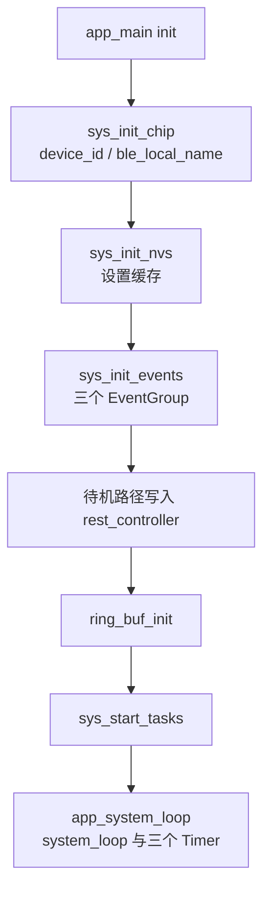
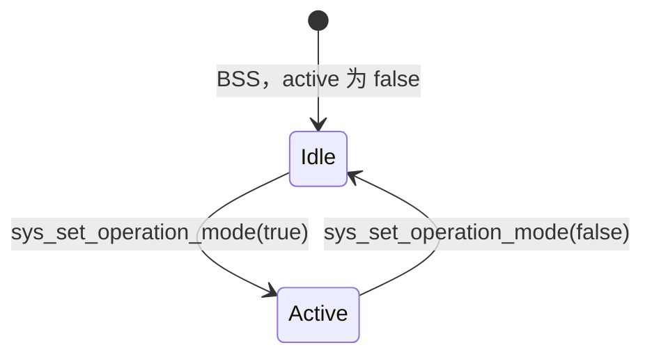

# 全局状态（Global State）

`mcu_t g_mcu` 是固件里唯一的组合根。身份、IMU 环形缓冲的控制块、任务与定时器句柄、运行电平，以及启动时从 NVS 抄出来的设置，都放在这一份对象里。各子系统直接读写字段，没有统一访问器，也没有一把盖住整个结构的锁。事件位的含义见 [events.md](events.md)，闪存键的编解码见 [nvs.md](nvs.md)。电源状态在旁边的 `g_power_mgmt_ctx`，IMU 函数表在 `g_imu`，键表在 `g_mcu_vars[]`，三者都不是 `mcu_t` 的成员。

## 职责

- 提供一份零初始化的 `g_mcu`，并在启动时填上设备身份、三个 FreeRTOS event group，以及设置缓存。
- 保存 IMU 环形缓冲的控制块、三条长期任务的句柄、三个软件定时器的句柄、自定义事件循环和 REST 服务器句柄。
- 用 `mcu_state_t` 上的电平表示 Wi-Fi、NTP、发现、LED、活动态和 OTA 错误；活动态只通过 `sys_set_operation_mode` 修改。
- 不解释事件位，不实现各外设的状态机，也不在 `sys_set_nvs_var` 里把闪存写回 RAM。

## 在系统中的位置

`app_main` 的 `init()` 按固定顺序碰这份对象，任务模型见 [boot-and-tasks.md](boot-and-tasks.md)。`sys_init_chip` 写身份并创建默认事件循环（不放进 `mcu_t`）。`sys_init_nvs` 装入设置缓存。`sys_init_events` 创建三个 event group，并置位 `EV_SYS_WIFI_DISCONNECTED`。待机路径在 [power-management.md](power-management.md) 里调用 `rest_controller_start`，把 `httpd` 句柄写入 `g_mcu.rest_controller`。环形缓冲要等待机返回后才 `ring_buf_init`。`sys_start_tasks` 拉起三条任务；自定义循环和三个定时器是 `app_system_loop` 进去之后才创建的。

身份字符串被 [wifi.md](wifi.md) 用作 DHCP 主机名，被 [ble.md](ble.md) 用作广播名，被 [discovery.md](discovery.md) 按 12 字节原样拷进发现报文。环形缓冲的生产者和消费者在 [imu-streaming.md](imu-streaming.md)。`state` 上的电平被系统循环用来决定要不要投递时间同步、发现、重连和 LED，分别见 [time-sync.md](time-sync.md)、[discovery.md](discovery.md)、[wifi.md](wifi.md)、[led.md](led.md)。活动态还会改 IMU 的 `mux`，见 [imu.md](imu.md)。升级只读 RAM 里的 `ota_url`，见 [ota.md](ota.md)。

## 设计

### 数据与状态

`sys.c` 里 `mcu_t g_mcu = {0}`。指针起始为 `NULL`，布尔为 false，整数为 0。`led_status` 的 0 就是 `LED_UNKNOWN`。注释里的 “Non Volatile Variables” 只是 RAM 布局上的分组：真正从 NVS 装入的只有其中一部分，`use_hamming` 和 `missed_frames` 不进闪存。

身份只写一次，在 `sys_init_chip`。`esp_efuse_mac_get_default` 取出 6 字节 MAC，格式化成 12 位小写十六进制，`memcpy` 进 `device_id[CONFIG_DEVICE_ID_LEN]`（12）。数组里没有自己的 `NUL`。紧挨着的 `_device_id_sep_` 保持 BSS 的 0，所以 `%s` 能停住；发现和 HI229 组包按 12 字节拷贝，不依赖这个 0。`ble_local_name` 先 `bzero` 再写入 `CONFIG_BLE_LOCAL_NAME_PREFIX`（`"markit_"`）加上完整的 12 位十六进制，共 19 个字符，缓冲 `CONFIG_BLE_LOCAL_NAME_LEN` 为 32。之后没有写者。不进 NVS，每次上电重算。

环形缓冲的控制块内嵌在 `g_mcu.imu_ring_buf`，字节存放在 `app_main` 的静态数组 `s_data_buf`，不在结构体里。`ring_buf_init` 的参数是 `CONFIG_DATA_BUF_LEN`（128）槽、`sizeof(imu_dgram_t)`、`static_buf` 为真。`head` 与槽游标 `_head` 都从 1 起。`push` 不看读者走到哪，写满就覆盖。`peek` 对 `index >= head` 返回 `ESP_ERR_INVALID_ARG`；对负数或 `index <= head - size` 不报错，改读 `head - 1`。按原序号能读到的窗口是 `size - 1` 帧。覆盖之后线上如何重复、补发，见 [imu-streaming.md](imu-streaming.md)。`app_main` 丢掉 `ring_buf_init` 的返回值。

`mcu_state_t` 全是电平，不是 event bit。没有锁。

| 字段 | 初值 | 谁写入 | 清不掉 |
| --- | --- | --- | --- |
| `wifi_connected` | false | 仅 `sys_wifi_try_connect` / `sys_wifi_try_disconnect` | 失败和断开会写回 false，见 [wifi.md](wifi.md) |
| `ntp_synced` | false | 仅 `time_sync_notification_cb` 置 true | 代码没有写回 false 的路径 |
| `ntp_sync_success_unix_usec` | 0 | 同一次回调，`get_time_usec` | 代码未体现读取方 |
| `discovery_completed` | false | 仅 `sys_discovery_handler` 在回复合法时置 true | 代码没有写回 false 的路径 |
| `last_discovery_unix_usec` | 0 | 每次进入发现处理函数就写，不论成败 | 代码未体现读取方 |
| `led_status` | `LED_UNKNOWN` | `blink_*` 在切换灯语时赋值 | 见 [led.md](led.md) |
| `led_manual` | false | REST `blink_configure`；`power_mgmt_on_enter_deep_sleep` 置 true | `auto` 会写回 false |
| `active` | false | 仅 `sys_set_operation_mode` | 传入 false 即离开活动态 |
| `ota_err` | 0，与 `ESP_OK` 相同 | `sys_ota_perform` 失败时写入返回码 | 成功路径 `esp_restart`，不记录成功 |

`sys_set_operation_mode` 先写 `active`，再 `set_sys_event(EV_SYS_MODE_CHANGE)`，总是返回 `ESP_OK`。调用点是 `button_daemon` 的单击（取反）、REST `operation_mode_handler` 的 `start` / `stop`、`app_data_client` 在发送失败且仍为活动态时、以及 `app_system_loop` 在看到 `EV_SYS_OTA_TRIGGERED` 时强制 false。IMU `mux` 和电源待机/活动不是在这个函数里改的：系统循环稍后把 `SYSTEM_MODE_CHANGE_EVENT` 投进自定义循环，`sys_mode_change_handler` 才按当时的 `active` 切 `IMU_MUX_STREAM` 或 `IMU_MUX_IDLE`。同一个事件还登记了 `sys_power_mgmt_handler`。因此读 `active` 的任务可以先于 `mux` 看到新值。

`led_manual` 为真时，系统循环不再投递 `SYSTEM_LED_STATUS_EVENT`。REST 的 `auto` 置 false 并发 `EV_SYS_LED_STATUS_CHANGED`；`manual` 同样发事件但置 true；`off` 只置 true 并直接 `blink_led_off`，不发事件。深睡入口把 `led_manual` 置 true，避免自动灯语再把指示灯点亮。灯语本身不在这里展开。

句柄：

| 字段 | 谁创建 | 谁清掉 |
| --- | --- | --- |
| `tasks.app_data_client_task` / `app_monitor_task` / `app_system_loop_task` | `sys_start_tasks`。`launch_task*` 在句柄已非 NULL 时什么也不做 | `sys_stop_tasks` 里 `vTaskDelete` 后置 NULL |
| `tasks.app_log_trace_task` | 仅当 `CONFIG_EN_PROFILING` 为真时结构体里才有这个成员 | 现有 `include/settings.h` 把它定为 0，成员不存在 |
| `timers.discovery_timer` / `time_sync_timer` / `power_mgmt_timer` | `app_system_loop` 里 `xTimerCreate` | `sys_stop_timers` 只 `xTimerStop`，不删除、不置 NULL |
| `sys_event_group` / `task_event_group` / `wifi_event_group` | `sys_init_events` | 代码未体现删除 |
| `system_loop` | `app_system_loop` 里 `esp_event_loop_create` | 再次进入该任务会覆盖句柄，不 `esp_event_loop_delete` |
| `rest_controller` | `power_mgmt_on_enter_standby` | `power_mgmt_on_enter_power_save` 调用 `rest_controller_stop`，不置 NULL |
| `ip_info` | `wifi_event_handler` 在 `IP_EVENT_STA_GOT_IP` 时整份拷贝 | 断开路径不清除 |

`wifi_event_group` 的位是 `EV_WIFI_CONNECTED_BIT` 与 `EV_WIFI_FAIL_BIT`，只服务一次连接尝试，见 [wifi.md](wifi.md)。`sys_event_group` 与 `task_event_group` 的位表不在这里重复。`get_sys_event` / `get_task_event` 用 `xEventGroupClearBits(group, 0)` 读当前值，不清除。系统循环用 `xEventGroupWaitBits(..., 0x00FFFFFF, pdTRUE, pdFALSE, portMAX_DELAY)`，返回时清掉低 24 位里已经置上的位，包括循环体没有单独分支的位。

自定义循环的参数：队列 16，任务名 `system_event_loop_task`，优先级等于创建时 `app_system_loop` 的优先级，栈 4096，`tskNO_AFFINITY`。`ESP_ERROR_CHECK` 包住创建和 handler 注册，失败会中止。默认事件循环在 `sys_init_chip` 里另行创建，Wi-Fi 回调跑在那一条上，句柄不进 `mcu_t`。

三个定时器都是自动重载，`xTimerStart` 的阻塞时间为 0：

| 句柄 | 周期 | 回调做的事 |
| --- | --- | --- |
| `discovery_timer` | `CONFIG_DISCOVERY_INTERVAL_S`（15 s） | `wifi_connected` 为真才投递 `SYSTEM_DISCOVERY_EVENT` |
| `time_sync_timer` | `CONFIG_NTP_UPDATE_INTERVAL_S`（300 s） | Wi-Fi 已连且任务位未置，或 `ntp_synced` 仍为假，则置 `EV_TASK_TIME_SYNC` 并投递时间同步 |
| `power_mgmt_timer` | `CONFIG_POWER_MGMT_DURATION_S`（20 s） | `g_power_mgmt_ctx.state` 不是 `POWER_SAVE` 才投递电源事件 |

设置缓存与闪存不是同一份数据。进程活着时，业务读的是 `g_mcu`。重启之后，以 `sys_load_nvs_configuration` 从 namespace `var` 装进来、再钳过位的那些字段为准。`sys_set_nvs_var` 只 commit NVS，不回写 RAM。空字符串会换成编译期默认，且不写回。整数缺键时的值不可靠，钳位规则和 blob 长度见 [nvs.md](nvs.md)。

| RAM 字段 | 宽度 | 启动 | 运行中还会写 RAM 的人 | 掉电后 |
| --- | --- | --- | --- | --- |
| `wifi_ssid` / `wifi_psk` | `CONFIG_VAR_STR_MAX_LEN`（64） | `WIFI_SSID` / `WIFI_PSK`，空则 `"markit"` / `"12345678"` | BLE 先改 RAM 再写 NVS | NVS。REST 通用写入要等下次启动 |
| `data_host_ip_addr` | 64 | `DATA_HOST`，空则 `"255.255.255.255"` | 发现成功时 `strncpy` 回复源地址，不 commit | 回到 NVS 或默认广播 |
| `ntp_host_ip_addr` | 64 | `NTP_HOST`，空则 `""` | 发现在 `pkt.ntp_host` 非空时覆盖 RAM，不 commit | 回到 NVS；空串的含义见 [time-sync.md](time-sync.md) |
| `ota_url` | `CONFIG_OTA_URL_LEN`（128） | 不装入，保持 `""` | REST 升级 `strcpy` 后置 `EV_SYS_OTA_TRIGGERED` | 不持久。键 `OTA_HOST` 不是这个字段 |
| `imu_baud` | `int32_t` | 仅 `CONFIG_IMU_SENSOR_HI229` 时装入并夹到 `[9600, 921600]` | 无 | 见 [nvs.md](nvs.md)。BNO08X 构建保持 0 |
| `seq` | `int32_t` | 装入后夹到 `[0, 255]`，不写回 | blink 的 seq 同时写 NVS 和 RAM | 下次启动再钳一次 |
| `target_fps` | `int32_t` | 大于 `CONFIG_MAX_FPS`（400）或 `<= 0` 时改成 `CONFIG_TARGET_FPS`（100） | 无 | REST 改的是 NVS，已启动的定时器不看它 |
| `use_hamming` | `int32_t` | 保持 0 | 无读写 | 代码未体现用途，也没有对应 NVS 键 |
| `missed_frames` | `int32_t` | 0 | `app_data_client` 进入发送循环时置 0，仅 `ESP_ERR_NO_MEM` 时 `++` | 不持久。代码未体现读取方 |

`g_mcu_vars[]` 还有 `TEST` 和 `OTA_HOST`。`TEST` 在装入其它键之前被读进栈上的 `_protect`，注释写明是为了避免后面的变量被写坏；它不是 `mcu_t` 的字段。`OTA_HOST` 可以被通用 REST 留下，启动路径不会把它拷进 `ota_url`。`CONFIG_VAR_URL_MAX_LEN`（128）没有被 `mcu_t` 使用。

`ntp_synced` 与 `discovery_completed` 不是这个状态机。它们在本次上电里只会从 false 变成 true。Wi-Fi 电平可以回到 false，但那是 [wifi.md](wifi.md) 的连接过程，不是 `mcu_state_t` 自己的迁移表。

### 行为与时序

任务创建时句柄必须还是 NULL，否则 `launch_task*` 直接跳过。栈参数都是 4096。ESP-IDF 的 `xTaskCreate` 以字节计。返回值不检查。

`CONFIG_EN_MULTI_CORE` 在 `include/settings.h` 里由目标宏决定：`CONFIG_IDF_TARGET_ESP32` 或 `CONFIG_IDF_TARGET_ESP32S3` 为 1，其它目标为 0。没有名为硬件版本的 Kconfig。

| 任务 | v1 / v2（多核） | 其它目标，含 v3 的 `CONFIG_IDF_TARGET_ESP32C5` |
| --- | --- | --- |
| `app_data_client` | 核 1，优先级 5 | 不绑核，优先级 12 |
| `app_monitor` | 核 0，优先级 6 | 不绑核，优先级 12 |
| `app_system_loop` | 核 0，优先级 4 | 不绑核，优先级 8 |

多核时数据任务独占核 1。它在追上 `head` 之后 `taskYIELD` 空转，同核上的 idle 不会因此跑到。这是句柄摆放的后果，发送循环见 [imu-streaming.md](imu-streaming.md)。

`app_system_loop` 先创建循环和定时器，再进入 `xEventGroupWaitBits`。`sys_init_events` 已经置过 `EV_SYS_WIFI_DISCONNECTED`，所以第一次等待会立刻返回并清掉该位。循环体按位投递自定义事件，但不在这条任务里执行发现、NTP 或电源处理函数；那些跑在 `system_event_loop_task` 上。例外是 OTA：看到 `EV_SYS_OTA_TRIGGERED` 后，它投递 `SYSTEM_OTA_EVENT`，把 `active` 置 false，然后在自己身上调用 `sys_ota_perform`。成功则 `esp_restart`，这条任务不再回到等待。失败则写入 `state.ota_err` 并返回，下一轮等待才会看见刚才置上的 `EV_SYS_MODE_CHANGE`。在此之前 `active` 已经是 false，IMU `mux` 仍可能停在 `IMU_MUX_STREAM`。

每次从等待返回，只要 `led_manual` 为假且 `EV_TASK_LED_STATUS` 未置，循环都会再投递一次 LED 事件。这与本次醒来的是哪一个系统位无关。

省电路径在 `app_power_save` 里先 `sys_stop_tasks` 再 `sys_stop_timers`，源码标了 FIXME。停掉的是三条应用任务和三个软件定时器，不是 `system_event_loop_task`。恢复时 `sys_start_tasks` 看到 NULL 句柄，会再创建一套任务；新的 `app_system_loop` 再 `xTimerCreate`、再 `esp_event_loop_create`，直接覆盖 `g_mcu` 里的句柄。旧循环任务和旧定时器对象没有删除调用。

`sys_ota_guard` 在 `app_main` 里、任务启动之后运行，然后 `vTaskDelete(NULL)` 结束 `app_main` 自己。它读 `wifi_connected` 的条件编译见 [ota.md](ota.md)。

### 并发

`mcu_t` 和 `mcu_state_t` 都没有互斥量。event group 的置位和等待由 FreeRTOS 内部串行化，这不保护旁边的布尔、`int64_t` 或字符串。

环形缓冲在 `ring_buf_init` 里创建了 `mutex`，但热路径调用的是 `ring_buf_push`、`ring_buf_reset`、`ring_buf_peek`。`ring_buf_push_safe` 和 `ring_buf_reset_safe` 在仓库里没有调用点，`peek` 也没有 safe 版本。`head` 是普通 `int64_t`。写任务、发送任务和 REST 的 `ring_buf_peek(..., -1, NULL)` 可以同时碰这块控制块。

字符串同样没有锁。BLE 的 GATT 回调写 `wifi_ssid` / `wifi_psk` 时，重连处理函数可能正在读。发现处理函数写 `data_host_ip_addr` / `ntp_host_ip_addr` 时，发送任务可能正在用这份地址建套接字或打日志。`sys_set_nvs_var` 与 `sys_get_nvs_var` 也没有应用层互斥，httpd 和 NimBLE 可以各自 `nvs_open`。库内部是否加锁，代码未体现。

定时器回调跑在 FreeRTOS 的 timer service 任务里，读 `wifi_connected`、`ntp_synced` 和电源状态，再 `esp_event_post_to(..., portMAX_DELAY)`。自定义循环上的处理函数会堵住同一条队列：发现和 NTP 的阻塞时间不在本文。队列满时，系统循环自己也会堵在 `portMAX_DELAY` 的投递上，于是 `sys_event_group` 的后续位要等它回到 `xEventGroupWaitBits`。

`get_*` 宏不是 FromISR 版本。按钮 ISR 不碰 `g_mcu`；单击在 `button_daemon` 里改活动态。

活动态的写与信号不是原子的：布尔先变，事件位后置，handler 更晚。OTA 失败路径上，`sys_ota_perform` 把 `g_power_mgmt_ctx.no_sleep` 写成 false，而 `SYSTEM_OTA_EVENT` 的处理函数把它写成 true。两条任务没有先后约定，后写的留下。`no_sleep` 不属于 `mcu_t`，见 [power-management.md](power-management.md)。

### 配置

决定 `mcu_t` 字段宽度和任务摆放的宏在 `include/settings.h`，不是 Kconfig：

| 宏 | 值 | 作用 |
| --- | --- | --- |
| `CONFIG_DEVICE_ID_LEN` | 12 | `device_id`，不含 `NUL` |
| `CONFIG_BLE_LOCAL_NAME_LEN` | 32 | `ble_local_name` |
| `CONFIG_BLE_LOCAL_NAME_PREFIX` | `"markit_"` | 广播名前缀 |
| `CONFIG_DATA_BUF_LEN` | 128 | 环形缓冲槽数 |
| `CONFIG_VAR_STR_MAX_LEN` | 64 | SSID、PSK、data host、NTP host |
| `CONFIG_OTA_URL_LEN` | 128 | `ota_url` |
| `CONFIG_TARGET_FPS` / `CONFIG_MAX_FPS` | 100 / 400 | 帧率钳位的替换值和上限 |
| `CONFIG_EN_MULTI_CORE` | ESP32 与 ESP32-S3 为 1，否则 0 | 任务是否 `xTaskCreatePinnedToCore` |
| `CONFIG_EN_PROFILING` | 0 | 为 0 时没有 `app_log_trace_task` 成员 |
| `CONFIG_DISCOVERY_INTERVAL_S` | 15 | 发现定时器 |
| `CONFIG_NTP_UPDATE_INTERVAL_S` | 300 | 时间同步定时器 |
| `CONFIG_POWER_MGMT_DURATION_S` | 20 | 电源定时器 |

`CONFIG_IMU_BAUD`（115200）定义在 `include/modelspec.h` 的 HI229 引脚段，只作为 `sys_load_int32_conf_default` 的参数。该默认分支仅在 `sys_find_var` 返回 NULL 时走到，而 `IMU_BAUD` 始终在 `g_mcu_vars[]` 里，所以正常构建用不到 115200 这条 else。NVS 键名见 [nvs.md](nvs.md)。

单核分支另有 `#if CONFIG_PROFILING_ENABLED`。仓库里没有这个宏的定义，现有配置下那段不参与编译。它和 `CONFIG_EN_PROFILING` 不是同一个开关。

装入缓存前有一次 `os_delay_ms(100)`。代码未体现这段等待在等什么。

### 硬件差异

身份、事件组、环形缓冲槽数、`state` 和除波特率以外的设置缓存，三套目标是同一份布局。分叉只有两处，而且守卫不是 “v1/v2/v3” 这个名字。

- 任务绑核与优先级：`CONFIG_IDF_TARGET_ESP32` 或 `CONFIG_IDF_TARGET_ESP32S3` 走多核表。`CONFIG_IDF_TARGET_ESP32C5`（v3）落到 `CONFIG_EN_MULTI_CORE == 0`，三条任务不绑核，数据与采集同为优先级 12，系统循环为 8。
- `imu_baud` 的装入和 `[9600, 921600]` 钳位包在 `CONFIG_IMU_SENSOR_HI229` 里。`CONFIG_IMU_SENSOR_BNO08X`（v2 的 ESP32-S3 与 v3 的 ESP32-C5，以及 modelspec 允许的 ESP32+BNO08X）不装入，字段保持 0，SPI 驱动也不读它。键本身在三套固件的 `g_mcu_vars[]` 里都在，REST 仍可读写闪存里的 `IMU_BAUD`。

深睡唤醒脚按 `CONFIG_IDF_TARGET_*` 分叉，那是电源模块的代码，不改变 `mcu_t` 的布局。见 [hardware.md](hardware.md) 与 [power-management.md](power-management.md)。

## 接口

其它子系统拿到的是全局对象本身，加上少量函数。

- 直接读写真值：`extern mcu_t g_mcu`。没有按字段加锁的 getter。
- 启动：`sys_init_chip`、`sys_init_nvs`、`sys_init_events`、`sys_start_tasks`。
- 停：`sys_stop_tasks`、`sys_stop_timers`。没有对称的 `sys_start_timers`；定时器只随 `app_system_loop` 创建。
- 活动态：`sys_get_operation_mode` 返回 `state.active`；`sys_set_operation_mode` 是唯一写者，并置 `EV_SYS_MODE_CHANGE`。
- 事件宏：`set_sys_event` / `clear_sys_event` / `get_sys_event`，以及 task 组的同名三套。位定义见 [events.md](events.md)。
- NVS 门面：`sys_find_var`、`sys_set_nvs_var`、`sys_get_nvs_var`，键表 `g_mcu_vars[]`。类型枚举含 `VAR_FLOAT32` 和 `VAR_UINT8`，表里没有对应键。契约见 [nvs.md](nvs.md)。
- 自定义循环上的 `SYSTEM_EVENTS` 与 `sys_event_type_t` 在 `sys.h` 声明，基址在 `system_loop.c` 定义。循环句柄是 `g_mcu.system_loop`。

依赖的 NVS 键，只列会进入 `mcu_t` 或容易被误当成会进入的那些：`WIFI_SSID`、`WIFI_PSK`、`DATA_HOST`、`NTP_HOST`、`IMU_BAUD`、`SEQ`、`TARGET_FPS`。`TEST` 不进入结构体。`OTA_HOST` 不进入 `ota_url`。

依赖的事件位是系统循环要等的那一组，外加任务组里用来挡住重复投递的位。本模块在 `sys_init_events` 置 `EV_SYS_WIFI_DISCONNECTED`，在 `sys_set_operation_mode` 置 `EV_SYS_MODE_CHANGE`。其余位的置位者不是 `sys.c`。

`mcu_state_t` 与事件位不是互为镜像。例如 `ntp_synced` 置 true 的同时会 `set_sys_event(EV_SYS_NTP_SYNCED)`，但系统循环的等待会清掉该位，布尔仍保持 true。不能用 “位是否还在” 判断 NTP 是否曾经成功。

## 失败与边界

- `xEventGroupCreate` 的 NULL 不检查。创建失败后的第一次 `set_sys_event` 会碰到空句柄。
- `xTaskCreate` / `xTaskCreatePinnedToCore` 的返回值不检查。句柄非 NULL 时后续 `sys_start_tasks` 不会重试。
- `xTimerCreate` 失败返回 NULL，代码仍调用 `xTimerStart`。只有返回 `pdPASS` 才打 “started” 日志，所以创建失败是静默的。之后 `sys_stop_timers` 仍会对这个 NULL 调用 `xTimerStop`。
- `vTaskDelete(NULL)` 会删除调用者自己。句柄已经是 NULL 时再进 `sys_stop_tasks`，第一条 `vTaskDelete` 就删掉当前任务，后面的置 NULL 执行不到。现有调用只有 `app_power_save` 一次，且发生在三条任务已经创建之后。
- 从省电恢复会泄漏上一次的 `system_event_loop_task` 和三个已停止的定时器，并把 `g_mcu.system_loop`、`timers.*` 指到新对象。旧循环上尚未跑完的队列不再通过 `g_mcu` 可达。
- `rest_controller_start` 失败返回 NULL 时，待机路径仍把 `controller_initialized` 置 true。省电时 `httpd_stop` 会拿到这个空句柄。句柄在 stop 之后仍留在 `g_mcu` 里。
- 升级 URL 的解析上限是 `CONFIG_PARAM_VALUE_MAX_LEN`（128），与 `ota_url` 数组一样长。handler 不看 `parse_url_kv_pair` 的返回值；失败时缓冲仍是 0，走 “empty ota_url”，不置 OTA 事件。成功且长度恰好 128 时，`strcpy` 会把结尾的 `NUL` 写到 `g_mcu.ota_url` 之外。
- 发现用 `strncpy(..., sizeof - 1)` 改 data host / NTP host，不强制最后一字节为 0，也不 commit。`pkt.ota_host` 只出现在日志里，代码未体现写入 `ota_url` 或 `OTA_HOST`。
- 通用 REST `POST /v1/nvs/variable/*` 之后，RAM 里的 SSID、主机、波特率、`seq`、`target_fps` 都还是旧的。`/v1/system/info` 的 `target_fps` 读 RAM，所以和 GET 闪存看到的数可以不同。采集定时器的周期只在 `app_monitor` 进入一轮采集时用当时的 `g_mcu.target_fps` 计算，没有热更新。
- `ring_buf_init` 在 `xSemaphoreCreateMutex` 失败时仍返回 `ESP_OK`。热路径本来也不拿这把锁。`ring_buf_reset` 只把 `head` / `_head` 拨回 1，不清槽里的字节，也不通知已经记住旧序号的发送任务。
- `device_id` 的 `%s` 依赖 `_device_id_sep_` 保持 0。代码没有写这个字节的路径；一旦被写成非 0，日志会把后面的 `ble_local_name` 接进去。按长度拷贝的发现报文不受影响。
- `ntp_synced`、`discovery_completed` 在本次上电成功后不再变回 false。Wi-Fi 断开、发现保持失败、NTP 后续失败，都不会单独清这两个布尔。发送任务因此可能继续认为 “已经同步且已经发现”。
- `missed_frames` 只在 `ESP_ERR_NO_MEM` 时增加。其它发送错误不增加它，也没有任务读它。它和 UDP 是否丢包不是同一个计数。
- 若 `CONFIG_EN_PROFILING` 与未定义的 `CONFIG_PROFILING_ENABLED` 同时被打开，单核分支会引用一个不存在的成员和函数；多核分支能编译。即便两边都编进去，`sys_stop_tasks` 删除剖析任务后不把句柄置 NULL，`launch_task*` 也不会再创建它。当前头文件不会走到这里。

## 设计取舍

设置缓存不是写穿的。`630718a` 的 subject 是 “v3.0.1”，正文用 “try to fix corrupted NVS by adding a guard variable” 解释先读 `TEST`；可检验的保护条件，历史未说明。`8ff1f77` 的 subject 是 “v3.1.2 Bug fix”，正文有 “no ota configuration, ota endpoint is set upon upgrade request”，对应当前 `ota_url` 不从 `OTA_HOST` 装入、升级也不写回 NVS。帧率缺键如何钳位，见 [nvs.md](nvs.md) 对 `908322e` 的引用。装入前等待 100 ms，历史未说明。

多核绑核来自 `47b42df`（subject “fix: adjust task priority”）。该 diff 把 `app_data_client` 放到核 1、`app_monitor` 放到核 0，优先级数字 5 / 6 / 4 没有改。subject 没有写为什么要换核。单核优先级 12 / 12 / 8 随 `b08f2df`（subject “feat: add support for esp32c5”）把非 ESP32、非 ESP32-S3 的 `CONFIG_EN_MULTI_CORE` 置 0 一起出现，subject 没有解释这组数字。

环形缓冲满了就覆盖，过期序号在 `peek` 里被换成最新一帧，而不是挡住生产者。这套行为随 `521da2c`（subject “EVERY THING HAS CHANGED”）进入仓库，历史未说明。`use_hamming` 也在该提交的结构体里，当前没有读写，历史未说明它要表达什么。`missed_frames` 出现在 `47b42df` 的差异里，subject 只谈任务优先级，没有写这个计数器给谁看。

省电停任务之后不拆掉自定义事件循环，源码用 FIXME 标在 `app_power_save` 上。提交 `50e877f` 的 subject 是 “Add power save function”，没有写句柄为什么只停不删。

## 源文件

- `components/sys/sys.h`
- `components/sys/sys.c`
- `components/sys/nvs_mgmt.c`
- `components/apps/system_loop.c`
- `components/apps/monitor.c`
- `components/apps/network.c`
- `main/app_main.c`
- `include/settings.h`
- `include/modelspec.h`
- `lib/ring_buf/ring_buf.h`
- `lib/ring_buf/ring_buf.c`
- `components/sys/power_mgmt.c`
- `components/sys/wifi.c`
- `components/sys/time_sync.c`
- `components/sys/discovery.c`
- `components/sys/led_status.c`
- `components/sys/button.c`
- `components/ble/gatt_srv.c`
- `components/rest_controller/rest_controller.c`
- `components/rest_controller/rest_controller_handlers.c`
