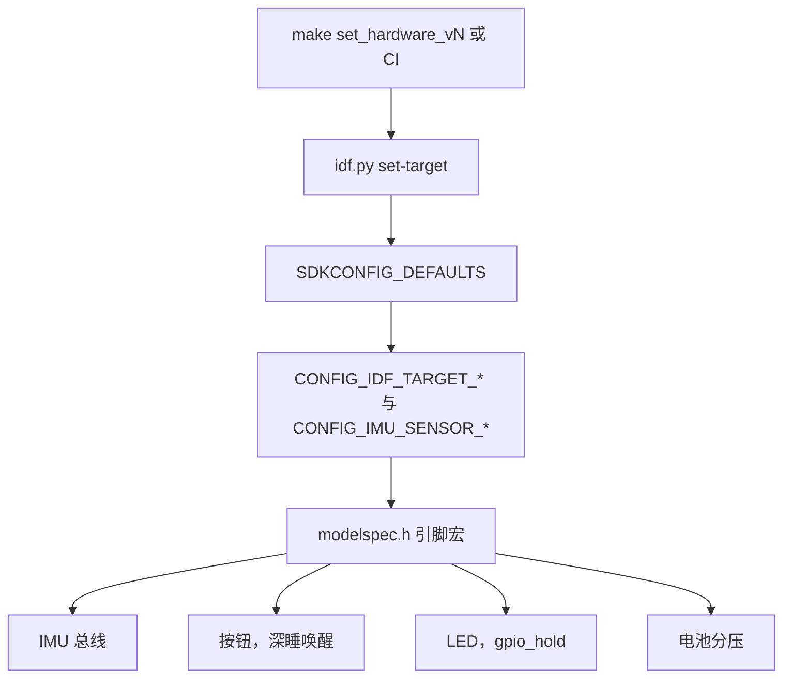
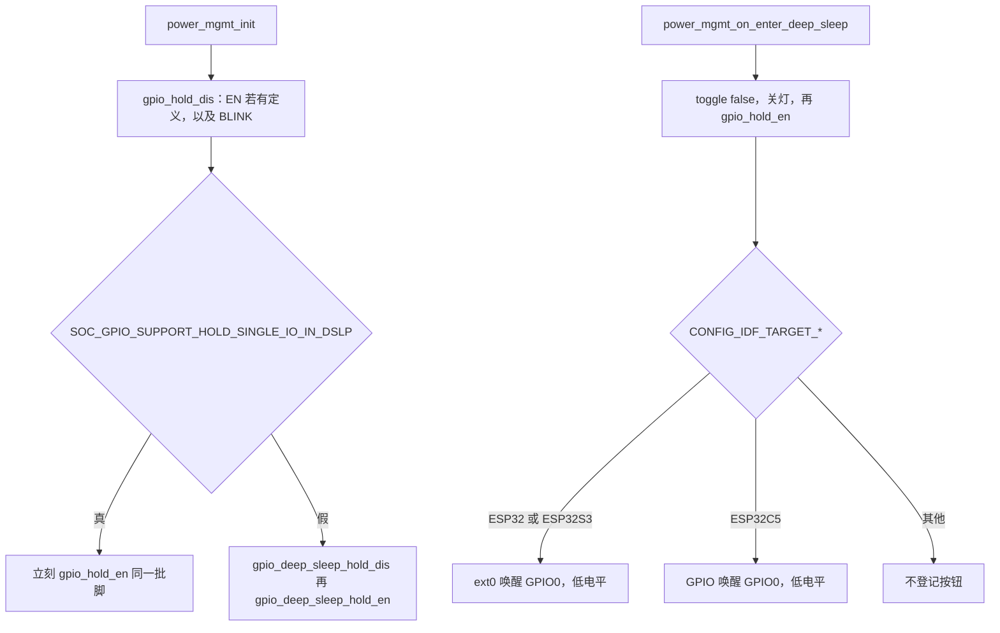

# 硬件变体与引脚（Hardware variants and pinout）

三块板的身份在编译期定死：哪颗 SoC、哪颗 IMU、哪些 GPIO。`include/modelspec.h` 按 `CONFIG_IDF_TARGET_*` 与 `CONFIG_IMU_SENSOR_*` 展开引脚宏；`Makefile` 的 `set_hardware_v1` / `v2` / `v3` 用 `idf.py set-target` 和对应 sdkconfig 把产品默认配上。固件没有运行时的板级探测。本文只记录这张规格，以及睡眠路径真正 hold 或拿来唤醒的脚；采样、手势、灯语和电源状态机不在这里展开。

## 职责

- 把产品名 v1 / v2 / v3 落到 IDF target、IMU Kconfig 和一份引脚表。仓库里没有 `CONFIG_HARDWARE_V1` 这类符号，电源和驱动只看 target 宏与 IMU 宏。
- 规定按钮、灯、IMU 总线、电池分压各自占用的 GPIO，以及方向和空闲电平。
- 标出 `modelspec.h` 注释里要求为 RTC GPIO 的脚，并写明 `power_mgmt` 在 deep sleep 前后实际操作的是哪几只。
- 记录随变体 defaults 一起变化、且属于板级差异的 sdkconfig：控制台、SoftAP 组件开关，以及 CPU 频率、Flash 模式、bootloader rollback 有没有写进该文件。

## 在系统中的位置

选择发生在编译，不经过 `app_main`。`make setup` 为 `esp32,esp32s3,esp32c5` 装工具链（`IDF_VERSION` 默认 `v5.5.3`）。CI（`.github/workflows/build-firmware.yml`）用同一 IDF 版本、同一组 `SDKCONFIG_DEFAULTS`，由 action 的 `target` 字段分别编 `esp32`、`esp32s3`、`esp32c5`。

下游只消费宏，不回写板型。总线行为见 [imu.md](imu.md)，按钮见 [button.md](button.md)，灯见 [led.md](led.md)，分压读数见 [battery.md](battery.md)，hold 与唤醒在状态机里的位置见 [power-management.md](power-management.md)。SoftAP 开关不改变 STA 路径，见 [wifi.md](wifi.md)。`CONFIG_EN_MULTI_CORE` 只影响任务能不能钉核，见 [boot-and-tasks.md](boot-and-tasks.md)。

## 设计

### 编译期如何选择

Kconfig 在 `main/Kconfig.projbuild`，菜单名 “IMU Sensor Configuration”。choice 的默认是 `IMU_SENSOR_HI229`，与芯片无关。`CONFIG_IMU_SENSOR_SELECT` 是派生字符串 `"hi229"` 或 `"bno08x"`，C 代码不读它。`CONFIG_USE_LINEAR_ACCELERATION` 与 `CONFIG_USE_GYRO` 默认 n，三份变体 defaults 都不改它们。

| 产品 | Make 目标 | `idf.py set-target` | `SDKCONFIG_DEFAULTS` | 传感器 |
| --- | --- | --- | --- | --- |
| v1 | `set_hardware_v1` | `esp32` | `sdkconfig.defaults;sdkconfig.defaults.v1` | `CONFIG_IMU_SENSOR_HI229=y` |
| v2 | `set_hardware_v2` | `esp32s3` | `sdkconfig.defaults;sdkconfig.defaults.v2` | `CONFIG_IMU_SENSOR_BNO08X=y` |
| v3 | `set_hardware_v3` | `esp32c5` | `sdkconfig.defaults;sdkconfig.defaults.v3` | `CONFIG_IMU_SENSOR_BNO08X=y` |

根 `CMakeLists.txt` 把 `lib/hi229` 和 `lib/bno08x` 都放进 `EXTRA_COMPONENT_DIRS`。两个库的 `CMakeLists.txt` 只在对应 `CONFIG_IMU_SENSOR_*` 为真时把 `.c` 放进 `SRCS`，否则注册空源文件列表。`components/imu/imu.c` 用同一对宏包含头文件并调用 `*_interface_init`；两个都没有时 `#error "No IMU sensor selected in Kconfig"`。`components/imu/CMakeLists.txt` 的 `PRIV_REQUIRES` 同时写了 `bno08x` 和 `hi229`，不按传感器裁掉依赖。

`modelspec.h` 的 IMU 段是 target 与传感器的叉积，不是三行产品表。ESP32 与 ESP32-S3 各有 HI229 和 BNO08X 两块；ESP32-C5 只有 `CONFIG_IMU_SENSOR_BNO08X`。因此可以编出产品默认之外的组合：ESP32 加 BNO08X，或 ESP32-S3 加 HI229。C5 加 HI229 时，这一段什么 IMU 宏都不定义。

工作区没有 `sdkconfig.defaults`。`.gitignore` 忽略了它和 `sdkconfig`。`Makefile` 与 CI 仍把它放在 `SDKCONFIG_DEFAULTS` 的第一项。缺这个文件时 `idf.py` 的退出码，代码未体现。下面能核对的只有三份已跟踪的 `sdkconfig.defaults.vN`。

### 三块产品与可编译组合

| 组合 | 守卫 | 是否产品默认 | 总线 |
| --- | --- | --- | --- |
| ESP32 + HI229 | `CONFIG_IDF_TARGET_ESP32` 且 `CONFIG_IMU_SENSOR_HI229` | v1 | `UART_NUM_1`，宏里的波特率 `CONFIG_IMU_BAUD` 为 115200 |
| ESP32-S3 + BNO08X | `CONFIG_IDF_TARGET_ESP32S3` 且 `CONFIG_IMU_SENSOR_BNO08X` | v2 | `SPI2_HOST`，`CONFIG_BNO08X_SPI_SPEED` 为 3000000 |
| ESP32-C5 + BNO08X | `CONFIG_IDF_TARGET_ESP32C5` 且 `CONFIG_IMU_SENSOR_BNO08X` | v3 | 与 v2 相同，主机也是 `SPI2_HOST` |
| ESP32 + BNO08X | 上列 target 加 `CONFIG_IMU_SENSOR_BNO08X` | 否 | `VSPI_HOST`，3 MHz。WAKE 与 v2/v3 不同 |
| ESP32-S3 + HI229 | `CONFIG_IDF_TARGET_ESP32S3` 且 `CONFIG_IMU_SENSOR_HI229` | 否 | 与 v1 同一组 UART 宏 |
| ESP32-C5 + HI229 | 只有 target，没有 HI229 引脚块 | 否 | IMU 引脚宏不存在 |

`include/settings.h` 里，`CONFIG_IDF_TARGET_ESP32` 或 `CONFIG_IDF_TARGET_ESP32S3` 把 `CONFIG_EN_MULTI_CORE` 设为 1，其余目标（含 ESP32-C5）为 0。这只说明 C5 这条编译不把任务钉到第二颗核，不改变引脚。

HI229 实际上装进 UART 的波特率是 `g_mcu.imu_baud`，不是写死的 115200。缺省来自 `CONFIG_IMU_BAUD`，NVS 可以覆盖。键与夹紧范围见 [nvs.md](nvs.md) 和 [imu.md](imu.md)。

### 三块板共用的脚

这两只写在 target 分支外面，IMU 选型不改它们。

| 宏 | GPIO | 方向与电平 | 谁配置 |
| --- | --- | --- | --- |
| `CONFIG_BUTTON_FN_GPIO_PIN` | `GPIO_NUM_0` | 输入，上拉，下拉关，`GPIO_INTR_ANYEDGE`。`CONFIG_BUTTON_FN_ACTIVE_LEVEL` 为 0 | `sys_init_buttons` |
| `CONFIG_BLINK_PIN` | `GPIO_NUM_7` | LEDC 输出。`CONFIG_IDF_TARGET_ESP32` 用 `LEDC_HIGH_SPEED_MODE`；`CONFIG_IDF_TARGET_ESP32S3` 与 `CONFIG_IDF_TARGET_ESP32C5` 用 `LEDC_LOW_SPEED_MODE`。通道 `LEDC_CHANNEL_0`，定时器 `LEDC_TIMER_0` | `blink_msp_init` |

`modelspec.h` 没有把这两只标成 RTC GPIO。按钮的手势不在本文；深睡时它是唤醒源，见下文。灯脚没有单独的 `gpio_config`，上下拉代码未体现，图案见 [led.md](led.md)。

### HI229 引脚

ESP32 与 ESP32-S3 的 HI229 块逐项相同。守卫是对应的 `CONFIG_IDF_TARGET_*` 再加 `CONFIG_IMU_SENSOR_HI229`。ESP32-C5 没有这一块。

| 宏 | GPIO | `modelspec.h` 注释 | 初始化 |
| --- | --- | --- | --- |
| `CONFIG_IMU_EN_PIN` | 4 | Need RTC GPIO | 输出，下拉，无上拉。`s_hi229_msp_init` 先写成 0 |
| `CONFIG_IMU_RX_PIN` | 17 | 无 | MCU 的 UART RX，`uart_set_pin` |
| `CONFIG_IMU_TX_PIN` | 16 | 无 | MCU 的 UART TX |
| `CONFIG_IMU_SYNC_IN_PIN` | 18 | 无 | 输入，下拉 |
| `CONFIG_IMU_SYNC_OUT_PIN` | 19 | 无 | 输出，下拉，初值 0 |
| `CONFIG_IMU_RESET_PIN` | 15 | 无 | 仅有宏。全仓库没有别的引用 |
| `CONFIG_IMU_UART_PORT` | `UART_NUM_1` | 无 | 8N1，无硬件流控，时钟 `UART_SCLK_APB` |
| `CONFIG_IMU_BAUD` | 115200 | 无 | 见上文，运行值可以来自 NVS |

RTS / CTS 在 `hi229.h` 里是 `UART_PIN_NO_CHANGE`，不占 GPIO。使能电平不在 `modelspec.h`：`CONFIG_HI229_ENABLE_LVL` 为 0，`CONFIG_HI229_DISABLE_LVL` 为 1。`hi229_toggle(false)` 把 EN 驱动为 1。`SYNC_IN` / `SYNC_OUT` 初始化之后没有再读再写。帧格式与关断命令见 [imu.md](imu.md)。

`s_hi229_msp_init` 末尾对 EN 调用 `rtc_gpio_is_valid_gpio`。合法只打信息日志，不合法打警告。函数在这之前已经把 `enabled` 置真，失败不中止，也不改脚。`gpio_config` 的返回值没有检查。

### BNO08X 引脚

SPI 数据脚在三颗 SoC 上相同。WAKE 只在经典 ESP32 上换成另一只。守卫是 `CONFIG_IDF_TARGET_*` 再加 `CONFIG_IMU_SENSOR_BNO08X`。C5 的 `#if` 没有 HI229 的 `elif`，选错传感器时下面这些宏全部缺失。

| 宏 | ESP32 | ESP32-S3 与 ESP32-C5 | 注释 | 初始化 |
| --- | --- | --- | --- | --- |
| `CONFIG_IMU_WAKE_PIN` | 14 | 3 | RTC GPIO，OUTPUT | 输出，无上下拉，初值 1。`GPIO_NUM_NC` 才会省掉这只，产品宏不是 NC |
| `CONFIG_IMU_MOSI_PIN` | 13 | 13 | 无 | SPI MOSI |
| `CONFIG_IMU_MISO_PIN` | 11 | 11 | 无 | SPI MISO |
| `CONFIG_IMU_SCLK_PIN` | 12 | 12 | 无 | SPI SCLK |
| `CONFIG_IMU_CS_PIN` | 10 | 10 | 无 | GPIO 输出，空闲 1。不交给 SPI 外设 |
| `CONFIG_IMU_INT_PIN` | 9 | 9 | RTC GPIO | 输入，上拉，`GPIO_INTR_NEGEDGE` |
| `CONFIG_IMU_RST_PIN` | 8 | 8 | RTC GPIO | 输出，无上下拉，空闲 1 |

主机宏在 `lib/bno08x/bno08x.h`：`CONFIG_IDF_TARGET_ESP32` 为 `VSPI_HOST`，`CONFIG_IDF_TARGET_ESP32S3` 或 `CONFIG_IDF_TARGET_ESP32C5` 为 `SPI2_HOST`。`BNO08x_init_spi` 把 `spics_io_num` 设为 -1，CS 用 `gpio_set_level`。旁边的注释写 ESP32 全双工不能把片选交给外设。S3 与 C5 走同一段，没有第二套硬件 CS。这三只 RTC 注释脚没有 `rtc_gpio_is_valid_gpio`。`gpio_config` 返回值未检查。报告、复位脉冲和 sleep 命令见 [imu.md](imu.md)。

### 电池分压

电池脚只按 target 分，不看 IMU 宏。三颗已支持的 SoC 都会定义它们。

| Target | `CONFIG_BATTERY_EN_PIN` | `CONFIG_BATTERY_READ_ADC_CHANNEL` | 注释里的 ADC 脚 |
| --- | --- | --- | --- |
| `CONFIG_IDF_TARGET_ESP32` | `GPIO_NUM_25` | `ADC_CHANNEL_6` | `GPIO_NUM_34` |
| `CONFIG_IDF_TARGET_ESP32S3` | `GPIO_NUM_2` | `ADC_CHANNEL_0` | `GPIO_NUM_1` |
| `CONFIG_IDF_TARGET_ESP32C5` | `GPIO_NUM_2` | `ADC_CHANNEL_0` | 无。对应哪只 GPIO，代码未体现 |

`battery_msp_init` 把 EN 配成输出、上拉、无下拉、中断关闭。闭合电平是 `CONFIG_BATTERY_EN_VALUE`（1），读完写成 0。`battery.c` 的注释把网络写成：VBAT 经 15 kΩ 到 ADC 节点，再经 10 kΩ 到低侧开关，开关另一端是 GND，控制端是 `ADC_EN`。采样用 `ADC_UNIT_1`。换算和校准见 [battery.md](battery.md)。EN 不在 deep sleep 的 hold 列表里，睡眠期间的电平代码未再设置。

### 哪些脚必须是 RTC GPIO

注释标成 RTC 的，和睡眠代码真正碰到的，不是同一组。

| 符号 | 何时存在 | GPIO | 注释 | 睡眠代码 |
| --- | --- | --- | --- | --- |
| `CONFIG_IMU_EN_PIN` | ESP32 或 ESP32-S3，且 HI229 | 4 | Need RTC GPIO | `gpio_hold_dis` / `gpio_hold_en`。另有一次 `rtc_gpio_is_valid_gpio`，只记日志 |
| `CONFIG_IMU_WAKE_PIN` | BNO08X | ESP32 为 14，S3 与 C5 为 3 | RTC GPIO，OUTPUT | 不 hold，不作唤醒源 |
| `CONFIG_IMU_INT_PIN` | BNO08X | 9 | RTC GPIO | 不 hold，不作唤醒源 |
| `CONFIG_IMU_RST_PIN` | BNO08X | 8 | RTC GPIO | 不 hold，不作唤醒源 |
| `CONFIG_BUTTON_FN_GPIO_PIN` | 三个 target 都有 | 0 | 未标 RTC | 唤醒源，不 hold |
| `CONFIG_BLINK_PIN` | 三个 target 都有 | 7 | 未标 RTC | 进入 deep sleep 时 hold |

产品 v1 编进 HI229，因此会 hold EN。产品 v2 / v3 编进 BNO08X，没有 `CONFIG_IMU_EN_PIN`，deep sleep 只 hold 灯。BNO 的关断是总线上的 sleep 命令，不是把某只 RTC 脚锁在睡眠电平；命令是否发出见 [imu.md](imu.md)。注释里的 WAKE / INT / RST 不会在深睡中被当成 IMU 唤醒或主机唤醒。

`power_mgmt_init` 先对「有宏才存在的 EN」和「始终存在的灯」做 `gpio_hold_dis`。随后的分支不是 `CONFIG_IDF_TARGET_*`，而是 `SOC_GPIO_SUPPORT_HOLD_SINGLE_IO_IN_DSLP`：

- 宏为真：注释写明这是 ESP32-C5，per-pin 的 `gpio_hold_en` 会穿过 deep sleep，所以刚松开的同一批脚要立刻 `gpio_hold_en`。产品 v3 没有 EN 宏，重新加上的只有 `CONFIG_BLINK_PIN`。
- 宏为假：`gpio_deep_sleep_hold_dis()` 然后 `gpio_deep_sleep_hold_en()`，只打开「深睡期间保持已经 hold 的脚」这个总开关。

本仓库没有 `soc_caps.h`。v1 / v2 的头文件是否定义 `SOC_GPIO_SUPPORT_HOLD_SINGLE_IO_IN_DSLP`，代码未体现。注释把为真的那条对应到 ESP32-C5。

`power_mgmt_on_enter_deep_sleep` 在 `g_imu.toggle(..., false)` 和关灯之后再次 `gpio_hold_en`：有 `CONFIG_IMU_EN_PIN` 就加上，灯脚总是加上。HI229 的 `toggle(false)` 先把 EN 写成 `CONFIG_HI229_DISABLE_LVL`（1），hold 锁住的是这个高电平，不是拉低。灯在 `blink_led_off` 之后被 hold；`led_initialized` 为假时跳过这次关灯，hold 仍会执行，锁住的电平就是当时焊盘上的电平。`gpio_hold_en` 的返回值没有检查。GPIO 7 是否在每颗芯片上都支持 hold，固件不探测。

按钮唤醒在 hold 之后登记，两套 API：

| 守卫 | 调用 |
| --- | --- |
| `CONFIG_IDF_TARGET_ESP32` 或 `CONFIG_IDF_TARGET_ESP32S3` | `esp_sleep_enable_ext0_wakeup(CONFIG_BUTTON_FN_GPIO_PIN, CONFIG_BUTTON_FN_ACTIVE_LEVEL)` |
| `CONFIG_IDF_TARGET_ESP32C5` | `esp_deep_sleep_enable_gpio_wakeup(BIT64(CONFIG_BUTTON_FN_GPIO_PIN), ESP_GPIO_WAKEUP_GPIO_LOW)` |
| 其他 target | 这段不编译，按钮不会被登记为唤醒源 |

`CONFIG_BUTTON_FN_ACTIVE_LEVEL` 为 0，所以 C5 的三元表达式选出低电平。EXT0 是否接受 GPIO 0，固件不调用 `rtc_gpio_is_valid_gpio`。上述两个 enable 的返回值都不检查，随后仍 `esp_deep_sleep_start`。醒来时 `power_mgmt_wake_up_handler` 把 `ESP_SLEEP_WAKEUP_EXT0` 和 `ESP_SLEEP_WAKEUP_GPIO` 都当成按钮。定时唤醒另由 `esp_sleep_enable_timer_wakeup` 打开，不占 GPIO。

light sleep（`app_power_save` 里的 `esp_light_sleep_start`）只登记定时器，不改 hold，也不调用上面的按钮唤醒 API。

### 控制台

`sdkconfig.defaults.v2` 与 `sdkconfig.defaults.v3` 都有 `CONFIG_ESP_CONSOLE_SECONDARY_USB_SERIAL_JTAG=y`。符号名是 secondary：这两份文件没有把主控制台改成 USB-JTAG，也没有写 USB D+/D− 的 GPIO。`sdkconfig.defaults.v1` 没有任何 `CONFIG_ESP_CONSOLE_*`。应用里没有控制台引脚宏。主控制台是 UART 还是 USB、接在哪两只脚，代码未体现。

### SoftAP 与其余板级 sdkconfig

应用没有 `#if CONFIG_ESP_WIFI_SOFTAP_SUPPORT`。v1 打开 IDF 的 SoftAP 组件，v2 和 v3 关掉。STA 仍然编译，见 [wifi.md](wifi.md)。

| 项 | v1 | v2 | v3 |
| --- | --- | --- | --- |
| `CONFIG_IMU_SENSOR_*` | `HI229` | `BNO08X` | `BNO08X` |
| `CONFIG_ESP_WIFI_SOFTAP_SUPPORT` | y | n | n |
| `CONFIG_ESP_CONSOLE_SECONDARY_USB_SERIAL_JTAG` | 未写 | y | y |
| `CONFIG_BOOTLOADER_APP_ROLLBACK_ENABLE` | y | 未写 | y |
| `CONFIG_ESPTOOLPY_FLASHMODE_QIO` | y | 未写 | 未写 |
| `CONFIG_ESP_DEFAULT_CPU_FREQ_MHZ_240` | y | 未写 | 未写 |
| `CONFIG_ESP_PHY_REDUCE_TX_POWER` | y | 未写 | 未写 |
| `CONFIG_ESP_WIFI_IRAM_OPT` / `CONFIG_ESP_WIFI_RX_IRAM_OPT` | 都是 n | 未写 | 未写 |
| `CONFIG_LWIP_IRAM_OPTIMIZATION` | 未写 | y | y |
| `CONFIG_LWIP_MAX_UDP_PCBS` | 512 | 未写 | 未写 |
| `CONFIG_BTDM_CTRL_BLE_MAX_CONN` | 3 | 未写 | 未写 |
| `CONFIG_BT_NIMBLE_HS_FLOW_CTRL` | y | 未写 | 未写 |
| `CONFIG_BT_NIMBLE_ENABLE_CONN_REATTEMPT` | 未写 | y，最多 3 次 | y，最多 3 次 |
| `CONFIG_FREERTOS_GENERATE_RUN_TIME_STATS` | y | 未写 | 未写 |

「未写」表示该文件没有这一行。共享 `sdkconfig.defaults` 不在树里，所以 v2 的 CPU 频率、Flash 模式和 bootloader rollback 不能从本仓库读出来。v1 注释把关掉 Wi-Fi IRAM 优化写成减少 ESP32 的 IRAM。rollback 的行为见 [ota.md](ota.md)，NimBLE 项见 [ble.md](ble.md)。这些开关都没有对应的 C 分支去改引脚。

## 接口

本规格不提供函数，也不占用事件位。其他子系统拿到的是头文件宏和 Kconfig 符号。

| 消费方 | 用到的符号 |
| --- | --- |
| `lib/hi229` | EN、RX、TX、SYNC_IN、SYNC_OUT、`UART_NUM_1`。不读 `CONFIG_IMU_RESET_PIN` |
| `lib/bno08x` | MOSI、MISO、SCLK、CS、INT、RST、WAKE，以及按 target 选择的 SPI host |
| `components/sys/button.c` | `CONFIG_BUTTON_FN_GPIO_PIN`。有效电平不参与 ISR，只交给深睡唤醒 |
| `components/blink` | `CONFIG_BLINK_PIN`，再按 target 选 LEDC 速度模式 |
| `lib/battery` | `CONFIG_BATTERY_EN_PIN`、`CONFIG_BATTERY_READ_ADC_CHANNEL` |
| `components/sys/power_mgmt.c` | EN（`#ifdef CONFIG_IMU_EN_PIN`）、灯、按钮；外加 `SOC_GPIO_SUPPORT_HOLD_SINGLE_IO_IN_DSLP` |

没有硬件版本的 NVS 键，引脚也不能在运行时改。`IMU_BAUD` 只影响 HI229 的 UART 波特率。唤醒原因不是 `sys.h` 里的事件位，而是 `esp_sleep_get_wakeup_cause` 返回的 `ESP_SLEEP_WAKEUP_EXT0` 或 `ESP_SLEEP_WAKEUP_GPIO`，由 [power-management.md](power-management.md) 解释。事件位表见 [events.md](events.md)。

## 失败与边界

- 产品默认之外的组合仍能编过，只要引脚宏存在。ESP32 加 BNO 会使用 GPIO 14 的 WAKE 和 `VSPI_HOST`，不是 v2 的 GPIO 3 与 `SPI2_HOST`。ESP32-S3 加 HI229 使用与 v1 相同的 UART 脚，包括会被 hold 的 EN。
- ESP32-C5 加 HI229：`modelspec.h` 不定义 IMU 引脚。`imu.c` 的 `#error` 不会触发，因为 Kconfig 仍然选中了 HI229。HI229 源文件继续引用 `CONFIG_IMU_EN_PIN` 等宏，结果是编译失败，没有单独的诊断。
- 两个 IMU 宏都没有：`imu.c` 直接 `#error`。正常的 Kconfig choice 不会落到这里。
- target 不是 ESP32、ESP32-S3、ESP32-C5：电池与 IMU 宏都没有；按钮和灯仍然是 GPIO 0 与 GPIO 7。深睡按钮唤醒的两段 `#if` 也都不编译。
- EN 不是合法 RTC GPIO 时只打警告，初始化继续，深睡仍会 `gpio_hold_en`。
- `CONFIG_IMU_RESET_PIN` 从未被驱动。HI229 硬复位不使用这只脚。
- BNO 的 WAKE、INT、RST 虽标了 RTC，深睡既不 hold 也不把它们登记为 `ext0` / GPIO 唤醒。主机不会靠这三只脚从深睡里把 IMU 或自己叫醒。
- 按钮脚未标 RTC，也没有有效性检查。EXT0 或 C5 GPIO 唤醒若被 IDF 拒绝，返回值被忽略，`esp_deep_sleep_start` 仍会执行。
- 灯脚未标 RTC。hold 是否真能在该焊盘上穿过 deep sleep，代码未检查。C5 那条 init 路径在跑起来之后就重新 hold 灯；LEDC 还能不能改电平见 [led.md](led.md)。
- 电池 EN 不参与 hold。深睡期间开关是开是关，代码未设置。
- C5 的 `ADC_CHANNEL_0` 没有注释 GPIO。不能从 S3 那一行的 `GPIO_NUM_1` 推断 C5。
- 分压注释写 “the voltage divider ratio is 2”，同一函数却做 `voltage / 2 * 5`。15 kΩ 与 10 kΩ 对应的是 2.5，不是 2。读数语义见 [battery.md](battery.md)。
- v1 打开 SoftAP 组件并不表示固件会进入 AP。v2 与 v3 关掉组件后，STA API 仍在。没有被这个符号裁掉的第二套射频引脚。
- v2 的 defaults 没有 rollback、CPU 频率和 Flash 模式。不能把 v1 的 240 MHz、QIO，或 v3 的 rollback，当成 v2 的现行配置。
- 主控制台引脚和 USB 差分线的 GPIO 号，代码未体现。
- `manifests/pcb/` 里有板级工程文件。固件编译不读它们，本文没有用原理图改上面的宏。
- light sleep 不配置这些脚。日志里把唤醒原因和 `ESP_SLEEP_WAKEUP_EXT0` 比较，但这条路径自己没有打开 ext0。

## 设计取舍

v1 与 v2 的配对写在 `3e172e7` 的 subject 里：v1 是 “sdkconfig.defaults.v1 for ESP32 + HI229 … and Wi-Fi SoftAP support”，v2 是 “sdkconfig.defaults.v2 for ESP32-S3 + BNO08X … disabled Wi-Fi SoftAP … and console via USB-JTAG”。Kconfig 的默认却仍是 HI229，产品锁定靠 defaults 文件，不靠 `modelspec.h` 单独完成。应用为何从不进入 AP，历史未说明。

v3 来自 `b08f2df`（“feat: add support for esp32c5”）。BNO 引脚与 S3 相同，SoftAP 同样是 n，控制台同样是 secondary USB-JTAG，并多写了 v2 文件里没有的 `CONFIG_BOOTLOADER_APP_ROLLBACK_ENABLE`。subject 没有解释 SoftAP、USB 或 rollback 的取舍。为何用 secondary 而不是把主控制台换成 USB-JTAG，历史未说明。

C5 在松开 hold 之后立刻重新锁上，来自 `016f90c`（“fix: remove unused include and add GPIO handling for ESP32-C5 in power management”）。理由在 `power_mgmt_init` 的注释里：单脚 hold 会留过 deep sleep。C5 改用 `esp_deep_sleep_enable_gpio_wakeup` 而不是 ext0，也在 `b08f2df` 里，subject 未说明原因。

EN、WAKE、INT、RST 的 RTC 注释，和现行 hold / 唤醒集合不一致。注释最早随 BNO 引脚一起出现，提交说明没有解释哪些脚必须在 RTC 域。软件片选避开 SPI 硬件 CS 的注释写的是 ESP32 硅片问题，S3 / C5 仍走同一路径，历史未说明这句是否仍然只针对 ESP32。EN 低电平才是开启，历史未说明。

不在当前 `HEAD` 上的 `9edb223` 曾经提交过共享 `sdkconfig.defaults`。本篇不把它当成现行配置。

## 源文件

- `include/modelspec.h`
- `include/settings.h`
- `main/Kconfig.projbuild`
- `Makefile`
- `CMakeLists.txt`
- `components/imu/CMakeLists.txt`
- `components/imu/imu.c`
- `lib/hi229/CMakeLists.txt`
- `lib/hi229/hi229.h`
- `lib/hi229/hi229.c`
- `lib/bno08x/CMakeLists.txt`
- `lib/bno08x/bno08x.h`
- `lib/bno08x/bno08x.c`
- `lib/bno08x/bno08x_driver.c`
- `lib/battery/battery.h`
- `lib/battery/battery.c`
- `components/blink/blink.h`
- `components/blink/blink.c`
- `components/sys/button.c`
- `components/sys/power_mgmt.c`
- `sdkconfig.defaults.v1`
- `sdkconfig.defaults.v2`
- `sdkconfig.defaults.v3`
- `.github/workflows/build-firmware.yml`
