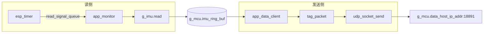
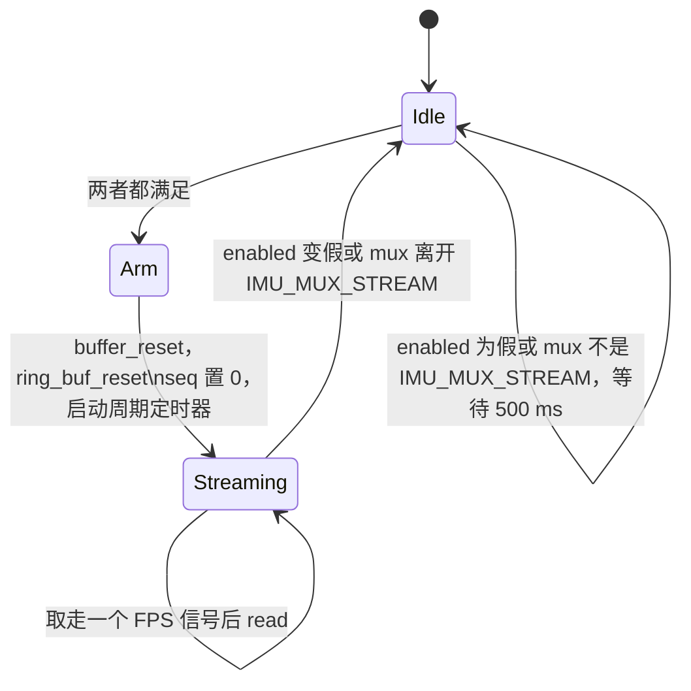
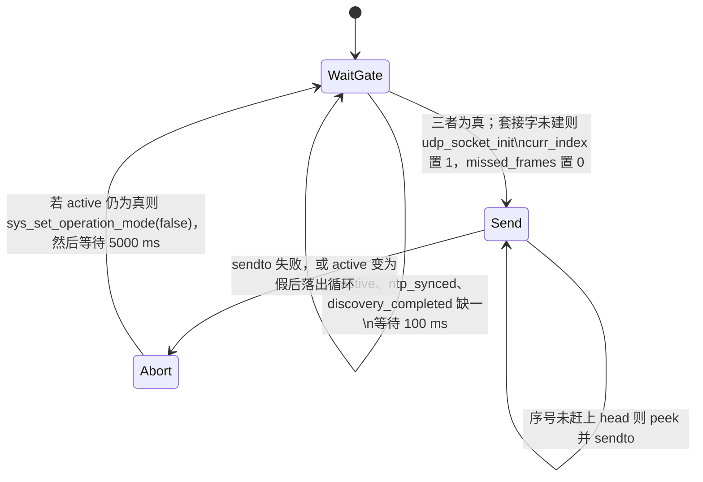

# IMU 数据面传输（IMU streaming）

这条路径把 IMU 采样送到上位机，是固件的数据面热路径。`app_monitor` 按目标帧率调用 `g_imu.read`，把成功读到的 `imu_dgram_t` 推进 `g_mcu.imu_ring_buf`；`app_data_client` 再逐帧编成 `marker_packet_t`，用 UDP 发到发现阶段记下的主机。传感器帧格式和 NTP 状态机不在这里展开，分别见 [imu.md](imu.md) 与 [time-sync.md](time-sync.md)。热路径不调用 `lib/spatial`。

## 职责

- 在 `IMU_MUX_STREAM` 且传感器 `enabled` 时，以 `g_mcu.target_fps` 为上限读取 IMU，并为每次成功读取分配从 0 递增的 `seq`。
- 用固定长度的环形缓冲解开读任务和发送任务。生产者覆盖旧槽，不阻塞；消费者按单调序号取帧。
- 把缓冲里的一帧收成无包头的 UDP 载荷，发往 `g_mcu.data_host_ip_addr` 的 `CONFIG_DATA_HOST_PORT`（18891）。
- 发送侧不按帧率节拍，有新序号就发。读失败、发送失败、缓冲被覆盖时各自丢弃或重复的对象不同，见下文。

`g_mcu.seq`（NVS 键 `SEQ`）只给灯语用，不进入本路径。见 [led.md](led.md)。

## 在系统中的位置

采样实现在 IMU 抽象之后，任务由启动流程拉起，目的地址来自发现，门闩来自全局状态。

| 方向 | 对象 | 文档 |
| --- | --- | --- |
| 上游 | `g_imu.read`、`imu_dgram_t`、`IMU_MUX_*` | [imu.md](imu.md) |
| 任务创建与停掉 | `sys_start_tasks` / `sys_stop_tasks` | [boot-and-tasks.md](boot-and-tasks.md)、[power-management.md](power-management.md) |
| 门闩与缓冲所有权 | `g_mcu.state`、`g_mcu.imu_ring_buf` | [global-state.md](global-state.md) |
| 模式切换事件 | `EV_SYS_MODE_CHANGE` | [events.md](events.md) |
| 时间门闩 | `g_mcu.state.ntp_synced` | [time-sync.md](time-sync.md) |
| 目的 IP | 发现应答的源地址 | [discovery.md](discovery.md) |
| 承载 | Wi-Fi STA | [wifi.md](wifi.md) |
| 进入 / 离开 active | 按键、REST、本路径发送失败、OTA | [button.md](button.md)、[api.md](api.md)、[ota.md](ota.md) |
| 帧率与主机默认值 | NVS | [nvs.md](nvs.md) |
| 芯片与传感器组合 | v1 / v2 / v3 | [hardware.md](hardware.md) |
| 系统总览 | — | [00-overview.md](00-overview.md) |

多核时读侧钉在 core 0，发送侧钉在 core 1。单核时两任务同核，见「并发」。

## 设计

### 数据与状态

启动时 `app_main` 用静态数组 `s_data_buf` 调用 `ring_buf_init`：`size` 为 `CONFIG_DATA_BUF_LEN`（128），`item_width` 为 `sizeof(imu_dgram_t)`，`static_buf` 为真。`head` 与槽游标 `_head` 都从 1 开始。槽下标是序号对 `size` 取模，因此第一帧在序号 1、槽 1，序号 128 才落到槽 0。

`ring_buf_push` 先把整份 `imu_dgram_t` 写入当前槽，再推进 `_head` 和 `head`。不看消费者走到哪，满了就覆盖。没有生产者侧的丢帧计数。`head` 是「下一写入序号」，已写入的序号是 `1 .. head-1`。

`ring_buf_peek` 的头文件注释与实现不一致，行为以 `ring_buf_peek` 为准：

| 请求的 index | 结果 |
| --- | --- |
| `index >= head` | `ESP_ERR_INVALID_ARG`，槽内容不动 |
| `index < 0`，或 `index <= head - size` | 改读 `head - 1`（当时最新的一帧），返回 `ESP_OK`，若 `index_out` 非空则写出这个实际序号 |
| 其余 | 返回该序号所在槽，`ESP_OK` |

因此按原序号返回的窗口是 `head - size < index < head`，一共 `size - 1` 帧。等于 `head - size` 的那一帧，即使槽还没被下一次写入盖掉，也会被换成最新帧。负序号是「给我最新一帧」：REST 在 `IMU_MUX_STREAM` 下用 `ring_buf_peek(..., -1, NULL)`，见 [api.md](api.md)。

缓冲里是完整的 `imu_dgram_t`（含 `eul`、`pressure`、`buffer_delay_us`）。线上只发 `marker_packet_t`，没有魔数、长度、校验和，也不做字节序转换。`compute_checksum` 标了 unused，发送路径不调用。三种目标都是 32 位 ILP32，按下表顺序 `int64_t` 落在 8 字节边界上，字段间无填充，结构尾也无填充，`sizeof` 为 80。没有 `packed`。

| 偏移 | 字段 | 类型 | 含义 |
| --- | --- | --- | --- |
| 0 | `acc[3]` | `float` | 来自 `imu_dgram_t.imu.acc` |
| 12 | `gyr[3]` | `float` | 来自 `imu.gyr` |
| 24 | `mag[3]` | `float` | 来自 `imu.mag` |
| 36 | `quat[4]` | `float` | 来自 `imu.quat`。`imu_data_t` 注释顺序为 w, x, y, z |
| 52 | `imu_ts_ms` | `uint32_t` | 传感器毫秒时间戳；谁填写见下表 |
| 56 | `dev_ts_us` | `int64_t` | 读路径写好的设备时间，微秒 |
| 64 | `tsf_ts_us` | `int64_t` | 读路径写好的 Wi-Fi TSF，微秒 |
| 72 | `seq` | `uint32_t` | `app_monitor` 成功入环后的序号 |
| 76 | `dev_delay_us` | `int32_t` | 发送前现算，不是传感器字段 |

不进载荷的还有 `imu.id`、`eul`、`pressure`、`buffer_delay_us`。物理单位代码未体现，热路径不做换算。

时间戳不在 `tag_packet` 里生成。`tag_packet` 只拷贝 `acc` / `gyr` / `mag` / `quat` / `imu_ts_ms` / `dev_ts_us` / `tsf_ts_us` / `seq`，再用 `gettimeofday` 计算 `dev_delay_us = (int32_t)(now_us - dev_ts_us)`。这个差只覆盖到 `sendto` 之前，不含协议栈排队；超过 `int32_t` 范围会截断；代码未对负值钳位。

| 字段 | `CONFIG_IMU_SENSOR_HI229` | `CONFIG_IMU_SENSOR_BNO08X` |
| --- | --- | --- |
| `dev_ts_us` | `hi229_read`：`gettimeofday` 再减去「解析完成到本次 read」的 `esp_timer` 间隔，回拨到快照时刻 | `bno08x_read`：read 返回前的 `gettimeofday`，不回拨 |
| `tsf_ts_us` | `esp_wifi_get_tsf_time(WIFI_IF_STA)` 减去同一间隔 | 同 API，不回拨 |
| `imu_ts_ms` | `ch_imu_data_t` 整块拷进 `imu_data_t`。两者布局相同，传感器的 `timestamp` 落在 `imu_ts_ms` | `bno08x_read` 不写该字段。`app_monitor` 只在任务开头把 `imu_dgram_t` 清零，故保持 0 |
| `buffer_delay_us` | UART 已缓冲字节数 / 波特率，估成微秒。只留在 `imu_dgram_t`，不上线 | 本次 read 内部耗时，同样不上线 |
| `mag` | 随传感器帧拷贝 | read 不写，保持 0 |
| `gyr` | 随传感器帧拷贝 | 仅当 Kconfig `CONFIG_USE_GYRO` 打开才写。`Kconfig.projbuild` 默认 `n`，v2/v3 的 sdkconfig 未打开，默认固件该字段为 0 |
| `acc` | 随传感器帧拷贝 | 默认原始加速度。`CONFIG_USE_LINEAR_ACCELERATION` 默认 `n`，打开后才改读线性加速度 |

`esp_wifi_get_tsf_time` 的返回值没有检查。`seq` 是 `app_monitor` 栈上的 `uint32_t`，每次进入采集循环置 0，只在 `g_imu.read` 返回 `ESP_OK` 之后 `seq++` 再 `ring_buf_push`。读失败不占序号，因此序号相对成功入环的帧是连续的，回绕只是无符号溢出，没有专门处理。它不是 `imu_t.seq`，也不是 NVS `SEQ`。

采集循环的状态：

发送循环的状态：

`Abort` 不是单独的错误标签跳转才进入。`while (g_mcu.state.active)` 正常结束会直接落到 `handle_error`，因此主动停流也会打出 aborted 日志并空等 5 秒。这 5 秒内不会开始下一轮发送。

### 行为与时序

**开门。** `app_data_client` 不看 `wifi_connected`，只看三个布尔：`g_mcu.state.active`、`ntp_synced`、`discovery_completed`。后两个只在对应成功路径上被写成真（`time_sync_notification_cb`、`sys_discovery_handler`），代码里没有清回假。`active` 由 `sys_set_operation_mode` 改写，并置 `EV_SYS_MODE_CHANGE`。`app_system_loop` 收到 `EV_SYS_MODE_CHANGE_BIT` 后向 `SYSTEM_MODE_CHANGE_EVENT` 投递；该事件同时注册了 `sys_mode_change_handler` 和 `sys_power_mgmt_handler`，注册顺序上先改 mux：`active` 为真则 `g_imu.p_imu->mux = IMU_MUX_STREAM`，否则 `IMU_MUX_IDLE`。电源侧随后进入 `POWER_ACTIVE` 或回到 standby，见 [power-management.md](power-management.md)。进入 active 时会把 Wi-Fi 最大发射功率设为 `CONFIG_MAX_TX_POWER`，并在 BLE 仍开着时关掉 modem sleep。这些发生在 mux 已经切到 `IMU_MUX_STREAM` 之后。

**读节拍。** `CONFIG_EN_READ_FPS_LIM` 在 `include/settings.h` 里定义为 1，是编译期开关，不是 Kconfig。打开时，`app_monitor` 创建一个深度 128、元素为 `char` 的队列，以及周期 `1000000 / g_mcu.target_fps` 微秒的 `esp_timer`（整数除法，例如 100 得到 10000 µs，400 得到 2500 µs）。回调把一个字节送进队列；`skip_unhandled_events` 为真。创建参数没有设 `dispatch_method`，即默认的定时器任务上下文，但回调使用 `xQueueSendFromISR`，也没有检查队列满。队列满时这次节拍被丢掉，读任务最多积压 128 个待读信号。

采集循环每次 `xQueueReceive(..., portMAX_DELAY)` 消费一个信号，然后调用 `g_imu.read(..., true)`。`crc_check` 固定传入真。`bno08x_read` 把它标成 unused；`hi229_read` 的函数体也不读这个参数。read 失败则 `taskYIELD` 后回到队列等待，不入环、不增加 `seq`，这个 FPS 信号就此作废。read 成功才写入 `seq` 并 `ring_buf_push`，然后 `taskYIELD`。

队列里如果已经积压了信号，下一次循环会马上再读，不再等满一个周期。所以帧率上限是「平均不超过定时器频率」，不是「两次 read 之间至少间隔一个周期」。HI229 的 read 在没有 `EV_DATA_READY` 时会最多阻塞 `0x10` 个 FreeRTOS tick（`xEventGroupWaitBits` 的超时）。当前工作区没有可引用的 `CONFIG_FREERTOS_HZ`（`sdkconfig.defaults` 不在树里），这里不换算成毫秒。阻塞期间定时器仍在灌队列，返回后可能突发补读。

**v1 上多出来的传感器帧。** `CONFIG_IMU_SENSOR_HI229` 时，`target_fps` 只放进 `hi229_config_t`，没有任何代码用它改传感器输出率。`hi229_init` 用 `xTaskCreate` 拉起 `hi229_poll_task`（栈参数 4096，优先级 7，调用点未钉核）。poll 任务每解析出一帧就覆盖 `raw_snapshot`。monitor 没取走的中间帧不会进环形缓冲，下一次成功的 read 只看到最新快照。`CONFIG_IMU_SENSOR_BNO08X` 则在 `bno08x_config` 里把报告间隔设为 `1000000 / p_imu->target_fps` 微秒（加速度、陀螺仪若启用、旋转向量）。芯片内部是否再排队，热路径看不出来；`BNO08x_data_available` 为假时 read 立即 `ESP_FAIL`。

**发送节奏。** 套接字在三个门闩第一次同时满足且 `client.initialized` 仍为假时创建：`udp_socket_init(&client, 0, g_mcu.data_host_ip_addr, CONFIG_DATA_HOST_PORT)`。源端口 0 表示不 `bind`，由协议栈在 `sendto` 时分配临时端口；18891 只是目的端口。目的地址字符串若等于 `255.255.255.255`，`udp_socket_init` 会打开 `SO_BROADCAST`。发现成功时先把应答源地址写进 `g_mcu.data_host_ip_addr`，再把 `discovery_completed` 置真，所以第一次建连看到的是该单播地址，不是 NVS 里的广播默认值。此后没有代码对这条数据套接字调用 `udp_socket_set_destination`。发现完成后的周期只发 keep-alive，不再改数据面地址。

内层循环没有定时器。`curr_index >= head` 时 `taskYIELD` 再试。否则 `ring_buf_peek` 到栈上的 `imu_dgram_t`，无论 `confirm_index` 被改成了什么，都执行 `curr_index++`，然后 `tag_packet` 和一次 `udp_socket_send`。成功后再 `taskYIELD`。一帧一个数据报，不合并。

**跟不上时丢什么。**

- 读信号队列满：丢掉的是定时器节拍，不是已经入环的帧。HI229 上对应的传感器帧会被后续快照覆盖。
- read 返回失败：这一拍不入环。若当时传感器已有更新，HI229 的快照还在，下一拍可以读到更新后的最新帧；这一拍本身没有序号。
- 环形缓冲覆盖：旧槽被新 `imu_dgram_t` 盖掉，被盖掉的 `seq` 不会再以原样出现。消费者不把 `curr_index` 跳到 `confirm_index + 1`。过期序号每次 peek 都得到当时的 `head - 1`，于是线上先重复多份相同 `seq` 的最新帧，等 `curr_index` 走进 `head - size < index < head` 之后，再按序号补发窗口里更老的帧。主机若假设 `seq` 严格单调且不重复，在覆盖之后会失真。
- `sendto` 失败：这一帧已经把 `curr_index` 加过，不会重发。`udp_socket_send` 把所有 `sendto < 0` 都返回成 `ESP_ERR_NO_MEM`，调用方分不清是内存还是网络错误。该返回值会 `missed_frames++` 并进入 `Abort`；其它非 `ESP_OK`（套接字未初始化时的 `ESP_FAIL`）只打错误日志，不增加 `missed_frames`，同样 `Abort`。`CONFIG_UDP_RETRY` 定义为 3，没有任何引用。日志字符串虽写 retry，控制流没有重试循环。
- 进入 `Abort` 且 `active` 仍为真：`sys_set_operation_mode(false)`，采集侧随后离开 `IMU_MUX_STREAM`。已经在环里、还没被这次会话发出去的帧，下一轮会从 `curr_index = 1` 重来；monitor 下次进入采集时还会 `ring_buf_reset`（只把 `head` / `_head` 拨回 1，不清槽里的字节）。

`CONFIG_EN_FPS_PROFILING` 同样为 1。采集循环每超过 1 秒打一条 `fps`（本秒 `seq` 增量）和 `g_imu.get_delay_us`。HI229 的实现是 UART 积压估计，BNO08X 固定返回 0。这只是日志，不反馈进节拍。

### 并发

`CONFIG_EN_MULTI_CORE` 在 `CONFIG_IDF_TARGET_ESP32` 或 `CONFIG_IDF_TARGET_ESP32S3` 时为 1，其它目标（含 v3 的 `CONFIG_IDF_TARGET_ESP32C5`）为 0。`sys_start_tasks` 据此分支：

| 任务 | `CONFIG_EN_MULTI_CORE == 1` | 否则 |
| --- | --- | --- |
| `app_monitor` | core 0，优先级 6，栈参数 4096 | `xTaskCreate`，优先级 12，栈参数 4096 |
| `app_data_client` | core 1，优先级 5，栈参数 4096 | `xTaskCreate`，优先级 12，栈参数 4096 |

ESP-IDF 里这个栈参数的单位是字节。单核时两个数据面任务优先级相同；是否时间片轮转取决于 FreeRTOS 配置，本仓库未提交对应的 sdkconfig，代码未体现。

热路径调用的是 `ring_buf_push`、`ring_buf_peek`、`ring_buf_reset`，不是 `*_safe`。`ring_buf_t.mutex` 只被 safe 变体使用，而全仓库没有 safe 变体的调用点。`imu_t.mutex` 在两种驱动的 `read` 里也不拿。`head` 是普通 `int64_t`，不是原子变量；64 位写入在这些核上不是单条指令，跨核也没有内存屏障。消费者能观察到新的 `head`，不代表一定已经观察到对应槽的全部写入。REST 的 `ring_buf_peek` 与发送任务、写任务同时进行，同样不加锁。

发送任务在追上 `head` 之后用 `taskYIELD` 空转，没有 `vTaskDelay`。`taskYIELD` 只让给同优先级任务。多核配置下该任务独占 core 1 且优先级为 5，core 1 上的 idle（优先级 0）不会因此跑到。这是有意用一个核换「环里一出现新序号就发」，不是漏掉的 sleep。

`active`、`ntp_synced`、`discovery_completed`、`mux` 都是普通共享变量，没有在数据面任务里用事件组阻塞。事件位只负责把「模式变了」送到 `app_system_loop`。

### 配置

| 符号 | 值 | 作用 |
| --- | --- | --- |
| `CONFIG_TARGET_FPS` | 100 | NVS 缺失、≤0 或大于上限时的回退 |
| `CONFIG_MAX_FPS` | 400 | 启动时装入后的上限 |
| `CONFIG_EN_READ_FPS_LIM` | 1 | 读侧是否等定时器信号 |
| `CONFIG_EN_FPS_PROFILING` | 1 | 每秒一条 fps 日志 |
| `CONFIG_DATA_BUF_LEN` | 128 | 环形槽数 |
| `CONFIG_DATA_HOST_IP_ADDR` | `255.255.255.255` | NVS `DATA_HOST` 为空时的初值 |
| `CONFIG_DATA_HOST_PORT` | 18891 | 目的端口，写死，不进 NVS |
| `CONFIG_NVS_DATA_HOST_NAME` | `DATA_HOST` | 启动时装入 `data_host_ip_addr` |
| `CONFIG_NVS_TARGET_FPS_NAME` | `TARGET_FPS` | 启动时装入 `target_fps` |

`sys_load_nvs_configuration` 在开机执行一次钳位：先把负值抬到 0，再把 ≤0 或 `> CONFIG_MAX_FPS` 换成 `CONFIG_TARGET_FPS`，最后再 `MIN` 到 400。合法保留范围是 1 到 400。钳位只改 RAM，不写回 NVS。`sys_set_nvs_var` 只改 NVS，不改 `g_mcu.target_fps`，也不重建定时器或传感器报告间隔。定时器在每次进入采集循环时 `esp_timer_start_periodic`，但离开循环时没有 `esp_timer_stop`。定时器已经在跑时再次 start 会失败，返回值被忽略，周期保持第一次成功 start 时的值。因此运行中改 NVS `TARGET_FPS` 或 `DATA_HOST` 不会改变已经开始的这条流。

v1 的 `sdkconfig.defaults.v1` 另有 `CONFIG_LWIP_MAX_UDP_PCBS=512`。v2/v3 的 defaults 没有这项，上限代码未体现。

### v1 / v2 / v3

数据面没有按硬件版本分开的源文件。差异来自目标芯片宏和 IMU 选择宏。

| | v1 | v2 | v3 |
| --- | --- | --- | --- |
| 目标 | `CONFIG_IDF_TARGET_ESP32` | `CONFIG_IDF_TARGET_ESP32S3` | `CONFIG_IDF_TARGET_ESP32C5` |
| 传感器 | `CONFIG_IMU_SENSOR_HI229`（`sdkconfig.defaults.v1`） | `CONFIG_IMU_SENSOR_BNO08X` | `CONFIG_IMU_SENSOR_BNO08X` |
| 核 | `CONFIG_EN_MULTI_CORE == 1`，monitor core 0，data client core 1 | 同 v1 | 宏为 0，两任务不钉核，优先级都是 12 |
| 帧率作用点 | 只限制 monitor 调用 read 的节奏；UART 帧率不跟 `target_fps` | 同时作为 BNO 报告间隔 | 同 v2 |
| 线上 `gyr` / `mag` / `imu_ts_ms` | 来自传感器帧 | 默认陀螺与磁力为 0，`imu_ts_ms` 为 0；陀螺和线性加速度看 Kconfig | 同 v2 |
| 会话开始时的 `buffer_reset` | 清解析状态并 `uart_flush`，环复位前丢掉尚未解析的 UART 字节 | `bno08x_buffer_reset` 是空函数 | 同 v2 |

`include/modelspec.h` 在 `CONFIG_IDF_TARGET_ESP32C5` 下只给出 BNO08X 引脚。C5 配 HI229 时 IMU 引脚宏不存在，那是 [hardware.md](hardware.md) 的边界，不是这条热路径的分支。

## 接口

对其它子系统暴露的是共享状态，不是单独的函数 API。

- 写入端：只有 `app_monitor` 调用 `ring_buf_push`。进入一轮采集前它还调用 `g_imu.buffer_reset` 和 `ring_buf_reset`。
- 读出端：`app_data_client` 按递增序号 `ring_buf_peek`。`imu_status_handler`（`/v1/imu/status`）在 `IMU_MUX_STREAM` 时用序号 `-1` 取最新一帧做 JSON，不从环里删掉它。`IMU_MUX_IDLE` / `IMU_MUX_DEBUG` 时该处理函数直接 `g_imu.read`，不碰环。
- 操作模式：`sys_set_operation_mode(bool)` 写 `g_mcu.state.active` 并置 `EV_SYS_MODE_CHANGE`。发送失败且仍为 active 时，数据面自己会把它设成假。按键与 REST 的入口见 [button.md](button.md)、[api.md](api.md)。OTA 路径在 `app_system_loop` 里先 `sys_set_operation_mode(false)` 再升级，见 [ota.md](ota.md)。
- 调试 mux：`imu_debug_toggle_handler` 把 mux 设成 `IMU_MUX_DEBUG` 或 `IMU_MUX_IDLE`，不会设回 `IMU_MUX_STREAM`。采集循环因此退出；只要 `active` 仍为真，发送任务就停在 `curr_index >= head` 的空转上。回到采集只能再走一次 mode-change。
- 可观察量：`GET /v1/system/info` 带有 `g_mcu.target_fps`。`g_mcu.missed_frames` 只在每轮发送开始时清零、在 `ESP_ERR_NO_MEM` 时加一，仓库里没有读取它的代码。

依赖的事件位（数据面任务自己不 `xEventGroupWaitBits`）：

| 位 | 数据面如何用到它 |
| --- | --- |
| `EV_SYS_MODE_CHANGE_BIT`（`BIT8`） | `sys_set_operation_mode` 置位。`app_system_loop` 把它变成 `SYSTEM_MODE_CHANGE_EVENT`，handler 才改 `mux`。发送任务看的是 `active`，不是这个位 |
| `EV_SYS_NTP_SYNCED_BIT`（`BIT4`） | 与 `ntp_synced = true` 同时写下。发送任务只读布尔量 |
| `EV_SYS_DISCOVERY_COMPLETED_BIT`（`BIT5`） | 与 `discovery_completed = true` 同时写下。发送任务只读布尔量 |
| `EV_SYS_OTA_TRIGGERED_BIT`（`BIT7`） | 系统循环收到后关掉 `active`，流随之停止 |

不依赖 `EV_TASK_*`，也不依赖 `EV_SYS_WIFI_*`。Wi-Fi 掉线不会清 `ntp_synced` 或 `discovery_completed`。

NVS 键：

| 键 | 宏 | 和热路径的关系 |
| --- | --- | --- |
| `DATA_HOST` | `CONFIG_NVS_DATA_HOST_NAME` | 只在 `sys_init_nvs` 时装入 RAM。发现成功会覆盖这块 RAM，且不写回 NVS。套接字使用建连那一刻的 RAM 字符串 |
| `TARGET_FPS` | `CONFIG_NVS_TARGET_FPS_NAME` | 只在同一次装入时钳位进 `g_mcu.target_fps`，供定时器周期和 BNO 报告间隔使用 |
| `SEQ` | `CONFIG_NVS_SEQ_NAME` | 不读、不写。与载荷里的 `seq` 无关 |

## 失败与边界

- 三个门闩缺任何一个：发送任务每 100 ms 醒一次，不建套接字、不发数据。采集任务只看 `enabled` 与 mux，可以在还没人收的时候把环写满并开始覆盖。
- `active` 先于 mux 变真。发送任务可能在 monitor `ring_buf_reset` 之前就带着 `curr_index = 1` 进入内层循环，此时 `head` 仍是上一轮的值。它会按覆盖规则把过期序号重发成「当时最新帧」，直到序号追上旧 `head`。随后 monitor 把 `head` 拨回 1，消费者的 `curr_index` 若已经大于新 `head`，会一直认为自己超前，直到新会话的 `head` 再次超过它，新会话开头的那些序号被跳过。两条任务之间没有交接标志。
- 每次离开发送内层循环，包括操作员把 `active` 关掉，都固定再等 5000 ms。这 5 秒内若再次设为 active，采集可以先跑起来，发送仍在睡觉；100 Hz 下 5 秒远超 128 槽，醒来后的第一轮必然走覆盖路径。
- 套接字一旦 `initialized`，失败路径不 `udp_socket_free`，也不清这个标志。目的地址、临时源端口和 `SO_BROADCAST` 都保持建连时的值。`sys_stop_tasks` 对两个任务 `vTaskDelete`，同样不关套接字。UDP fd 留在进程里，直到重启。
- `app_monitor` 的 `esp_timer` 句柄在任务栈上，离开 `IMU_MUX_STREAM` 或任务被删时都没有 `esp_timer_stop`。队列和「队列是否已创建」是函数外的静态状态。任务被删掉之后若定时器已经 start，回调还会往原队列送字节；再次 `sys_start_tasks` 会再 `esp_timer_create` 一个定时器，复用同一队列。省电是否真的会再次拉起任务，见 [power-management.md](power-management.md)：`app_power_save` 末尾调用了 `sys_start_tasks`，但 `power_mgmt_handle_transition` 在创建该任务后立刻 `power_mgmt_on_enter_deep_sleep(false)`，后者不返回。
- `imu_debug` 把 mux 拨离 `IMU_MUX_STREAM` 而保持 `active`：采集停，发送空转，主机看到的是停流而不是 `operation_mode` 被关掉。`missed_frames` 不加。
- 覆盖窗口里的重复帧与补发帧会在线上倒序出现（先重复最新 `seq`，再出现更小的 `seq`）。代码没有水位标记或丢帧位图告诉主机哪些序号是被盖掉的。
- `dev_delay_us` 在 NTP 步进时可以为负。`tsf_ts_us` 在 Wi-Fi 尚未有 TSF 时的取值，代码未处理。
- `ring_buf_push` 对空指针返回 `ESP_ERR_INVALID_ARG`，正常路径不会发生。初始化失败（`size == 0` 或静态缓冲指针与 `static_buf` 不匹配）只可能来自调用参数；当前 `app_main` 的参数不会触发。mutex 创建失败时 `ring_buf_init` 仍返回 `ESP_OK`，但热路径本来也不拿这把锁。

## 设计取舍

跟不上时选择覆盖槽位，并由 `ring_buf_peek` 把过期序号换成最新帧，而不是阻塞生产者或把读序号跳到窗口边缘。该判断随 `521da2c` 进入仓库，subject 是 "EVERY THING HAS CHANGED"，历史未说明。

发送失败不再重试。`47b42df` 的 subject 是 "fix: adjust task priority"：它去掉 `CONFIG_UDP_RETRY` 循环（原先最多 3 次、失败后等待 1 ms），改成失败即增加 `missed_frames` 并结束会话；同一次提交把 `app_data_client` 改钉到 core 1、`app_monitor` 改钉到 core 0。subject 没有写为什么不再重试，也没有写为什么读在 core 0、发送在 core 1。

帧率上限放在读任务而不是发送任务。能对上的说明只有 `8ff1f77` 正文中的 "feat: speed limit for monitor"，以及 `0c747a5` 的 subject "fix: fix monitor rate control"。两者都没有写为什么用深度 128 的队列，以及队列有积压时为什么允许连着 read。运行中修改 NVS 是否应该立刻改周期或目的地址，历史未说明；当前代码只在开机装入时生效。

## 源文件

- `components/apps/monitor.c`
- `components/apps/network.c`
- `components/apps/system_loop.c`
- `components/sys/sys.c`
- `components/sys/sys.h`
- `components/sys/discovery.c`
- `components/sys/nvs_mgmt.c`
- `components/sys/time_sync.c`
- `components/sys/power_mgmt.c`
- `components/imu/imu.h`
- `components/imu/imu.c`
- `components/rest_controller/rest_controller_handlers.c`
- `lib/ring_buf/ring_buf.h`
- `lib/ring_buf/ring_buf.c`
- `lib/libudp/udp.h`
- `lib/libudp/udp.c`
- `lib/hi229/hi229.c`
- `lib/hi229/hi229_serial.h`
- `lib/bno08x/bno08x.c`
- `include/settings.h`
- `include/modelspec.h`
- `main/app_main.c`
- `main/Kconfig.projbuild`
- `sdkconfig.defaults.v1`
- `sdkconfig.defaults.v2`
- `sdkconfig.defaults.v3`
