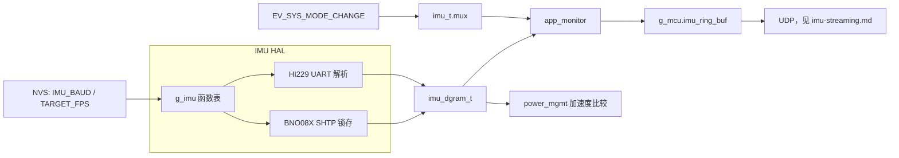
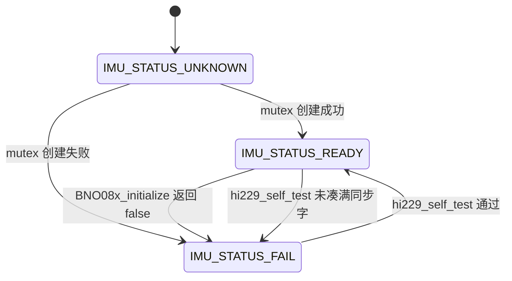
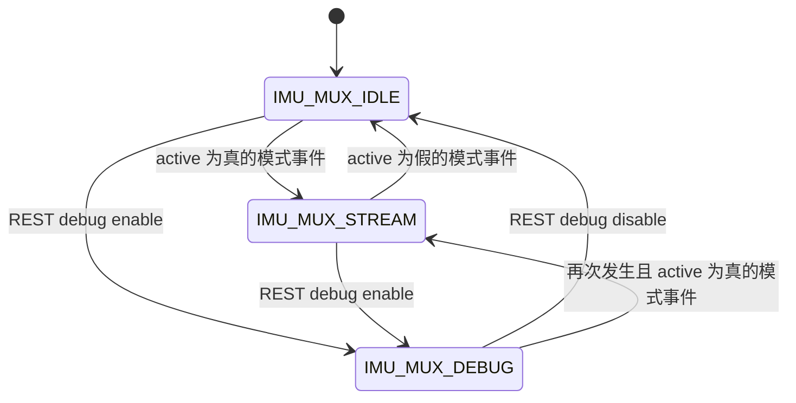

# IMU 外设与硬件抽象层（IMU HAL）

运动捕捉节点要在两种 IMU 上交出同一形态的样本。本模块在编译期于 HI229（UART）和 BNO08X（SPI）之间二选一，把读数收成 `imu_dgram_t`。调用方只使用全局函数表 `g_imu`，不直接操作寄存器或总线。Chaohe / SHTP 的线字节布局和 UDP 组包不在本文，见 [imu-streaming.md](imu-streaming.md)；`dev_ts_us` 与 `tsf_ts_us` 属于哪一个时钟，见 [time-sync.md](time-sync.md)。

## 职责

- 按 Kconfig 绑定唯一驱动，填好 `imu_interface_t` 函数表。
- 初始化总线与控制脚，启停传感器，把最新样本抄进调用方提供的 `imu_dgram_t`。
- 给 HI229 做一次上电后的同步字自检；BNO08X 的 `self_test` 不检查传感器。
- 不负责环形缓冲、序号、UDP，也不把自检结果变成系统事件。

源码里没有名为 `imu_init`、`imu_read`、`imu_toggle`、`imu_self_test`、`imu_reset` 的包装函数。对应入口是 `g_imu` 上的函数指针，由 `imu_interface_init()` 装上。复位拆成三个指针，而不是一次 `imu_reset`。

| 口头名称 | 函数指针 | HI229（`CONFIG_IMU_SENSOR_HI229`） | BNO08X（`CONFIG_IMU_SENSOR_BNO08X`） |
|---|---|---|---|
| init | `init` | `hi229_init` | `bno08x_init` |
| read | `read` | `hi229_read` | `bno08x_read` |
| toggle | `toggle` | `hi229_toggle` | `bno08x_toggle` |
| 是否开启 | `enabled` | `hi229_is_powered_on`（读 EN 脚电平） | `bno08x_enabled`（读 `imu_t.enabled`） |
| self-test | `self_test` | `hi229_self_test` | `bno08x_self_test`（直接 `ESP_OK`） |
| 软复位 | `soft_reset` | `hi229_chip_soft_reset` | `bno08x_soft_reset` |
| 硬复位 | `hard_reset` | `hi229_chip_hard_reset` | `bno08x_hard_reset` |
| 缓冲复位 | `buffer_reset` | `hi229_buffer_reset` | `bno08x_buffer_reset`（空函数） |
| 缓冲延迟 | `get_delay_us` | `hi229_get_buffer_delay` | `bno08x_get_delay_us`（恒为 0） |
| 原始读/写 | `read_bytes` / `write_bytes` | UART 直通 | 读出格式化文本；写为 `ESP_OK` 空操作 |

两套实现之外若都没选中，`imu_interface_init()` 以 `#error` 停在编译期。

## 在系统中的位置

`power_mgmt_on_enter_standby()` 在外设尚未标记 `imu_initialized` 时调用 `imu_interface_init()`，配置里的 `target_fps` 来自 `g_mcu.target_fps`。随后 `app_main()` 的 `init()` 调用 `g_imu.self_test()`，返回值被丢弃。任务模型见 [boot-and-tasks.md](boot-and-tasks.md)，全局对象见 [global-state.md](global-state.md)。

正常取数的人是 `app_monitor`：仅当 `imu_t.enabled` 且 `mux == IMU_MUX_STREAM` 时调用 `read`，成功后自己写入 `imu_dgram_t.seq`，再 `ring_buf_push` 到 `g_mcu.imu_ring_buf`。环形缓冲和 UDP 见 [imu-streaming.md](imu-streaming.md)。

`mux` 不由 IMU 驱动自己推进。`EV_SYS_MODE_CHANGE` 经 `SYSTEM_MODE_CHANGE_EVENT` 进 `sys_mode_change_handler()`：`g_mcu.state.active` 为真则 `IMU_MUX_STREAM`，否则 `IMU_MUX_IDLE`。事件位本身见 [events.md](events.md)。

REST 使用同一张函数表做开关、状态、调试串流和字节透传，路径见 [api.md](api.md)。电源状态机在深睡、定时唤醒和省电轮询里调用 `toggle` / `read` / `buffer_reset`，状态定义见 [power-management.md](power-management.md)。波特率与目标帧率的 NVS 键见 [nvs.md](nvs.md)。引脚按芯片变体分叉，见 [hardware.md](hardware.md)。

## 设计

### 数据与状态

唯一对外样本是 `imu_dgram_t`。其中 `imu` 为 `imu_data_t`：`id`、`acc[3]`、`gyr[3]`、`mag[3]`、`eul[3]`（注释为 roll、pitch、yaw）、`quat[4]`（注释为 w、x、y、z）、`pressure`、`imu_ts_ms`。旁边还有 `dev_ts_us`、`tsf_ts_us`、`seq`、`buffer_delay_us`。`imu_data_extra_t`（计步、稳定性、活动）标了 TODO，没有任何驱动写入。

`imu_t` 是函数表指向的对象头：`initialized`、`addr`、`status`、`enabled`、`mux`、`mutex`、`target_fps`、`seq`。具体芯片把更大的结构体放在前面，HI229 为 `hi229_t`，BNO08X 为 `bno08x_t`，各有一个静态实例。`imu_t.seq` 驱动从不递增；对外序号只由 `app_monitor` 写在 `imu_dgram_t.seq` 上。`addr` 被写成常数（HI229 `CONFIG_HI229_ADDR` 0xe5，BNO08X `CONFIG_BNO08X_ADDR` 0x50），当前读路径不用它做总线寻址。

`status` 与 `mux`：

| 枚举 | 值 | 含义 |
|---|---|---|
| `IMU_STATUS_UNKNOWN` | -1 | BSS 初值，`imu_interface_init()` 之前 |
| `IMU_STATUS_FAIL` | 0 | mutex 创建失败，或 BNO 初始化失败，或 HI229 自检未通过 |
| `IMU_STATUS_READY` | 1 | mutex 创建成功；HI229 自检通过时也会写成此值 |
| `IMU_MUX_IDLE` | 0 | 不进入 `app_monitor` 的推流循环 |
| `IMU_MUX_STREAM` | 1 | `app_monitor` 按节拍 `read` 并推入环形缓冲 |
| `IMU_MUX_DEBUG` | 2 | REST 调试占用；`app_monitor` 不再推流 |

BNO08X 的 `self_test` 不改 `status`。`initialized` 一旦为真，再次 `imu_interface_init()` 只打日志并返回；BNO 会先改 `target_fps` 字段再返回，但不会用新值重下报告周期，也不会重装函数指针。

内存中的一帧不是线包。HI229 解析器把一帧填进 `ch_imu_data_t`，字段顺序与 `imu_data_t` 相同；`hi229_read` 在 `EV_DATA_READY` 上把 `raw_snapshot` 整块 `memcpy` 到 `out->imu`，`timestamp` 因此落在 `imu_ts_ms`。BNO08X 先把各报告锁存在 `BNO08x` 的定点字段里，`bno08x_read` 再按 Q 格式转成浮点写入 `out`。线字段的偏移与 UDP 载荷见 [imu-streaming.md](imu-streaming.md)。

时间戳只在 `read` 成功时填写，语义交界如下，时钟选择不在本文：

| 字段 | 谁写 | 取值 |
|---|---|---|
| `dev_ts_us` | 两个 `read` | `gettimeofday` 的 Unix 微秒。HI229 再减去「快照时刻到本次 read」的 `esp_timer` 差；BNO 不回拨 |
| `tsf_ts_us` | 两个 `read` | `esp_wifi_get_tsf_time(WIFI_IF_STA)`。同样只有 HI229 回拨。返回值未检查 |
| `imu.imu_ts_ms` | 仅 HI229 解析 | 帧内原样整数。注释和调试打印标成毫秒，解析不做换算。BNO 把 SHTP 时间戳留在 `BNO08x.time_stamp`，`read` 不拷贝 |
| `seq` | `app_monitor` | 每次成功 `read` 后递增。失败不占号 |
| `buffer_delay_us` | `read` | HI229：`1000000 * UART 已缓冲字节 / baud`。BNO：本次 `read` 调用前后的 `esp_timer` 差，不是传感器延迟 |

`g_imu.get_delay_us()` 与上面不是同一件事：HI229 再算一次 UART 排空估计；BNO 固定返回 0。

单位以代码里的换算和注释为准，两套芯片并不相同。

| 量 | HI229 分项定点路径 | HI229 `KItemIMUSOL` / `KItemGWSOL` | BNO08X `read` 实际写入 |
|---|---|---|---|
| `acc` | int16/1000。调试打印标成 g | 帧内 float 原样拷贝，代码未换算 | `BNO08x_get_accel` 或线性加速度，注释为 m/s²。Q 点 `ACCELEROMETER_Q1` / `LINEAR_ACCELEROMETER_Q1`（均为 8） |
| `gyr` | int16/10。调试打印标成 deg/s | 同上，原样 float | 仅 `CONFIG_USE_GYRO`。`BNO08x_get_gyro_calibrated_velocity`，注释为 rad/s，Q 点 `GYRO_Q1`（9） |
| `mag` | int16/10。调试打印标成 µT | 原样 float | 不写入，保持调用方缓冲区原值 |
| `eul` | roll/pitch 为 int16/100，yaw 为 int16/10 | 原样 float | 流式 `read` 里欧拉转换被注释掉，不写。调试用的 `read_bytes` 才调用 `spatial_quaternion_to_euler_deg` |
| `quat` | 4 个 float 原样 | 原样 float，顺序 w、x、y、z | `get_quat` 的 real、i、j、k 写入 `[0]`…`[3]`。Q 点 `ROTATION_VECTOR_Q1`（14）。精度参数被丢掉 |
| `pressure`、`id` | 分项或求解帧里有则写入 | 求解帧写入 | 不写入 |

BNO 默认编译（`CONFIG_USE_LINEAR_ACCELERATION` 与 `CONFIG_USE_GYRO` 都默认 n）因此只保证旋转向量和加速度计；`gyr` 保持 0，直到打开陀螺选项。精度、计步、稳定性分类虽然在驱动对象里，不进入 `imu_dgram_t`。

### 行为与时序

`imu_interface_init()` 只做派发：`CONFIG_IMU_SENSOR_BNO08X` 调用 `bno08x_interface_init`，`CONFIG_IMU_SENSOR_HI229` 调用 `hi229_interface_init`。两边都把静态对象塞进 `g_imu.p_imu`，若 `initialized` 已真则不再初始化。

HI229 初始化（`hi229_init` → `s_hi229_msp_init`）：

1. 安装 `UART_NUM_1`，8N1，无硬件流控，时钟源 `UART_SCLK_APB`。RX 缓冲 `CONFIG_HI229_UART_RX_BUF_LEN`（5120），TX 缓冲 0。波特率用当时的 `g_mcu.imu_baud`，不是头文件里的 `target_fps`。
2. EN 配成输出并拉低；`SYNC_OUT` 输出拉低；`SYNC_IN` 输入下拉。RTS/CTS 为 `UART_PIN_NO_CHANGE`。
3. 延时 100 ms 后 `hi229_toggle(true)`：EN 置 `CONFIG_HI229_ENABLE_LVL`（0），再延时 100 ms 并 `uart_flush`。
4. 创建 `hi229_poll_task`（栈 4096，优先级 7，不绑核）。`initialized` 置真，函数返回 `ESP_OK`，即使 mutex 创建失败也是如此。

轮询任务每次 `uart_read_bytes` 最多 `CONFIG_HI299_BLOCK_READ_NUM`（32）字节，超时 `0x10` 个 tick。字节逐个送入 `ch_serial_input(..., true)`，CRC 始终检查，`read` 的 `crc_check` 参数被忽略。完整且 CRC 通过时覆盖 `raw_snapshot`，记下 `esp_timer`，并置上私有事件组的 `EV_DATA_READY`（`BIT0`）。帧长非法或 CRC 失败则不更新快照。本轮读到的字节数小于 32 时额外 `vTaskDelay` 10 ms。任务不看 `enabled`，关掉芯片后仍在空转。

`hi229_read` 以 `0x10` tick 等待 `EV_DATA_READY`（不自动清除）。等到则拷贝快照、填写三个时间相关字段、再清除该位，返回 `ESP_OK`。`out == NULL` 也返回 `ESP_OK`，但不清事件位。等不到返回 `ESP_FAIL`。快照只有一份：读得比帧慢时，中间帧被覆盖，事件位不是计数器。`0x10` 与自检的 `0x100` 是 tick 数，不是毫秒常量；本工作区的 `sdkconfig.defaults.*` 没有 `CONFIG_FREERTOS_HZ`。`hi229_delay_ms` 以及驱动里 `vTaskDelay(n / portTICK_PERIOD_MS)` 则按毫秒书写。

HI229 的输出速率没有在固件里设置。除软复位的 `AT+RST\r\n` 外，代码未向模块下发 ODR。`hi229_config_t.target_fps` 只是拷进去，读路径不用。主机侧节拍在 `app_monitor`：`CONFIG_EN_READ_FPS_LIM` 在 `settings.h` 里为 1 时，`esp_timer` 周期为 `1000000 / g_mcu.target_fps` 微秒（整数除法），回调往深度 128 的队列投一个字节；队列满则 `xQueueSendFromISR` 的失败被忽略。`read` 失败则 `taskYIELD` 后继续，不推进 `seq`。

BNO08X 初始化：

1. `bno08x_init` 创建 mutex，成功则 `status = IMU_STATUS_READY`。随后 `BNO08x_init` 配置 SPI 与 GPIO，并做一次空的 SPI 传输。`initialized` 在 `bno08x_config` 之前就置真。
2. SPI 模式 3，时钟 `CONFIG_BNO08X_SPI_SPEED`（3 MHz），超过 3 MHz 会被改回 3 MHz。`spics_io_num = -1`，CS 由 GPIO 手动拉。主机在 `CONFIG_IDF_TARGET_ESP32` 上是 `VSPI_HOST`，在 `CONFIG_IDF_TARGET_ESP32S3` 或 `CONFIG_IDF_TARGET_ESP32C5` 上是 `SPI2_HOST`。
3. HINT（`INT`）为下降沿。ISR `BNO08x_hint_handler` 关掉中断并通知 `bno08x_spi_task`。该任务优先级 8；`bno08x_data_proc_task` 优先级 7。两者栈均为 4096，不绑核。有报告使能时，SPI 任务每轮重新打开 HINT 中断。
4. `BNO08x_initialize` 做 hard reset，再要 product ID。`BNO08x_get_reset_reason` 非 0 才算初始化成功（驱动注释：1 POR、2 内部、3 看门狗、4 外部、5 其他）。失败则 `status = IMU_STATUS_FAIL` 且 `enabled` 保持 false。
5. 成功后按 `1000000 / target_fps` 微秒使能旋转向量，以及加速度计或线性加速度计；`CONFIG_USE_GYRO` 时同样间隔使能陀螺。计步和稳定性分类的间隔参数是 `CONFIG_BNO08X_SLOW_INTERVAL_MS`（500）。`BNO08x_enable_report` 的单位是微秒，注释却写成 2 Hz。固件发出的就是 500 µs；芯片是否钳位，代码未体现。

SPI 任务在 HINT 上若发送队列非空则发一包，否则收一包。收包把 SHTP 包送进深度为 1 的 RX 队列（`xQueueSend` 超时 0，满则丢），并置 `EVT_GRP_SPI_RX_DONE_BIT`。解析任务把合法包标成 `EVT_GRP_SPI_RX_VALID_PACKET_BIT`，否则标无效。`bno08x_read` 调用 `BNO08x_data_available` → `BNO08x_wait_for_data`，最多等 `HOST_INT_TIMEOUT_MS`（300 ms）。等到任意合法包就读取当前锁存的四元数和加速度（以及可选陀螺）返回 `ESP_OK`；超时、无效包或没有任何报告使能则 `ESP_FAIL`。因此一次 `read` 对齐的是「下一包 SHTP」，不是「同一时刻的 acc+quat+gyro」。这一包若是计步或命令响应，姿态字段仍是上一次锁存的值。`crc_check` 被忽略。

`toggle`：

- HI229：EN 脚。开为电平 0，关为电平 1，之后固定等 100 ms 并 `uart_flush`，把 `enabled` 设成请求值，返回 `ESP_OK`。不停止轮询任务。`enabled()` 读的是脚电平是否等于 0，不是 `enabled` 标志。
- BNO08X：请求值与 `enabled` 相同则直接 `ESP_OK`。开：先 `BNO08x_hard_reset`，再走一遍 `bno08x_config`（其中会再 hard reset，并再创建一对 SPI/解析任务）。关：`BNO08x_mode_sleep`（executable 通道命令字节 3）。只有对应调用返回成功才改 `enabled`。驱动里的 `BNO08x_mode_on` 没有接到 `toggle(true)`。

三个复位：

- 软复位：HI229 发送 `AT+RST\r\n`，break 长度参数 `0xF`，然后 `uart_wait_tx_done(..., portMAX_DELAY)`。不等待重启完成，也不清 `status`。BNO 走 executable 通道软复位并清掉全部报告使能位，再空等最多三次接收。
- 硬复位：HI229 是 `toggle(false)` 再 `toggle(true)`，不碰 `CONFIG_IMU_RESET_PIN`。BNO 把 RST 拉低 50 ms 再拉高（注释写最小 10 ns，实现固定 50 ms），CS 与 WAKE 保持高，并清报告使能；随后要等到 advertisement 和 initialize response，超时即失败。
- 缓冲复位：HI229 `memset` 解析状态并 `uart_flush`，不清 `EV_DATA_READY`，也不清 `raw_snapshot`。BNO 空函数，已锁存的样本还在。

`app_monitor` 每次进入 `IMU_MUX_STREAM` 循环前都会 `buffer_reset` 并 `ring_buf_reset`。HI229 上若事件位仍置着，第一次 `read` 会交出复位前的快照。

自检发生在轮询或 SPI 任务已经启动之后。

- HI229 `hi229_self_test`：`uart_flush` 后读最多 `CONFIG_HI299_MAX_READ_NUM`（512）字节，超时 `0x100` tick，清点 `0x5A 0xA5`。计数停在 `CONFIG_HI229_SELF_TEST_RETRY`（4）。凑满则 `status = IMU_STATUS_READY` 并 `ESP_OK`，否则 `IMU_STATUS_FAIL` 与 `ESP_FAIL`。这不是重试循环。它与 `hi229_poll_task` 同时读同一 UART，且不拿 `mutex`。读满 512 字节时，循环会访问 `data[len]`，缓冲区只有 512 字节。
- BNO `bno08x_self_test` 无条件 `ESP_OK`。初始化是否成功只反映在 `init` 留下的 `status` / `enabled` 上。

`app_main` 不看自检返回值，也不因此改 `mux` 或打系统事件。HI229 自检失败后 `enabled` 仍为真，模式一旦进入 `IMU_MUX_STREAM` 就会继续推流。BNO 若 `initialize` 失败则 `enabled` 为假，`app_monitor` 不会推流，直到某次 `toggle(true)` 把 `bno08x_config` 跑成功。

调试路径：`IMU_MUX_DEBUG` 时 WebSocket 周期调用 `read_bytes`。HI229 是再读 UART 原始字节（又与轮询任务争用同一驱动缓冲）。BNO 是在又一次 `data_available` 之后格式化一行四元数和欧拉角文本，不是 SPI 原始字节。反向 `write_bytes`：HI229 写 UART 并等待发送完成；BNO 直接 `ESP_OK`。REST 校准处理函数是 TODO，驱动里的校准例程没有接到 `imu_interface_t`。

省电与定时唤醒只借用 `read` 的 `acc`。定时唤醒在读到一帧后拿它和 `(0, 0, -1)` 做差并打日志，然后仍然返回 `POWER_DEEP_SLEEP`，比较结果不影响分支。省电循环在 light sleep 前后 `toggle`，阈值是 `CONFIG_POWER_SAVE_MOTION_LIMIT`（0.04），比较的是相邻两次 `acc`。阈值与参考向量的单位代码未按芯片区分。深睡前 `toggle(false)`；仅当 `CONFIG_IMU_EN_PIN` 有定义（即当前编译包含 HI229 引脚宏）时，`power_mgmt` 才 `gpio_hold_en` 该脚。BNO 的 RST、WAKE、INT 没有对应的 hold。

### 并发

`imu_t.mutex` 两边都会创建，创建失败把 `status` 设为 `IMU_STATUS_FAIL`。全仓库没有任何 `xSemaphoreTake` 使用这把锁。

HI229：轮询任务写 `raw_snapshot`，`read`、自检、`read_bytes` 读同一 UART。快照拷贝与解析状态都没有临界区。`hi229_read` 标了 `IRAM_ATTR`，但函数体内调用了 `gettimeofday` 和 `esp_wifi_get_tsf_time`。

BNO：解析任务写 `BNO08x` 定点字段，`read` 在等到合法包之后读取。RX/TX/FRS/reset-reason 队列深度都是 1。另一次 `toggle(true)` 会再 `xTaskCreate` 一对任务并把句柄覆写掉，旧任务没有删除；`cb_list` 也再次 `malloc`。`cb_list` 分配失败时只打日志，紧接着仍解引用。回调表的注册接口存在，`bno08x.c` 没有注册回调。

`app_monitor` 在 `CONFIG_EN_MULTI_CORE`（`CONFIG_IDF_TARGET_ESP32` 与 `CONFIG_IDF_TARGET_ESP32S3`）下钉在核 0、优先级 6；否则优先级 12。IMU 任务不钉核。双核上 HI229 轮询（7）和 BNO SPI 任务（8）都高于 `app_monitor`；ESP32-C5 上 `app_monitor` 更高。

### 配置

| 符号 | 作用 |
|---|---|
| `CONFIG_IMU_SENSOR_HI229` / `CONFIG_IMU_SENSOR_BNO08X` | `main/Kconfig.projbuild` 的 choice，默认 HI229。决定编进哪套 `.c`、`imu.c` 调用谁 |
| `CONFIG_IMU_SENSOR_SELECT` | 同文件里的字符串，默认 `"hi229"` 或 `"bno08x"`。C 代码未引用 |
| `CONFIG_USE_LINEAR_ACCELERATION` | 默认 n。BNO 用线性加速度代替加速度计 |
| `CONFIG_USE_GYRO` | 默认 n。BNO 才使能陀螺报告并在 `read` 里写出 `gyr` |
| `CONFIG_TARGET_FPS` / `CONFIG_MAX_FPS` | `settings.h` 中 100 与 400 |
| `CONFIG_NVS_TARGET_FPS_NAME`（`TARGET_FPS`） | 启动时载入 `g_mcu.target_fps`。缺省、`<= 0` 或 `> 400` 时改为 100，再与 400 取较小值。合法存储值 1…400 保持原值 |
| `CONFIG_NVS_IMU_BAUD_NAME`（`IMU_BAUD`） | 仅 `CONFIG_IMU_SENSOR_HI229` 时装入 `g_mcu.imu_baud`，缺省 `CONFIG_IMU_BAUD`（115200），再夹到 `[9600, 921600]` |
| `CONFIG_EN_READ_FPS_LIM` | 主机 `read` 节拍开关，当前为 1 |

NVS 的 POST 只调用 `sys_set_nvs_var`，不改 `g_mcu.target_fps` / `g_mcu.imu_baud`，也不重配 UART 或 BNO 报告间隔。这两项要到下次启动、再次 `imu_interface_init` 才进入驱动；BNO 的报告间隔还只在 `bno08x_config` 里下发一次。

未使用但容易误认的宏：`CONFIG_HI229_PAYLOAD_LEN`（82）没有被解析器拿来卡长度，长度来自帧头；`CONFIG_BNO08X_TRY_TIMES`（5）无引用。`cpu_spi_intr_affinity` 由全零配置进入 SPI 驱动，`bno08x_init` 未另赋值。

### v1 / v2 / v3 差异

产品默认来自三份 sdkconfig，不是 `modelspec.h` 里的 `#if` 单独决定的。`modelspec.h` 允许在 ESP32 与 ESP32-S3 上编译另一颗芯片的引脚；ESP32-C5 只有 BNO 引脚块，没有 HI229 分支。

| 变体 | 目标与默认传感器 | 总线 | 与另一变体不同的脚 |
|---|---|---|---|
| v1 `sdkconfig.defaults.v1` | `CONFIG_IDF_TARGET_ESP32` + `CONFIG_IMU_SENSOR_HI229` | UART1，8N1 | EN 4、RX 17、TX 16、SYNC_IN 18、SYNC_OUT 19、RESET 15。WAKE 无此宏 |
| v2 `sdkconfig.defaults.v2` | `CONFIG_IDF_TARGET_ESP32S3` + `CONFIG_IMU_SENSOR_BNO08X` | SPI2，模式 3，3 MHz | WAKE 3、MOSI 13、MISO 11、SCLK 12、CS 10、INT 9、RST 8 |
| v3 `sdkconfig.defaults.v3` | `CONFIG_IDF_TARGET_ESP32C5` + `CONFIG_IMU_SENSOR_BNO08X` | 同 v2，主机宏同样是 `SPI2_HOST` | 引脚与 v2 的 BNO 相同 |

若在 ESP32 上改选 BNO，WAKE 是 GPIO 14，SPI 主机是 `VSPI_HOST`，MOSI/MISO/SCLK/CS/INT/RST 与上表相同。ESP32 与 ESP32-S3 的 HI229 引脚表相同。RESET 只在 HI229 引脚表里定义，驱动不操作它。

同步脚只存在于 HI229 编译。`SYNC_OUT` 初始化为输出低，`SYNC_IN` 为输入下拉，此后没有边沿输出，也没有人读 `SYNC_IN`。代码未体现同步协议。BNO 的 INT 是 HINT，不是 HI229 那种 SYNC；WAKE 在 `BNO08x_init` 和 hard reset 时被拉高，`toggle` 不用它进出睡眠。

深睡 hold 与 `CONFIG_IMU_EN_PIN` 同生共死：只有编进 HI229 引脚时，EN 才会在深睡前被 hold。BNO 关断依赖 sleep 命令是否在掉电前发出。

## 接口

对其他子系统暴露的是 `g_imu`（`components/imu/imu.h` 的 `imu_interface_t`）和 `imu_interface_init()`。样本类型是 `imu_dgram_t`。驱动私有的 `hi229_*` / `BNO08x_*` 不应被 HAL 以外调用；当前也没有这样的调用。

依赖的系统事件只有模式切换：`EV_SYS_MODE_CHANGE` → `SYSTEM_MODE_CHANGE_EVENT` → `sys_mode_change_handler` 写 `mux`。IMU 自己的 `EV_DATA_READY` 以及 BNO 的 `EVT_GRP_SPI_*`、`EVT_GRP_RPT_*` 都在驱动私有事件组上，不是 `g_mcu.sys_event_group`。没有「IMU 就绪 / IMU 失败」系统事件位。

NVS 键：`IMU_BAUD`、`TARGET_FPS`。语义见上文配置表与 [nvs.md](nvs.md)。运行中改键不会热更新总线。

| 调用方 | 使用的入口 |
|---|---|
| `power_mgmt_on_enter_standby`、定时唤醒 | `imu_interface_init`；已初始化且未 enable 时 `toggle(true)` |
| `app_main` | `self_test`，忽略返回值 |
| `app_monitor` | `buffer_reset`、`read`、`get_delay_us`；只在 `enabled && IMU_MUX_STREAM` |
| `sys_mode_change_handler` | 写 `mux`，不调用函数表 |
| REST `/v1/imu/toggle` | `toggle` |
| REST `/v1/imu/status` | `enabled`、`status`、`mux`；IDLE/DEBUG 时 `buffer_reset` + `read`，STREAM 时看环形缓冲 |
| REST 调试 WebSocket | `read_bytes`、`write_bytes`；要求 `IMU_MUX_DEBUG` |
| 深睡与省电 | `toggle`、`buffer_reset`、`read` |
| 仓库内其他代码 | 不调用 `g_imu.soft_reset` / `g_imu.hard_reset` / `g_imu.init` |

`g_imu.init` 只被放进函数表。真正的第一次初始化发生在 `*_interface_init` 内部。

## 失败与边界

- mutex 创建失败：`status = IMU_STATUS_FAIL`，初始化仍继续。HI229 最终仍返回 `ESP_OK` 且 `enabled` 为真。
- UART 安装失败：`ESP_ERROR_CHECK` 直接中止。HI229 的 `gpio_config` 返回值未检查。BNO 的 `spi_bus_initialize` / `spi_bus_add_device` 返回值未检查。
- HI229 自检失败：只改 `status` 并返回 `ESP_FAIL`。不复位、不关 EN、不阻止推流。与轮询任务竞态，自检可能因字节被拿走而失败。历史未说明为何要恰好累计 4 个同步字。
- BNO `initialize` 失败：`status = IMU_STATUS_FAIL`，`enabled` 保持 false，但 `initialized` 已经为真，下次 `imu_interface_init` 不会再试。恢复路径是 `toggle(true)`。`self_test` 仍返回成功。
- BNO `cb_list` 分配失败：记录错误日志后继续解引用。代码未体现可恢复路径。
- `toggle(true)` 在 BNO 上叠加新的 SPI 任务和解析任务，旧任务仍在跑。
- `read` 失败对 `app_monitor` 只是让出 CPU。环形缓冲不插入占位帧，`seq` 不递增，因此序号不能当作传感器丢帧计数。
- HI229 丢帧策略是单槽覆盖。BNO 是深度 1 的队列，发送超时 0；包被丢掉时 `EVT_GRP_SPI_RX_DONE_BIT` 仍会置位，解析任务若没取到包，`wait_for_data` 会空等到 300 ms。
- 多报告共享一次 `read`：返回的 `acc` 与 `quat` 不一定来自同一包。慢速报告若按 500 µs 请求，会和姿态报告抢 HINT。
- `buffer_reset` 不能保证下一帧是新的。HI229 可能重读旧快照；BNO 什么都不清。
- 软复位不等待器件恢复。HI229 硬复位只是 EN 脚翻转两次，`CONFIG_IMU_RESET_PIN` 未驱动。
- `SYNC_IN` / `SYNC_OUT` 保持初始化电平。代码未体现外部同步采样。
- 关断后的 HI229 轮询任务仍在读 UART。调试 `read_bytes` 再开一条读路径。
- `TARGET_FPS` 或 `IMU_BAUD` 在运行中写入 NVS 后，当前进程的帧周期和波特率不变。
- 加速度单位随芯片和 Kconfig 变化。省电阈值 0.04、唤醒参考向量 `(0, 0, -1)` 没有按 m/s² 或 g 缩放；定时唤醒的比较结果也不决定是否继续睡。细节见 [power-management.md](power-management.md)。
- `esp_wifi_get_tsf_time` 在 Wi-Fi 未连接时的返回值未处理。如何解释 `tsf_ts_us` 见 [time-sync.md](time-sync.md)。

## 设计取舍

对外接口是一张 C 函数表，而不是按芯片分叉的宏。`a80e267` 的说明写 “use C struct instead of macro to separate interface / realization”，同一次提交用 `buffer_delay_us` 换掉了原来的 `uart_buffer_len`。

采样率分成两处，而且并不对称。主机读取节拍由 `TARGET_FPS` 控制：`908322e` 写 “fps is now configurable”，`8ff1f77` 写 “speed limit for monitor”。BNO 的报告间隔另外用 `1000000 / target_fps` 微秒下发，`0c747a5` 写 “fix report time of bno08x”。HI229 没有对应的输出率命令，历史未说明模块 ODR 应如何跟 `TARGET_FPS` 对齐。线性加速度和陀螺是后加的编译开关且默认关闭（`02743f7` “add linear acc option”，`54d3c3b` “feat: add gyroscope configuration”）。BNO 流式路径不再填欧拉角，`908322e` 写 “remove euler output”。

BNO 的开不走驱动里的 `BNO08x_mode_on`。`3fa3a0d` 写 “the enable/disable of bno08x”：打开是 hard reset 之后重新使能报告，关闭才是 sleep 命令。重复打开会再创建任务，历史未说明这是预期的生命周期。

同步脚只做 GPIO 初始化、RESET 脚不驱动、自检以 4 个同步字为门槛、慢速报告注释与微秒参数不符、mutex 创建后从未使用：历史未说明。v3 只是把同一套 BNO 引脚放到 ESP32-C5 上（`b08f2df` “feat: add support for esp32c5”）；v1/v2 的芯片与传感器配对写在 `3e172e7` 引入的 `sdkconfig.defaults.v1` 与 `sdkconfig.defaults.v2` 里。

## 源文件

- `components/imu/imu.h`
- `components/imu/imu.c`
- `components/imu/CMakeLists.txt`
- `lib/hi229/hi229.h`
- `lib/hi229/hi229.c`
- `lib/hi229/hi229_serial.h`
- `lib/hi229/hi229_serial.c`
- `lib/hi229/CMakeLists.txt`
- `lib/bno08x/bno08x.h`
- `lib/bno08x/bno08x.c`
- `lib/bno08x/bno08x_driver.h`
- `lib/bno08x/bno08x_driver.c`
- `lib/bno08x/CMakeLists.txt`
- `include/modelspec.h`
- `include/settings.h`
- `main/Kconfig.projbuild`
- `main/app_main.c`
- `components/apps/monitor.c`
- `components/sys/sys.h`
- `components/sys/sys.c`
- `components/sys/nvs_mgmt.c`
- `components/sys/power_mgmt.c`
- `components/rest_controller/rest_controller_handlers.c`
- `sdkconfig.defaults.v1`
- `sdkconfig.defaults.v2`
- `sdkconfig.defaults.v3`
