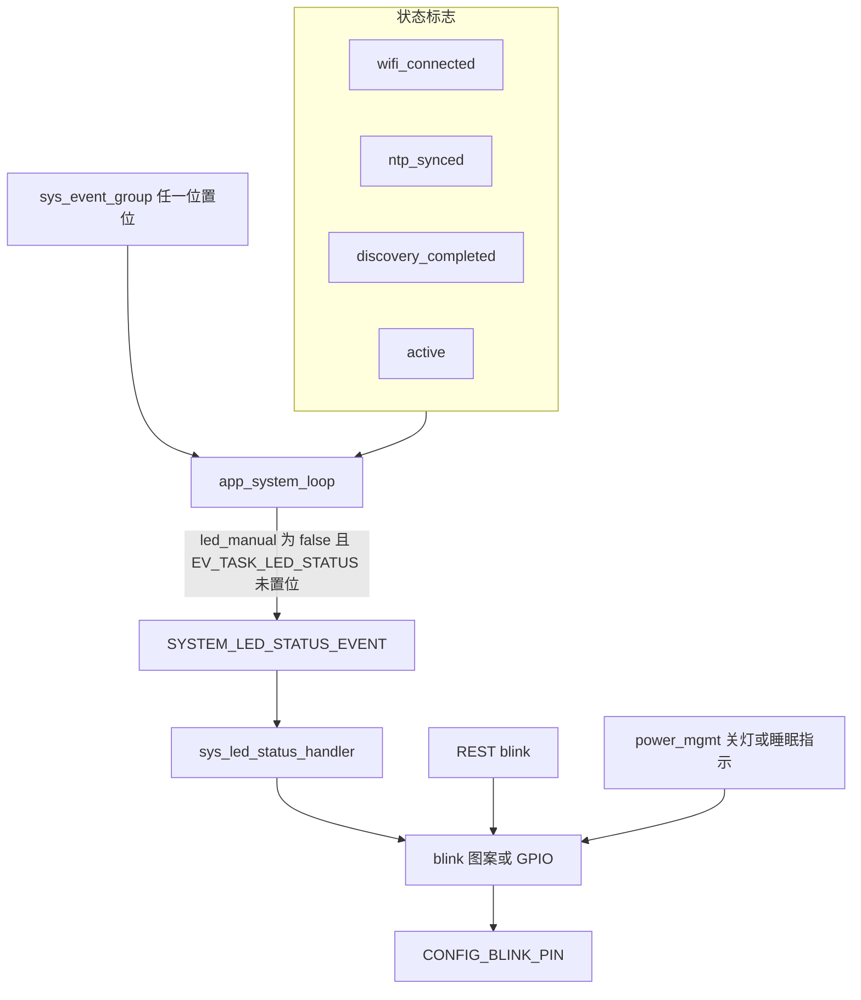
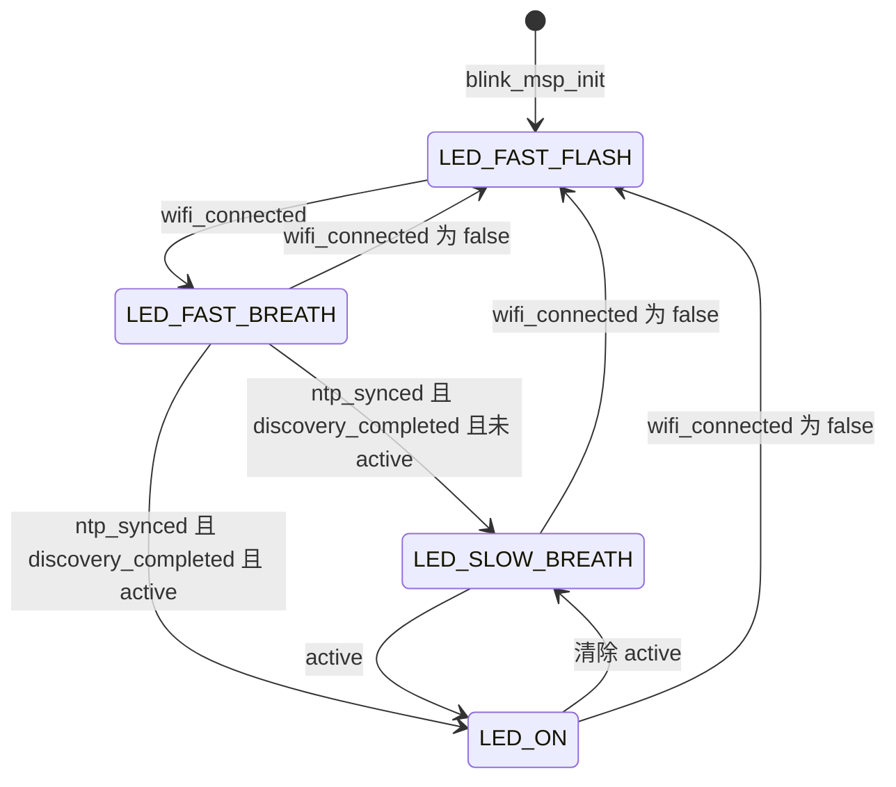

# LED 灯语与 blink 驱动（LED status and blink）

板上只有一颗 LED，要同时充当连网进度和手动测试灯。`led_status` 把 `g_mcu.state` 里的少数标志收成 `led_status_enum`；`blink` 用 LEDC PWM 按固定样本表点亮，或在常亮/熄灭时改走 GPIO。自动灯语不编码设备身份。`LED_SEQ_ENC` 只在手动切换时播放，内容是 NVS 键 `SEQ` 的一个字节，不是 `device_id`。

## 职责

- 自动灯语：在 `led_manual == false` 时，把 Wi-Fi、NTP、discovery、`active` 映射成快闪、快呼吸、慢图案或常亮。
- 图案发生器：用一个 `esp_timer` 周期回调改 LEDC 占空比。常亮和熄灭则停掉 PWM。
- 手动覆盖：REST 可以锁住自动策略，或按枚举值直接点亮；电源路径可以绕过策略把灯关掉，或在 deep sleep 前抢占灯语。
- 不负责按钮手势判定，也不负责决定何时进入省电或睡眠。那些调用进到本模块时，灯才被接管。

## 在系统中的位置

`app_main` 在拉起任务之前进入 standby，第一次点灯发生在这里。之后 [boot-and-tasks.md](boot-and-tasks.md) 里的 `app_system_loop` 消费 [events.md](events.md) 的系统事件位，再把 `SYSTEM_LED_STATUS_EVENT` 投进 `g_mcu.system_loop`。策略读取的标志由 [wifi.md](wifi.md)、[time-sync.md](time-sync.md)、[discovery.md](discovery.md) 写入；`active` 由 `sys_set_operation_mode` 写入，见 [global-state.md](global-state.md)。

手动接口在 [api.md](api.md) 的 `/v1/blink/configure` 与 `/v1/blink/toggle`。序列号进 [nvs.md](nvs.md) 的键 `SEQ`。关灯和睡眠指示的最终所有权在 [power-management.md](power-management.md)：省电路径直接 `blink_led_off`，deep sleep 先把 `led_manual` 置位再自己驱动引脚。长按进睡眠的手势本身见 [button.md](button.md)，本文只写它对灯的占有。引脚见 [hardware.md](hardware.md)。OTA 把 `active` 清掉（[ota.md](ota.md)），灯跟着自动策略走，没有单独的 OTA 图案。

## 设计

### 数据与状态

`g_mcu` 静态零初始化，因此 `led_status` 初值是 `LED_UNKNOWN`（0），`led_manual` 与 `active` 均为 false。这两个布尔和当前枚举都不进 NVS。`g_mcu.seq` 在 `sys_init_nvs` 从命名空间 `var`、键 `SEQ` 加载，并夹到 0..255；键不存在时保持 0。`g_mcu.use_hamming` 没有任何读写，blink 不看它。

`led_manual` 为 true 时，`app_system_loop` 不再投递灯语事件。已经进队列的 `SYSTEM_LED_STATUS_EVENT` 仍会跑 `sys_led_status_handler`，该处理函数自己不看 `led_manual`。

| 值 | 枚举 | 谁把它变成当前灯 |
| --- | --- | --- |
| 0 | `LED_UNKNOWN` | 仅初始值。`sys_set_led_status` 返回 `ESP_FAIL` |
| 1 | `LED_OFF` | REST `mode=off`、`target_state=1`、省电或睡眠收尾 |
| 2 | `LED_ON` | 自动策略在 active；或手动 |
| 3 | `LED_DUTY` | 只有 `blink_led_set_duty`。策略和 REST toggle 都到不了，仓库内无调用 |
| 4 | `LED_FAST_FLASH` | 未连接 Wi-Fi；也是 `blink_msp_init` 的开机图案 |
| 5 | `LED_FAST_BREATH` | 已连接，但 NTP 或 discovery 至少缺一个 |
| 6 | `LED_SLOW_BREATH` | 已连接且两者都完成，并且未 active |
| 7 | `LED_SEQ_ENC` | 仅手动 `target_state=7`。自动策略从不返回它 |

`led_status.c` 文件头注释写的是 Normal Breath、Slow Flash、enabled 时常亮。`get_target_led_status` 实际返回的是 `LED_FAST_BREATH`、`LED_SLOW_BREATH`、`LED_ON`。以函数为准。

自动策略按固定优先级只看四个标志，不看电源状态机，也不看 IMU：

| 条件 | 结果 |
| --- | --- |
| `wifi_connected == false` | `LED_FAST_FLASH` |
| 已连接，且 `ntp_synced` 或 `discovery_completed` 为 false | `LED_FAST_BREATH` |
| 已连接，两者都为 true，且 `active` | `LED_ON` |
| 已连接，两者都为 true，且未 `active` | `LED_SLOW_BREATH` |

`ntp_synced` 与 `discovery_completed` 只有置 true 的路径，没有清回 false 的路径。一旦两者都完成，自动灯语只在 `LED_ON` 与 `LED_SLOW_BREATH` 之间随 `active` 切换，除非 `wifi_connected` 被写成 false，那时直接回到快闪，中间不经过快呼吸。

Wi-Fi 标志并不等于链路实时状态。`wifi_event_handler` 在 `WIFI_EVENT_STA_DISCONNECTED` 里只重试或置 `wifi_event_group` 的 `EV_WIFI_FAIL_BIT`，不改 `g_mcu.state.wifi_connected`，也不 `set_sys_event`。标志被清掉的地方是 `sys_wifi_try_disconnect` 以及 `sys_wifi_try_connect` 的失败分支。链路掉了但没人走这两条函数时，灯保持掉线前的图案。

### 行为与时序

初始化顺序在 `init()`：`sys_init_nvs` 先于 `power_mgmt_on_enter_standby`。standby 里若 `peripheral_state.led_initialized` 为 false，调用一次 `blink_msp_init`，然后把该标志置 true。再次进入 standby（从 active 回来，或从省电循环回来）不会重新初始化，因此也不会按新的 `seq` 重算序列图案。deep sleep 唤醒后 `power_mgmt_init` 会把 `peripheral_state` 清零，下一次 standby 才会再跑 `blink_msp_init`。

`blink_msp_init` 配置 LEDC Timer 0 / Channel 0，分辨率 `LEDC_TIMER_13_BIT`，频率 `CONFIG_BLINK_PWN_FREQ`（4000 Hz），`clk_cfg` 为 `LEDC_AUTO_CLK`，初始 duty 0，`en_val` 固定为 1（高电平点亮）。接着 `blink_prepare_pattern` 填序列缓冲、把 `s_blink_idx` 置 0，并创建唯一的 `esp_timer`。创建参数没有 `dispatch_method`，回调走默认的 `ESP_TIMER_TASK`，不是 LEDC 或 GPIO 中断。回调仍标了 `IRAM_ATTR`，注释写 Used in interrupt。`skip_unhandled_events = true`：回调来不及执行的周期被丢掉，`s_blink_idx` 不前进，图案被拉长而不是跳步。初始化的最后一脚是 `blink_led_fast_flash`。此时 `app_system_loop` 尚未启动；`sys_init_events` 已经置了 `EV_SYS_WIFI_DISCONNECTED`，循环一开始就会再算一次策略，结果仍是快闪。

图案回调 `blink_timeout` 的占空比是 `sample * CONFIG_BLINK_MAX_DUTY / 0x100`，即 sample × 4000 / 256。样本 255 得到 3984，不是 13-bit 满幅 8191，也不是 4000。`blink_led_set_duty` 的参数按 0..100 解释，换算是 `4000 * duty / 100`，没有夹紧。

| 图案 | 定时器周期 | 样本 | 重复 |
| --- | --- | --- | --- |
| `LED_FAST_FLASH` | 50 ms | 16 字节，0 与 255 交替 | 亮灭周期 100 ms |
| `LED_FAST_BREATH` | 50 ms | 0, 32, 64, 96, 128, 160, 192, 224, 255，再对称降到 32 | 16 步，800 ms。末样本是 32，下一圈跳回 0 |
| `LED_SLOW_BREATH` | 200 ms | 14 个 0，随后两个 255 | 3.2 s 里只亮 400 ms。名字是呼吸，波形是一次短脉冲 |
| `LED_SEQ_ENC` | `CONFIG_BLINK_TIMER_INTERVAL_MS`（50 ms） | 4 字节同步头加 24 字节数据 | 28 步，1.4 s |

常亮和熄灭不走样本表。两者都在当前状态属于四种图案之一时 `esp_timer_stop`，然后 `ledc_stop`：常亮 idle level 1，熄灭 idle level 0，再 `gpio_set_level` 写成 `en_val` 或它的反相。`ledc_stop` 之后引脚是否已从 LEDC 切回 GPIO，代码未再切换，也未检查。图案模式则一直留在 LEDC 上，只改 duty。

换图案时的不变量：

- 目标已经是同一种图案则直接返回，不重启定时器，不把 `s_blink_idx` 拉回 0。
- 从另一种图案过来时先 `esp_timer_stop`，再换 `s_selected_pattern` 指针。索引仍沿用旧值，所以新图案可能从中间开始，要等回调里 `s_blink_idx >= len` 才绕回 0。序列图案的同步头因此不一定出现在切换后的第一圈。
- 只有从 `LED_ON` 或 `LED_OFF` 进入 PWM 时才 `ledc_set_freq` 回 4000 Hz。`LED_DUTY` 和 `LED_UNKNOWN` 两个分支都不停定时器、也不重设频率。开机那次快闪能亮，是因为 `blink_msp_init` 刚刚设过频率，而且定时器是新的。
- `esp_timer_start_periodic` 的返回值被忽略。定时器其实还在跑时，状态字仍会被改成新图案。

`LED_SEQ_ENC` 的线格式在 `blink_prepare_pattern` 里生成一次，用的是当时的 `g_mcu.seq`。REST 稍后改 `SEQ` 只写 RAM 和 NVS，不重建 `s_seq_enc_pattern`，也不重启定时器。新序列要等下次 `blink_msp_init`（冷启动，或 deep sleep 唤醒后再次进 standby）。

同步头四个样本固定为 255, 255, 255, 64。按 255 为高、64 为低读，是 1110。其后 12 个码字位各展开成两个 PWM 样本，样本只会被写成前一个符号里已经出现过的 255 或 64：

| 码字下标 | 0 | 1 | 2 | 3 | 4 | 5 | 6 | 7 | 8 | 9 | 10 | 11 |
| --- | --- | --- | --- | --- | --- | --- | --- | --- | --- | --- | --- | --- |
| 内容 | 校验 | 校验 | seq bit7 | 校验 | bit6 | bit5 | bit4 | 校验 | bit3 | bit2 | bit1 | bit0 |

数据位下标是 `{2,4,5,6,8,9,10,11}`，从 `seq` 的 bit7 取到 bit0。位 0 表示重复前一个两样本符号，位 1 表示把该符号前后对调。参考符号是同步头的最后两格 255, 64。注释写偶校验，但 `hamming_seq[12]` 没有清零，四个校验位把自身未初始化值加进和再取模 2，掩码也不是教科书 Hamming 的位置集合。校验结果不稳定，不能当成可纠错的 Hamming(12,8)。`CONFIG_BLINK_SEQ_LEN` 的 24 是样本数（12 位 × 2），不是 24 位码，也不是设备 ID。

自动策略的刷新不是只看 `EV_SYS_LED_STATUS_CHANGED`。`app_system_loop` 用掩码 `0x00FFFFFF` 等待 `sys_event_group`，返回时清掉等到的位。每次醒来，只要 `led_manual` 为 false 且 `EV_TASK_LED_STATUS` 未置位，就置该任务位并 `esp_event_post_to(..., SYSTEM_LED_STATUS_EVENT)`。因此任何系统事件都会顺带重算灯，包括与灯无关的 OTA、Wi-Fi 和模式位。`EV_SYS_LED_STATUS_CHANGED` 只是这些唤醒位之一。

`EV_TASK_LED_STATUS` 是在途守卫，不是灯的状态镜像。处理函数在「目标与当前相同」和「已经调用 `sys_set_led_status`」两条路上都清除它。相等时不会重画，相位继续。守卫置着的时候新的系统事件仍会被循环吃掉，但不会再投递一次灯语；处理函数读标志的时刻决定画什么。标志若在处理函数返回之后才变化，灯要等下一次系统事件。

会把循环叫醒、从而可能重算灯的置位：

| 事件位 | 置位者 | 与灯相关的状态 |
| --- | --- | --- |
| `EV_SYS_WIFI_CONNECTED` | `sys_wifi_try_connect` 成功 | `wifi_connected = true` |
| `EV_SYS_WIFI_DISCONNECTED` | `sys_init_events`、`sys_wifi_try_disconnect` | 后者同时把 `wifi_connected` 清掉 |
| `EV_SYS_WIFI_FAIL` | `sys_wifi_reconnect_event_handler` 在连接失败时 | 失败路径已把 `wifi_connected` 清掉 |
| `EV_SYS_WIFI_CONFIG_UPDATED` | BLE GATT | 不直接改灯的四个标志，只是叫醒循环 |
| `EV_SYS_NTP_SYNCED` | `time_sync_notification_cb` | 只在同步成功时把 `ntp_synced` 置 true。超时不置位，标志保持 false |
| `EV_SYS_DISCOVERY_COMPLETED` | `sys_discovery_handler` 收到合法回复 | `discovery_completed = true`。超时只打日志 |
| `EV_SYS_MODE_CHANGE` | `sys_set_operation_mode` | 先写 `active`。按钮单击、REST `/v1/operation/mode`、OTA 开始、数据任务退出都会走这里 |
| `EV_SYS_LED_STATUS_CHANGED` | `blink_configure_handler` 的 `mode=auto` 与 `mode=manual` | `mode=off` 不置这个位 |
| `EV_SYS_OTA_TRIGGERED` | REST 升级 | 同一次循环里把 `active` 清掉 |

`EV_SYS_POWER_MGMT` 在仓库里没有 `set_sys_event` 调用。电源周期定时器直接 `esp_event_post_to(SYSTEM_POWER_MGMT_EVENT)`，不经过 `sys_event_group`，因此不会刷新灯语。`POWER_MODE_PERFORMANCE`、`NORMAL`、`LOW_ENERGY` 也不改 `led_status`。它们只武装或解除省电定时器，以及在低能耗时停 BLE。active 时 `sys_power_mgmt_handler` 把 `no_sleep` 置 true，周期处理里不断 `reset_power_save_timer`，空闲超时不会到期；灯变成常亮是因为 `active`，不是因为电源状态进入了 `POWER_ACTIVE`。`power_mgmt_on_enter_active` 本身不碰 LED。

省电与睡眠谁说了算：

- 正常运行且 `led_manual == false`：说了算的是 `sys_led_status_handler`。REST toggle 若没有先把 `led_manual` 置上，下一次系统事件会把手动图案盖掉。
- `mode=manual` 只置标志并叫醒循环；循环看到 `led_manual` 就跳过，当前图案继续。`mode=off` 置 `led_manual` 并直接 `blink_led_off`，不发灯事件。`mode=auto` 清标志并置 `EV_SYS_LED_STATUS_CHANGED`，策略按四个标志重画。
- `power_mgmt_on_enter_power_save` 无条件 `blink_led_off`，不置 `led_manual`，也不看 `led_initialized`。调用它的 `app_power_save` 已经 `sys_stop_tasks`，`app_system_loop` 被删掉，自动策略不再投递。已排队的 `SYSTEM_LED_STATUS_EVENT` 仍可能在 `system_event_loop_task` 上晚到，处理函数不看 `led_manual`，有机会把灯重新点亮。
- 空闲定时器回调 `power_mgmt_handle_transition` 先以优先级 12 创建 `app_power_save`，随后在同一次回调里调用 `power_mgmt_on_enter_deep_sleep(false)`。高优先级的省电任务会先 `blink_led_off`；回调继续执行时，睡眠路径再盖过它。源码在 `app_power_save` 上标了 FIXME。`CONFIG_POWER_SAVE_CYCLE_MAX_COUNT` 那条再进 deep sleep 的路径，要这个任务能跑完光睡循环才到得了。
- `power_mgmt_on_enter_deep_sleep` 先写 `led_manual = true`，空等 100 ms，再在 `led_initialized` 时 `blink_led_on`、空等 2000 ms、`blink_led_off`。然后对所有 target `gpio_hold_en(CONFIG_BLINK_PIN)` 并 `esp_deep_sleep_start`。这 2 秒常亮是睡眠确认，不是自动策略。`wakeup == false` 时不设定时唤醒（按钮长按、REST `shutdown`、空闲定时器回调）。`wakeup == true` 时用 `CONFIG_POWER_WAKE_UP_DURATION_S`（30 s）。REST `shutdown` 先回 HTTP，3 s 后才进这个函数。
- 定时器唤醒后若 `power_mgmt_wake_up_handler` 仍返回 `POWER_DEEP_SLEEP`，`app_main` 会在 `blink_msp_init` 之前再次睡眠。`led_initialized` 仍为 false，2 秒确认被跳过，但 `gpio_hold_en` 仍会执行。按钮唤醒返回 `POWER_NORMAL_BOOT`，随后 standby 重新快闪。

`gpio_hold_en` 之后的关机电平就是刚才 `blink_led_off` 写下的低电平。若排队的灯语处理函数赶在 hold 之前把灯点亮，被锁存进睡眠的就会是亮电平。代码没有清事件队列。

### 并发

策略处理跑在 `system_event_loop_task` 上。该任务在 `app_system_loop` 里创建，优先级等于当时的 `uxTaskPriorityGet(NULL)`：`CONFIG_IDF_TARGET_ESP32` 与 `CONFIG_IDF_TARGET_ESP32S3` 上 `app_system_loop` 优先级 4 并钉在 core 0；其余 target（v3）`CONFIG_EN_MULTI_CORE` 为 0，优先级 8，不钉核。队列深度 16，投递用 `portMAX_DELAY`。

`sys_led_status_handler` 有一把懒创建的 mutex，`portMAX_DELAY` 取锁。它只串行化策略重入，不覆盖 REST、电源任务和 `esp_timer` 回调。这些路径都写 `g_mcu.state.led_status`、LEDC 和 `s_blink_idx`，blink 层没有第二把锁。`esp_timer` 任务优先级高于系统循环，回调可以插在 `esp_timer_stop` 与换图案指针之间。`ledc_*` 的返回值除 `esp_timer_create` 用了 `ESP_ERROR_CHECK` 之外都不检查。

### 配置

灯没有 Kconfig 项。`CONFIG_BLINK_*` 尽管带 `CONFIG_` 前缀，全是 `blink.h` 里的宏：间隔 50 ms，同步头 4，数据样本 24，PWM 频率 4000，软件满幅 4000，定时器与通道都是 `LEDC_TIMER_0` / `LEDC_CHANNEL_0`。名字里的 `PWN` 是源码拼写，不是 `PWM`。

与睡眠指示有关、但不由 blink 解释的宏在 `settings.h`：`CONFIG_POWER_SAVE_TIMEOUT_S` 300、`CONFIG_POWER_WAKE_UP_DURATION_S` 30。NVS 键只有 `SEQ`（`CONFIG_NVS_SEQ_NAME`），类型 `VAR_INT32`。

### v1 / v2 / v3

`CONFIG_BLINK_PIN` 在 `modelspec.h` 里是 `GPIO_NUM_7`，不在 `CONFIG_IDF_TARGET_*` 或 `CONFIG_IMU_SENSOR_*` 的分支里。三块板子的灯脚相同，IMU 选型不改变灯。

LEDC 速度模式只在 `blink_msp_init` 分叉：

| 硬件 | 守卫 | `speed_mode` |
| --- | --- | --- |
| v1，ESP32 | `CONFIG_IDF_TARGET_ESP32` | `LEDC_HIGH_SPEED_MODE` |
| v2，ESP32-S3 | `CONFIG_IDF_TARGET_ESP32S3` | `LEDC_LOW_SPEED_MODE` |
| v3，ESP32-C5 | `CONFIG_IDF_TARGET_ESP32C5` | `LEDC_LOW_SPEED_MODE` |

两个字段（通道和 timer）用同一套条件。都未命中时，复合字面量里该成员保持 0。本仓库的 `make set_hardware_v1/v2/v3` 都会命中。

睡眠保持在 `power_mgmt_init` 再分一次，守卫是 `SOC_GPIO_SUPPORT_HOLD_SINGLE_IO_IN_DSLP`，不是 target 宏。按本树默认的 ESP-IDF v5.5.3：ESP32 与 ESP32-S3 的 `soc_caps.h` 没有这个宏（`#if` 为 0），ESP32-C5 定义为 1。

- v1/v2：`gpio_hold_dis(CONFIG_BLINK_PIN)` 之后调用 `gpio_deep_sleep_hold_dis` 再 `gpio_deep_sleep_hold_en`。全局 deep-sleep hold 只在睡眠期间生效，运行时 LEDC 可以改脚。
- v3：松开之后立刻 `gpio_hold_en(CONFIG_BLINK_PIN)`。注释写明单脚 hold 会跨 deep sleep 保留，所以要重新加上。`blink_msp_init` 不再 `gpio_hold_dis`。ESP-IDF 约定 hold 期间垫电平不变；固件没有再探测灯是否还能被 LEDC 改写。

进入 deep sleep 前的 `gpio_hold_en(CONFIG_BLINK_PIN)` 三块板子都执行。唤醒源的 ext0 / GPIO 差异不改变灯语，见 [button.md](button.md) 与 [power-management.md](power-management.md)。

## 接口

对其他子系统暴露的是 `sys.h` 里的 `sys_set_led_status`、`sys_led_status_handler`，以及 `blink.h` 的 `blink_msp_init`、`blink_led_on`、`blink_led_off`、`blink_led_set_duty`、三个图案函数和 `blink_start_seq_enc_pattern`。全局配置对象是 `g_blink_cfg`。电源模块只应通过 `blink_msp_init` / `blink_led_on` / `blink_led_off` 碰硬件；自动重画只应来自 `SYSTEM_LED_STATUS_EVENT`。

依赖的事件位，定义在 `sys.h`：

- `EV_SYS_LED_STATUS_CHANGED`（`BIT6`，`g_mcu.sys_event_group`）。唯一置位者是 REST `mode=auto|manual`。循环不按名字测试它。
- `EV_TASK_LED_STATUS`（`BIT2`，`g_mcu.task_event_group`）。仅 `app_system_loop` 置位，仅 `sys_led_status_handler` 清除。
- 上表里其余系统事件位：它们不描述灯，但会触发一次策略计算。

NVS 键：`var` / `SEQ`。没有灯模式、亮度或 `led_manual` 的键。

REST，参数都在 URI query 里，不是 JSON body。两条路径都会 `reset_power_save_timer`。

- `GET /v1/blink/configure`：`seq` 是 `g_mcu.seq % 100`，不是完整的 0..255；`mode` 为 `auto` 或 `manual`。
- `POST /v1/blink/configure`：`mode` 取 `auto`、`manual`、`off`，其他 400。`seq` 必须被 `strtol` 吃完整个字符串，然后 `seq % 0x100` 写入 `g_mcu.seq` 和 NVS。负数按 C 的向零取模留下负值，要到下次启动的 0..255 夹紧才消失，而且不会因此重算已经生成的图案。`mode` 先于 `seq` 生效，seq 非法时 mode 已经改完。
- `GET /v1/blink/toggle`：JSON 数字字段 `state` 就是 `led_status_enum`。
- `POST /v1/blink/toggle`：`target_state` 必须 `> 0`，再交给 `sys_set_led_status`。因此 0 被拒绝；3（`LED_DUTY`）和其他未列出的值得到 `ESP_FAIL` 与 HTTP 400。成功也不置 `led_manual`。

`POST /v1/system/power?target_state=shutdown` 在 3 s 后进入上面的 deep sleep 灯序。这是电源接口，不是 blink 路由。

## 失败与边界

- 策略 mutex 创建失败时没有检查。随后 `xSemaphoreTake` 若失败，函数直接返回，不清除 `EV_TASK_LED_STATUS`。守卫一直为真，自动灯语不再入队。`portMAX_DELAY` 下，已创建的 mutex 不会超时。
- `sys_set_led_status` 对 `LED_UNKNOWN` 和 `LED_DUTY` 返回 `ESP_FAIL`，处理函数忽略返回值，仍然清守卫。
- NTP 失败或 discovery 无回复：对应标志保持 false，灯停在 `LED_FAST_BREATH`（前提是 `wifi_connected` 仍为 true）。没有单独的失败图案。
- 运行中的 Wi-Fi 掉线不更新 `wifi_connected`。灯不会因此回到快闪。
- 同一图案的重复请求不重置相位。切换图案不把索引归零，`LED_SEQ_ENC` 的 1110 头可能要等一整圈才出现。
- 序列缓冲在开机时生成。运行中改 `SEQ`，正在闪的码不变。`hamming_seq` 未清零，校验位不可复现。初始化时还会 `printf` 整段样本。
- `blink_led_set_duty` 不夹紧，且没有任何模块调用它。REST 不能通过 toggle 进入 `LED_DUTY`。
- 省电关灯与 deep sleep 的 2 秒确认没有和 `system_event_loop_task` 互斥。先置 `led_manual` 只能阻止新的投递。
- 空闲超时的可见灯序是睡眠确认（常亮 2 s 再灭并 hold），不是长时间停在 `POWER_SAVE` 的熄灭。省电任务里的 `blink_led_off` 会被同一次回调的 deep sleep 盖过，两者没有同步。
- v3 在 LEDC 初始化前重新 `gpio_hold_en`。固件没有对应的 `gpio_hold_dis`，也没有读回引脚来确认图案还在走。
- `ledc_timer_config`、`ledc_channel_config`、`ledc_set_duty`、`esp_timer_start_periodic` 失败时，`led_status` 仍可能已经被写成目标枚举。之后的同状态调用会直接 return，不会再试。

## 设计取舍

自动四态和三张样本表从 `521da2c`（EVERY THING HAS CHANGED）起就是现在这样。subject 没有说明为何 active 用常亮而不是 `LED_SEQ_ENC`，也没有说明慢图案为何是 14 个 0 加两个 255。历史未说明。

同步头按高低电平读是 1110，对应 `9c63b6c`（Update of blink - Modified sleep timeout - Blink begin with header 1110）。样本用 64 而不是 0、以及差分展开和校验公式为何写成现在这样，历史未说明。

v2 在 `b2439cc`（Feature update）把 LEDC 改到 `LEDC_LOW_SPEED_MODE`，v3 由 `b08f2df`（feat: add support for esp32c5）并进同一分支。subject 只说明在加芯片，没有另外的灯语取舍。v3 重新 hold 来自 `016f90c`（fix: remove unused include and add GPIO handling for ESP32-C5 in power management），理由写在 `power_mgmt_init` 的注释里：单脚 hold 会跨 deep sleep 留下。省电函数来自 `50e877f`（Add power save function），subject 没有解释为何定时器回调在创建 `app_power_save` 之后又无条件 deep sleep。`skip_unhandled_events`、200 ms 步长、睡眠前的 100 ms 与 2 s 常亮，历史未说明。

## 源文件

- `components/sys/led_status.c`
- `components/blink/blink.c`
- `components/blink/blink.h`
- `components/blink/CMakeLists.txt`
- `components/sys/sys.h`
- `components/sys/sys.c`
- `components/sys/power_mgmt.c`
- `components/sys/nvs_mgmt.c`
- `components/sys/wifi.c`
- `components/sys/time_sync.c`
- `components/sys/discovery.c`
- `components/sys/button.c`
- `components/apps/system_loop.c`
- `components/rest_controller/rest_controller.c`
- `components/rest_controller/rest_controller_handlers.c`
- `include/modelspec.h`
- `include/settings.h`
- `main/app_main.c`
