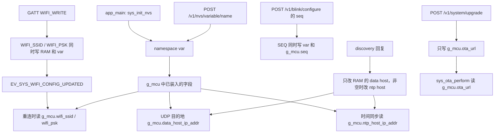
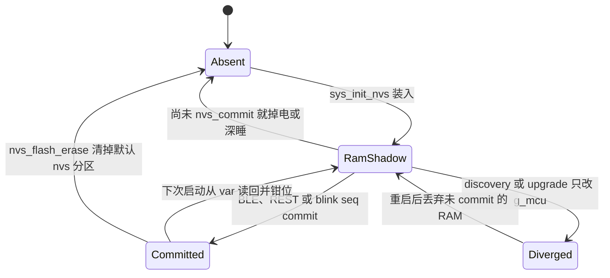

# NVS 持久化（NVS persistence）

标记需要在掉电、深睡和重启之后仍能连上原来的 AP，并记住灯语序号、采样率和 HI229 波特率。这些值放在默认 NVS 分区的 namespace `var` 里，启动时一次性装入 `g_mcu`，之后业务代码只读 RAM。发现协议改写的 data host / NTP host，以及升级请求带上的 OTA URL，都不写回闪存。

应用没有第二套专用 namespace。`include/settings.h` 里的 `CONFIG_NVS_*_NAME` 是编译期专用键名，全部登记在 `g_mcu_vars[]`，再作为 `var` 的键。运行时不能注册新键。

## 职责

- 初始化默认 NVS 分区；在 `ESP_ERR_NVS_NO_FREE_PAGES` 或 `ESP_ERR_NVS_NEW_VERSION_FOUND` 时整区擦除后重试。
- 维护闭合键表：类型、文本与 NVS 原生类型的转换、启动时装入 `g_mcu` 的那一部分。
- 把空字符串换成编译期默认值；对 `SEQ`、`TARGET_FPS` 以及 HI229 的 `IMU_BAUD` 做只影响 RAM 的钳位。
- 向 BLE、REST 和 blink 的 seq 接口提供按键读写。默认值、钳位结果、发现结果和升级 URL 都不在这里落盘。

`components/sys/sys.c` 包含 `nvs_flash.h`，但没有 `nvs_*` 调用。OTA 只用 RAM 里的 `g_mcu.ota_url`。

## 在系统中的位置

`app_main` 的 `init()` 在 `sys_init_chip()` 之后、事件组和任务之前调用 `sys_init_nvs()`。见 [boot-and-tasks.md](boot-and-tasks.md)。装入结果落在 [global-state.md](global-state.md) 的 `g_mcu` 上。

上游是写入方：[ble.md](ble.md) 的 Wi-Fi 特征、[api.md](api.md) 的 `/v1/nvs/variable/*` 与 `/v1/blink/configure`、`/v1/system/upgrade`。下游只消费 RAM：[wifi.md](wifi.md)、[discovery.md](discovery.md)、[time-sync.md](time-sync.md)、[imu-streaming.md](imu-streaming.md)、[imu.md](imu.md)、[led.md](led.md)、[ota.md](ota.md)。NVS 模块自己不等待任何事件位；事件定义见 [events.md](events.md)。

## 设计

### 数据与状态

分区表 `manifests/partitions.csv`：`nvs` 在 `0x9000`，大小 `0x4000`（16 KiB）；表尾另有 `nvs_key`，大小 `0x1000`。应用只调用 `nvs_flash_init()` / `nvs_flash_erase()`，作用对象是默认 `nvs` 分区。三份 `sdkconfig.defaults.v*` 和源码都没有 NVS 加密初始化，代码未体现对 `nvs_key` 的读写。`phy_init` 是另一分区，这条擦除路径不会动它。

namespace 只有 `CONFIG_VAR_NVS_TABLE_NAME`（`"var"`）。键名最长受 `CONFIG_MAX_VAR_NAME_LEN`（16）限制，现有名字都放得下。`mcu_var_type_t` 与落盘形式：

| 类型 | 写入 | 从文本解析 |
| --- | --- | --- |
| `VAR_INT32` | `nvs_set_i32` | `strtol` 十进制 |
| `VAR_UINT8` | `nvs_set_u8` | `strtol` 后截成 `uint8` |
| `VAR_FLOAT32` | 长度为 `sizeof(float)` 的 blob | `strtold` |
| `VAR_STR` | 固定 `CONFIG_VAR_STR_MAX_LEN`（64）字节的 blob，不是 `nvs_set_str` | 调用方缓冲的前 64 字节 |

表里实际只有 `VAR_STR` 和 `VAR_INT32`。`VAR_UINT8` 与 `VAR_FLOAT32` 的分支没有键会走到；后者读取时把 length 传成 `NULL`。

`g_mcu` 在 `sys.c` 里零初始化。下表的「装入」只发生在 `sys_load_nvs_configuration()`。字符串「空」指读进缓冲后 `strlen == 0`（真的空 blob，或读取没改写已经清零的缓冲）。空串会换成编译期默认，且不写回。整数没有「读失败则用默认」这条路径：`sys_load_int32_conf_default` 的默认值只在 `sys_find_var` 返回 `NULL` 时使用，而 `IMU_BAUD` 始终在表里，所以 `CONFIG_IMU_BAUD` 到不了。

| 键 | 类型 | 装入 | 字符串空值时的编译期默认 | commit 之后谁改 RAM |
| --- | --- | --- | --- | --- |
| `WIFI_SSID` | blob | `g_mcu.wifi_ssid` | `CONFIG_WIFI_SSID`（`"markit"`） | 仅 BLE |
| `WIFI_PSK` | blob | `g_mcu.wifi_psk` | `CONFIG_WIFI_PSK`（`"12345678"`） | 仅 BLE |
| `DATA_HOST` | blob | `g_mcu.data_host_ip_addr` | `CONFIG_DATA_HOST_IP_ADDR`（`"255.255.255.255"`） | 不改。discovery 另写 RAM |
| `OTA_HOST` | blob | 不装入 | 无 | 无。升级用的是另一个缓冲 |
| `NTP_HOST` | blob | `g_mcu.ntp_host_ip_addr` | `CONFIG_NTP_HOST_IP_ADDR`（`""`） | 不改。discovery 在回复非空时另写 RAM |
| `TEST` | i32 | 丢进局部 `char _protect` 后抛弃 | 无 | 无 |
| `IMU_BAUD` | i32 | 仅 `CONFIG_IMU_SENSOR_HI229` 时装入 `g_mcu.imu_baud` | 表项缺失才会用 `CONFIG_IMU_BAUD`（115200），正常构建走不到 | 不改 |
| `SEQ` | i32 | `g_mcu.seq` | 无 | blink 的 seq；通用 REST 不改 |
| `TARGET_FPS` | i32 | `g_mcu.target_fps` | 无 | 不改 |

`mcu_t` 里标了 Non Volatile 的 `use_hamming`、`missed_frames` 不在表中，也没有任何 `nvs_*` 访问。`use_hamming` 没有其他引用；`missed_frames` 只是 [imu-streaming.md](imu-streaming.md) 路径上的 RAM 计数。`g_mcu.ota_url` 长度是 `CONFIG_OTA_URL_LEN`（128），不是 64 字节的 `OTA_HOST` blob。`CONFIG_VAR_URL_MAX_LEN`（128）没有被使用。

端口不在 NVS 里：数据口 `CONFIG_DATA_HOST_PORT`（18891）等仍是 `settings.h` 的编译期常量。`CONFIG_NVS_*`、`CONFIG_WIFI_SSID`、`CONFIG_TARGET_FPS`、`CONFIG_MAX_FPS` 也是普通宏，不是 menuconfig 项。

一个键的 RAM 与闪存可以分开：

`Absent` 是该键在 `var` 中不存在。`RamShadow` 是启动加载并完成字符串默认替换和整数钳位之后的 RAM。`Diverged` 是 RAM 已经偏离上次 commit。钳位本身停在 `RamShadow`，不会回到 `Committed`。

### 行为与时序

`sys_init_nvs()` 调用 `nvs_flash_init()`。返回 `ESP_ERR_NVS_NO_FREE_PAGES` 或 `ESP_ERR_NVS_NEW_VERSION_FOUND` 时 `ESP_ERROR_CHECK(nvs_flash_erase())` 再 `nvs_flash_init()`；第二次的返回值不检查。其他错误也不分支，照样进入加载，随后的 `nvs_open` 用 `ESP_ERROR_CHECK`，失败会中止当前任务。擦除是整份默认 `nvs` 分区，没有按键迁移。

加载前有 `os_delay_ms(100)`。顺序是 `TEST`、`WIFI_SSID`、`WIFI_PSK`、`DATA_HOST`、`NTP_HOST`，HI229 时还有 `IMU_BAUD`，然后 `SEQ`、`TARGET_FPS`。`OTA_HOST` 在表里，但不在这条顺序中。每次字符串或整数宏结束都会把复用的 `value_buffer` 清零。

字符串非空时，按 `min(字段大小, 64)` 拷进 `g_mcu`。空则按默认串的 `strlen` 拷贝；`g_mcu` 起初是零，短默认串的尾部仍是 0。整数读出后直接赋值，再钳位，且不写回：

- HI229：`imu_baud` 先收到不大于 921600，再收到不小于 9600。0、负数和缺键留下的垃圾都会被推进这个闭区间，而不是换成 115200。
- `seq` 收到 `[0, 255]`。这是饱和，不是模 256。闪存里的 256 在 RAM 里变成 255，不是 0。
- `target_fps` 先与 0 取大；若 `<= 0` 或 `> CONFIG_MAX_FPS`（400），RAM 改为 `CONFIG_TARGET_FPS`（100）；然后再与 400 取小。因此 RAM 合法范围是 1 到 400。闪存里的 0 每次启动都在 RAM 里变成 100，GET 该键仍可能看到 0。

`TEST` 的注释写明它是防止后续变量读坏的 workaround。实现只是在读字符串之前多读一次 i32，把值截进一个随即丢弃的 `char`。不比较、不重试、不擦除。

写入只有三条，每次都是打开 `var`、写一个键、`nvs_commit`、关闭。`nvs_set_*` 和 `nvs_commit` 的返回值被忽略，函数在没有触发 `ESP_ERROR_CHECK` 时返回 `ESP_OK`。

1. BLE `gatt_svr_chr_wifi_info` 在 `GATT_WIFI_WRITE_UUID` 上解析 `"<SSID> <PASSWORD>"`：SSID 取第一个空格之前，PSK 取其余部分直到 `\n`，因此 PSK 可以含空格，SSID 不能。然后清零并拷入 `g_mcu.wifi_ssid` / `wifi_psk`，再 `sys_set_nvs_var` 两个键，最后 `set_sys_event(EV_SYS_WIFI_CONFIG_UPDATED)`。缺任一字段则返回 `BLE_ATT_ERR_UNLIKELY`，不写。连接状态机见 [wifi.md](wifi.md)：`system_loop` 把该位与断线和失败放在一起，空闲时再投递重连；重连读的是 `g_mcu`，不是当场再读 NVS。
2. `POST /v1/nvs/variable/<name>?value=` 只 commit 表中已有的键。不回填 `g_mcu`，也不发事件。因此 REST 改 Wi-Fi、data host、NTP、波特率、`TARGET_FPS` 或 `SEQ`，要等下一次 `sys_init_nvs` 才进入运行时字段。查询串经 URL 解码，不是 JSON body。
3. `POST /v1/blink/configure` 的 `seq` 在通过解析后做 `seq % 0x100`，写入 `SEQ`，并立刻设置 `g_mcu.seq`。GET 返回的是 `g_mcu.seq % 100U`。灯语用的是未再对 100 取模的 `g_mcu.seq`，见 [led.md](led.md)。这和 `app_monitor` 里每帧自增的 `imu_data.seq` 不是同一个数。

`GET /v1/nvs/variable/<name>` 把键格式化成字符串。它不读 `g_mcu`，所以可以看到尚未被钳位、也还没在本次启动生效的闪存值。`/v1/system/info` 的 `target_fps` 和 IMU status 的 `baud_rate` 读的是 RAM。

发现回复会把 `g_mcu.data_host_ip_addr` 换成回复源地址；`pkt.ntp_host` 非空时才覆盖 `g_mcu.ntp_host_ip_addr`。两者都不 commit。`pkt.ota_host` 只出现在日志里，代码未体现写入 `g_mcu.ota_url` 或 `OTA_HOST`。因此已提交的 `DATA_HOST` 只是发现完成前的目的地（默认广播）；发现成功后的控制器地址活不过深睡和重启。空的 `NTP_HOST` 让 [time-sync.md](time-sync.md) 改用网关，失败次数越过 `CONFIG_NTP_PRIMARY_MAX_RETRY` 后用编译期 `CONFIG_NTP_HOST_IP_ADDR_BACKUP`，那不是 NVS 键。

`POST /v1/system/upgrade` 在 `ota_url` 非空时 `strcpy` 到 `g_mcu.ota_url` 并置 `EV_SYS_OTA_TRIGGERED`。不写 `OTA_HOST`。下载过程见 [ota.md](ota.md)。

`sys_wifi_try_connect` 在 `esp_wifi_set_config` 之前没有 `esp_wifi_set_storage`。ESP-IDF 默认 `WIFI_STORAGE_FLASH` 时，驱动会把 STA 配置再写入 NVS 的私有键。本仓库不读那些键，私有键名代码未体现。下次启动仍以 `var` 装入的 SSID/PSK 为准，再次 `set_config`。

深睡是 `esp_deep_sleep_start()`，唤醒后重新进入 `app_main` 和 `sys_init_nvs`。已经 commit 的键还在；发现覆盖、升级 URL、钳位修正和尚未 commit 的编译期默认都不在。

`TARGET_FPS` 在 `app_monitor` 里变成 `esp_timer` 周期 `1000000 / g_mcu.target_fps`，并传给 IMU 配置。`IMU_BAUD` 只在 `hi229_interface_init` 拷进 UART 配置。通用 REST 写入不会改已启动的定时器或 UART。代码未体现热更新。

### 并发

加载发生在 `sys_start_tasks()` 之前，此时还没有本应用的 HTTP 或 BLE 任务。`os_delay_ms(100)` 只阻塞 `app_main`。

之后 `sys_set_nvs_var` / `sys_get_nvs_var` 没有应用层互斥。httpd 与 NimBLE 的 GATT 回调可以交错，各自 `nvs_open`、commit、`nvs_close`。库内部是否加锁，代码未体现。BLE 写 `g_mcu` 字符串和置事件位也不在 Wi-Fi 重连同一把锁下。

没有跨键事务。一次调用只 commit 一个键。BLE 的 SSID 与 PSK 是两次 commit，中间掉电可以只留下其中一个。

### 配置

- 键名和字符串默认值：`include/settings.h`。
- namespace、类型、64 与 128 的长度宏：`components/sys/sys.h` 的 NVS 段。`g_mcu` 的字符串字段用 `CONFIG_VAR_STR_MAX_LEN`。
- `CONFIG_TARGET_FPS` 为 100，`CONFIG_MAX_FPS` 为 400。
- `CONFIG_IMU_BAUD` 为 115200，定义在 `include/modelspec.h` 的 ESP32 / ESP32-S3 且 `CONFIG_IMU_SENSOR_HI229` 分支。
- 分区：`manifests/partitions.csv`。

### v1 / v2 / v3

`nvs_mgmt.c` 里没有 `CONFIG_IDF_TARGET_*`。键表、namespace 和分区三套硬件共用。唯一编译期分叉是 `CONFIG_IMU_SENSOR_HI229`：

- v1（`sdkconfig.defaults.v1`，ESP32 + HI229）：加载 `IMU_BAUD`，并把 RAM 钳在 9600 到 921600。`modelspec.h` 提供 `CONFIG_IMU_BAUD`。
- v2（ESP32-S3 + `CONFIG_IMU_SENSOR_BNO08X`）和 v3（ESP32-C5 + BNO08X）：不加载、不钳位。`g_mcu.imu_baud` 保持 BSS 的 0。ESP32-C5 的引脚段没有 `CONFIG_IMU_BAUD`。
- 键 `IMU_BAUD` 在三套固件的 `g_mcu_vars[]` 里都在，REST 仍可读写。BNO08X 构建启动时不采用它，SPI IMU 也不读这个字段。

硬件差异的其余部分见 [hardware.md](hardware.md)。

## 接口

对其他子系统：

- `sys_init_nvs()`：只应从启动路径调用一次。当前唯一调用点是 `main/app_main.c`。
- `sys_find_var(name, len)`：线性扫描 `g_mcu_vars[]`。未知名字返回 `NULL`，不会建键。
- `sys_set_nvs_var(p_var, value)`：`value` 永远是文本。整数走十进制解析。字符串把 `value` 指向的 64 字节写入 blob，不看 `strlen`。
- `sys_get_nvs_var(p_var, out, value_buffer)`：把值格式化进 `value_buffer`。`out` 可为 `NULL`。注释要求缓冲大于 64；启动路径用的数组长度正好是 64。
- `g_mcu_vars[]`：闭合键表，外部可以遍历，但不能扩展。

NVS 代码不读取事件位。它也不设置事件位。唯一相关的位是 BLE 在两次 Wi-Fi 键 commit 之后设置的 `EV_SYS_WIFI_CONFIG_UPDATED`（`sys_event_group` 的 `BIT0`）。通用 REST 写入不置这个位。

依赖的不是「实时 NVS 读」，而是启动后的 RAM 字段：`wifi_ssid`、`wifi_psk`、`data_host_ip_addr`、`ntp_host_ip_addr`、`imu_baud`、`seq`、`target_fps`。`OTA_HOST` 没有对应的运行时消费者。`g_mcu.ota_url` 不来自 NVS。

HTTP 面（细节见 [api.md](api.md)）：

- `GET` 与 `POST /v1/nvs/variable/*`，由 `nvs_variable_handler` 处理。
- `nvs_variable_list_handler` 能列出九个键名，但 `controller_uri[]` 没有登记它。代码未体现名单路由。
- blink 的 seq 与升级 URL 是旁边的专用入口，不是通用变量接口的别名。

没有删除键的接口。键一直留到下一次整区擦除。

## 失败与边界

`nvs_open` 失败会在调用任务里 `abort`，REST 看不到 `ESP_FAIL`。`sys_set_nvs_var` 在没 abort 时总是 `ESP_OK`，所以 handler 里「cannot set value」这条分支当前走不到。commit 没成功时，调用方仍会当作已经落盘。commit 返回之前掉电，新值不保证可见。

`sys_get_nvs_var` 不看 `nvs_get_*` 的返回值。`value_buffer == NULL` 时在 `nvs_open` 之后直接返回 `ESP_ERR_INVALID_ARG`，不 `nvs_close`。现有调用都传了缓冲。

整数的局部 `data` 未清零。键不存在时，库不写输出，随后 `memcpy` 把这份未初始化值覆盖调用方原本的 0。缺键的 `SEQ` 不是可靠的 0，缺键的 `TARGET_FPS` 也不是可靠的 100；它们先变成栈上的垃圾，再被钳位。垃圾若落在 1 到 400，会被当成合法帧率。`IMU_BAUD` 的 115200 同样用不上，垃圾只会被推进 `[9600, 921600]`。

读字符串时传给 `nvs_get_blob` 的 length 未初始化，返回值被忽略。启动顺序里，前一个宏已经把缓冲清零，所以「键不存在」和「库拒绝写入缓冲」都会变成 `strlen == 0`，换成编译期默认，并且不把默认值 commit 回去。真正存了一个空 blob 时结果相同。满 64 字节且其中没有 `NUL` 时，`strlen` 会走出这个 64 字节缓冲；拷进 `g_mcu` 的数组也没有多出来的终止符。

REST 把 `value` 解进 65 字节缓冲，长度上限却是 `CONFIG_PARAM_VALUE_MAX_LEN`（128）。65 到 128 字节的值会越界，NVS 侧仍然只存前 64 字节。GET 用 `strlen(name)`，不截掉 `?`，带查询串的 GET 对不上键；POST 用 `?` 之前的长度。`strtol` 不检查尾指针，`"12abc"` 会存成 12，非数字变成 0。

BLE 的 `ssid` / `psk` 栈数组没有先清零。`strcpy` 之后 `nvs_set_blob` 仍拷贝 64 字节，`NUL` 后面的栈内容会进 blob。读回时 C 字符串停在第一个 `NUL`，逻辑 SSID 仍在，但 blob 不是干净的零填充。SSID 长过 63 还会在写入前撑破这个 64 字节数组。代码没有按 32 字节截断；`sys_wifi_prepare_config` 对 `wifi_config_t.sta.ssid`（32 字节）和 password（64 字节）做 `strcpy`。密码字段和 blob 一样长，同样没有多余的 `NUL` 余量。

blink 的 `seq % 0x100` 在 C 里向零截断，负数可以仍是负数。`seq_str[4]` 放得下 `0` 到 `255` 的十进制；负值的文本可能越界。启动钳位用饱和把 RAM 收到 `[0, 255]`，不回写。GET 再对 `100U` 取模，所以闪存里的 150 经启动后灯语用 150，HTTP 显示 50；闪存里的 1000 每次启动都变成 RAM 255，显示 55。通用 REST 写入的 `SEQ` 在重启前不会改变灯语。

`OTA_HOST` 可以被 REST 留下，重启后仍可用 GET 读到，但没有任何启动路径把它装进 `g_mcu.ota_url`。发现注释写着回复是为了取得 `OTA_HOST`，赋值不存在。升级 URL 最长按 128 字节约，和 64 字节的 `OTA_HOST` blob 也不是同一存储。

分区写满时，本次 `nvs_set` 失败会被忽略。下一次启动若 `nvs_flash_init` 返回 `ESP_ERR_NVS_NO_FREE_PAGES`，修复方式是丢掉整个 `var`，以及默认分区里驱动可能写下的 STA 配置，然后字符串重新走编译期默认。代码未体现单独回收某个键。

## 设计取舍

`630718a`（`fix: try to fix corrupted NVS by adding a guard variable`）引入了 `TEST`。当前代码仍只是在其他键之前读一次并丢掉，提交说明没有给出可检验的保护条件。

`8ff1f77`（`feat: no ota configuration, ota endpoint is set upon upgrade request`）拿掉了启动时装入 `OTA_HOST` 以及升级接口把它写回 NVS 的路径；同一提交的说明里还有 `feat: time sync use gateway as default ntp server`，对应现在的空 `NTP_HOST`。键还留在表里，只是不再驱动 OTA。

`908322e`（`fix: fps is now configurable`）去掉了「i32 小于等于 0 就换编译期默认」的加载规则，并把帧率上限从当时的 `CONFIG_TARGET_FPS` 放到 `CONFIG_MAX_FPS`。因此缺键或非正值不再自动变成默认帧率，只靠事后的 RAM 钳位。

字符串用定长 blob、加载前等待 100 ms，以及波特率上下限 9600 / 921600，历史未说明。`17ca4ca` 只是把波特率钳位放进 `CONFIG_IMU_SENSOR_HI229`，主题没有解释界限。

## 源文件

- `components/sys/nvs_mgmt.c`
- `components/sys/sys.h`
- `components/sys/sys.c`
- `include/settings.h`
- `include/modelspec.h`
- `main/app_main.c`
- `components/ble/gatt_srv.c`
- `components/rest_controller/rest_controller.c`
- `components/rest_controller/rest_controller_handlers.c`
- `components/sys/discovery.c`
- `components/sys/wifi.c`
- `components/sys/time_sync.c`
- `components/apps/monitor.c`
- `components/apps/network.c`
- `components/blink/blink.c`
- `lib/hi229/hi229.c`
- `components/sys/power_mgmt.c`
- `manifests/partitions.csv`
- `sdkconfig.defaults.v1`
- `sdkconfig.defaults.v2`
- `sdkconfig.defaults.v3`
