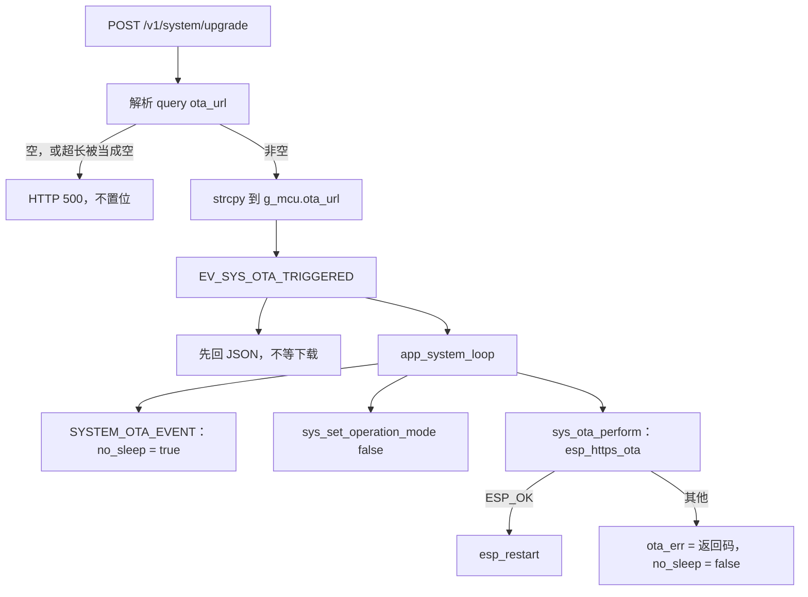
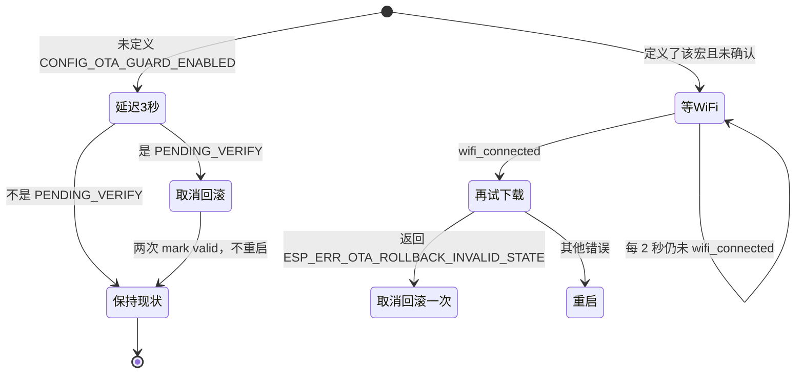

# OTA 与分区（OTA and partitions）

设备要在不插线的情况下换应用镜像，并在 bootloader 启用回滚时，让一次没被确认的新镜像还有机会回到旧槽。本子系统不自己选槽、不解析镜像头：REST 把完整 URL 放进 `g_mcu.ota_url`，`app_system_loop` 调用 `esp_https_ota()`，成功就 `esp_restart()`，失败把 `esp_err_t` 留在 RAM 里的 `g_mcu.state.ota_err`。下次启动由 `sys_ota_guard()` 看启动分区是不是 `ESP_OTA_IMG_PENDING_VERIFY`；当前没有任何配置打开 `CONFIG_OTA_GUARD_ENABLED`，因此编进来的路径只等 3 秒就确认，不做 Wi-Fi 或 IMU 自检。下载期间向电源管理投递 `SYSTEM_OTA_EVENT`，只为把 `no_sleep` 置位，免得空闲定时器在传输途中进入深度睡眠。

## 职责

- 用 `manifests/partitions.csv` 描述两块等大的 OTA app 槽，以及 `otadata`。应用代码不读写这张表。
- 接受一次 HTTP 触发，把 query 里的 URL 原样交给 `esp_https_ota()`。
- 成功则重启；失败则记下返回码并清掉 `no_sleep`，不重启，也不调用 `esp_ota_mark_app_invalid_rollback_and_reboot()`。
- 启动后若镜像仍待确认，在编进固件的路径上无条件 `esp_ota_mark_app_valid_cancel_rollback()`。
- 不比较版本号，不从 NVS 或发现报文组装 URL，不在 BLE 上提供升级入口。

## 在系统中的位置

触发面只有 [api.md](api.md) 的 `POST /v1/system/upgrade`。`system_upgrade_handler()` 写 `g_mcu.ota_url` 并 `set_sys_event(EV_SYS_OTA_TRIGGERED)`，自己不下载。位定义在 [events.md](events.md)，字段在 [global-state.md](global-state.md)。[boot-and-tasks.md](boot-and-tasks.md) 里 `app_system_loop()` 看到该位后，先向 `g_mcu.system_loop` 投递 `SYSTEM_OTA_EVENT`，再 `sys_set_operation_mode(false)`，然后在这个任务上阻塞调用 `sys_ota_perform()`。`app_main()` 在 `sys_start_tasks()` 之后调用 `sys_ota_guard()`，然后删掉自己。

`SYSTEM_OTA_EVENT` 的处理函数是 [power-management.md](power-management.md) 的 `sys_power_mgmt_handler()`，只把 `no_sleep` 设为 true。下载要已经连上的 STA，见 [wifi.md](wifi.md)；本路径不发起关联。`active` 被立刻写成 false 之后，[imu-streaming.md](imu-streaming.md) 的发送循环会退出。IMU mux 和电源状态要等 `EV_SYS_MODE_CHANGE`，而那个位要等下载返回后的下一轮 `xEventGroupWaitBits` 才会被转发。

[nvs.md](nvs.md) 的键 `OTA_HOST` 在变量表里，启动时不装入 `g_mcu.ota_url`。 [discovery.md](discovery.md) 会解析并打印回复里的 `ota_host`，不写入 RAM 或 NVS。 [ble.md](ble.md) 的 GATT 没有升级特征。灯没有单独的 OTA 图案，见 [led.md](led.md)。引脚与分区无关，见 [hardware.md](hardware.md)。总览见 [00-overview.md](00-overview.md)。

## 设计

### 数据与状态

分区表在 `manifests/partitions.csv`。偏移留空表示接在上一行之后。下表最后三行的偏移是按尺寸相加得到的，CSV 里没写死。`1600K` 按分区表惯例是 `1600 × 1024 = 0x190000`。`phy_init` 结束于 `0x10000`，后面没有空隙；ESP-IDF 还会把 app 分区对齐到 64 KiB，这里的边界已经对齐。

| 名称 | Type | SubType | 偏移 | 大小 | 结束 |
| --- | --- | --- | --- | --- | --- |
| `nvs` | data | nvs | `0x9000` | `0x4000` | `0xD000` |
| `otadata` | data | ota | `0xD000` | `0x2000` | `0xF000` |
| `phy_init` | data | phy | `0xF000` | `0x1000` | `0x10000` |
| `ota_0` | app | ota_0 | `0x10000` | 1600K | `0x1A0000` |
| `ota_1` | app | ota_1 | `0x1A0000` | 1600K | `0x330000` |
| `nvs_key` | data | nvs_keys | `0x330000` | `0x1000` | `0x331000` |

没有 factory app。表从 `0x9000` 开始，不包含 bootloader 和分区表自身。末端 `0x331000` 大于 2 MiB、小于 4 MiB。芯片 Flash 容量不在已跟踪的 defaults 里。应用不解析 `otadata`，只通过 `esp_ota_get_boot_partition()` / `esp_ota_get_state_partition()` 看启动槽的镜像状态。`nvs_key` 这 4 KiB 没有任何 C 代码引用。

`g_mcu` 零初始化，因此上电时 `ota_url` 全 0，`g_mcu.state.ota_err` 为 0，与 `ESP_OK` 相同。`ota_url` 长度是 `CONFIG_OTA_URL_LEN`（128），只活在 RAM，不进 RTC，重启即丢。`ota_err` 同样只在 RAM：失败时写成 `esp_https_ota()` 的返回码，成功路径在写它之前就 `esp_restart()`。重启之后 GET 看到的又是 0，不能区分「没试过」「上次成功」和「失败后已经重启」。

NVS 键 `OTA_HOST`（`CONFIG_NVS_OTA_HOST_NAME`）类型 `VAR_STR`，经通用 NVS 路由可以读写，blob 长度是 `CONFIG_VAR_STR_MAX_LEN`（64），不是 128。`sys_load_nvs_configuration()` 不读它。发现回复的 `MarkerDiscoveryReplyPacket.ota_host` 是 32 字节，只出现在一条日志里；注释写 Update NTP and OTA host，代码只在 `ntp_host` 非空时 `strncpy` 到 `g_mcu.ntp_host_ip_addr`。

HTTP 客户端只填了这些字段，其余保持零初始化：

| 字段 | 值 |
| --- | --- |
| `url` | `g_mcu.ota_url` 的指针，不是拷贝 |
| `max_authorization_retries` | 3 |
| `auth_type` | `HTTP_AUTH_TYPE_NONE` |
| `event_handler` | `esp_ota_event_handler` |
| `keep_alive_enable` | true |
| `skip_cert_common_name_check` | true |

没有用户名、密码、`cert_pem`、`crt_bundle_attach`、`timeout_ms` 或缓冲区长度。事件回调对 `HTTP_EVENT_ERROR`、`HTTP_EVENT_REDIRECT`、`HTTP_EVENT_ON_DATA` 只打 `ESP_LOGD`，一律返回 `ESP_OK`，不把 HTTP 错误变成传输失败，也不累计字节。真正的失败码只来自 `esp_https_ota()` 的返回值。

镜像状态只有 `sys_ota_uncommitted()` 在用：读的是 **boot** 分区，不是 `esp_ota_get_running_partition()`。局部变量 `ota_state` 没有初值，`esp_ota_get_state_partition()` 的返回值被忽略。只有读到的值等于 `ESP_OTA_IMG_PENDING_VERIFY` 才算未确认。`NULL` 分区、API 失败而没有写入 `ota_state` 时，比较没有定义。

### 行为与时序

谁可以发起一次升级，固件里只有一条路径。`POST /v1/system/upgrade` 用 `parse_url_kv_pair()` 取 query `ota_url`。解码后的字符串非空才 `strcpy` 进 `g_mcu.ota_url` 并置 `EV_SYS_OTA_TRIGGERED`。空串时 HTTP 500，JSON 字段 `status` 为 `empty ota_url`，不置位。非空时响应体只有回显的 `ota_url`，没有 `status`，HTTP 状态保持默认 200。处理函数先 `reset_power_save_timer()`，把 JSON 发完就返回，不等下载。

`GET /v1/system/upgrade` 只放一个数字字段 `ota_err`。没有进行中标志。下载还没失败时，读到的是上一次留下的值；上电后这个值是 0。

`app_system_loop()` 用掩码 `0x00FFFFFF` 等待，返回时清掉本次等到的位。OTA 分支的顺序是：

1. `esp_event_post_to(..., SYSTEM_OTA_EVENT)`，`portMAX_DELAY`。处理函数在另一条任务 `system_event_loop_task` 上把 `no_sleep` 设为 true。注释写 Disable deep sleep / light sleep。
2. `sys_set_operation_mode(false)`：立刻把 `g_mcu.state.active` 写成 false，并置 `EV_SYS_MODE_CHANGE`。这个位不在本轮已经取到的 `bits` 里。
3. `sys_ota_perform()` 阻塞在 `app_system_loop` 上。

`esp_https_ota()` 成功返回 `ESP_OK` 时调用 `esp_restart()`，函数没有别的成功返回。失败则打警告日志，把返回码写入 `ota_err`，把 `no_sleep` 写成 false，再把该码返回给系统循环。应用不调用 `esp_ota_get_next_update_partition()`、`esp_ota_set_boot_partition()` 或 `esp_ota_abort()`。选哪个槽、写入、校验、何时改 `otadata`，都在 `esp_https_ota()` 内部。失败路径不重启；库有没有改启动槽，本文件看不出来。

`active == false` 之后，UDP 发送循环的 `while (g_mcu.state.active)` 会退出。`sys_mode_change_handler()` 把 mux 改成 `IMU_MUX_IDLE`、`sys_power_mgmt_handler()` 进入待机，都要等系统循环再次等待事件组。成功重启则这两步在本次运行里不会发生。失败返回后，同一轮循环末尾仍可能投递 `SYSTEM_LED_STATUS_EVENT`；成功则走不到。

电源侧真正挡住睡眠的不是 `no_sleep` 本身。`power_mgmt_on_enter_deep_sleep()` 不读它，300 秒定时器回调 `power_mgmt_handle_transition()` 也不读它。`no_sleep` 只有一处效果：状态已是 `POWER_STANDBY` 时，每 `CONFIG_POWER_MGMT_DURATION_S`（20 秒）的 `SYSTEM_POWER_MGMT_EVENT` 调用 `reset_power_save_timer()`。`POWER_ACTIVE` 则不论 `no_sleep` 都重置。空闲定时器是一次的，时长 `CONFIG_POWER_SAVE_TIMEOUT_S`（300 秒）；到期后创建 `app_power_save` 并立刻以 `wakeup == false` 进入深度睡眠，Wi-Fi 会拆掉。OTA 把系统循环堵住时，FreeRTOS 定时器守护任务和 `system_event_loop_task` 仍在跑，所以 20 秒节拍还能在下载期间重置定时器。HTTP 入口那一次 `reset_power_save_timer()` 先把窗口拨回 300 秒；下载长于 300 秒时，要靠节拍继续拨。下载开始时电源状态还停在原来的 `POWER_ACTIVE` 或 `POWER_STANDBY`，因为模式事件被推迟了。

下一次启动的确认在 `app_main()`：`init()`（含 IMU `self_test`，返回值丢掉）和 `sys_start_tasks()` 都已经跑完，然后才是 `sys_ota_guard()`。守卫与系统循环并发。`CONFIG_OTA_GUARD_ENABLED` 不是 Kconfig 项，三份 `sdkconfig.defaults.v*` 和 `main/Kconfig.projbuild` 都没有它，当前编译走 `#else`：

1. 无条件 `os_delay_ms(3000)`。这是 3000 毫秒，不是 tick。不管是不是刚升过级都会等。等的是 `app_main` 任务，系统循环已经在跑。
2. 若未确认，调用 `esp_ota_mark_app_valid_cancel_rollback()`，打日志 firmware is working fine，再调用一次。两次返回值都不看。
3. 不看 Wi-Fi、不看 `self_test`、不调用 `esp_ota_mark_app_invalid_rollback_and_reboot()`。

因此回滚窗口只是「新镜像没能活到这次确认」。确认发生在任务已启动之后的 3 秒末尾，不是功能测试。3 秒内崩溃或复位、且 bootloader 回滚已打开、镜像仍是 `PENDING_VERIFY` 时，下一次由 bootloader 换回旧槽。应用自己不会做出「判定失败并回滚」的决定。

`#ifdef CONFIG_OTA_GUARD_ENABLED` 仍留在 `sys.c` 里，当前构建不会编进去。它在 `app_main` 上循环：未确认且 Wi-Fi 未连上就 `os_delay_ms(2000)`，连上之后再调用 `sys_ota_perform()`。日志写明这次 OTA will not succeed。只有返回 `ESP_ERR_OTA_ROLLBACK_INVALID_STATE` 才 `mark valid` 一次并离开循环。其他错误打日志 rolling back，然后 `esp_restart()`，仍然不调用 `esp_ota_mark_app_invalid_rollback_and_reboot()`。注释把这次重启当成回滚；那只在 bootloader 回滚已打开、且镜像仍是 `PENDING_VERIFY` 时成立。Wi-Fi 一直不来则永远停在这个循环里，不确认也不重启。`sys_ota_perform()` 若返回 `ESP_OK` 会在内部重启，守卫看不到成功返回。此时 `g_mcu.ota_url` 仍是上电的空串，除非这 2 秒循环期间已经有人 POST 过。

bootloader 选项与这段 C 无关，应用没有 `#if CONFIG_BOOTLOADER_APP_ROLLBACK_ENABLE`。v1 的 `sdkconfig.defaults.v1` 和 v3 的 `sdkconfig.defaults.v3` 打开了它。v2 的 `sdkconfig.defaults.v2` 没有。未打开时，镜像会不会进入 `ESP_OTA_IMG_PENDING_VERIFY`、`mark valid` 会不会直接失败，本仓库没有第二套实现。守卫仍会跑，失败的返回值仍被忽略，日志照样可以打出 firmware is working fine。

### 并发

| 上下文 | OTA 期间在做什么 |
| --- | --- |
| httpd | 写 `g_mcu.ota_url`、置事件位、读 `ota_err`。与下载并行 |
| `app_system_loop` | 堵在 `esp_https_ota()` 里，不再转发事件组 |
| `system_event_loop_task` | 处理已经入队的 `SYSTEM_OTA_EVENT`，以及定时器新投递的电源、发现、对时 |
| `app_main` | 冷启动后的守卫可能与一次新的下载重叠。编进固件的守卫不下载 |
| FreeRTOS 定时器 | 20 秒电源节拍和 300 秒空闲定时器都不在被堵住的那条任务上 |

`url` 指向 `g_mcu.ota_url`。下载未结束时再来一次 POST 会 `strcpy` 进同一块缓冲，没有互斥量。事件位在系统循环堵住时不会被清掉；这次下载若失败返回，下一轮等待会再用当时缓冲里的 URL 做一次。同一轮里多次置位合并成一次。成功则 `esp_restart()`，排队的那一次不会发生。

`sys_ota_perform()` 写 `no_sleep` 不拿 `sys_power_mgmt_handler()` 的 `sync_mutex`。失败路径把标志清掉之后，推迟的 `SYSTEM_MODE_CHANGE_EVENT` 还会再写一次 false，并调用 `power_mgmt_on_enter_standby()`。

系统循环堵住时，新的 `EV_SYS_WIFI_CONNECTED` 要等下载结束才转发。已经在跑的发现和对时定时器仍能向事件环投递，不经过这次等待。

### 配置

OTA 行为不读 `CONFIG_IDF_TARGET_*` 或 `CONFIG_IMU_SENSOR_*`。URL 长度、端口和空闲时间都在 `include/settings.h`：

| 宏 | 值 | 用途 |
| --- | --- | --- |
| `CONFIG_OTA_URL_LEN` | 128 | `g_mcu.ota_url` 的字节数，不含额外的 NUL |
| `CONFIG_NVS_OTA_HOST_NAME` | `"OTA_HOST"` | 变量表里的键，OTA 路径不读 |
| `CONFIG_CONTROLLER_LISTEN_PORT` | 18888 | REST，也是升级 URL 的设备侧端口 |
| `CONFIG_PARAM_VALUE_MAX_LEN` | 128 | query 值的上限，定义在 REST 处理文件里 |
| `CONFIG_POWER_SAVE_TIMEOUT_S` | 300 | 空闲一次定时器 |
| `CONFIG_POWER_MGMT_DURATION_S` | 20 | 用来拨动空闲定时器的节拍 |

`Makefile` 的 `set_hardware_v1` / `v2` / `v3` 和 `.github/workflows/build-firmware.yml` 都把 `SDKCONFIG_DEFAULTS` 设成 `sdkconfig.defaults;sdkconfig.defaults.vN`。`sdkconfig.defaults` 被 `.gitignore` 忽略，当前工作区没有这个文件。三份已跟踪的 `sdkconfig.defaults.v*` 都没有 `CONFIG_PARTITION_TABLE_CUSTOM` 或 `CONFIG_PARTITION_TABLE_CUSTOM_FILENAME`。因此「构建会不会把 `manifests/partitions.csv` 编进去」在当前树里看不出来。仓库里这份 CSV 仍然是唯一的分区描述。

回滚开关只有两处：`sdkconfig.defaults.v1` 与 `sdkconfig.defaults.v3` 的 `CONFIG_BOOTLOADER_APP_ROLLBACK_ENABLE=y`。没有 `CONFIG_BOOTLOADER_APP_ANTI_ROLLBACK`，应用也不比较 `CONFIG_FIRMWARE_VERSION`。版本字符串只出现在 `GET /v1/system/info` 的 `ver`，不参与升级决定。

证书包、HTTP 超时、NVS 加密（`CONFIG_NVS_ENCRYPTION`）都不在已跟踪的 defaults 里。`nvs_key` 分区在不在被 NVS 加密使用，代码未体现。

### v1 / v2 / v3

C 代码同一份。没有按 `CONFIG_IDF_TARGET_ESP32`、`CONFIG_IDF_TARGET_ESP32S3`、`CONFIG_IDF_TARGET_ESP32C5` 或 `CONFIG_IMU_SENSOR_*` 分叉的 OTA 路径。

| 变体 | defaults | bootloader rollback |
| --- | --- | --- |
| v1 ESP32 | `sdkconfig.defaults.v1` | 打开 |
| v2 ESP32-S3 | `sdkconfig.defaults.v2` | 未设置 |
| v3 ESP32-C5 | `sdkconfig.defaults.v3` | 打开 |

分区 CSV 不按变体拆分。三个目标若都选用这张表，槽大小相同。镜像里的芯片魔数是否匹配，由 `esp_https_ota` 和 bootloader 决定，本仓库没有再检查。

## 接口

对其他子系统暴露：

| 符号 | 调用方 | 行为 |
| --- | --- | --- |
| `sys_ota_perform()` | `app_system_loop`；守卫的未编译分支 | 按 `g_mcu.ota_url` 下载。成功重启。失败写 `ota_err`、清 `no_sleep` 并返回该码 |
| `sys_ota_guard()` | `app_main`，在任务启动之后 | 见上面的状态图。不返回错误 |

依赖的事件：

| 事件 | 方向 |
| --- | --- |
| `EV_SYS_OTA_TRIGGERED_BIT`（`BIT7`） | 仅 REST POST 在 URL 非空时置位。系统循环清掉并执行下载 |
| `SYSTEM_OTA_EVENT` | 系统循环投递。电源处理只写 `no_sleep = true` |
| `EV_SYS_MODE_CHANGE` / `SYSTEM_MODE_CHANGE_EVENT` | `sys_set_operation_mode(false)` 置位。转发被下载堵住，成功重启则丢 |

不置位 Wi-Fi、NTP、发现或 LED 专用位。不读 `EV_SYS_WIFI_CONNECTED`；未编译的守卫才读 `g_mcu.state.wifi_connected`。

NVS：不写任何键。不读 `OTA_HOST`。命名空间仍是 `"var"`，只是这条路径用不上。

读写的状态：写 `g_mcu.ota_url`（REST）、`g_mcu.state.ota_err`、`g_mcu.state.active`、`g_power_mgmt_ctx.no_sleep`。读 boot 分区的镜像状态。

REST 细节在 [api.md](api.md)。`manifests/openapi/openapi.yaml` 里 GET 还有 `ota_host`，POST 成功体是 `status`。处理函数对不上：GET 只有 `ota_err`，POST 成功体是 `ota_url`。空 URL 的 500 与规格一致。

## 失败与边界

- 未连接 Wi-Fi 时 POST 到不了设备。若事件已经置上而链路不可用，`esp_https_ota()` 失败，码进 `ota_err`，不重启，旧槽继续跑。没有重试循环。
- 空 URL、缺少 `ota_url`、`parse_url_kv_pair` 返回错误，都变成 HTTP 500 `empty ota_url`。处理函数不看解析返回值。编码长度大于 128 因此不会被截断后下载。
- 解码后长度正好 128 时，局部缓冲是 `CONFIG_OTA_URL_LEN + 1`，放得下 NUL；`strcpy` 的目标只有 128 字节，结尾 NUL 会写入紧接着的 `ntp_host_ip_addr`。不检查 scheme。任意非空字符串都会触发下载。
- `ota_err` 不进 NVS。成功重启后调用方看不到这次的结果。失败后、重启前，GET 才能读到非零码。新的一次开始时不把旧码清零。
- 应用不擦除写了一半的槽，也不在失败时改启动分区。库内部是否留下半幅镜像，代码未体现。下一次成功的 `esp_https_ota()` 会自己再选槽。
- 没有版本门、没有芯片门。CI 产物名 `rfmarkit-esp-node-v1.bin` / `v2` / `v3` 不会被固件检查。
- 证书材料不在本仓库。主机脚本用的是 `http://`。`https://` 在没有 CA 时能否握手，代码未体现。`skip_cert_common_name_check` 只跳过名字检查。认证类型是 NONE，同时把授权重试设为 3，但没有口令可重试。
- 事件回调不因 `HTTP_EVENT_ERROR` 中止传输。重定向次数未配置。
- `no_sleep` 挡不住长按和 `POST /v1/system/power?target_state=shutdown`。也挡不住已经到期的空闲定时器：回调不看这个标志。20 秒节拍若停了，或状态既不是 `POWER_STANDBY` 也不是 `POWER_ACTIVE`，300 秒到点仍会深度睡眠，下载被切断。`POWER_MODE_PERFORMANCE` 会删掉定时器，但当前固件没有写入者把 `mode` 设成它。
- 下载期间 `vTaskDelete(app_system_loop)`（空闲回调那条省电路径）没有配合的退出。OTA 不给自己登记「正在升级」的标志。
- 成功路径不把 `g_power_mgmt_ctx.state` 写成 `POWER_DEEP_SLEEP`，也不清 `initialized`。软件复位是否仍保留 `RTC_DATA_ATTR`，代码未体现。若保留，下一次 `power_mgmt_init()` 会走到 `POWER_UNKNOWN` 并再次 `esp_restart()`，见 [power-management.md](power-management.md)。
- 守卫使用未初始化的 `ota_state`，且不检查 boot 分区是否为 `NULL`。v2 未打开 rollback 时，`PENDING_VERIFY` 可能根本不会出现；比较结果随 API 是否写入该变量而定，本文件没有分支。
- 编进固件的确认不看自检。`self_test` 失败只要还能回到 `app_main` 的后半段，3 秒后仍会 `mark valid`。
- 未编译的守卫把「除 `ESP_ERR_OTA_ROLLBACK_INVALID_STATE` 以外的任何错误」都当成要重启。空 URL 的探测会走这条失败臂。它不是当前固件的行为。
- `mark valid` 连调两次。第一次若已经成功，第二次的返回值仍被忽略。历史未说明为何两次。
- REST 没有鉴权。能访问 STA 上 18888 端口的调用方都能触发升级。省电和深度睡眠里 REST 已停，这两态没有升级入口。`POWER_ACTIVE` 不停 REST。
- BLE、按键、发现、NVS 写入都不能置 `EV_SYS_OTA_TRIGGERED`。

主机侧有两套互不一致的假定，都不是设备上的烧录步骤。

`scripts/ota/prepare_firmware.sh` 把 `PROJECT_NAME` 写成 `esp32-imu-node`，从相对路径 `../build/` 拷贝 `$PROJECT_NAME.bin` 为 `firmware.bin`，并拷贝仓库根的 `version.txt`。当前 CMake 工程名是 `rfmarkit-esp-node`，构建产物是 `build/rfmarkit-esp-node.bin`；工作区没有 `version.txt`。可选参数 `build` 会在脚本目录的上一级跑 `idf.py build`，不经过 `Makefile` 的 IDF 环境。然后在脚本目录执行 `python -m http.server`，端口 5138。它假定的 URL 形态是 `http://<主机>:5138/firmware.bin`。脚本不向设备 POST。

`scripts/ota/prepare_firmware_remote.sh` 用另一个名字 `imu-esp-node`，同样落成 `firmware.bin` 和 `version.txt`，`scp` 到 `pi@10.233.233.3:/home/pi/imu-node-deploy/ota`，在远端用 `python3 -m http.server` 听 5138。对应的 URL 形态是 `http://10.233.233.3:5138/firmware.bin`。同样不调用设备。

`scripts/ota_trigger.sh` 不在 `scripts/ota/` 里，但是唯一会打到本固件升级路由的主机脚本。主机取第一个参数或环境变量 `OTA_HOST`（不是 NVS 键）。它先 `GET http://<主机>:18888/v1/markers`，用 `jq` 取 `.clients[].address`。设备固件没有 `/v1/markers`。然后对每个地址 `POST http://<地址>:18888/v1/system/upgrade?ota_url=http://<主机>:18888/v1/ota/download`，`curl -m 5`，不检查响应体。交给固件的 URL 是控制器上的 `/v1/ota/download`，不是 5138 端口的 `firmware.bin`。固件不理解这两种形态，只 GET query 里的字符串。

CI 把 `build/rfmarkit-esp-node.bin` 另存为 `rfmarkit-esp-node-v1.bin`、`v2`、`v3`。`scripts/ota` 不使用这些文件名。

## 设计取舍

两块 1600K 的 app 槽、没有 factory，来自 `521da2c`（EVERY THING HAS CHANGED，正文 "fix: adopt custom partition table and increase partition size"）。同一张表里的 `nvs_key` 为何在没有已跟踪加密开关时仍占 4 KiB，历史未说明。已跟踪 defaults 没有把 CSV 指给 `CONFIG_PARTITION_TABLE_CUSTOM_FILENAME`，当前工作区也没有 `sdkconfig.defaults`。

下载地址不再由主机名拼接。`8ff1f77`（v3.1.2 Bug fix，正文 "feat: no ota configuration, ota endpoint is set upon upgrade request"）改成只使用本次 query 的完整 URL，POST 不再写 `OTA_HOST`。在此之前 URL 是 `http://` 加上主机名和固定路径。发现报文里的 `ota_host` 现在只打印，历史未说明为何字段还留着。

回滚确认原来要等 Wi-Fi，再做一次预期失败的 OTA，把 `ESP_ERR_OTA_ROLLBACK_INVALID_STATE` 当成存活证据。`630718a`（v3.0.1，正文 "fix: simplify ota update guard"）把该循环放进无人定义的 `CONFIG_OTA_GUARD_ENABLED`，默认改为等 3 秒就确认。同一提交正文还有 "fix: de-activate marker during ota"，对应下载前强制 `sys_set_operation_mode(false)`。连调两次 `mark valid`，历史未说明。

v1 打开 bootloader rollback 写在 `3e172e7` 的 subject 里。v3 在 `b08f2df`（feat: add support for esp32c5）里打开同一项。v2 不打开，历史未说明。

`no_sleep` 在 OTA 事件里置位，来自 `50e877f`（Add power save function），注释要禁掉 deep sleep / light sleep。实现只在待机节拍上重置 300 秒定时器。为何不卸下定时器、也不拿 PM 锁，历史未说明。

## 源文件

- `manifests/partitions.csv`
- `components/sys/sys.c`
- `components/sys/sys.h`
- `components/sys/power_mgmt.c`
- `components/sys/nvs_mgmt.c`
- `components/sys/discovery.c`
- `components/sys/CMakeLists.txt`
- `components/apps/system_loop.c`
- `components/apps/network.c`
- `components/rest_controller/rest_controller.c`
- `components/rest_controller/rest_controller_handlers.c`
- `main/app_main.c`
- `main/Kconfig.projbuild`
- `include/settings.h`
- `sdkconfig.defaults.v1`
- `sdkconfig.defaults.v2`
- `sdkconfig.defaults.v3`
- `Makefile`
- `.github/workflows/build-firmware.yml`
- `scripts/ota/prepare_firmware.sh`
- `scripts/ota/prepare_firmware_remote.sh`
- `scripts/ota_trigger.sh`
- `manifests/openapi/openapi.yaml`
