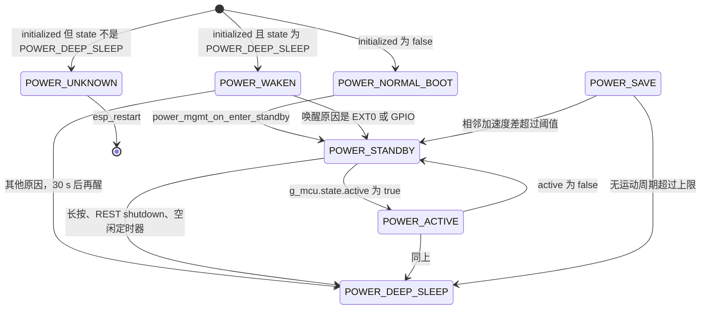
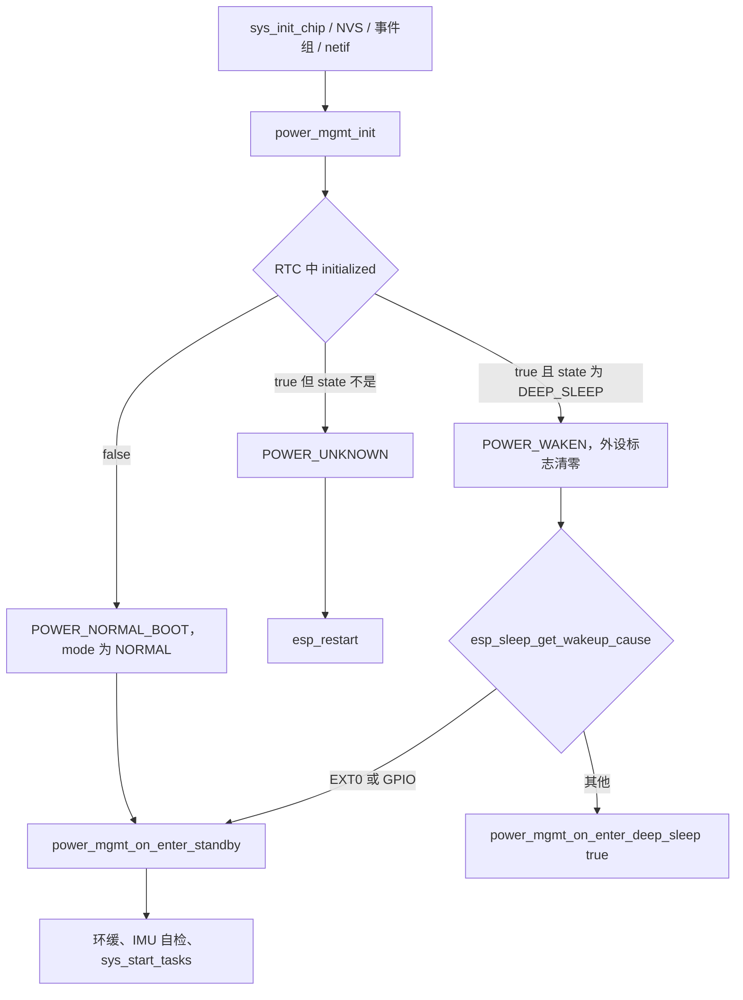

# 电源管理（Power management）

标记点需要在可配置、可推流和尽量省电之间切换。本子系统用一份放在 RTC 内存里的上下文决定冷启动、待机、推流、省电循环和深度睡眠，并记下哪些外设已经打开，避免重复初始化。空闲多久后关掉射频、深度睡眠用哪个脚唤醒、醒来要不要立刻再睡，都在这里。它不负责电池曲线，也不负责 IMU 样本怎么发出去。

## 职责

- 维护 `power_mgmt_state_t` 与 `power_mode_t`，以及外设是否已初始化的标志。
- 在进入待机、推流、省电、深度睡眠时打开或关掉按钮、LED、IMU、BLE、Wi-Fi 和 REST。
- 用两只 FreeRTOS 定时器推迟或触发睡眠：20 s 的周期检查，以及 300 s 的一次空闲定时器。
- 深度睡眠前锁住指定 GPIO，并登记按钮唤醒；若调用方要求，再加 RTC 定时器唤醒。
- 从深度睡眠回来时区分按钮与其他原因。按钮则进入待机；其他原因读一次 IMU 后再次深度睡眠。

电源模式注释里写的 “禁止 light sleep” 并没有对应的 `esp_pm` 配置。真正关掉的是那只 300 s 定时器，而且当前固件没有路径能选中该模式。详见下文。

## 在系统中的位置

`app_main` 在 NVS 和事件组之后调用 `power_mgmt_init()`，再按 RTC 里的状态决定再睡、重启或进入待机，然后才启动业务任务。启动顺序见 [boot-and-tasks.md](boot-and-tasks.md)。上下文与 `g_mcu` 的分界见 [global-state.md](global-state.md)。事件位到 `esp_event` 的转发见 [events.md](events.md)。

上游只把意图送进来：

- [button.md](button.md) 的单击翻转 `g_mcu.state.active`，长按直接深度睡眠。
- [api.md](api.md) 的 REST 可以预约关机或重启、切换推流，并在多数请求上推迟空闲定时器。
- [ota.md](ota.md) 触发时把 `no_sleep` 置位；升级本身不在本模块里执行。
- [imu-streaming.md](imu-streaming.md) 在发送失败时把 operation mode 拉回 inactive，从而回到待机。

下游是外设开关，不是协议：

- [wifi.md](wifi.md)：待机只做 `sys_wifi_msp_init()`，不在这里连接。省电路径才 `sys_wifi_msp_deinit()`。发现包是否还在发，见 [discovery.md](discovery.md)。
- [ble.md](ble.md)：待机启动 NimBLE，进入推流或低功耗模式时关掉。
- [imu.md](imu.md)：待机初始化并在已关闭时重新打开；睡眠前后用 `g_imu.toggle`。
- [led.md](led.md)：待机调用 `blink_msp_init()`；深度睡眠前把 `g_mcu.state.led_manual` 置位，避免灯态任务再改灯。
- [battery.md](battery.md)：待机（以及更早的 `sys_init_chip()`）调用 `battery_msp_init()`。状态机不读电量。
- [time-sync.md](time-sync.md)：只有 `app_power_save` 会通过 `sys_stop_timers()` 停掉对时定时器。
- 引脚定义见 [hardware.md](hardware.md)。本子系统不读写 NVS，见 [nvs.md](nvs.md)。

## 设计

### 数据与状态

全部状态在 `g_power_mgmt_ctx`（`RTC_DATA_ATTR`）。结构体注释把字段分成 “Non-Volatile” 和 “Volatile”，但整个结构都在 RTC 里。深度睡眠不会把它清掉；上电是否清掉，本仓库没有写。

枚举从 0 起排，只有 `POWER_UNKNOWN` 显式为 -1。RTC 被清成 0 时，`initialized` 为 false，`state` 的 0 等于 `POWER_NORMAL_BOOT`，`mode` 的 0 等于 `POWER_MODE_PERFORMANCE`。冷启动分支会立刻把 `mode` 写成 `POWER_MODE_NORMAL`，不会把 0 当成未知状态。

| 状态 | 值 | 注释中的含义 | 代码里何时赋值 |
| --- | --- | --- | --- |
| `POWER_UNKNOWN` | -1 | 无 | `initialized` 已为 true，但醒来时 `state` 不是 `POWER_DEEP_SLEEP` |
| `POWER_NORMAL_BOOT` | 0 | 无 | 冷启动；按钮唤醒时函数返回这个值，但不写回 `state` |
| `POWER_STANDBY` | 1 | RF 开，不发送 | `power_mgmt_on_enter_standby()` 成功路径的末尾 |
| `POWER_ACTIVE` | 2 | RF 开，发送 | `power_mgmt_on_enter_active()` 末尾 |
| `POWER_SAVE` | 3 | RF 关，周期看 IMU | `power_mgmt_on_enter_power_save()` 末尾 |
| `POWER_DEEP_SLEEP` | 4 | 无 | 调用 `esp_deep_sleep_start()` 的前一行 |
| `POWER_WAKEN` | 5 | 无 | 确认是从深度睡眠回来的那一次 `power_mgmt_init()` |

| 模式 | 值 | 注释 | 进入 `POWER_STANDBY` 时的实际动作 |
| --- | --- | --- | --- |
| `POWER_MODE_PERFORMANCE` | 0 | 禁止 deep sleep 与 light sleep | BLE 仍按 “非低功耗” 启动；`disarm_power_save_timer()` |
| `POWER_MODE_NORMAL` | 1 | 允许睡眠，BLE 开 | 若 BLE 未开则启动，并把 Wi-Fi 设为 `WIFI_PS_MAX_MODEM`；武装 300 s 定时器 |
| `POWER_MODE_LOW_ENERGY` | 2 | 允许 deep sleep，BLE 关 | 无条件 `blehr_stop_srv()`；武装 300 s 定时器 |

冷启动把 `mode` 和 `next_mode` 都设为 `POWER_MODE_NORMAL`。从深度睡眠回来时不改 `mode`，只把 `next_mode` 抄成当前 `mode`。当前树里没有第二处写入。因此 `POWER_MODE_PERFORMANCE` 与 `POWER_MODE_LOW_ENERGY` 的分支存在，但这次编译出的固件不会自己选中它们。若 RTC 里残留旧值，唤醒后会按残留值执行；代码没有迁移。

外设标志在 `power_peripheral_state_t`。进入某个状态时先看标志，避免重复 `init`。深度睡眠唤醒和错误路径都会把整组标志清零，句柄类资源（互斥量）作废后重建。

| 字段 | 置位 | 清位 |
| --- | --- | --- |
| `button_initialized` | 第一次待机调用 `sys_init_buttons()` | 唤醒或错误路径的 `memset` |
| `led_initialized` | 第一次待机调用 `blink_msp_init()` | 同上 |
| `imu_initialized` | 第一次待机调用 `imu_interface_init()` | 同上。已置位但 `g_imu` 被关掉时，待机只 `toggle(true)` |
| `ble_enabled` | `blehr_start_srv()` 成功启动后由 BLE 层写成 true | `blehr_stop_srv()` 末尾写成 false，无论 `nimble_port_stop()` 是否成功 |
| `wifi_initialized` | 待机里 `sys_wifi_msp_init()` 之后 | 省电路径 `sys_wifi_msp_deinit()` 之后 |
| `controller_initialized` | 待机里 `rest_controller_start()` 之后 | 省电路径 `rest_controller_stop()` 之后 |

`g_power_mgmt_ctx.mutex` 创建后没有任何 `xSemaphoreTake`。事件处理用的是文件内静态的 `sync_mutex`，不在 RTC 里。`no_sleep` 虽然写在 “Volatile” 一段，唤醒路径却不清它。

RTC 里实际保留的内容：

| 字段 | 冷启动（`initialized == false`） | 确认从深度睡眠醒来 | 错误路径 |
| --- | --- | --- | --- |
| `initialized` | 写成 true | 保持 true | 保持 true |
| `state` | `POWER_NORMAL_BOOT` | 先改为 `POWER_WAKEN` | `POWER_UNKNOWN` |
| `mode` | `POWER_MODE_NORMAL` | 不改 | 不改 |
| `next_mode` | 抄 `mode` | 抄 `mode` | 不改 |
| `boot_count` | 自增后打日志，没有别的读者 | 同左 | 同左 |
| `mutex` | 新建 | 丢弃旧句柄并新建 | 写成 `NULL` |
| `peripheral_state` | 清零 | 清零 | 清零 |
| `no_sleep` | 不赋值；RTC 全 0 时为 false | 不改 | 不改 |

`boot_count` 统计的是进入 `power_mgmt_init()` 的次数，不是成功冷启动的次数。掉电后是否还在，代码未体现。

`g_mcu` 不在 RTC 里。深度睡眠后再启动，`g_mcu.state.active`、灯的手动标志、任务句柄都是新的零值。Wi-Fi 凭证靠启动时重新读 NVS，不靠这份电源上下文。

`POWER_SAVE` 只在 `app_power_save` 里被赋值。空闲定时器的回调在创建该任务之后立刻深度睡眠，所以这条边能不能发生取决于调度，不是状态机保证的。见「行为与时序」。

### 行为与时序

启动判定在 `main/app_main.c` 的 `init()`，不看 `power_mgmt_init()` 的返回码，只看写完的 `state`。

`power_mgmt_init()` 一开始就对脚做 hold 解除，好让醒来后的输出重新生效。`#if SOC_GPIO_SUPPORT_HOLD_SINGLE_IO_IN_DSLP` 时，注释称这是 ESP32-C5：per-pin hold 会穿过深度睡眠，所以先 `gpio_hold_dis`，再立刻对同一批脚 `gpio_hold_en`。`#else` 先 `gpio_deep_sleep_hold_dis()` 再 `gpio_deep_sleep_hold_en()`，只打开 “深度睡眠期间保持已 hold 的脚” 这个总开关，运行期不锁脚。被操作的脚是 `CONFIG_BLINK_PIN`，以及宏存在时的 `CONFIG_IMU_EN_PIN`。

确认从深度睡眠回来之后，`power_mgmt_wake_up_handler()`：

- `ESP_SLEEP_WAKEUP_EXT0` 或 `ESP_SLEEP_WAKEUP_GPIO`：打日志 “wakeup from button”，返回 `POWER_NORMAL_BOOT`。`g_power_mgmt_ctx.state` 仍是 `POWER_WAKEN`，直到随后的待机把它写成 `POWER_STANDBY`。
- 其他原因（含定时器，也含 `ESP_SLEEP_WAKEUP_UNDEFINED`）：日志写成 “wakeup from timer”。先 `imu_interface_init()`，再 `g_imu.read(..., crc_check = true)`，失败就 `taskYIELD()` 空转，没有超时，也没有间隔。读到一帧后，用 `spatial_vector_multiply_plus` 计算 `acc + (-1) * {0, 0, -1}` 的欧氏范数，只打日志。返回值固定是 `POWER_DEEP_SLEEP`，不与 `CONFIG_POWER_SAVE_MOTION_LIMIT` 比较。源码 TODO 写明运动检测要等 PCB 修改后再做。
- `app_main` 看到返回 `POWER_DEEP_SLEEP` 就 `power_mgmt_on_enter_deep_sleep(true)`，该函数不返回。此路径上外设标志已被清零，所以不会做那 2 秒亮灯；按钮任务也还没创建。

待机 `power_mgmt_on_enter_standby()` 按标志补齐外设，然后把 `state` 设为 `POWER_STANDBY`：

1. 按钮、LED、IMU（或把已经初始化但关掉的 IMU 打开）。
2. `mode != POWER_MODE_LOW_ENERGY` 且 BLE 未开：先 `esp_wifi_set_ps(WIFI_PS_MAX_MODEM)`，再 `blehr_start_srv()`。低功耗模式则无论标志都 `blehr_stop_srv()`。
3. Wi-Fi 未初始化则 `sys_wifi_msp_init()`（`esp_wifi_init` + STA，不 `esp_wifi_start`）。连接由 [wifi.md](wifi.md) 在 `EV_SYS_WIFI_DISCONNECTED` 上做。
4. 日志打印 `CONFIG_MAX_TX_POWER`，实际调用 `esp_wifi_set_max_tx_power(CONFIG_NORMAL_TX_POWER)`。两者都不等返回值。
5. REST 未启动则 `rest_controller_start(CONFIG_CONTROLLER_BASE_PATH)`。
6. `mode != POWER_MODE_PERFORMANCE` 时武装 300 s 一次定时器，否则解除并删掉它。
7. `battery_msp_init()`，忽略返回值。

枚举注释说待机 “不发送”。推流任务确实要 `g_mcu.state.active` 才发，但发现定时器不由本模块关掉。Wi-Fi 已连接时，待机仍可能发出发现包。

推流不是本模块主动发起的。`sys_set_operation_mode()` 改 `g_mcu.state.active` 并置 `EV_SYS_MODE_CHANGE`。`app_system_loop` 把它投成 `SYSTEM_MODE_CHANGE_EVENT`。同一事件上先注册的 `sys_mode_change_handler()` 把 IMU mux 设为 `IMU_MUX_STREAM` 或 `IMU_MUX_IDLE`，后注册的 `sys_power_mgmt_handler()` 再切电源状态：active 时进入 `POWER_ACTIVE` 并把 `no_sleep` 置 true；否则重新进入待机并把 `no_sleep` 置 false。

`power_mgmt_on_enter_active()` 只做三件事：按 `CONFIG_MAX_TX_POWER` 设置发射功率（日志与参数一致）；若 BLE 开着则停掉并 `esp_wifi_set_ps(WIFI_PS_NONE)`；把 `state` 写成 `POWER_ACTIVE`。它不初始化 IMU，不改灯，也不在此刻重置 300 s 定时器。BLE 本来就没开时，Wi-Fi modem sleep 保持原样。

周期节拍是 `g_mcu.timers.power_mgmt_timer`，在 `app_system_loop` 里创建，周期 `CONFIG_POWER_MGMT_DURATION_S`（20 s），自动重载。回调在 `state != POWER_SAVE` 时向系统事件环投递 `SYSTEM_POWER_MGMT_EVENT`，不带数据。处理函数先看 `next_mode != mode`（当前没有写入者，进不去），再按状态：

- `POWER_STANDBY` 且 `no_sleep`：`reset_power_save_timer()`。
- `POWER_ACTIVE`：无论 `no_sleep` 都重置。
- `POWER_NORMAL_BOOT`、`POWER_SAVE`、`POWER_DEEP_SLEEP`、`POWER_WAKEN`：空。

因此 `no_sleep` 的实际作用只有一处：待机时让 20 s 节拍把 300 s 定时器往后推。它不解除定时器，也不出现在 `power_mgmt_on_enter_deep_sleep()` 里。注释写 “Disable deep sleep / light sleep”，与调用点不符。进入推流后，第一次重置要等下一拍，最长约 20 s；这 20 s 里若 300 s 定时器到期，仍会进入下面的回调。

空闲定时器 `power_save_timer` 是一次的，时长 `CONFIG_POWER_SAVE_TIMEOUT_S`（300 s），静态变量，不进 RTC。第一次创建并启动返回 `ESP_OK`；已存在时 `xTimerReset` 后仍 `return ESP_FAIL`。调用方都不看返回值。`reset_power_save_timer()` 仅在句柄非空时重置。解除时 stop、delete，并把句柄置 `NULL`。

到期回调 `power_mgmt_handle_transition()`：

1. `xTaskCreate(app_power_save, ..., 优先级 12, 栈 4096)`，不检查返回值，不绑核。
2. 紧接着 `power_mgmt_on_enter_deep_sleep(false)`。该函数是 `_Noreturn`。

`app_power_save` 里有关 Wi-Fi、`os_delay_ms` 和 `esp_light_sleep_start`，都会让出 CPU。定时器守护任务因此会在省电循环跑完之前继续执行，进入 “只许按钮唤醒” 的深度睡眠。文件内有 FIXME。循环本身仍是写成的行为，不能当成稳定达到的状态：

1. `sys_stop_tasks()` 删掉 `app_system_loop`、`app_monitor`、`app_data_client`。不删按钮任务，也不删 `esp_event` 的 `system_event_loop_task`。
2. `sys_stop_timers()` 停发现、对时和 20 s 电源节拍，不停已经响过的 `power_save_timer`。
3. `power_mgmt_on_enter_power_save()`：停 BLE、反初始化 Wi-Fi、`blink_led_off()`、停 REST，然后 `state = POWER_SAVE`。这里不关 IMU，也不登记 RTC 唤醒。
4. 读一帧作为基准（失败则延时 100 ms 再试，无超时），之后循环：日志写 “light sleep for 10 seconds”，`esp_sleep_enable_timer_wakeup(10 * 1000000UL)`，注释却写 “3 seconds”。关掉 IMU，延时 10 ms，`esp_light_sleep_start()`。此路径没有使能 EXT0；醒来日志把非 EXT0 都打印成 “timer”。
5. 再打开 IMU 并读一帧。差向量是本帧 `acc` 减上一帧 `acc`，范数大于 `CONFIG_POWER_SAVE_MOTION_LIMIT`（0.04）则跳出。否则更新基准。加速度单位代码未换算。
6. 无运动时 `cycle_count` 在比较之后加一，大于 `CONFIG_POWER_SAVE_CYCLE_MAX_COUNT`（300）才 `power_mgmt_on_enter_deep_sleep(true)`。所以是 301 个无运动周期，而不是 300。每周期的睡眠是写死的 10 s，另加读数重试，不是宏。
7. 因运动跳出后：再次待机、`sys_start_tasks()`、删除自己。深度睡眠那一支不返回，到不了这里。

深度睡眠 `power_mgmt_on_enter_deep_sleep(bool wakeup)` 不看当前状态，也不看 `no_sleep`：

1. `g_imu.toggle(g_imu.p_imu, false)`。不检查 `imu_initialized`。HI229（`CONFIG_IMU_SENSOR_HI229`）把 `CONFIG_IMU_EN_PIN` 拉到 `CONFIG_HI229_DISABLE_LVL`（1）；使能电平是 0。BNO08X 发睡眠命令（executable 通道命令字节 3），不切电源轨；失败时 `enabled` 可能仍为 true。
2. `g_mcu.state.led_manual = true`，延时 100 ms。
3. 仅当 `led_initialized`：`blink_led_on()`，2 s，`blink_led_off()`。定时器唤醒后再睡的那条路径标志已清零，跳过这一步。
4. `gpio_hold_en`：有 `CONFIG_IMU_EN_PIN` 时加上该脚，以及始终加上 `CONFIG_BLINK_PIN`。灯灭时 `en_val` 为 1，`blink_led_off()` 把脚写成 0，hold 住的是这个电平。C5 那条 init 路径在运行期已经 hold，这里没有先 `gpio_hold_dis`。hold 期间改电平是否进焊盘，代码未再处理。
5. `wakeup == true`：定时器 `CONFIG_POWER_WAKE_UP_DURATION_S`（30）秒，单位微秒。`false`：不设定时器，日志 “entering deep sleep forever”。
6. 按钮始终是唤醒源。然后 `state = POWER_DEEP_SLEEP`，`esp_deep_sleep_start()`。

调用方与 `wakeup`：

| 调用方 | `wakeup` | 醒来条件 |
| --- | --- | --- |
| 长按按钮 | false | 仅按钮 |
| REST `target_state=shutdown`（先等 3 s） | false | 仅按钮 |
| 300 s 定时器回调 | false | 仅按钮 |
| 省电循环超过周期上限 | true | 按钮或 30 s |
| 定时器唤醒后的再睡 | true | 按钮或 30 s |

按钮路径见 [button.md](button.md)：长按阈值 `CONFIG_LONG_PRESS_DURATION`（1000 个 tick）。单击翻转 operation mode。双击只打日志，TODO 未实现，不进电源状态机。

REST 与睡眠的交界，处理函数本身见 [api.md](api.md)：

| 请求 | 对电源的作用 |
| --- | --- |
| `GET` 或 `POST /v1/system/power_mgmt` | 两者相同：重置空闲定时器，返回 `mode` 字符串（`performance` / `normal` / `low_energy` / `unknown`）和 `no_sleep`。不解析查询，不改模式。文件头注释里的 `always_on` / `cancel_always_on` 没有对应实现 |
| `POST /v1/system/power?target_state=reboot` | 3 s 后 `esp_restart()` |
| `POST /v1/system/power?target_state=shutdown` | 3 s 后深度睡眠，`wakeup` 为 false |
| `POST /v1/operation/mode?action=start` 或 `stop` | `sys_set_operation_mode`，从而进入 `POWER_ACTIVE` 或待机 |
| `POST /v1/imu/debug/toggle` | 解析到 `enable` 则 `no_sleep = true` 且 mux 为 `IMU_MUX_DEBUG`；`disable` 则 `no_sleep = false` 且 mux 为 `IMU_MUX_IDLE`。查询键在源码里是空字符串 |

`rest_controller_handlers.c` 里各 HTTP 处理函数开头几乎都调用 `reset_power_save_timer()`。WebSocket `/v1/imu/debug/socket` 不调用。IMU 推流路径也不调用；推流期间靠 `POWER_ACTIVE` 的 20 s 节拍推迟空闲定时器。

OTA：`EV_SYS_OTA_TRIGGERED` 的处理里先投递 `SYSTEM_OTA_EVENT`（处理函数只把 `no_sleep` 置 true），再 `sys_set_operation_mode(false)`，然后在 `app_system_loop` 任务里阻塞运行 `sys_ota_perform()`。mode-change 位要等 OTA 返回、该任务再次 `xEventGroupWaitBits` 才会被转发。OTA 成功则 `esp_restart()`，mode-change 来不及跑。失败则 `sys_ota_perform()` 直接把 `no_sleep` 写成 false，随后的 mode-change 进入待机并再写一次 false。守卫路径再次调用 `sys_ota_perform()` 时，失败同样清 `no_sleep`。

电池只是调用关系：`sys_init_chip()` 一次，每次进入待机再一次。`/v1/system/info` 调用 `battery_read_level()` 并重置空闲定时器。状态迁移不看电压。分压与换算见 [battery.md](battery.md)。

### 并发

| 上下文 | 电源相关动作 |
| --- | --- |
| `app_main` 的 `init` | 判定 RTC、可能再睡或重启、第一次待机。此时业务任务还没有 |
| Timer 守护任务 | 20 s 投递、300 s 回调、REST 的 3 s 重启/关机 |
| `system_event_loop_task` | `sys_power_mgmt_handler` |
| `app_system_loop` | 把事件组转成 `esp_event`；OTA 在这个任务里阻塞执行 |
| `button_daemon`（优先级 10，栈 2048） | 单击改 operation mode，长按深度睡眠 |
| `app_power_save`（优先级 12，栈 4096，不绑核） | 省电循环 |
| httpd | 重置定时器、改 `no_sleep`、预约关机 |

`sys_power_mgmt_handler` 用 `sync_mutex` 和 `portMAX_DELAY` 把模式切换、节拍和 OTA 置位串起来。待机、推流、省电、深度睡眠这些入口本身不加这把锁，按钮、REST 定时器和 `app_main` 可以同时调用。`g_power_mgmt_ctx.mutex` 未使用。创建互斥量失败时，代码未处理。

`sdkconfig.defaults.v1`、`v2`、`v3` 都没有设置 `CONFIG_FREERTOS_TIMER_TASK_PRIORITY`。空闲回调和 `app_power_save` 谁先占住 CPU，不能从本仓库的配置读出来。能确定的是回调在 `xTaskCreate` 之后无条件进入不返回的深度睡眠。

`CONFIG_EN_MULTI_CORE` 在 `CONFIG_IDF_TARGET_ESP32` 与 `CONFIG_IDF_TARGET_ESP32S3` 上为 1，其余为 0。它只影响 `sys_start_tasks()` / `sys_stop_tasks()` 管理的那几个业务任务的绑核和优先级，不改变 `app_power_save`。

### 配置

`CONFIG_POWER_*` 在 `include/settings.h`，不是 Kconfig，也不在三份 `sdkconfig.defaults.*` 里。三份 defaults 都没有 `CONFIG_PM_ENABLE`。自动 light sleep 未打开；唯一的 light sleep 是 `app_power_save` 里那次显式调用。

| 宏 | 值 | 谁用 |
| --- | --- | --- |
| `CONFIG_POWER_MGMT_DURATION_S` | 20 | 周期节拍，自动重载 |
| `CONFIG_POWER_SAVE_TIMEOUT_S` | 300 | 空闲一次定时器 |
| `CONFIG_POWER_SAVE_CYCLE_MAX_COUNT` | 300 | 无运动周期上限（比较是加一之后 `>`，故 301 次） |
| `CONFIG_POWER_SAVE_MOTION_LIMIT` | 0.04 | 仅省电循环里相邻加速度差 |
| `CONFIG_POWER_WAKE_UP_DURATION_S` | 30 | `wakeup == true` 的深度睡眠定时器 |
| `CONFIG_NORMAL_TX_POWER` | 34 | 待机实际传入 `esp_wifi_set_max_tx_power` |
| `CONFIG_MAX_TX_POWER` | 68 | 推流实际传入；待机只出现在日志 |
| `CONFIG_BUTTON_FN_GPIO_PIN` | `GPIO_NUM_0` | 深度睡眠唤醒脚 |
| `CONFIG_BUTTON_FN_ACTIVE_LEVEL` | 0 | 低电平唤醒；按钮输入开启上拉 |

发射功率整数直接交给 ESP-IDF，本仓库不换算。v1 的 `sdkconfig.defaults.v1` 另有 `CONFIG_ESP_PHY_REDUCE_TX_POWER=y`，v2/v3 的 defaults 没有这一项。状态机仍然传入同一对宏。

### v1 / v2 / v3 差异

产品默认来自 sdkconfig：v1 是 `CONFIG_IDF_TARGET_ESP32` 加 `CONFIG_IMU_SENSOR_HI229`，v2 是 `CONFIG_IDF_TARGET_ESP32S3` 加 `CONFIG_IMU_SENSOR_BNO08X`，v3 是 `CONFIG_IDF_TARGET_ESP32C5` 加 `CONFIG_IMU_SENSOR_BNO08X`。电源代码不判断 “v1/v2/v3” 这个名字，只看目标宏和 IMU 宏。`modelspec.h` 允许 ESP32 或 ESP32-S3 在两种 IMU 之间切换；ESP32-C5 的引脚块只有 BNO08X。

深度睡眠唤醒：

| 守卫 | API |
| --- | --- |
| `CONFIG_IDF_TARGET_ESP32` 或 `CONFIG_IDF_TARGET_ESP32S3` | `esp_sleep_enable_ext0_wakeup(CONFIG_BUTTON_FN_GPIO_PIN, CONFIG_BUTTON_FN_ACTIVE_LEVEL)` |
| `CONFIG_IDF_TARGET_ESP32C5` | `esp_deep_sleep_enable_gpio_wakeup(BIT64(GPIO 0), ESP_GPIO_WAKEUP_GPIO_LOW)` |
| 其他目标 | 这段不编译，按钮唤醒不会被登记 |

醒来时两种原因都认：`ESP_SLEEP_WAKEUP_EXT0` 与 `ESP_SLEEP_WAKEUP_GPIO`。`modelspec.h` 没有把按钮脚标成 RTC GPIO。EXT0 是否接受该脚，由芯片和 ESP-IDF 决定，本文件没有检查。

`include/modelspec.h` 标了 RTC 的脚，和电源代码真正 hold / 用作唤醒的脚不是同一组。

| 符号 | 出现条件 | GPIO | 电源代码 |
| --- | --- | --- | --- |
| `CONFIG_BUTTON_FN_GPIO_PIN` | 三种目标都有，未标 RTC | 0 | 唤醒，不 hold |
| `CONFIG_BLINK_PIN` | 三种目标都有，未标 RTC | 7 | 进入深度睡眠时 hold；C5 的 init 分支还会在运行期重新 hold |
| `CONFIG_IMU_EN_PIN` | `CONFIG_IDF_TARGET_ESP32` 或 `ESP32S3`，且 `CONFIG_IMU_SENSOR_HI229`。注释 “Need RTC GPIO” | 4 | hold。关掉 IMU 后电平为 1 |
| `CONFIG_IMU_WAKE_PIN` | BNO08X。ESP32 为 14，ESP32-S3 与 ESP32-C5 为 3。注释为 RTC 输出 | 见左 | 不 hold，不作唤醒 |
| `CONFIG_IMU_INT_PIN` | BNO08X，三种目标。注释为 RTC | 9 | 不 hold，不作唤醒 |
| `CONFIG_IMU_RST_PIN` | BNO08X，三种目标。注释为 RTC | 8 | 不 hold，不作唤醒 |

v1 默认 HI229，因此会 hold EN 脚。v2/v3 默认 BNO08X，没有 `CONFIG_IMU_EN_PIN`，深度睡眠只 hold 灯，IMU 只靠睡眠命令。电池使能脚也不在 hold 列表里，睡眠期间的电平代码未设置。

init 时走 per-pin 重新 hold 还是 `gpio_deep_sleep_hold_en()`，由 `SOC_GPIO_SUPPORT_HOLD_SINGLE_IO_IN_DSLP` 决定，不是 `CONFIG_IDF_TARGET_*`。源码注释把前者对应到 ESP32-C5。v1/v2 的 soc 头文件是否定义该宏，本仓库未记录。

## 接口

对其他子系统暴露的符号在 `components/sys/sys.h`：

- `g_power_mgmt_ctx`：状态、模式、`next_mode`、`no_sleep`、外设标志、`boot_count`。
- `power_mgmt_init()`、`power_mgmt_wake_up_handler()`。
- `power_mgmt_on_enter_standby()`、`power_mgmt_on_enter_active()`、`power_mgmt_on_enter_power_save()`、`power_mgmt_on_enter_deep_sleep(bool)`。最后一个不返回。
- `reset_power_save_timer()`。
- `sys_power_mgmt_handler()`：处理 `SYSTEM_POWER_MGMT_EVENT`、`SYSTEM_MODE_CHANGE_EVENT`、`SYSTEM_OTA_EVENT`。

依赖的事件，定义见 [events.md](events.md)：

| 符号 | 位 | 方向 |
| --- | --- | --- |
| `EV_SYS_POWER_MGMT_BIT` | `BIT9` | 只消费。`app_system_loop` 若看到它，就投递 `SYSTEM_POWER_MGMT_EVENT`。当前树里没有 `set_sys_event(EV_SYS_POWER_MGMT)`。20 s 节拍是直接 `esp_event_post_to`，不经这一位 |
| `EV_SYS_MODE_CHANGE_BIT` | `BIT8` | 消费。由 `sys_set_operation_mode()` 置位。电源与 IMU mux 各有一个处理函数 |
| `EV_SYS_OTA_TRIGGERED_BIT` | `BIT7` | 不由本模块置位。系统循环把它变成 `SYSTEM_OTA_EVENT` 后再跑 OTA |

本模块不置任何系统事件位。Wi-Fi 反初始化会间接触发 [wifi.md](wifi.md) 里的断线事件。不读写任何 NVS 键；模式和 `no_sleep` 只活在 RAM/RTC。

`no_sleep` 的写入点：进入 `POWER_ACTIVE`、离开它回到待机、`SYSTEM_OTA_EVENT`、OTA 失败、IMU 调试开关。没有别的。

## 失败与边界

- `initialized == true` 且 `state != POWER_DEEP_SLEEP`：置 `POWER_UNKNOWN` 并 `esp_restart()`。`initialized` 不会被清掉。软件复位是否还保留 `RTC_DATA_ATTR`，代码未体现。若保留，下一次仍走这条路径。
- 定时器唤醒后的 IMU 读没有超时。一直失败则停在 `power_mgmt_wake_up_handler()`，按钮任务尚未创建，也不会再睡。省电循环里的读同样无超时，但每次失败间隔 100 ms。
- 运动范数在唤醒路径上不参与决策。设备会以 30 s 为周期反复深度睡眠，直到按钮产生 EXT0 或 GPIO 唤醒。
- 空闲定时器不看 `no_sleep`、不看 `POWER_ACTIVE`。推流或 OTA 只靠 20 s 节拍去重置它。节拍还没跑到、或者 `app_system_loop` 已被删掉时，定时器仍会触发深度睡眠。`POWER_MODE_PERFORMANCE` 才会真正删掉这只定时器，而当前没有写入者。
- 长按和 REST shutdown 同样不看 `no_sleep`。调试模式或 OTA 置位挡不住它们。
- 从推流长按入睡时，`no_sleep` 仍是 true，并留在 RTC 里。按钮唤醒后 `g_mcu.state.active` 已丢，待机不会自动把它清掉。之后只要 20 s 节拍还在，空闲定时器会被一直重置，直到某次 mode-change、OTA 失败或调试关闭把它写成 false。
- C5 的 init 在释放 hold 后立刻重新 hold 灯（以及存在时的 IMU EN）。深度睡眠前的 2 s 亮灯没有先解除 hold。
- BNO08X 的关断是芯片命令不是电源轨。命令失败时 MCU 仍会睡，传感器是否睡了，代码只看 `BNO08x_mode_sleep` 的布尔返回值，失败不阻止 `esp_deep_sleep_start()`。
- 每次待机都 `battery_msp_init()`，而 `sys_init_chip()` 已经调用过。电源侧不看返回值。重复初始化会不会在 ADC 上失败，见 [battery.md](battery.md)。
- `esp_wifi_set_ps` 发生在 `sys_wifi_msp_init()` 之前，`esp_wifi_set_max_tx_power` 又在 `esp_wifi_start()` 之前。返回值都未检查。待机日志打印 68，写入的是 34。
- `blehr_stop_srv()` 在 `nimble_port_stop()` 非 0 时不 `deinit`，但仍把 `ble_enabled` 写成 false。低功耗待机分支即使 BLE 没开过也会调用它。
- `arm_power_save_timer()` 在重置已有定时器时返回 `ESP_FAIL`，和真正的 `xTimerStart` 失败用同一个返回值。
- `sys_stop_tasks()` 使用 `vTaskDelete`。若当时任务正停在 OTA 或持有锁上，代码没有配合的退出路径。按钮任务在省电循环里仍然可以长按入睡或改 operation mode。
- `POWER_STANDBY` 的注释与发现包发送并不一致，见上文。light sleep 的 10 s 与旁边 “3 seconds” 注释不一致。

## 设计取舍

空闲到期后同时创建 `app_power_save` 并调用 `power_mgmt_on_enter_deep_sleep(false)`。`50e877f`（Add power save function）里曾有注释：PCB 把 SPI CS 误接到 IMU 的 SYNC_IN，省电任务不能工作，因此当时不创建任务。`0c747a5`（fix: fix monitor rate control）删掉这句、恢复 `xTaskCreate`，并留下 FIXME；深度睡眠调用仍在。0.04、300 次和写死的 10 s 为什么取这些数，历史未说明。唤醒时相对 `{0, 0, -1}` 的范数被忽略，当前 TODO 写 “update this logic after PCB fix”；引入该 TODO 的 `4361a37`（Draft Hardware Change）没有写原因。

ESP32-C5 不能用原来的 EXT0。`b08f2df`（feat: add support for esp32c5）把按钮唤醒扩成 EXT0 或 GPIO，并在 C5 上改用 `esp_deep_sleep_enable_gpio_wakeup`。`016f90c`（fix: remove unused include and add GPIO handling for ESP32-C5 in power management）写明 C5 的 per-pin hold 会跨深度睡眠保留，所以 init 时先释放再 hold。运行期一直持有 hold 对点灯的影响，提交说明没有写。

三种 `power_mode_t` 的切换代码还在，写入端不在。`908322e`（refactor: change names of attributes）删掉了 REST 里对 `next_mode` 的赋值和 `set_sys_event(EV_SYS_POWER_MGMT)`，subject 未说明原因。同一则说明里的 “feat: ble auto-stop” 对得上进入 `POWER_ACTIVE` 时关 BLE。为何待机用 `WIFI_PS_MAX_MODEM`、推流用 `WIFI_PS_NONE`，历史未说明。BNO 构建不再定义 `CONFIG_IMU_EN_PIN`，来自 `3fa3a0d`（Fix bno08x power mgmt）；说明写的是 enable/disable，没有写 hold 只剩下灯这回事。

## 源文件

- `components/sys/power_mgmt.c`
- `components/sys/sys.h`
- `components/sys/sys.c`
- `components/sys/button.c`
- `components/sys/wifi.c`
- `components/apps/system_loop.c`
- `components/rest_controller/rest_controller.c`
- `components/rest_controller/rest_controller_handlers.c`
- `components/ble/ble_srv.c`
- `components/blink/blink.c`
- `components/imu/imu.h`
- `main/app_main.c`
- `include/settings.h`
- `include/modelspec.h`
- `lib/hi229/hi229.c`
- `lib/hi229/hi229.h`
- `lib/bno08x/bno08x.c`
- `lib/bno08x/bno08x_driver.c`
- `lib/battery/battery.c`
- `lib/spatial/spatial.c`
- `sdkconfig.defaults.v1`
- `sdkconfig.defaults.v2`
- `sdkconfig.defaults.v3`
