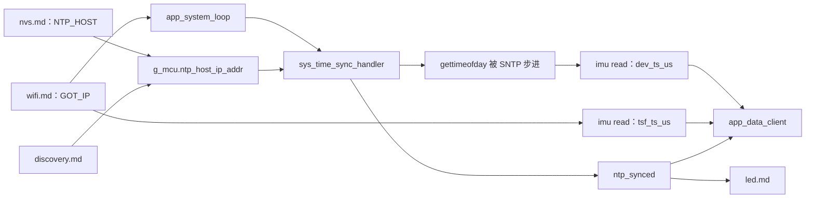
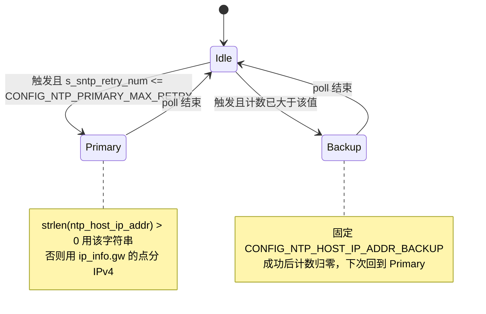
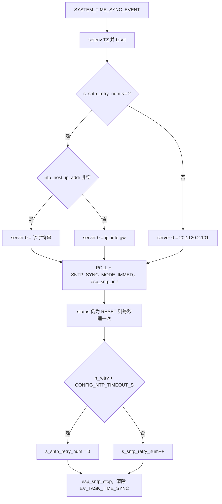
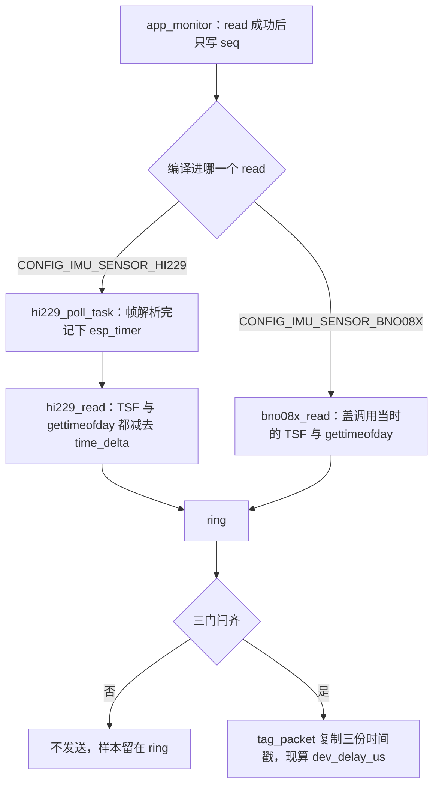

# 时间同步（Time Sync）

标记点要和同一台 AP 上的其他节点、以及上位机的动捕时间轴对齐。本子系统用一次性 SNTP 把 `gettimeofday` 步进到 UTC，并用 `ntp_synced` 卡住 UDP 推流；每条 IMU 样本上的时刻不是在 `app_monitor` 或 `app_data_client` 里生成的，而是在对应 IMU 驱动的 `read` 里盖上 Wi-Fi TSF 和这套墙上时钟。`esp_timer` 只做回拨差值和采样节拍。`time_sync.c` 末尾关于 TBTT 的公式没有实现。

## 职责

- 在 Wi-Fi 获得地址之后，以及之后的固定周期，向一个 SNTP 服务器做一次 poll，然后停掉客户端。
- 按连续失败次数在主服务器（NVS 或发现下发的主机名，空则用网关 IPv4）和编译期备份地址之间切换。
- 成功时把 `g_mcu.state.ntp_synced` 置位，并记下当时的 Unix 微秒。这个布尔量只会被写成 `true`。
- 每次尝试前设置 POSIX 时区。样本时间戳走 `gettimeofday`，不走 `localtime`。
- 不组 UDP 包，不决定采样率，也不把 TSF 换算成 Unix 时间。

## 在系统中的位置

上游是 [wifi.md](wifi.md)（`EV_SYS_WIFI_CONNECTED` 与 `g_mcu.ip_info.gw`）、[nvs.md](nvs.md)（启动时载入 `NTP_HOST`）、[discovery.md](discovery.md)（可覆盖 RAM 里的主机名）和 [boot-and-tasks.md](boot-and-tasks.md)（`app_system_loop` 创建定时器并投递 `SYSTEM_TIME_SYNC_EVENT`）。事件位与字段的存放见 [events.md](events.md) 和 [global-state.md](global-state.md)。

下游里，[imu.md](imu.md) 的 `read` 盖 `dev_ts_us` / `tsf_ts_us`；[imu-streaming.md](imu-streaming.md) 的 `app_data_client` 在 `ntp_synced` 为真之前不发送；[led.md](led.md) 用同一个布尔量决定是否还停在快呼吸；[api.md](api.md) 的 `GET /v1/system/info` 读出当前墙上时间和 TSF。[power-management.md](power-management.md) 会停掉对时定时器并拆掉 Wi-Fi。硬件引脚差异见 [hardware.md](hardware.md)。



## 设计

### 数据与状态

`g_mcu` 在 `sys.c` 里零初始化，因此启动时 `ntp_synced == false`，`ntp_host_ip_addr` 为空。NVS 载入发生在任何对时之前。

| 状态 | 谁写 | 谁读 | 清除 |
| --- | --- | --- | --- |
| `g_mcu.ntp_host_ip_addr` | `sys_load_str_conf`；发现回复里非空的 `ntp_host` | `sys_time_sync_handler` | 发现用 `strncpy` 覆盖 RAM。不写回 NVS。REST 改 NVS 不会改这块 RAM |
| `s_sntp_retry_num` | 本文件静态变量，初值 0 | 选择主/备 | 本次 `n_retry < CONFIG_NTP_TIMEOUT_S` 时归零，否则加一。无上界 |
| `g_mcu.state.ntp_synced` | 仅 `time_sync_notification_cb` 写 `true` | `app_data_client`、`get_target_led_status`、定时器回调 | 代码未体现清零。断线、对时失败、power save 都不清 |
| `ntp_sync_success_unix_usec` | 回调里的 `get_time_usec` | 代码未体现读取者 | 下次成功覆盖 |
| `EV_TASK_TIME_SYNC` | 定时器回调在投递前 `set_task_event` | 定时器自己的重入条件 | handler 末尾 `clear_task_event`。Wi-Fi 连接路径不置这个位 |
| `EV_SYS_NTP_SYNCED` | 回调 `set_sys_event` | `app_system_loop` 的 `xEventGroupWaitBits` 会把它和别的位一起清掉 | loop 里没有针对 `EV_SYS_NTP_SYNCED_BIT` 的分支 |

服务器选择是「同一时刻只配置 index 0」，不是主备同时注册：



`<= CONFIG_NTP_PRIMARY_MAX_RETRY`（值为 2）且计数从 0 起步，所以主服务器会先被尝试 3 次（计数 0、1、2），第 4 次才换成备份。备份上的失败会让计数一直增加，直到某次被判成功才回到主服务器。判成功看的是下面的 `n_retry`，不是 `ntp_synced`。

样本上有四套时钟，不要混用：

| 时钟 | API | 进入样本的字段 | 不做什么 |
| --- | --- | --- | --- |
| SNTP 步进后的系统时间 | `gettimeofday` | `dev_ts_us`；发送时再减出 `dev_delay_us` | 不是 TSF，也不是传感器计数 |
| AP 的 Wi-Fi TSF | `esp_wifi_get_tsf_time(WIFI_IF_STA)` | `tsf_ts_us` | 固件不减去 beacon 抖动，不换算成 Unix |
| `esp_timer` | `esp_timer_get_time` | 不直接发送 | HI229 用它算回拨；BNO08X 用它填 `buffer_delay_us`；`app_monitor` 用它限帧率 |
| 传感器自己的计数 | HI229 帧内 `timestamp`；BNO08X 的 `BNO08x.time_stamp` | 仅 HI229 落到 `imu_ts_ms` | BNO08X 的 `BNO08x_get_time_stamp` 没有被 `bno08x_read` 调用，`imu_ts_ms` 保持 0 |

### 行为与时序

`app_system_loop` 启动后立刻 `xTimerStart` 一个自动重载定时器，周期 `CONFIG_NTP_UPDATE_INTERVAL_S`（300）秒。FreeRTOS 定时器第一次到期是一个完整周期之后，启动当下不会对时。真正的第一次对时来自 `EV_SYS_WIFI_CONNECTED`：loop 收到该位后先投递 `SYSTEM_TIME_SYNC_EVENT`，再投递发现事件。同一条 `esp_event` 队列按顺序执行，所以同一次关联上的第一次 SNTP 看不到这次发现写进来的主机名。发现只改 RAM，不再投递一次对时。

定时器回调的投递条件是：

```c
(g_mcu.state.wifi_connected && !get_task_event(EV_TASK_TIME_SYNC))
    || !g_mcu.state.ntp_synced
```

因此尚未成功时，即使 Wi-Fi 已断开、即使任务位已置上，每 300 秒仍会再投递一次。已经成功之后，只有 Wi-Fi 仍连接且任务位空着才会周期重同步。Wi-Fi 路径不看这个位，可能和定时器各投一条；真正串行靠的是单线程 event loop 加上 handler 里的 `sync_mutex`。

一次尝试的服务器与收尾：



等待循环的不变量：

```c
while (esp_sntp_get_sync_status() == SNTP_SYNC_STATUS_RESET
       && ++n_retry < CONFIG_NTP_TIMEOUT_S) {
    os_delay_ms(1000);
}
/* 失败分支：n_retry >= CONFIG_NTP_TIMEOUT_S */
```

`CONFIG_NTP_TIMEOUT_S` 为 5 时，比较失败发生在 `n_retry` 被加到 5 的那一次检查上，前面只睡了 4 秒。状态一旦不是 `SNTP_SYNC_STATUS_RESET` 就短路，`++n_retry` 不再执行。同步模式是 `SNTP_SYNC_MODE_IMMED`（阶跃，不是 `SNTP_SYNC_MODE_SMOOTH`），所以预期终态是 `SNTP_SYNC_STATUS_COMPLETED` 并调用 `time_sync_notification_cb`。回调里才把 `ntp_synced` 置真、置 `EV_SYS_NTP_SYNCED`、记下 `ntp_sync_success_unix_usec`。若循环因为状态离开 `RESET` 而当成成功，但回调没有跑，计数会被清零，发送门仍然关着。

每次尝试都 `esp_sntp_stop`。周期不是 lwIP 的 SNTP 更新间隔，sdkconfig 里也没有 `CONFIG_LWIP_SNTP_*`。下一次要么是 300 秒定时器，要么是又一次 `EV_SYS_WIFI_CONNECTED`。失败不会马上重试。

时区字符串是 `CONFIG_LOCAL_TZ`（`"CTS-8"`）。按 POSIX 规则，减号表示本地时间比 UTC 快 8 小时，且字符串里没有夏令时规则。全树只有这里调用 `setenv` / `tzset`，没有任何 `localtime`。`dev_ts_us` 仍是 UTC 微秒。

推流门闩在 `app_data_client` 外层：`active`、`ntp_synced`、`discovery_completed` 三者同时为真才创建 UDP socket。内层循环只再看 `active`。因此第一次成功之后，后续 SNTP 失败不会停流；下一次成功的 `SNTP_SYNC_MODE_IMMED` 仍可能把墙上时钟阶跃，使已经在飞的 `dev_ts_us` 和稍后算出的 `dev_delay_us` 不连续。TSF 不随这次阶跃改变。

对时成功不会清空 `imu_ring_buf`，也不会改写已经盖上的时间戳。`app_monitor` 在 `enabled && mux == IMU_MUX_STREAM` 时就把样本推进 ring，不等 NTP。`mux` 在 `sys_mode_change_handler` 里随 `active` 变成 `IMU_MUX_STREAM`。若操作模式先于第一次 SNTP 成功被打开，门闩打开后会把对时前盖的 `dev_ts_us` 原样发出。`ring_buf` 深度是 `CONFIG_DATA_BUF_LEN`（128）；过旧的 index 由 `ring_buf_peek` 钳到最新一条，这不是对时逻辑自己的丢包策略。

样本时刻的盖法：



`app_monitor` 在 `CONFIG_EN_READ_FPS_LIM`（`settings.h` 里为 1）时用 `esp_timer` 周期 `1000000 / target_fps` 微秒唤醒 `read`。这只决定何时去取数。HI229 的盖戳时刻是后台 `hi229_poll_task` 解析完一帧的 `esp_timer`，`hi229_read` 里 `time_delta = esp_timer_get_time() - raw_timestamp`，再从当前 TSF 和当前 `gettimeofday` 里减去它，使两个时间轴都回到「帧解析完成」而不是「monitor 来取」的时刻。UART 里还没读走的字节另算 `buffer_delay_us = 1000000 * buffered_len / baud`（整数除法），表示按波特率排空 FIFO 的时间，不从时间戳里扣，发送路径也不读它。`SYNC_IN` / `SYNC_OUT` 只在 `s_hi229_msp_init` 里配成输出拉低和输入，之后没有翻转或采样。代码未体现硬件同步线参与对时。

HI229 的 `ch_imu_data_t` 与 `imu_data_t` 字段布局一致，`hi229_read` 整结构 `memcpy`，帧内 `timestamp` 落入 `imu_ts_ms`。解析处调试字符串把它标成 ms。固件不换算、不和 TSF 或 Unix 对齐。

BNO08X 在拷完四元数和加速度之后直接写当前 `esp_wifi_get_tsf_time(WIFI_IF_STA)` 和当前 `gettimeofday`，没有 `time_delta`。`buffer_delay_us` 是这次 `read` 体内的 `esp_timer` 差值。驱动在 `BNO08x_parse_input_report` 里保存报告时间戳，`bno08x_read` 不把它拷进 `imu_ts_ms`。报告间隔在 `bno08x_config` 里以微秒传给 `BNO08x_enable_*`（`1000000 / target_fps`），那是传感器出数周期，不是盖戳时钟。

`tag_packet` 复制 `imu_ts_ms`、`dev_ts_us`、`tsf_ts_us`，再用一次 `gettimeofday` 计算 `dev_delay_us = now_us - dev_ts_us`，截成 `int32_t`。`buffer_delay_us` 不到这一步。

动捕对齐用的是上面两份已经盖好的时间，而不是注释里的 TBTT 公式：

- 同一 AP 上的多标记点相对对齐靠 `tsf_ts_us`。各 STA 读到的是这台 AP 的 TSF。HI229 把它回拨到帧解析完成；BNO08X 盖的是 `read` 当时。固件不做 `TSF % beacon_interval` 补偿，也不把 TSF 写成系统时间。
- 绝对时间以及「可以开始推流」靠 SNTP。`dev_ts_us` 是步进后的 Unix 微秒；`ntp_synced` 是门闩。`dev_delay_us` 是盖戳到发送的停留，供接收端从 `dev_ts_us` 上扣除，前提是这段时间里墙上时钟没有再被阶跃。
- `esp_timer` 和传感器计数都不是跨节点的公共时间轴。BNO08X 的传感器时间戳当前根本不会离开芯片。

### 并发

`sys_time_sync_handler` 跑在 `app_system_loop` 创建的 `system_event_loop_task` 上（`tskNO_AFFINITY`，栈 4096，队列深度 16）。源码注释写它 VERY CPU intensive；实现是 `os_delay_ms(1000)` 轮询，最多大约 4 秒。这 4 秒里同一条 loop 上的发现、LED、Wi-Fi 重连、电源和 OTA 事件都排在队列里。

`sync_mutex` 在第一次进入时创建，`portMAX_DELAY` 拿锁。SNTP 通知回调不拿这把锁。回调可能在 SNTP 任务里写 `ntp_synced`、事件位和 `ntp_sync_success_unix_usec`。`app_data_client` 与 LED 读 `ntp_synced` 也没有锁，类型是普通 `bool`。

`EV_TASK_TIME_SYNC` 只覆盖「定时器已投递、handler 尚未返回」这一段，而且未同步时定时器根本不看它。它不是全局的对时互斥。Wi-Fi 路径不置位，handler 结束时却无条件清除。

HI229 的 `raw_timestamp` 由 `hi229_poll_task` 写、由 `hi229_read` 读，中间用 `EV_DATA_READY` 交割快照。`app_monitor` 与 `app_data_client` 之间只有 ring，没有时间戳专用的锁。

### 配置

NTP 参数都是 `include/settings.h` 里的宏，不是 Kconfig，三份 `sdkconfig.defaults.v*` 里也没有 SNTP 符号。IMU 选择才走 Kconfig（`main/Kconfig.projbuild` 的 `IMU_SENSOR_HI229` / `IMU_SENSOR_BNO08X`），从而决定盖戳函数。

| 宏 | 值 | 作用 |
| --- | --- | --- |
| `CONFIG_NTP_HOST_IP_ADDR` | `""` | NVS 缺省或空串时的默认主机名。空串不传给 SNTP，而是走网关分支 |
| `CONFIG_NVS_NTP_HOST_NAME` | `"NTP_HOST"` | NVS 键，命名空间 `var`，类型 `VAR_STR` |
| `CONFIG_NTP_HOST_IP_ADDR_BACKUP` | `202.120.2.101` | 注释写 ntp.sjtu.edu.cn。只在主服务器连续失败之后使用 |
| `CONFIG_NTP_PRIMARY_MAX_RETRY` | 2 | 与 `<=` 合用，主服务器 3 次后换备份 |
| `CONFIG_NTP_TIMEOUT_S` | 5 | 见上一节：最多睡 4 秒，`n_retry >= 5` 算失败 |
| `CONFIG_NTP_UPDATE_INTERVAL_S` | 300 | FreeRTOS 定时器周期，不是 SNTP 协议里的 poll interval |
| `CONFIG_LOCAL_TZ` | `CTS-8` | 只影响 libc 本地时区 |
| `CONFIG_EN_READ_FPS_LIM` | 1 | 编译进 monitor 的 `esp_timer` 限帧，不改时间轴的定义 |

### v1 / v2 / v3

SNTP 状态机、时区、重试和两个事件位没有 `CONFIG_IDF_TARGET_*` 或 `CONFIG_IMU_SENSOR_*` 守卫，三版相同。

盖戳跟随 IMU 宏，而不是目标芯片宏。量产 sdkconfig 把二者绑在一起：

| 变体 | 目标 | IMU 宏 | 盖戳 |
| --- | --- | --- | --- |
| v1 | `CONFIG_IDF_TARGET_ESP32`（`sdkconfig.defaults.v1`） | `CONFIG_IMU_SENSOR_HI229` | `hi229_read` 回拨 TSF 与 Unix，并带上片内 `imu_ts_ms` |
| v2 | `CONFIG_IDF_TARGET_ESP32S3`（`sdkconfig.defaults.v2`） | `CONFIG_IMU_SENSOR_BNO08X` | `bno08x_read` 盖当前 TSF 与 Unix，`imu_ts_ms` 恒为 0 |
| v3 | `CONFIG_IDF_TARGET_ESP32C5`（`sdkconfig.defaults.v3`） | `CONFIG_IMU_SENSOR_BNO08X` | 与 v2 同一函数 |

`modelspec.h` 在 ESP32 与 ESP32-S3 上才有 HI229 的 `CONFIG_IMU_SYNC_IN_PIN` / `CONFIG_IMU_SYNC_OUT_PIN`。ESP32-C5 段只有 BNO08X 引脚，没有这组同步线。`settings.h` 里 `CONFIG_EN_MULTI_CORE` 对 ESP32-C5 为 0，但不改变对时任务的亲和性：event loop 本来就是 `tskNO_AFFINITY`。

## 接口

对其他子系统暴露的是状态和副作用，没有单独的「给一个时间戳」API。

- `sys_time_sync_handler` 只注册在 `SYSTEM_EVENTS` / `SYSTEM_TIME_SYNC_EVENT` 上。
- 耐久结果是 `g_mcu.state.ntp_synced`。`EV_SYS_NTP_SYNCED` 只负责叫醒 `app_system_loop`；loop 清位时若 `EV_TASK_LED_STATUS` 空着且不是手动灯，会再投递 LED 事件。灯色读的是布尔量，不是事件位。
- `EV_TASK_TIME_SYNC` 是定时器与 handler 之间的软标志，见上一节。
- 依赖 `EV_SYS_WIFI_CONNECTED` 做首次对时。该位由 `sys_wifi_try_connect` 在 `EV_WIFI_CONNECTED_BIT` 之后设置；`g_mcu.ip_info` 在 `IP_EVENT_STA_GOT_IP` 里先写好，所以这条路径上的网关地址是本次 DHCP 的网关。
- NVS 键 `NTP_HOST`。启动时 `sys_load_str_conf` 载入；空则保持默认空串。`POST /v1/nvs/variable/NTP_HOST` 只调用 `sys_set_nvs_var`，不更新 RAM，下次重启才重新载入，其间若发现写过 RAM，重启又会回到 NVS。
- 发现回复的 `ntp_host`（32 字节）非空时 `strncpy` 进 `ntp_host_ip_addr`（64 字节缓冲，最多 63 字符）。不写 NVS，也不立刻重对时。空串表示保留原来的主服务器，继续允许网关回退。
- 样本字段 `dev_ts_us`、`tsf_ts_us`、`imu_ts_ms` 由 IMU `read` 写入 `imu_dgram_t`，`tag_packet` 抄走并另写 `dev_delay_us`。
- `GET /v1/system/info` 返回 `time`（`gettimeofday` 的秒，double）和 `tsf_time`（`esp_wifi_get_tsf_time(WIFI_IF_STA)`）。这是观察口，不触发对时。

## 失败与边界

- 等待结束时 `n_retry >= 5`：打警告，计数加一，`esp_sntp_stop`，清除任务位。不修改 `ntp_synced`。若这是开机后的失败，发送门保持关闭，LED 仍按未同步处理，下一次尝试靠定时器或新的 Wi-Fi 连接事件。
- 主服务器失败满 3 次后改打备份。备份成功会把计数清零，再下一个周期又打主服务器，即使主服务器其实一直不可用。
- 尚未同步时定时器不要求 Wi-Fi 已连接。此时若主机名仍为空，会把 `ip_info.gw` 格式化成服务器；若还没有 `IP_EVENT_STA_GOT_IP`，该地址仍是零初始化的 `0.0.0.0`。代码未检查 `sprintf` 结果，也未检查后续 `esp_sntp_init` 的返回值。
- 主机名非空时不做地址合法性检查，原字符串交给 `esp_sntp_setservername`。发现字段若 32 字节内没有 `NUL`，`strlen` 会越过 `ntp_host` 读到同一结构里的 `ota_host`。
- 回调与超时判定不是同一个条件。超时分支已经把计数加一之后，迟到的回调仍可能把 `ntp_synced` 置真（门打开），但下一次服务器选择仍按已经增加的计数走。
- `ntp_synced` 一旦为真就不再变回假。Wi-Fi 断开、power save 拆掉 Wi-Fi、后来的 SNTP 超时，都不关闭发送门，也不刷新 LED 的「未同步」条件。TSF 读取不检查返回值；未关联时驱动仍会把返回值（再减去 HI229 的 `time_delta`）写进 `tsf_ts_us`。
- `SNTP_SYNC_MODE_IMMED` 阶跃系统时间。阶跃点附近的 `dev_ts_us` 会跳，`dev_delay_us` 的 `int32_t` 截断在间隔超过大约 2147 秒时溢出。代码未饱和、未丢弃这些样本。TSF 不受这次阶跃影响，所以两个时间轴会暂时对不齐。
- 对时前已经进 ring 的样本会在门闩打开后按旧的 `dev_ts_us` 发送。代码未在回调里 `ring_buf_reset`。
- handler 占用 event loop 期间，发现回复若排在同一次 Wi-Fi 连接的后面，会晚于第一次 SNTP。第一次用的是 NVS 或网关，发现主机名要等下一次触发。
- power save：`sys_stop_timers` 停掉 `time_sync_timer`，`power_mgmt_on_enter_power_save` 会 `sys_wifi_msp_deinit`。`ntp_synced` 保留。从 power save 回到 standby 时若 Wi-Fi 未标记为已初始化，会 `sys_wifi_msp_init`，但该函数本身不关联、不置 `EV_SYS_WIFI_CONNECTED`。`sys_start_tasks` 会新建一个 `app_system_loop`，从而再 `xTimerCreate` 一只定时器；代码未在唤醒当下补一次对时。深睡是芯片重启，RAM 状态丢失，走正常启动，代码未体现单独的唤醒对时。
- `xTimerStart` 失败时只是没有 “time sync timer started” 日志。此后只剩 Wi-Fi 连接事件这一条触发源。
- `GET /v1/system/info` 把 `time` 和 `tsf_time` 都放进 cJSON 数字（double）。TSF 微秒大到超过 2^53 后，这个观察口不再保证整数微秒。推流路径上的 `tsf_ts_us` 仍是 `int64_t`。
- `tests/test_timestamp.py` 向 TCP `18888` 发送 ASCII `time`，把回复最后一个冒号后面解析成秒，再和主机 `time.time()` 相减。当前固件没有这条命令，REST 端口上的时间在 `GET /v1/system/info`。`tests/tsf_reporter/tsf_reporter.ino` 不编进节点固件；它打印的是 `esp_mesh_get_tsf_time`，草图里的 NTP 服务器和时区偏移没有被调用。节点固件使用的是 `esp_wifi_get_tsf_time`。

## 设计取舍

空的主服务器改走网关，来自 `8ff1f77` 的说明 “feat: time sync use gateway as default ntp server”（subject 只是 “v3.1.2 Bug fix”）。同一次 diff 把 `CONFIG_NTP_TIMEOUT_S` 从 20 改成 5，说明里没有写原因。更新周期从 1200 秒改成 300 秒落在 `0c747a5`，说明中有一行 “fix: fix ntp config”，没有写为什么是 300；同一次的 “fix: fix report time of bno08x” 实际改的是 BNO08X 报告间隔的单位（毫秒误写成了微秒量级的分母）。

样本时间戳离开 `app_monitor`、改在 HI229 帧解析完成时打点，subject 是 `db62b0c` “fix: monitor will not tag timestamp”。同 AP 对齐的 TBTT 笔记是 `7840a04` 放进 `time_sync.c` 的注释；该提交把 TSF 读取换成 `esp_mesh_get_tsf_time`，理由写的是 faster。当前 `hi229_read`、`bno08x_read` 和 `system_info_handler` 都使用 `esp_wifi_get_tsf_time`，切回的原因历史未说明。注释里的补偿公式没有对应代码。

发现回复曾经把 OTA 主机也写进 `ntp_host_ip_addr`。`7a9f5f0` “fix: bug in network to cause wrong ntp/data host” 收成只在 `ntp_host` 非空时 `strncpy`。仍然只改 RAM。为何每次 `esp_sntp_stop` 而不是把 SNTP 留在后台按协议自己更新，历史未说明；现实现的周期完全由 `time_sync_timer` 决定。

## 源文件

- `components/sys/time_sync.c`
- `components/apps/system_loop.c`
- `components/apps/monitor.c`
- `components/apps/network.c`
- `components/sys/sys.h`
- `components/sys/sys.c`
- `components/sys/nvs_mgmt.c`
- `components/sys/discovery.c`
- `components/sys/wifi.c`
- `components/sys/led_status.c`
- `components/sys/power_mgmt.c`
- `components/imu/imu.h`
- `components/imu/imu.c`
- `lib/hi229/hi229.c`
- `lib/hi229/hi229_serial.h`
- `lib/hi229/hi229_serial.c`
- `lib/bno08x/bno08x.c`
- `lib/bno08x/bno08x_driver.c`
- `lib/bno08x/bno08x_driver.h`
- `components/rest_controller/rest_controller_handlers.c`
- `include/settings.h`
- `include/modelspec.h`
- `main/Kconfig.projbuild`
- `sdkconfig.defaults.v1`
- `sdkconfig.defaults.v2`
- `sdkconfig.defaults.v3`
- `tests/test_timestamp.py`
- `tests/tsf_reporter/tsf_reporter.ino`
