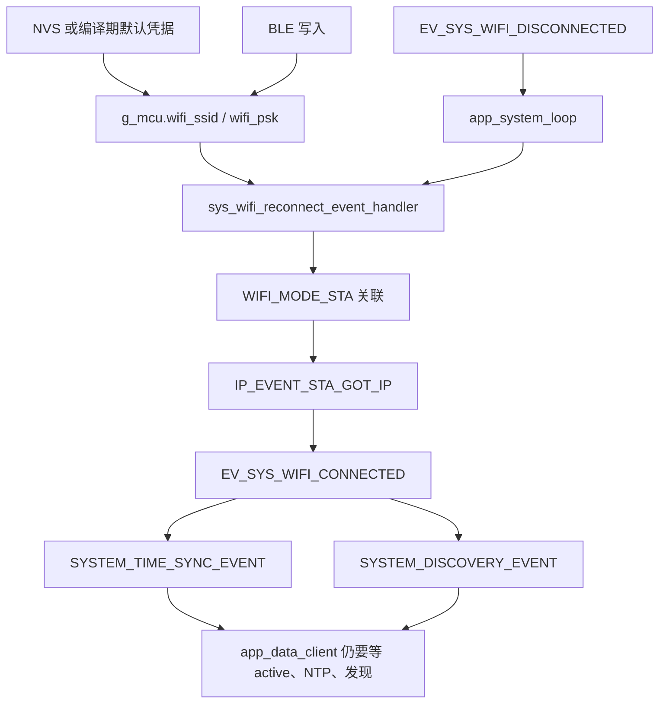
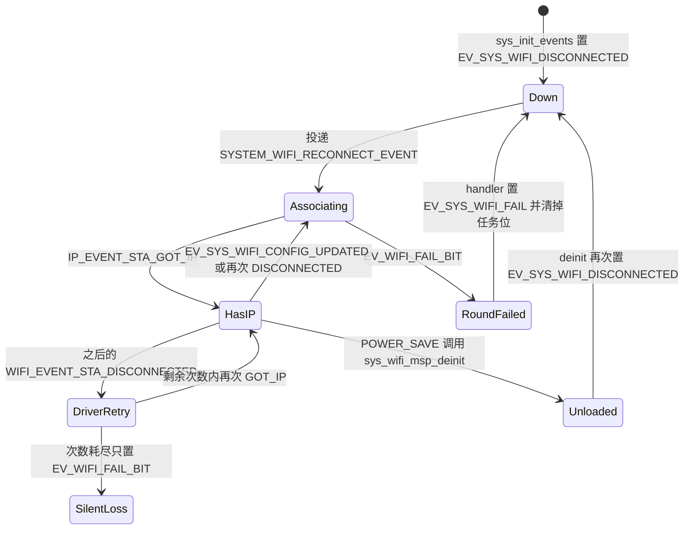

# 无线接入（Wi-Fi STA）

标记点只作为 STA 加入已有 AP，以便取得 IPv4 地址，供时间同步、设备发现以及之后的数据发送使用。凭据放在 `g_mcu.wifi_ssid` / `g_mcu.wifi_psk`，来自 NVS，空串则回退到编译期常量。一次关联是否成功，由默认事件循环上的 `wifi_event_handler` 用 `g_mcu.wifi_event_group` 通知阻塞中的 `sys_wifi_try_connect`；要不要再连，则由 `app_system_loop` 看 `EV_SYS_WIFI_*` 与 `EV_TASK_WIFI_RECONNECT`。固件没有 SoftAP 工作模式。`wifi.c` 不按 `CONFIG_IDF_TARGET_*` 或 `CONFIG_IMU_SENSOR_*` 分叉。

## 职责

- 创建默认 STA `esp_netif`，把 DHCP 主机名设为 `g_mcu.ble_local_name`。
- 初始化 Wi-Fi 驱动并固定为 `WIFI_MODE_STA`；连接、断开、卸载驱动。
- 用当前 RAM 中的 SSID/PSK 组 `wifi_config_t`，在拿到 IP 或内层重试耗尽之前阻塞等待。
- 维护 `g_mcu.state.wifi_connected`，并把结果翻译成系统事件，供系统循环决定重连或通知下游。
- 不负责发现报文、NTP、数据 UDP、REST 路由或 BLE GATT 的编解码。

## 在系统中的位置

启动顺序见 [启动与任务](boot-and-tasks.md)。`app_main` 的 `init` 在 `sys_init_chip`（创建默认事件循环，并拼出设备名）和 `sys_init_nvs` 之后调用 `sys_wifi_netif_init`，再进入 [电源管理](power-management.md) 的 `power_mgmt_on_enter_standby`。待机路径调用 `sys_wifi_msp_init`，此时驱动已初始化但尚未 `esp_wifi_start`。`sys_start_tasks` 拉起 `app_system_loop` 之后，启动时已经置位的 `EV_SYS_WIFI_DISCONNECTED` 才触发第一次连接。

凭据的读写约定见 [NVS](nvs.md)，事件位的全体定义见 [事件](events.md) 与 [全局状态](global-state.md)。运行时改凭据的入口在 [BLE](ble.md)；HTTP 只是把同名键写入 NVS，见 [API](api.md)。拿到 IP 之后系统循环投递的是 [时间同步](time-sync.md) 和 [发现](discovery.md)。数据 socket 不在这条路径上创建，见 [IMU 流](imu-streaming.md)。`wifi_connected` 还驱动 [LED](led.md) 的快闪。省电卸载驱动、以及待机/活动两档发射功率，由 [电源管理](power-management.md) 调用本模块。

## 设计

### 数据与状态

运行时状态分三层，不要混用。

| 位置 | 含义 |
| --- | --- |
| `g_mcu.state.wifi_connected` | 电平。仅 `sys_wifi_try_connect` 在等到 `EV_WIFI_CONNECTED_BIT` 时置 true；`try_connect` 失败路径和 `sys_wifi_try_disconnect` 置 false |
| `g_mcu.ip_info` | `IP_EVENT_STA_GOT_IP` 时整份 `esp_netif_ip_info_t` 拷贝。与系统事件无关，失败或断开时不清除 |
| `g_mcu.wifi_event_group` | 一次 `sys_wifi_try_connect` 的内部握手 |
| `g_mcu.sys_event_group` 的 `EV_SYS_WIFI_*` | 一次性通知。`app_system_loop` 用 `xEventGroupWaitBits(..., pdTRUE, ...)` 读出即清除 |
| `EV_TASK_WIFI_RECONNECT` | 电平。表示已经向自定义事件循环投递过重连，用来挡住重复投递 |

内部握手只有两位，都在 `sys.h`：

| 位 | 置位者 | 等待者 |
| --- | --- | --- |
| `EV_WIFI_CONNECTED_BIT` | `IP_EVENT_STA_GOT_IP` | `sys_wifi_try_connect`，`portMAX_DELAY`，等到任一位，且不在返回时清除 |
| `EV_WIFI_FAIL_BIT` | `WIFI_EVENT_STA_DISCONNECTED` 且 `s_wifi_retry_num == 0` | 同上。下一次 `try_connect` 入口会同时清掉这两位 |

系统事件与任务位：

| 位 | 谁置位 | 谁清除 | `app_system_loop` 做什么 |
| --- | --- | --- | --- |
| `EV_SYS_WIFI_DISCONNECTED` | `sys_init_events`；每次 `sys_wifi_try_disconnect` | 循环读出 | 若 `EV_TASK_WIFI_RECONNECT` 未置位，则置位并投递 `SYSTEM_WIFI_RECONNECT_EVENT` |
| `EV_SYS_WIFI_FAIL` | 重连 handler 在 `sys_wifi_try_connect` 返回非 `ESP_OK` 时 | 成功时 `clear_sys_event`；否则等循环读出 | 与断开、配置更新同一分支，请求重连 |
| `EV_SYS_WIFI_CONNECTED` | `try_connect` 确认 `EV_WIFI_CONNECTED_BIT` | 循环读出 | 投递 `SYSTEM_TIME_SYNC_EVENT` 和 `SYSTEM_DISCOVERY_EVENT`。不创建 socket |
| `EV_SYS_WIFI_CONFIG_UPDATED` | BLE 写入 SSID 与 PSK 都成功之后 | 循环读出 | 与断开、失败同一分支 |
| `EV_TASK_WIFI_RECONNECT` | 投递重连事件之前 | 重连 handler 末尾，无论成败 | 仅作互斥，本身不投递事件 |

`SYSTEM_WIFI_RECONNECT_EVENT` 是自定义循环 `g_mcu.system_loop` 上的事件号，不是 event bit。处理函数是 `sys_wifi_reconnect_event_handler`。`WIFI_EVENT` / `IP_EVENT` 注册在 `sys_init_chip` 创建的默认事件循环上，因此关联过程的回调不会被堵在自定义循环里的 `try_connect` 挡住。

`s_wifi_retry_num` 是 `wifi.c` 的文件内静态计数，初值 `CONFIG_WIFI_MAX_RETRY`。只有 `WIFI_EVENT_STA_START` 把它重新装成 5。`GOT_IP` 不重置它。

电平状态与「驱动还在不在」不是同一个标志。`g_power_mgmt_ctx.peripheral_state.wifi_initialized` 只表示 `sys_wifi_msp_init` 已调用且尚未 `sys_wifi_msp_deinit`。重连 handler 不读这个标志。

`SilentLoss` 不会自动回到 `Down`：`wifi_connected` 保持 true，也不会置 `EV_SYS_WIFI_FAIL` 或 `EV_SYS_WIFI_DISCONNECTED`。此时没有人再等 `g_mcu.wifi_event_group`。

### 行为与时序

`sys_wifi_msp_init` 使用 `WIFI_INIT_CONFIG_DEFAULT()`，不改其中的字段，注册 `WIFI_EVENT` 的全部 ID 和 `IP_EVENT_STA_GOT_IP`，然后 `esp_wifi_set_mode(WIFI_MODE_STA)`。它不 `start`，也不 `connect`。仓库里没有 `WIFI_MODE_AP`、`WIFI_MODE_APSTA` 或 `WIFI_IF_AP`。

重连 handler 在 `sync_mutex` 内固定做三件事：`sys_wifi_try_disconnect`、用当前 RAM 凭据 `sys_wifi_prepare_config`、`sys_wifi_try_connect`。断开会先把 `wifi_connected` 置 false 并再次置 `EV_SYS_WIFI_DISCONNECTED`，即使之前并没有关联。`try_connect` 先清内部两位，再 `esp_wifi_set_config(WIFI_IF_STA)` 和 `esp_wifi_start`。真正的 `esp_wifi_connect` 只出现在 `wifi_event_handler` 里。

内层计数：

| 事件 | 动作 |
| --- | --- |
| `WIFI_EVENT_STA_START` | `esp_wifi_connect()`，然后 `s_wifi_retry_num = 5` |
| `WIFI_EVENT_STA_DISCONNECTED` 且计数大于 0 | 再 `esp_wifi_connect()`，计数减一 |
| 同上且计数已是 0 | 只置 `EV_WIFI_FAIL_BIT`，不再 connect |
| `IP_EVENT_STA_GOT_IP` | 打日志、置 `EV_WIFI_CONNECTED_BIT`、覆盖 `g_mcu.ip_info`。不改计数，不置 `EV_SYS_WIFI_CONNECTED` |

因此一次 `start` 是 1 次初始 connect，外加最多 5 次断开后的重试，共 6 次 `esp_wifi_connect`。置失败位的是第 6 次尝试失败后的那一次断开，不是计数从 1 减到 0 的那一次。每次断开都会打 “connect to the AP fail”，包括还会重试的那些次。`esp_wifi_connect` 的返回值被忽略。

`try_connect` 若同时看到两位，先判断 `EV_WIFI_CONNECTED_BIT`，视为成功。成功才把 `wifi_connected` 置 true 并 `set_sys_event(EV_SYS_WIFI_CONNECTED)`。失败只把电平置 false 并返回 `ESP_FAIL`，不在这里置 `EV_SYS_WIFI_FAIL`。`esp_wifi_set_config` / `esp_wifi_start` 失败走 `ESP_ERROR_CHECK`，进程中止，不会变成 `EV_SYS_WIFI_FAIL`。

外层没有次数上限，也没有退避。handler 若返回非 `ESP_OK` 就置 `EV_SYS_WIFI_FAIL` 并清掉 `EV_TASK_WIFI_RECONNECT`；系统循环随即可以再投递一次重连。成功则 `clear_sys_event(EV_SYS_WIFI_FAIL)`。成功路径不清除 `EV_SYS_WIFI_DISCONNECTED`。

拿到 IP 之后的通知链是：

1. 默认事件循环写入 `g_mcu.ip_info` 并置内部连接位。
2. `try_connect` 返回后，handler 清失败位和 `EV_TASK_WIFI_RECONNECT`。
3. `app_system_loop` 看到 `EV_SYS_WIFI_CONNECTED`，向同一条自定义循环投递时间同步，再投递发现。两个处理函数都在 `system_event_loop_task` 上同步跑完，才会轮到同一次唤醒里随后投递的 LED 事件。
4. 发现定时器（`CONFIG_DISCOVERY_INTERVAL_S`，15 s）仅在 `wifi_connected` 为真时再投递发现。时间同步定时器的条件在 [时间同步](time-sync.md)，不是 Wi-Fi 模块实现的。
5. `app_data_client` 不订阅 Wi-Fi 事件。它要等 `g_mcu.state.active`、`ntp_synced` 和 `discovery_completed` 都为真才 `udp_socket_init`。发现成功后才会改写 `g_mcu.data_host_ip_addr`。因此数据 socket 不是「拿到 IP」的直接结果。
6. REST 服务器在待机路径、`sys_wifi_msp_init` 之后就 `rest_controller_start`，不由连接事件启动。有地址之后该监听才从网络上可达。

STA 配置由 `sys_wifi_prepare_config` 先 `memset` 再填写，只改这些字段：

| 字段 | 值 |
| --- | --- |
| `sta.ssid` / `sta.password` | `strcpy` 自调用者给出的字符串。重连时来自 `g_mcu` |
| `sta.threshold.authmode` | `WIFI_AUTH_WPA2_PSK`。代码注释写明这是最低认证，WEP/WPA 需删掉这一行才可能连上 |
| `sta.pmf_cfg.capable` | true |
| `sta.pmf_cfg.required` | false |

信道、BSSID、`scan_method`、`failure_retry_cnt` 以及静态 IP 都没有另设。代码未体现静态地址；地址只来自 `IP_EVENT_STA_GOT_IP`。

发射功率不在 `wifi.c`，而在电源状态入口，单位按 ESP-IDF 5.5.3 的 `esp_wifi_set_max_tx_power` 为 0.25 dBm。该 API 还把设定值折到离散档：34 落在 `[34, 43]`，实际仍是 34（8.5 dBm，国家码字段里的 8 dBm）；68 落在 `[66, 71]`，实际被折成 66（16.5 dBm，国家码字段里的 16 dBm）。

| 入口 | 日志打印 | 实际传入 |
| --- | --- | --- |
| `power_mgmt_on_enter_standby` | `CONFIG_MAX_TX_POWER`（68） | `CONFIG_NORMAL_TX_POWER`（34） |
| `power_mgmt_on_enter_active` | 68 | 68 |

返回值被忽略。IDF 规定该调用必须在 `esp_wifi_start` 之后，否则返回 `ESP_ERR_WIFI_NOT_STARTED`。待机入口的调用发生在 `sys_wifi_msp_init` 之后、任何 `start` 之前；从活动态回到待机时，若驱动仍处于已 `start`，同一次调用才满足这个时序。

省电类型同样不在 `wifi.c`：

| 条件 | 调用 |
| --- | --- |
| 进入待机且将要启动 BLE（`POWER_MODE_LOW_ENERGY` 除外） | 先 `esp_wifi_set_ps(WIFI_PS_MAX_MODEM)`，再启动 BLE。第一次进入待机时，这发生在 `sys_wifi_msp_init` 之前 |
| 进入活动态且当时 BLE 已启用 | 停 BLE，再 `esp_wifi_set_ps(WIFI_PS_NONE)` |
| 其他路径，包括活动态但 BLE 从未启用 | 不调用 `esp_wifi_set_ps` |

IDF 5.5.3 写明默认是 `WIFI_PS_MIN_MODEM`。本仓库不调用 `esp_wifi_get_ps`，因此 `init` 之前那次 `WIFI_PS_MAX_MODEM` 是否生效，代码未体现。

`POWER_SAVE` 在 `sys_stop_tasks` 之后调用 `sys_wifi_msp_deinit`：先 `try_disconnect`（再次置 `EV_SYS_WIFI_DISCONNECTED`），注销两个事件处理函数，再 `esp_wifi_stop` 与 `esp_wifi_deinit`，并把 `wifi_initialized` 置 false。自定义事件循环任务不在 `sys_stop_tasks` 的删除名单里。从省电恢复时，`power_mgmt_on_enter_standby` 会重新 `msp_init`，`sys_start_tasks` 重新跑系统循环；若断开位还在，会再走一遍重连。

### 并发

两条循环：

- `wifi_event_handler` 跑在默认事件循环。它只碰内部事件组和 `g_mcu.ip_info`。
- `sys_wifi_reconnect_event_handler`、时间同步、发现、LED、电源处理函数跑在 `system_event_loop_task`（队列长度 16，栈 4096，`tskNO_AFFINITY`，优先级取创建时 `app_system_loop` 的优先级）。
- `app_system_loop` 是另一条任务。v1/v2（`CONFIG_EN_MULTI_CORE` 为 1）把它钉在核 0、优先级 4；v3 的 ESP32-C5 在 `include/settings.h` 里把该宏定义为 0，走不绑核的优先级 8。这只影响系统循环的摆放，Wi-Fi 状态机没有目标守卫。

`try_connect` 在自定义循环任务上 `portMAX_DELAY` 阻塞。阻塞期间默认循环仍能推进关联和重试，但时间同步、发现、LED、电源与 OTA 的处理函数要等这次重连 handler 返回。队列满时，系统循环里的 `esp_event_post_to(..., portMAX_DELAY)` 会反过来堵住 `app_system_loop`。

`sync_mutex` 懒创建，只包住重连 handler。`sys_wifi_msp_deinit` 里的 `try_disconnect` 不拿这把锁。`g_mcu.wifi_ssid` / `wifi_psk` 由 BLE 主机任务写入、由重连任务读取，中间没有锁。`wifi_connected` 同样没有锁：重连路径写，定时器、LED、数据任务和 BLE 读路径读。

配置更新若落在重连已经开始之后，有两种结果。handler 进入 `try_connect` 前已经把凭据拷进 `wifi_config_t` 并 `set_config`。若系统循环在 `EV_TASK_WIFI_RECONNECT` 仍为真时读到 `EV_SYS_WIFI_CONFIG_UPDATED`，该位被等待清除，且不会再投递一次；这次关联继续用旧副本。若该位一直留到 handler 清掉任务位之后才被循环看到，循环会再开一轮，那一轮才读到新的 RAM 凭据。

`try_disconnect` 置位的 `EV_SYS_WIFI_DISCONNECTED` 与稍后的 `EV_SYS_WIFI_CONNECTED` 是独立的位。若循环在关联完成前已经把断开位读走，且当时任务位为真，则不会重复投递，这是预期路径。若两个系统位在同一次 `xEventGroupWaitBits` 里一起返回，循环会既投递 NTP/发现，又因为任务位此时往往已经清掉而再投递一轮重连。成功路径没有清除断开位，所以是否发生取决于循环何时回到等待。

主动断开没有「正在停止」标志。`try_disconnect` 调用的 `esp_wifi_disconnect` 仍会进入 `WIFI_EVENT_STA_DISCONNECTED` 分支，可能在 `esp_wifi_stop` 之前再发出一次 `esp_wifi_connect` 并消耗计数。`disconnect` / `stop` 的返回值被忽略。

### 配置

凭据与重试常量都在 `include/settings.h`，不是 Kconfig：

| 宏 | 值 | 作用 |
| --- | --- | --- |
| `CONFIG_WIFI_SSID` | `"markit"` | NVS 字符串长度为 0 时的 SSID |
| `CONFIG_WIFI_PSK` | `"12345678"` | 同上，PSK |
| `CONFIG_WIFI_MAX_RETRY` | 5 | 每次 `STA_START` 之后允许的额外重试次数，不是外层重连次数 |
| `CONFIG_NORMAL_TX_POWER` | 34 | 待机入口传入 `esp_wifi_set_max_tx_power` |
| `CONFIG_MAX_TX_POWER` | 68 | 活动态传入；待机日志也打印这个数 |
| `CONFIG_NVS_WIFI_SSID_NAME` | `"WIFI_SSID"` | NVS 键 |
| `CONFIG_NVS_WIFI_PSK_NAME` | `"WIFI_PSK"` | NVS 键 |

NVS 命名空间是 `CONFIG_VAR_NVS_TABLE_NAME`（`"var"`），值类型 `VAR_STR`，缓冲 `CONFIG_VAR_STR_MAX_LEN`（64）。`sys_load_str_conf` 在 `strlen(value_buffer) > 0` 时拷入 `g_mcu`，否则拷编译期默认值。加载发生在 `sys_init_nvs`，早于第一次重连。

工作区没有 `sdkconfig.defaults`。`Makefile` 的 `set_hardware_v1` / `v2` / `v3` 仍把 `sdkconfig.defaults;sdkconfig.defaults.vN` 交给 `SDKCONFIG_DEFAULTS`。当前树里能核对的 Wi-Fi 项只有三个变体文件。应用代码不读取这些项，也没有 `#if CONFIG_ESP_WIFI_SOFTAP_SUPPORT`。

| 项 | v1 `sdkconfig.defaults.v1` | v2 | v3 |
| --- | --- | --- | --- |
| 目标 | `CONFIG_IDF_TARGET_ESP32`，`CONFIG_IMU_SENSOR_HI229` | ESP32-S3，`CONFIG_IMU_SENSOR_BNO08X` | ESP32-C5，`CONFIG_IMU_SENSOR_BNO08X` |
| `CONFIG_ESP_WIFI_SOFTAP_SUPPORT` | y | n | n |
| `CONFIG_ESP_PHY_REDUCE_TX_POWER` | y | 未写 | 未写 |
| `CONFIG_ESP_WIFI_IRAM_OPT` | n | 未写 | 未写 |
| `CONFIG_ESP_WIFI_RX_IRAM_OPT` | n | 未写 | 未写 |
| `CONFIG_LWIP_IRAM_OPTIMIZATION` | 未写 | y | y |

v1 文件里的注释把两个 IRAM 选项关掉的原因写成减少 ESP32 的 IRAM 占用。协议、带宽、国家码、静态/动态 buffer、CSI 都不在这三个文件里，应用也没有调用对应 API。代码未体现 802.11ax 或双频的显式配置；v3 即使芯片具备这些能力，STA 路径与 v1/v2 仍是同一份 `wifi.c`。

### 硬件差异

没有按 IMU 或芯片目标编译进去的另一套连接逻辑。SoftAP 只存在于 sdkconfig：v1 打开 IDF 的 SoftAP 组件，v2/v3 关掉。应用不进入 AP 模式，因此 v3 上不存在一段会被 `CONFIG_ESP_WIFI_SOFTAP_SUPPORT=n` 编掉的固件分支；STA API（`esp_netif_create_default_wifi_sta`、`WIFI_MODE_STA`、`WIFI_IF_STA`）在 SoftAP 关闭时仍然使用。

v1 额外打开 `CONFIG_ESP_PHY_REDUCE_TX_POWER`。应用没有再解释该开关，也没有按目标改 34/68 这两档功率。

## 接口

对其他子系统暴露的是 `sys.h` 中的 `sys_wifi_netif_init`、`sys_wifi_msp_init`、`sys_wifi_msp_deinit`、`sys_wifi_prepare_config`、`sys_wifi_try_connect`、`sys_wifi_try_disconnect`、`sys_wifi_reconnect_event_handler`，以及 `g_mcu.state.wifi_connected`、`g_mcu.ip_info`、`g_mcu.wifi_ssid`、`g_mcu.wifi_psk`。当前树里 `try_connect` 的唯一调用者是重连 handler。

依赖的事件位：`EV_SYS_WIFI_CONNECTED`、`EV_SYS_WIFI_DISCONNECTED`、`EV_SYS_WIFI_FAIL`、`EV_SYS_WIFI_CONFIG_UPDATED`、`EV_TASK_WIFI_RECONNECT`，外加模块私有的 `EV_WIFI_CONNECTED_BIT` 与 `EV_WIFI_FAIL_BIT`。依赖的 NVS 键：`WIFI_SSID`、`WIFI_PSK`。

凭据如何进入下一次关联：

| 来源 | 是否写入 `g_mcu` | 是否立刻重连 |
| --- | --- | --- |
| 启动时 NVS 非空串 | 是 | 随启动已置位的 `EV_SYS_WIFI_DISCONNECTED` |
| NVS 空串 | 写入 `CONFIG_WIFI_SSID` / `CONFIG_WIFI_PSK` | 同上 |
| BLE 写入 | 是，并 `sys_set_nvs_var` 两个键。按第一个空格拆 SSID，余下到换行之前为 PSK；缺任一字段则不改 RAM、不置事件 | 置 `EV_SYS_WIFI_CONFIG_UPDATED` |
| REST `POST` 这两个键 | 否，只写 NVS | 否。下次启动加载才进入 RAM |

BLE 读路径在 `wifi_connected` 为真时返回 `g_mcu.ip_info.ip` 的点分文本，否则返回字面量 `"0.0.0.0"`。时间同步在 NTP 主机字符串为空时使用 `g_mcu.ip_info.gw`。这两处都是读已拷贝的地址，不是 Wi-Fi 事件的订阅者。

`sys_ota_guard` 仅在定义了 `CONFIG_OTA_GUARD_ENABLED` 时轮询 `wifi_connected`。三个变体 defaults 都没有这项，未定义时的分支不看 Wi-Fi。见 [OTA](ota.md)。

IMU（`CONFIG_IMU_SENSOR_HI229` 的 `hi229.c`，以及 `CONFIG_IMU_SENSOR_BNO08X` 的 `bno08x.c`）和 `/v1/system/info` 直接调用 `esp_wifi_get_tsf_time(WIFI_IF_STA)`。IDF 5.5.3 说明：STA 未关联，或关联后尚未收到 beacon 时返回 0；除 modem sleep 外，省电可能使返回值不准。调用点不检查 0。

## 失败与边界

- 外层重连没有上限和延时。AP 不存在时，每轮 6 次 connect 结束后立刻再来一轮。`ESP_ERROR_CHECK` 的失败不是这条路径，而是直接中止。
- 已经报告 `EV_SYS_WIFI_CONNECTED` 之后的链路丢失，只在 `wifi_event_handler` 里用剩余的 `s_wifi_retry_num` 重试。`GOT_IP` 不清计数，所以剩多少取决于本次 `STA_START` 之后已经消耗的次数；最后一次尝试才成功时，剩余为 0，下一次断开立即置 `EV_WIFI_FAIL_BIT`。该位没有等待者，`wifi_connected` 保持 true。发现定时器会继续认为链路还在。代码没有把这次失败升级成 `EV_SYS_WIFI_DISCONNECTED` 或 `EV_SYS_WIFI_FAIL`。
- 主动 `try_disconnect` 与驱动自动重连共用一个回调，可能在 `stop` 前多一次 `connect`。
- 第一次待机设置的发射功率发生在 `start` 之前，返回值丢弃。从开机到下一次「驱动已经 start」的待机/活动入口之前，关联用的是哪一档功率，代码未体现。待机日志打印 68，实参是 34。
- `WIFI_PS_NONE` 只在「进入活动态且 BLE 当时开着」时设置。低功耗模式从未开过 BLE 时，进入活动态不改省电类型。
- `power_mgmt_handle_transition` 创建 `app_power_save` 之后立刻 `power_mgmt_on_enter_deep_sleep(false)`。deep sleep 路径本身不调用 `sys_wifi_msp_deinit`。卸载是否赶在睡眠前发生，取决于 `app_power_save` 是否先跑到 `power_mgmt_on_enter_power_save`。代码没有同步点。
- 若重连 handler 正堵在 `try_connect`，`msp_deinit` 仍可能并发 `disconnect`/`stop`/`deinit`，因为它不持有 `sync_mutex`。
- `strcpy` 写入 `wifi_config_t` 的 SSID/密码字段，不按 IDF 的 32/64 字节上限截断。`g_mcu` 与 NVS 缓冲是 64 字节。SSID 超过接口所能容纳的长度会越界。`prepare_config` 也不拒绝空串；启动加载会把空 NVS 换成默认值，这条不覆盖已经停在 RAM 里的非空旧值。
- REST 改的是 NVS 而不是 RAM。在重启前的重连，包括 BLE 触发的重连，都仍用旧的 `g_mcu` 凭据。
- 重连与连接成功的日志打印 PSK 明文。
- 主机名是 `CONFIG_BLE_LOCAL_NAME_PREFIX`（`"markit_"`）加上 12 位十六进制 `device_id`，共 19 个字符，缓冲 `CONFIG_BLE_LOCAL_NAME_LEN` 为 32。`sys_wifi_netif_init` 用 `ESP_ERROR_CHECK` 调用 `esp_netif_set_hostname`，失败会中止启动。源码注释是 “some wifi says hostname is too long”。代码未体现长度上限或哪些 AP 会拒绝该名字。
- `sys_get_nvs_var` 不检查 `nvs_get_blob` 的返回值，传入的长度也未先设成缓冲区大小。`sys_load_str_conf` 只按结果串是否非空来选择默认值。缺键与空串的差别，代码未体现。

## 设计取舍

应用从未进入 SoftAP。v1 打开组件的提交说明是 `refactor: Introduced sdkconfig.defaults.v1 for ESP32 + HI229 with settings for IMU sensor, bootloader rollback, flash mode, CPU frequency, BLE controller, FreeRTOS stats, and Wi-Fi SoftAP support.`（3e172e7），同一提交为 v2 关掉 SoftAP；v3 继续关掉，subject 是 `feat: add support for esp32c5`（b08f2df）。为什么固件不使用 AP，历史未说明。

默认 PSK 改动的 subject 是 `Fix hardware_v2.sdkconfig`（d8660b2），正文只写了 `fix: fix default wifi password`，没有写原因；同一提交给主机名加了 “too long” 注释，也没有写触发条件。内层 5 次重试、外层无限重连且无退避、34 与 68 的分档，以及待机日志与实参不一致，历史未说明。`wifi_event_handler` 的注释写明形状来自 ESP-IDF 示例；把 `try_connect` 堵在自定义事件循环上、从而推迟 NTP 和发现，历史未说明是否另有取舍。

另有提交 `feat: add sdkconfig.defaults for project configuration`（9edb223）写过更大的 Wi-Fi buffer 和 `CONFIG_ESP_WIFI_CSI_ENABLED`，但它不在当前 `HEAD` 上。本篇不把它当成现行配置。

## 源文件

- `components/sys/wifi.c`
- `components/sys/sys.h`
- `components/sys/sys.c`
- `components/sys/nvs_mgmt.c`
- `components/sys/power_mgmt.c`
- `components/sys/time_sync.c`
- `components/sys/discovery.c`
- `components/sys/led_status.c`
- `components/apps/system_loop.c`
- `components/apps/network.c`
- `components/ble/gatt_srv.c`
- `components/rest_controller/rest_controller_handlers.c`
- `lib/hi229/hi229.c`
- `lib/bno08x/bno08x.c`
- `include/settings.h`
- `main/app_main.c`
- `Makefile`
- `sdkconfig.defaults.v1`
- `sdkconfig.defaults.v2`
- `sdkconfig.defaults.v3`
